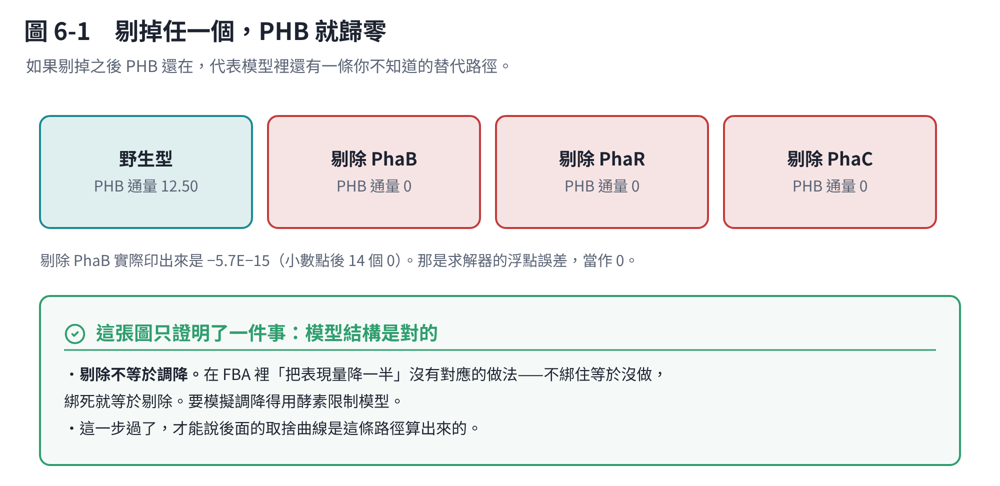

# 第 6 章　自己重跑（三）：培養基、驗證、掃描

模型結構修好了，接下來要定條件、驗證它、然後掃出第 3 章那張表。

## 6.1 定義培養基

COBRApy 用 `model.medium` 設定每個交換反應的上限。這段之後會重複用到很多次，建議存成一個片段：

```python
medium = {
    "EX_glc__D_e": 10.0,    # 葡萄糖，固定基準
    "EX_nh4_e":   100.0,    # 氮源（之後要掃描的就是它）
    "EX_pi_e":    100.0,
    "EX_o2_e":     60.0,    # 氧氣充足
    "EX_so4_e":   100.0,
    "EX_h2o_e":  1000.0,
    "EX_h_e":    1000.0,
    "EX_k_e":      10.0, "EX_na1_e": 10.0, "EX_cl_e": 10.0,
    "EX_mg2_e":    10.0, "EX_ca2_e": 10.0,
    "EX_fe2_e": 1.0, "EX_fe3_e": 1.0, "EX_mn2_e": 1.0, "EX_zn2_e": 1.0,
    "EX_cu2_e": 0.1, "EX_cobalt2_e": 0.1, "EX_mobd_e": 0.1,
}
medium = {rid: v for rid, v in medium.items() if rid in model.reactions}
model.medium = medium
```

**最後那一行過濾一定要加。** 模型裡沒有的交換反應直接丟進 `model.medium` 會報 KeyError，而每個模型收錄的交換反應都不一樣。

## 6.2 氧氣飽和點

固定葡萄糖 10、氨氮 100，把 `EX_o2_e` 掃 5 / 10 / 20 / 30 / 40 / 60 / 80 / 100，目標設 `Growth`：

```text
O2 = 5   → Growth 0.278
O2 = 20  → Growth 0.334
O2 = 40  → Growth 0.408
O2 = 60  → Growth 0.4435  (實際只吃 49.89)
O2 = 80  → Growth 0.4435
O2 = 100 → Growth 0.4435
```

**飽和點約 50。** 給到 60 以上生長就不會再上升了，所以之後一律用 `EX_o2_e = 60` 當「氧氣充足」的基準。

這一步看起來只是個細節，但它決定了後面所有數字的基準。如果氧氣設太低，你得到的是「缺氧下的取捨曲線」，結論會完全不同。

## 6.3 氮源健檢（不要跳過）

氧氣掃描的時候出現一個怪現象：**生長上升，氨氮消耗反而下降。**

如果氨氮是唯一氮源、而且元素守恆，理論上不該這樣。所以要先查：模型有沒有從別的地方偷到氮？

要查三件事：

1. 實際被攝取的交換反應裡，有沒有其他含氮物質（胺基酸、尿素、硝酸鹽）
2. 有通量的內部反應裡，有沒有氮元素不平衡的
3. biomass 反應的元素組成

**結果：乾淨。** 外界含氮的攝取只有 `EX_nh4_e`，有通量的反應沒有氮不平衡。

> `Growth` 這條 pseudo-reaction 印出 `'N': -10.768, 'C': -38.83 ...` 這種負值是**正常的**。它本來就是把前驅物抽走形成 1 g 菌體，不是一條需要左右平衡的酵素反應。

## 6.4 剔除驗證



```bash
python - <<'PY'
from cobra.io import read_sbml_model
model = read_sbml_model("09_GEM/curated/BMB171_PHA_curated_v2.xml")

medium = {
    "EX_glc__D_e": 10.0, "EX_nh4_e": 100.0, "EX_pi_e": 100.0,
    "EX_o2_e": 60.0, "EX_so4_e": 100.0, "EX_h2o_e": 1000.0, "EX_h_e": 1000.0,
    "EX_k_e": 10.0, "EX_na1_e": 10.0, "EX_cl_e": 10.0,
    "EX_mg2_e": 10.0, "EX_ca2_e": 10.0,
    "EX_fe2_e": 1.0, "EX_fe3_e": 1.0, "EX_mn2_e": 1.0, "EX_zn2_e": 1.0,
    "EX_cu2_e": 0.1, "EX_cobalt2_e": 0.1, "EX_mobd_e": 0.1,
}
model.medium = {k: v for k, v in medium.items() if k in model.reactions}
model.objective = "DM_phb_repeat_c"

def run_case(label, gene_id=None):
    with model:
        if gene_id:
            model.genes.get_by_id(gene_id).knock_out()
        s = model.optimize()
        print(f"\n===== {label} =====")
        print("Status =", s.status)
        print("PHB        =", s.fluxes["DM_phb_repeat_c"])
        print("PhaB flux  =", s.fluxes["PHAB_NADPH"])
        print("PhaRC flux =", s.fluxes["PHAC_PHB_POLYMERIZATION"])

run_case("WT")
run_case("PhaB knockout", "WP_000250409_1")
run_case("PhaR knockout", "WP_000566942_1")
run_case("PhaC knockout", "WP_000206336_1")
PY
```

| 條件 | PHB 通量 |
|---|---:|
| 野生型 | **12.50** |
| 剔除 PhaB | −5.7E−15 ≈ **0** |
| 剔除 PhaR | **0** |
| 剔除 PhaC | **0** |

**三個都歸零，驗證通過。** 這代表模型裡的 PHB 生產已經鎖在那條經基因體確認的路徑上，沒有可以繞過核心基因的假性替代路。從這裡開始 `BMB171_PHA_curated_v2.xml` 才算是正式的分析模型。

> **剔除不等於調降。** 在 FBA 裡「把表現量降一半」沒有對應的做法：不綁住等於沒做，綁死就等於剔除。要模擬調降得用酵素限制模型（ecModel）。這一點在別的案子上踩過——以為「調降某個競爭酵素」會讓產物變多，結果那是沒有固定生長速率造成的假象。

## 6.5 氨氮 × 生長 × PHB 矩陣

**為什麼要加生長下限？**

只設「最大化 PHB」的話，模型會直接選 `Growth = 0, NH4 = 0`——那只是化學計量的極限，沒有製程意義。沒有菌，誰來做 PHB？

```bash
python - <<'PY'
from cobra.io import read_sbml_model
import pandas as pd, math

model = read_sbml_model("09_GEM/curated/BMB171_PHA_curated_v2.xml")

base_medium = {
    "EX_glc__D_e": 10.0, "EX_pi_e": 100.0, "EX_o2_e": 60.0, "EX_so4_e": 100.0,
    "EX_h2o_e": 1000.0, "EX_h_e": 1000.0,
    "EX_k_e": 10.0, "EX_na1_e": 10.0, "EX_cl_e": 10.0,
    "EX_mg2_e": 10.0, "EX_ca2_e": 10.0,
    "EX_fe2_e": 1.0, "EX_fe3_e": 1.0, "EX_mn2_e": 1.0, "EX_zn2_e": 1.0,
    "EX_cu2_e": 0.1, "EX_cobalt2_e": 0.1, "EX_mobd_e": 0.1,
}
base_medium = {k: v for k, v in base_medium.items() if k in model.reactions}

# 先求 μmax
with model:
    model.medium = {**base_medium, "EX_nh4_e": 100.0}
    model.objective = "Growth"
    mu_max = model.optimize().objective_value
print("mu_max =", mu_max)

nh4_levels = [10, 7.5, 5, 4, 3, 2, 1, 0.5, 0.2, 0.1, 0.05, 0]
growth_fractions = [0.00, 0.10, 0.25, 0.50, 0.75, 0.90]

rows = []
for nh4_limit in nh4_levels:
    for fraction in growth_fractions:
        with model:
            model.medium = {**base_medium, "EX_nh4_e": nh4_limit}
            model.reactions.get_by_id("Growth").lower_bound = fraction * mu_max
            model.objective = "DM_phb_repeat_c"
            s = model.optimize()

            if s.status == "optimal":
                glc = abs(s.fluxes["EX_glc__D_e"])
                nh4 = abs(s.fluxes["EX_nh4_e"])
                phb = s.fluxes["DM_phb_repeat_c"]
                # PHB 重複單元 86.09 g/mol；葡萄糖 180.156 g/mol
                yield_gg = (phb * 86.09) / (glc * 180.156) if glc > 1e-9 else math.nan
                cn = (glc * 6) / nh4 if nh4 > 1e-9 else math.inf
                rows.append({
                    "NH4_limit": nh4_limit,
                    "Growth_fraction_of_mu_max": fraction,
                    "Growth_flux": s.fluxes["Growth"],
                    "PHB_flux": phb,
                    "PHB_yield_g_g_glucose": yield_gg,
                    "NH4_uptake": nh4,
                    "O2_uptake": abs(s.fluxes["EX_o2_e"]),
                    "Metabolic_C_N_ratio": cn,
                    "Status": s.status,
                })
            else:
                rows.append({"NH4_limit": nh4_limit,
                             "Growth_fraction_of_mu_max": fraction,
                             "Status": s.status})

df = pd.DataFrame(rows)
print(df.to_string(index=False))
df.to_csv("09_GEM/reports/BMB171_NH4_Growth_PHB_matrix.csv", index=False)
try:
    df.to_excel("09_GEM/reports/BMB171_NH4_Growth_PHB_matrix.xlsx", index=False)
except Exception as e:
    print("Excel 輸出失敗，但 CSV 已產生：", e)
PY
```

**主要發現：只要氨氮供應足以支撐指定的生長速率，PHB 通量與產率幾乎不再受氨氮上限影響。** 這正是第 3.4 節那個結論的來源——氮限制是透過限制 biomass 間接把碳讓給 PHB。

### infeasible 是對的，不是錯的

當 `NH4_limit = 4` 的時候，90% μmax（需要 4.298）會算不出解；`NH4_limit = 3` 的時候，75% μmax（需要 3.582）也算不出來。

**這是約束正確運作的證據。** 你要求模型長到那麼快，但給的氮不夠，它就該告訴你做不到。看到 infeasible 不要慌，先算一下「這個生長速率需要多少氮」，對得上就是正常的。

## 6.6 取捨曲線

把 `growth_fractions` 改成 0.00 到 1.00 每 0.05 一格，氨氮固定 100（不限氮），其餘同上：

```text
09_GEM/reports/BMB171_Growth_PHB_tradeoff.csv / .xlsx
```

結果就是第 3 章那張表與那張圖。

## 6.7 下一步：pFBA（還沒跑）

**這是目前最值得做的一步。** 它要回答第 1.3 節那個還沒答案的問題：60% μmax 的轉折到底是哪一條碳流在變？

pFBA 會在維持最佳目標值的前提下再最小化總通量，得到的路徑比單一 FBA 解更可能是真的——因為 FBA 的最佳解通常不唯一，隨便挑一個出來看會誤導。

```bash
python - <<'PY'
from cobra.io import read_sbml_model
from cobra.flux_analysis import pfba
import pandas as pd

model = read_sbml_model("09_GEM/curated/BMB171_PHA_curated_v2.xml")

medium = {
    "EX_glc__D_e": 10.0, "EX_nh4_e": 100.0, "EX_pi_e": 100.0,
    "EX_o2_e": 60.0, "EX_so4_e": 100.0, "EX_h2o_e": 1000.0, "EX_h_e": 1000.0,
    "EX_k_e": 10.0, "EX_na1_e": 10.0, "EX_cl_e": 10.0,
    "EX_mg2_e": 10.0, "EX_ca2_e": 10.0,
    "EX_fe2_e": 1.0, "EX_fe3_e": 1.0, "EX_mn2_e": 1.0, "EX_zn2_e": 1.0,
    "EX_cu2_e": 0.1, "EX_cobalt2_e": 0.1, "EX_mobd_e": 0.1,
}
model.medium = {k: v for k, v in medium.items() if k in model.reactions}

model.objective = "Growth"
mu_max = model.optimize().objective_value
print("mu_max =", mu_max)

target_ids = ["Growth", "EX_glc__D_e", "EX_o2_e", "EX_nh4_e", "EX_co2_e",
              "ACACT1r", "PHAB_NADPH", "PHAC_PHB_POLYMERIZATION", "DM_phb_repeat_c",
              "PDH", "CS", "PTAr", "ACKr"]

rows = []
for fraction in [0.10, 0.25, 0.50]:
    with model:
        model.reactions.get_by_id("Growth").lower_bound = fraction * mu_max
        model.objective = "DM_phb_repeat_c"
        sol = pfba(model)
        for rid in target_ids:
            if rid in model.reactions:
                rows.append({"Growth_fraction": fraction, "Reaction_ID": rid,
                             "Reaction_name": model.reactions.get_by_id(rid).name,
                             "Flux": sol.fluxes[rid]})

pivot = pd.DataFrame(rows).pivot(index=["Reaction_ID","Reaction_name"],
                                 columns="Growth_fraction", values="Flux")
pivot.columns = ["10pct_mu_max", "25pct_mu_max", "50pct_mu_max"]
print(pivot.to_string())
pivot.to_excel("09_GEM/reports/BMB171_pFBA_key_fluxes.xlsx")
PY
```

**怎麼讀結果：**

| 看什麼 | 意義 |
|---|---|
| `ACACT1r` / `PHAB_NADPH` / `PHAC_...` | 往 PHB 的碳流 |
| `CS`（檸檬酸合成酶） | 乙醯輔酶 A 進 TCA 的量 |
| `PTAr` / `ACKr` | 乙醯輔酶 A 有沒有被分流成乙酸（overflow） |
| PPP 相關反應 | NADPH 的供應夠不夠餵 PhaB |

如果生長從 10% 拉到 50% 時 PHB 下降而 `CS` 上升，代表長菌把乙醯輔酶 A 吃去 TCA 了；如果 `PTAr`／`ACKr` 很高，乙酸 overflow 就是下一個工程標的。

**建議加跑兩件事：**

1. **把 fraction 加到 0.55、0.60、0.65**，才看得到轉折那一格發生什麼事。只跑 10/25/50 看不到轉折。
2. **把磷酸酮醇酶相關的反應加進 `target_ids`**。第 1.2 節算出模型的碳回收率是 83.3%，遠高於課本路徑的 66.7%——那個額外的碳一定有來源，pFBA 應該找得到它。這會直接告訴你 0.5973 g/g 這個上限可不可信。

## 6.8 也要跑 FVA

FBA 的最佳解常常不唯一。FVA 會算出每條反應在接近最佳解時可以落在什麼範圍。

**如果某條反應的範圍很寬**（例如 0 到 12.5 都可以），那代表「模型說它走這條路」只是眾多等價解之一，不能當結論。這件事和上面的 pFBA 是互補的：pFBA 給你一個最精簡的解，FVA 告訴你那個解有多獨特。
