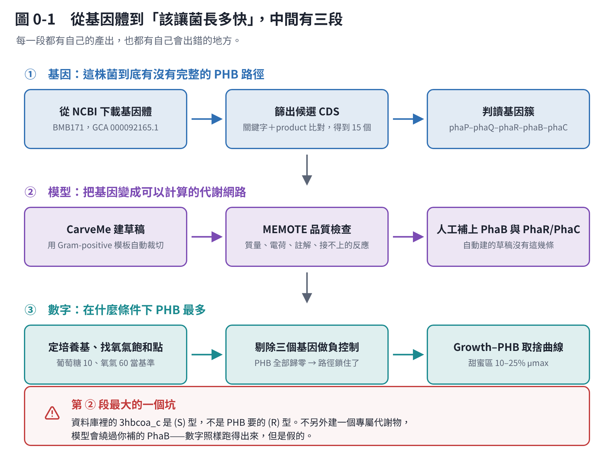

# BMB171 PHB：從基因體到代謝模型

這個分區整理一份分析：把 *Bacillus thuringiensis* **BMB171** 的基因體拿來，確認它有沒有完整的 PHB（聚羥基丁酸）合成路徑，再建一個可以計算的代謝模型，最後回答一個很具體的問題——**要讓菌長多快，PHB 才會最多？**

## 先說清楚這份東西的來歷

**模型不是在這個 repo 裡跑的。** 原始內容來自一份 ChatGPT 對話（114 則訊息），使用者在自己的 Windows + WSL2 上用 CarveMe 與 COBRApy 做出來的。這個環境沒有 BMB171 的基因體檔案、沒有裝 CarveMe、也沒有對外網路，**所以模型重跑不了**。

能做的是**內部一致性查核**：表格裡的通量、產率、佔理論上限的百分比、氮需求、代謝 C/N 這幾欄是互相綁死的，只要有一欄抄錯就會對不起來。`code/checks.py` 把每一欄重算一次再和原文比對。

**結果：全部一致，沒有一欄對不上。** 另外加算了兩件原文沒算的事，寫在第 1 章。

所以讀這個分區的時候，請分清楚三種句子：

| 標示 | 意思 |
|---|---|
| （沒標示） | 原文的內容，照實轉述 |
| **已查核** | `code/checks.py` 重算過 |
| **推論** | 原文自己標明是推論，或我判斷還沒有證據支撐 |

## 章節

| 章 | 內容 |
|---|---|
| [第 1 章](01-conclusion.md) | 結論：模型到底算出了什麼，哪些可以用、哪些不行 |
| [第 2 章](02-genes.md) | 基因：BMB171 的 PHA 基因簇長什麼樣 |
| [第 3 章](03-numbers.md) | 數字：生長與 PHB 的取捨曲線 |
| [第 4 章](04-build-genome.md) | 自己重跑（一）：環境、下載基因體、找出候選基因 |
| [第 5 章](05-build-model.md) | 自己重跑（二）：建模、人工校正，和那個最大的坑 |
| [第 6 章](06-build-scan.md) | 自己重跑（三）：培養基、驗證、掃描出取捨曲線 |
| [第 7 章](07-pitfalls.md) | 踩過的坑與排解 |
| [第 8 章](08-limits.md) | 限制與下一步 |

## 這個分區和其他分區的關係

「從 DNA 到最適培養」那個分區講的是**通用流程**，例子用細菌。這裡是**同一套流程的一個完整案例**，而且是細菌（不是酵母菌），所以那個分區的工具鏈在這裡幾乎都適用——Prokka／CarveMe／gapseq 這些是為細菌設計的。

「紅酵母 α-farnesene」那個分區是**真核生物**的案例，工具鏈完全不同，但有一個教訓是共通的，而且在這份 BMB171 的分析裡又出現了一次：

> **任何「改 A 之後 B 變多」的比較，都要先把生長速率固定住。**

這件事在第 3 章和第 6 章會再講。
