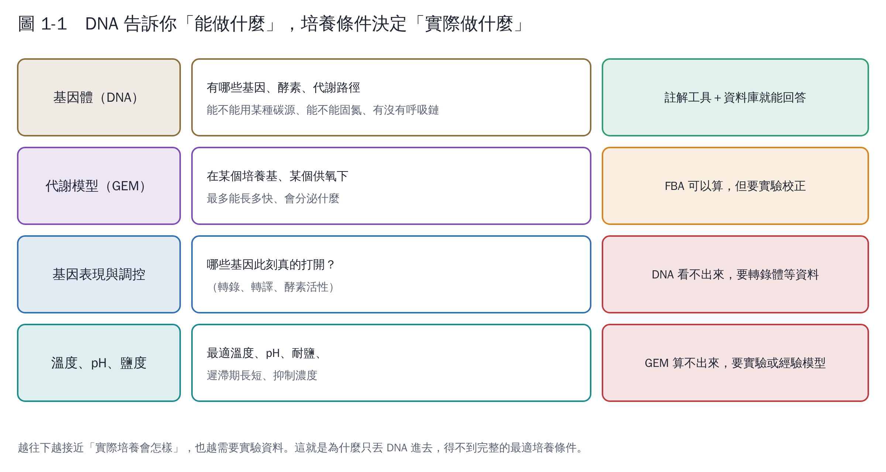

# 第 1 章　先回答你的問題

這一章逐題回答你提出的問題，接著補上幾個你沒問、但一開始就該想清楚的問題。

## 1.1 丟入 DNA 序列，能定義基因功能嗎？

**可以，這是整條路上最成熟的一段。** 流程是：

1. 把定序資料組裝成基因體。
2. 用註解工具找出每個基因的位置。
3. 拿去和資料庫比對，推定功能。

常用的工具：

- 基因預測：Prokka 或 Bakta [1, 2]。
- 功能資料庫：eggNOG-mapper [3] 與 KEGG [4]。

KEGG 會告訴你這株菌有哪些代謝路徑、路徑是否完整（例如糖解、TCA 循環、固氮、某種胺基酸合成）。

**要注意的限制**：

- **「推定」不等於「確定」**：大部分功能是靠和已知基因相似來推論的，有一部分基因永遠是「功能未知」。近年的 AI 工具（如 CLEAN [5]）能提高酵素功能預測的準確度，但仍然是預測。
- **有基因不代表會用**：基因要被打開（表現）才有作用，而表現受培養條件調控。DNA 告訴你「能做什麼」，不告訴你「此刻在做什麼」。
- **只有 16S rRNA 序列不夠**：16S 只能鑑定菌種，無法定義功能。要做功能分析，需要**全基因體定序**。

## 1.2 能直接得到最適培養參數嗎？

**能得到一部分，而且不同參數的可預測程度差很多。**

| 參數 | 從基因體能預測嗎？ | 怎麼做 |
|---|---|---|
| 能用哪些碳源、氮源 | 可以，相對準 | 代謝模型（第 3、4 章） |
| 需要哪些維生素、胺基酸 | 可以，但常有誤差 | 代謝模型＋實驗驗證 |
| 好氧、厭氧、兼性 | 可以 | 看呼吸鏈基因；代謝模型 |
| 產物走哪條路徑、副產物 | 可以，定性準、定量要校正 | 代謝模型（第 4 章） |
| 最適溫度 | 只能粗估 | 機器學習預測，誤差常有幾 °C [6] |
| 最適 pH、耐鹽 | 只能粗估 | 新的基因體機器學習模型 [7] |
| 遲滯期、最大生長速率、抑制濃度 | 幾乎不行 | 只能靠實驗 |

所以實際的做法是兩段：

1. **用基因體縮小範圍**：例如「應該能吃木糖，偏好中溫，需要通氣」。
2. **用實驗找出最適值**：見第 7、8 章。

此外，近緣菌株已知的培養條件也是很好的起點。BacDive 收錄了八萬多株細菌與古菌的培養、代謝資料 [8]。

## 1.3 怎麼知道哪些參數重要、調哪個會影響哪條代謝路徑？

這正是代謝模型最擅長的事。第 4 章會實際示範：

- **改供氧**：大腸桿菌從「完全氧化成 CO₂」，變成「分泌乙酸」，再變成「混合酸發酵（乙酸＋乙醇＋甲酸）」。模型能畫出每條路徑的流量怎麼變。
- **找瓶頸**：模型可以算出「多給 1 單位糖」或「多給 1 單位氧」，生長率各增加多少。增加最多的，就是當下的限制因子。
- **剔除基因**：模擬拿掉某個基因後還能不能長。同一個基因，在好氧和厭氧下的重要性可能完全不同。

## 1.4 微生物生長是動態的，分階段要調什麼？看什麼指標？

你的直覺是對的：最佳條件會隨時間改變。典型的批次培養會依序經過：

1. 遲滯期；
2. 指數生長；
3. 轉換期（缺氧或溢流代謝）；
4. 產物期；
5. 停滯期。

每個階段的限制因子不同，要調的參數也不同。

**判斷階段的指標**（第 5 章）：OD（菌量）、溶氧、pH、尾氣中的 O₂ 與 CO₂，以及定時取樣分析糖和產物。這些指標的**轉折點**，就是調參數的時機。

**怎麼決定每階段調什麼**（第 6 章）：

1. 先跑一批基準培養，找出階段。
2. 對每個階段做敏感度分析，找出 2–4 個關鍵參數。
3. 決定切換規則：用時間切換，還是用指標門檻觸發。
4. 最後把切換時間和各階段參數一起最佳化。

第 6 章用模擬示範了一個重要結果：**最佳切換時間取決於你打算什麼時候收穫**，而且和供氧能力有交互作用。

## 1.5 這需要建立模型嗎？

**看參數有幾個、階段有幾段。**

| 情況 | 建議 |
|---|---|
| 1–2 個參數、單一階段 | 傳統實驗設計就夠（第 7 章） |
| 3–6 個參數，或有交互作用 | 統計或機器學習模型＋貝氏最適化（第 8 章） |
| 多階段、要知道代謝路徑怎麼變、想換產物 | 代謝模型＋動態模擬，再配合實驗校正（第 3–6 章） |

模型有三種，互相搭配：

- **機理模型**：如代謝模型、Monod 動力學。它知道「為什麼」，可以外推，但需要校正。
- **經驗模型**：如反應曲面、溫度基點模型。它描述「長什麼樣子」，簡單，但只在做過實驗的範圍內可靠。
- **資料驅動模型**：如高斯過程、機器學習。資料越多越準，適合用來決定「下一批做什麼實驗」。

## 1.6 國內外有人這樣做了嗎？

**國外：有，而且已經發展了二十年。**

- 2010 年前後，代謝模型與通量平衡分析（FBA）已成為標準方法 [9]。
- 現在可以從基因體自動產生代謝模型，例如 CarveMe [10] 與 gapseq [11]。
- 2019 年，美國伊利諾大學的 BioAutomata 用機器人加貝氏最適化自動做實驗。它評估的組合不到所有可能的 1%，表現卻比隨機篩選好 77% [12]。
- 2023 年，日本團隊用主動學習最適化培養基，讓目標菌長得好、另一種菌長不好 [13]。

**臺灣**：

- 有定序服務，例如農業科技研究院的細菌全基因體定序與分析 [14]、海洋大學的長讀定序 [15]。
- 有菌種保存中心：食品工業發展研究所生物資源保存及研究中心（BCRC）。
- 「從基因體到培養最適化」的整合平台，我沒有找到公開的例子（詳見第 11 章）。

## 1.7 能不能看到調整參數後的變化？

**可以。** 我做了一個互動模擬器（第 9 章），拉動溫度、pH、供氧、接種量、切換時間，會立刻看到：

- 菌量、糖、乙酸、乙醇隨時間的曲線，以及每個階段的位置；
- 任一時間點的中心代謝流量圖（哪條路徑變粗、哪條停用）；
- 最佳切換時間的掃描曲線；
- 哪個參數最敏感。

它用的是示範模型。換成你的菌，要用自己的基因體建模，再以實驗校正，介面可以沿用。

## 1.8 你沒問、但應該先想清楚的問題

1. **你的目標是什麼？** 「最大菌數」、「最高產物濃度」、「最高生產速率」、「最高產率（每克糖產多少）」，四者的最適條件通常不同。第 6 章的模擬中：
   - 全程好氧的菌量最多（9.3 gDW/L），但幾乎不產乙醇；
   - 兩階段的乙醇最多，菌量只有一半多一點。

   先選定一個主要目標，其他當限制條件。
2. **是純菌還是混菌？** 本教材以純菌為主。混菌或菌群要用群落代謝模型，複雜很多（第 12 章）。
3. **要放大到什麼規模？** 搖瓶的供氧能力遠低於發酵槽。在搖瓶找到的最適條件，到發酵槽常常要重新調整，尤其是和供氧有關的參數 [16]。
4. **培養基成本與後續處理**：最適條件若需要昂貴的成分，或產生難分離的副產物（例如大量乙酸），未必划算。
5. **生物安全與資料管理**：
   - 確認菌株的生物安全等級，以及實驗室的對應規定；
   - 定序資料與實驗紀錄要有統一格式，否則之後無法拿來訓練模型；
   - 若菌株有商業價值，公開序列前先考慮智慧財產。
6. **模型會錯**：所有模型都是簡化。把模型當成「幫你決定下一批實驗做什麼」的工具，不要當成答案。

## 本章重點

- DNA 加資料庫可以可靠地列出基因功能與代謝潛力，但不能告訴你最適溫度、pH 與生長速率。
- 最適培養條件要靠「模型縮小範圍＋實驗確認」的循環取得。
- 參數多、有分階段時，值得建模；國外已有成熟工具，臺灣少見完整平台。
- 調參數後的變化可以視覺化，第 9 章有可直接使用的模擬器。

## 參考文獻

1. Seemann T (2014). Prokka: rapid prokaryotic genome annotation. *Bioinformatics*, 30, 2068–2069. https://doi.org/10.1093/bioinformatics/btu153
2. Schwengers O, Jelonek L, Dieckmann MA, et al. (2021). Bakta: rapid and standardized annotation of bacterial genomes via alignment-free sequence identification. *Microbial Genomics*, 7, 000685. https://doi.org/10.1099/mgen.0.000685
3. Cantalapiedra CP, Hernández-Plaza A, Letunic I, Bork P, Huerta-Cepas J (2021). eggNOG-mapper v2: functional annotation, orthology assignments, and domain prediction at the metagenomic scale. *Molecular Biology and Evolution*, 38, 5825–5829. https://doi.org/10.1093/molbev/msab293
4. Kanehisa M, Goto S (2000). KEGG: Kyoto Encyclopedia of Genes and Genomes. *Nucleic Acids Research*, 28, 27–30. https://doi.org/10.1093/nar/28.1.27
5. Yu T, Cui H, Li JC, et al. (2023). Enzyme function prediction using contrastive learning. *Science*, 379, 1358–1363. https://doi.org/10.1126/science.adf2465
6. Li G, Rabe KS, Nielsen J, Engqvist MKM (2019). Machine learning applied to predicting microorganism growth temperatures and enzyme catalytic optima. *ACS Synthetic Biology*, 8, 1411–1420. https://doi.org/10.1021/acssynbio.9b00099
7. Ramoneda J, Stallard-Olivera E, Hoffert M, et al. (2023). Building a genome-based understanding of bacterial pH preferences. *Science Advances*, 9, eadf8998. https://doi.org/10.1126/sciadv.adf8998
8. Reimer LC, Sardà Carbasse J, Koblitz J, et al. (2022). BacDive in 2022: the knowledge base for standardized bacterial and archaeal data. *Nucleic Acids Research*, 50, D741–D746. https://doi.org/10.1093/nar/gkab961
9. Orth JD, Thiele I, Palsson BØ (2010). What is flux balance analysis? *Nature Biotechnology*, 28, 245–248. https://doi.org/10.1038/nbt.1614
10. Machado D, Andrejev S, Tramontano M, Patil KR (2018). Fast automated reconstruction of genome-scale metabolic models for microbial species and communities. *Nucleic Acids Research*, 46, 7542–7553. https://doi.org/10.1093/nar/gky537
11. Zimmermann J, Kaleta C, Waschina S (2021). gapseq: informed prediction of bacterial metabolic pathways and reconstruction of accurate metabolic models. *Genome Biology*, 22, 81. https://doi.org/10.1186/s13059-021-02295-1
12. HamediRad M, Chao R, Weisberg S, et al. (2019). Towards a fully automated algorithm driven platform for biosystems design. *Nature Communications*, 10, 5150. https://doi.org/10.1038/s41467-019-13189-z
13. Zhang S, Aida H, Ying BW (2023). Employing active learning in medium optimization for selective bacterial growth. *Applied Microbiology*, 3, 1355–1369. https://doi.org/10.3390/applmicrobiol3040091
14. 農業科技研究院：細菌全基因體定序與分析服務介紹。https://agritechtaiwan.com/en-gb/a-powerful-genomebased-characterization-tool-launched-by-agricultural-technology-research-institute-taiwan
15. 國立臺灣海洋大學海洋基因體中心：定序服務價目。https://en-taogc.ntou.edu.tw/service/4
16. Garcia-Ochoa F, Gomez E (2009). Bioreactor scale-up and oxygen transfer rate in microbial processes: an overview. *Biotechnology Advances*, 27, 153–176. https://doi.org/10.1016/j.biotechadv.2008.10.006
