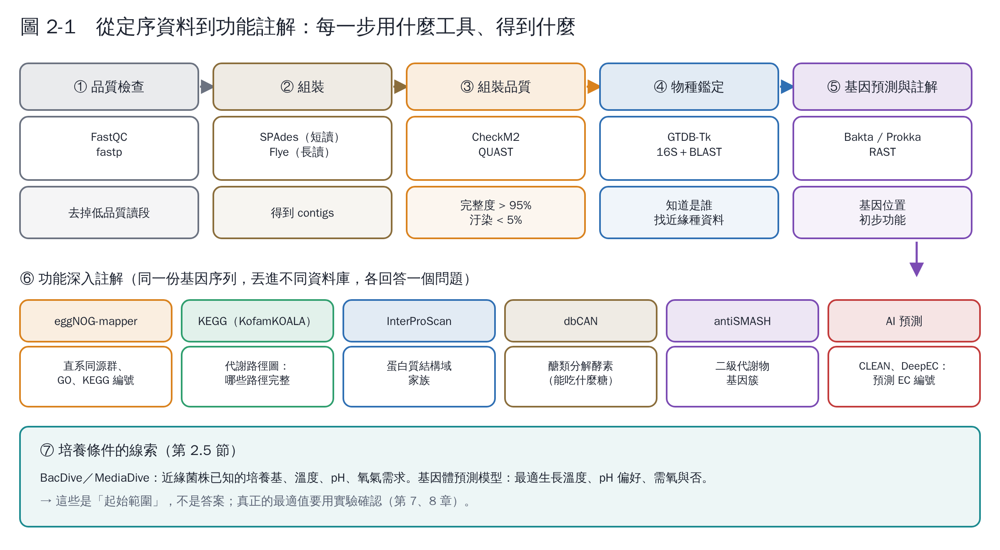
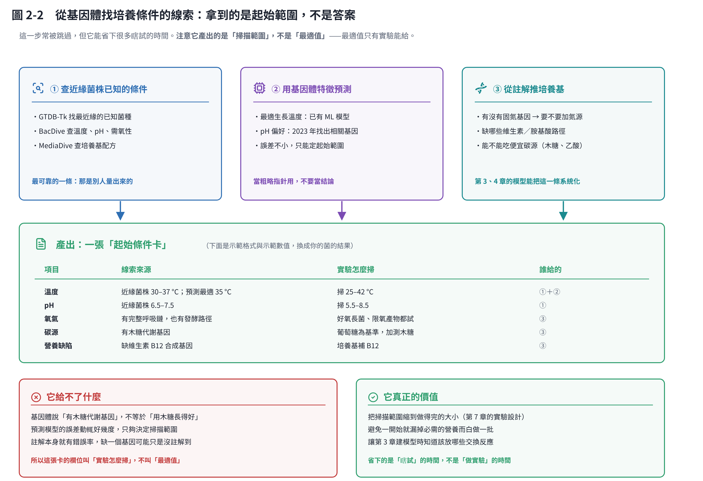

# 第 2 章　從序列到功能：定序、註解與培養線索

這一章說明「把 DNA 丟進去、定義基因功能」實際上要經過哪些步驟、用什麼工具、每一步要檢查什麼。

## 2.1 先確認你手上的「序列」是什麼

| 你手上的資料 | 能做什麼 | 不能做什麼 |
|---|---|---|
| 一段 16S rRNA 序列 | 鑑定到屬或種 | 定義功能、建代謝模型 |
| 幾個基因的序列（例如 PCR 產物） | 確認那幾個基因的功能 | 看整體代謝 |
| 純菌的全基因體（WGS） | 完整功能註解、建代謝模型 | 判斷基因何時表現 |
| 混菌的宏基因體 | 群落有哪些功能 | 準確對應到單一菌株 |

**要做這套系統，建議送純菌的全基因體定序。** 理想的組合是：

- 長讀定序（Oxford Nanopore 或 PacBio）：拼出完整的染色體與質體。
- 短讀定序（Illumina）：校正錯誤。

細菌基因體通常 2–8 Mb，定序成本已不高（第 1 章列了臺灣的服務單位）。

## 2.2 組裝與品質檢查

| 步驟 | 工具 | 看什麼 |
|---|---|---|
| 讀段品質 | fastp [1] | 去除接頭與低品質序列 |
| 組裝 | SPAdes（短讀）[2]、Flye（長讀）[3] | contig 數越少越好；長讀常可拼成一條完整染色體 |
| 完整度與汙染 | CheckM2 [4] | 完整度 > 95%、汙染 < 5% 是常用門檻 |
| 物種鑑定 | GTDB-Tk [5] | 依全基因體判定分類；找出最近緣的已知菌 |

**為什麼品質檢查很重要？** 如果菌不純（汙染），註解出來的功能會混到別的菌；如果組裝不完整，缺的基因會讓代謝模型以為這株菌「不能」做某件事。

## 2.3 功能註解：同一份基因，問不同的資料庫

| 想知道什麼 | 工具或資料庫 |
|---|---|
| 基因在哪裡、初步功能 | Bakta [6]、Prokka [7] |
| 直系同源群、GO 與 KEGG 編號 | eggNOG-mapper [8] |
| 代謝路徑是否完整 | KEGG [9]（可用 KofamKOALA [10] 指派 KEGG 編號） |
| 蛋白質結構域 | InterProScan [11] |
| 能分解哪些醣類（纖維素、澱粉…） | dbCAN [12] |
| 二級代謝物（抗生素、色素…） | antiSMASH [13] |
| 酵素 EC 編號（AI 預測） | CLEAN [14]、DeepEC [15] |

**讀註解結果的訣竅**：

1. 先看**主要代謝路徑是否完整**：
   - 糖解、五碳糖途徑、TCA 循環；
   - 呼吸鏈（有沒有細胞色素氧化酶，決定能否好氧）；
   - 發酵路徑（乳酸、乙醇、乙酸、丁酸）。
2. 再看**和你的目標相關的路徑**：例如要產某種產物，它的合成路徑有沒有缺步驟。
3. 留意**營養缺陷**：如果某種胺基酸或維生素的合成路徑不完整，培養基裡就要加。這是設計培養基最直接的線索。
4. **AI 預測要標註可信度**：預測結果拿來排優先順序，重要的結論用實驗確認。

## 2.4 不想自己架設工具怎麼辦？

| 選項 | 適合誰 | 說明 |
|---|---|---|
| 定序公司的分析套餐 | 完全不寫程式 | 通常包含組裝、註解、KEGG 報告 |
| KBase 網頁平台 [16] | 想自己動手但不想安裝 | 有組裝、註解、建代謝模型的現成流程 |
| Galaxy、BV-BRC 等網頁平台 | 同上 | 免費、有教學 |
| 自己的電腦或國網中心 | 想完全掌握流程 | 用 conda 安裝工具；AI 可以幫你寫流程腳本 |

## 2.5 從基因體找「培養條件的線索」

這一步常被忽略，但能省下很多摸索的時間。

先說清楚它給的是什麼：**三條線索最後匯成一張「起始條件卡」，卡上寫的是「實驗怎麼掃」，不是「最適值」**。基因體算不出最適溫度，它只能幫你把要掃的範圍縮到做得完的大小。

1. **查近緣菌株的已知培養條件**：
   - 用 GTDB-Tk 的結果找到最近緣的已知菌種；
   - 到 BacDive 查它們的培養溫度、pH、需氧性與培養基 [17]；
   - 再到 MediaDive 查培養基配方 [18]。

   MediaDive 收錄了三千多種標準化培養基，並對應到四萬多株菌。
2. **用基因體預測生長條件**：
   - 最適生長溫度：已有用基因體特徵預測的機器學習模型 [19]；
   - pH 偏好：2023 年的研究找出和 pH 偏好相關的基因，可以從基因體估計 [20]。

   這些預測的誤差不小，只適合用來決定實驗的起始範圍。
3. **從註解推培養基**：
   - 有沒有固氮基因（決定能否不加氮源）；
   - 缺哪些維生素或胺基酸合成路徑；
   - 能不能用便宜的碳源（例如甘油、木糖、乙酸）。

   第 3、4 章的代謝模型可以把這些推論系統化。

**把線索整理成一張「起始條件卡」**：

| 項目 | 線索來源 | 起始範圍 |
|---|---|---|
| 溫度 | 近緣菌株 30–37 °C；預測最適 35 °C | 實驗掃 25–42 °C |
| pH | 近緣菌株 6.5–7.5 | 實驗掃 5.5–8.5 |
| 氧氣 | 有完整呼吸鏈，也有發酵路徑 | 兼性：好氧長菌、限氧產物都可試 |
| 碳源 | 有木糖代謝基因 | 葡萄糖為基準，加測木糖 |
| 營養缺陷 | 缺維生素 B12 合成基因 | 培養基補 B12 |

（表中是示範用的格式與數值，請換成你的菌的實際結果。）

## 本章重點

- 要定義功能，需要純菌的全基因體；長讀加短讀最理想。
- 流程是：品質檢查 → 組裝 → 完整度與汙染 → 物種鑑定 → 註解 → 深入資料庫。每一步都有成熟的免費工具。
- 註解結果先看主要路徑與營養缺陷，它們直接決定培養基設計。
- 近緣菌株的培養資料（BacDive、MediaDive）和基因體預測，能提供實驗的起始範圍。

## 參考文獻

1. Chen S, Zhou Y, Chen Y, Gu J (2018). fastp: an ultra-fast all-in-one FASTQ preprocessor. *Bioinformatics*, 34, i884–i890. https://doi.org/10.1093/bioinformatics/bty560
2. Bankevich A, Nurk S, Antipov D, et al. (2012). SPAdes: a new genome assembly algorithm and its applications to single-cell sequencing. *Journal of Computational Biology*, 19, 455–477. https://doi.org/10.1089/cmb.2012.0021
3. Kolmogorov M, Yuan J, Lin Y, Pevzner PA (2019). Assembly of long, error-prone reads using repeat graphs. *Nature Biotechnology*, 37, 540–546. https://doi.org/10.1038/s41587-019-0072-8
4. Chklovski A, Parks DH, Woodcroft BJ, Tyson GW (2023). CheckM2: a rapid, scalable and accurate tool for assessing microbial genome quality using machine learning. *Nature Methods*, 20, 1203–1212. https://doi.org/10.1038/s41592-023-01940-w
5. Chaumeil PA, Mussig AJ, Hugenholtz P, Parks DH (2020). GTDB-Tk: a toolkit to classify genomes with the Genome Taxonomy Database. *Bioinformatics*, 36, 1925–1927. https://doi.org/10.1093/bioinformatics/btz848
6. Schwengers O, Jelonek L, Dieckmann MA, et al. (2021). Bakta: rapid and standardized annotation of bacterial genomes via alignment-free sequence identification. *Microbial Genomics*, 7, 000685. https://doi.org/10.1099/mgen.0.000685
7. Seemann T (2014). Prokka: rapid prokaryotic genome annotation. *Bioinformatics*, 30, 2068–2069. https://doi.org/10.1093/bioinformatics/btu153
8. Cantalapiedra CP, Hernández-Plaza A, Letunic I, Bork P, Huerta-Cepas J (2021). eggNOG-mapper v2: functional annotation, orthology assignments, and domain prediction at the metagenomic scale. *Molecular Biology and Evolution*, 38, 5825–5829. https://doi.org/10.1093/molbev/msab293
9. Kanehisa M, Goto S (2000). KEGG: Kyoto Encyclopedia of Genes and Genomes. *Nucleic Acids Research*, 28, 27–30. https://doi.org/10.1093/nar/28.1.27
10. Aramaki T, Blanc-Mathieu R, Endo H, et al. (2020). KofamKOALA: KEGG Ortholog assignment based on profile HMM and adaptive score threshold. *Bioinformatics*, 36, 2251–2252. https://doi.org/10.1093/bioinformatics/btz859
11. Jones P, Binns D, Chang HY, et al. (2014). InterProScan 5: genome-scale protein function classification. *Bioinformatics*, 30, 1236–1240. https://doi.org/10.1093/bioinformatics/btu031
12. Zheng J, Ge Q, Yan Y, et al. (2023). dbCAN3: automated carbohydrate-active enzyme and substrate annotation. *Nucleic Acids Research*, 51, W115–W121. https://doi.org/10.1093/nar/gkad328
13. Blin K, Shaw S, Augustijn HE, et al. (2023). antiSMASH 7.0: new and improved predictions for detection, regulation, chemical structures and visualisation. *Nucleic Acids Research*, 51, W46–W50. https://doi.org/10.1093/nar/gkad344
14. Yu T, Cui H, Li JC, et al. (2023). Enzyme function prediction using contrastive learning. *Science*, 379, 1358–1363. https://doi.org/10.1126/science.adf2465
15. Ryu JY, Kim HU, Lee SY (2019). Deep learning enables high-quality and high-throughput prediction of enzyme commission numbers. *Proceedings of the National Academy of Sciences*, 116, 13996–14001. https://doi.org/10.1073/pnas.1821905116
16. Arkin AP, Cottingham RW, Henry CS, et al. (2018). KBase: The United States Department of Energy Systems Biology Knowledgebase. *Nature Biotechnology*, 36, 566–569. https://doi.org/10.1038/nbt.4163
17. Reimer LC, Sardà Carbasse J, Koblitz J, et al. (2022). BacDive in 2022: the knowledge base for standardized bacterial and archaeal data. *Nucleic Acids Research*, 50, D741–D746. https://doi.org/10.1093/nar/gkab961
18. Koblitz J, Halama P, Spring S, et al. (2023). MediaDive: the expert-curated cultivation media database. *Nucleic Acids Research*, 51, D1531–D1538. https://doi.org/10.1093/nar/gkac803
19. Li G, Rabe KS, Nielsen J, Engqvist MKM (2019). Machine learning applied to predicting microorganism growth temperatures and enzyme catalytic optima. *ACS Synthetic Biology*, 8, 1411–1420. https://doi.org/10.1021/acssynbio.9b00099
20. Ramoneda J, Stallard-Olivera E, Hoffert M, et al. (2023). Building a genome-based understanding of bacterial pH preferences. *Science Advances*, 9, eadf8998. https://doi.org/10.1126/sciadv.adf8998
