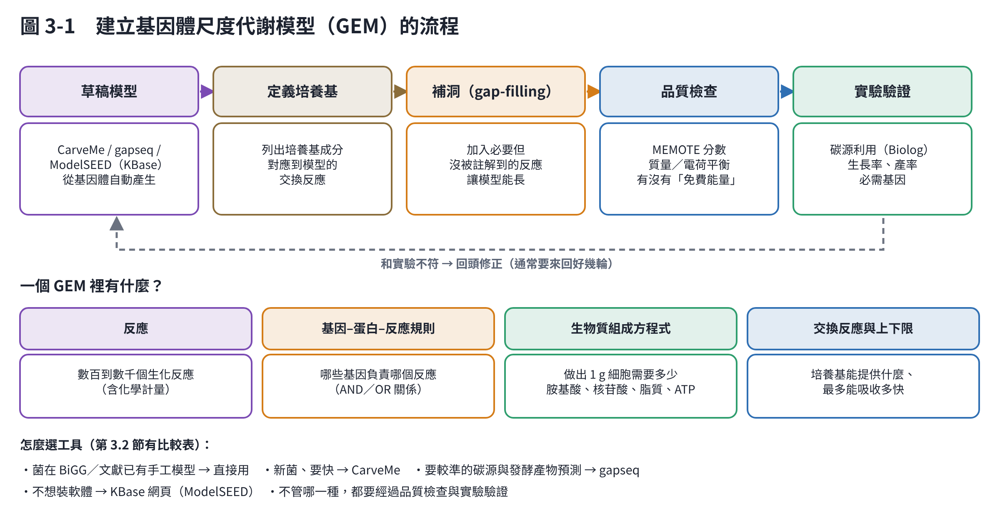

# 第 3 章　建立代謝模型：把基因變成可以計算的網路

註解告訴你「有哪些酵素」，代謝模型則把這些酵素連成一張網路，讓電腦能回答「在這個培養條件下，細胞最多能長多快、會分泌什麼」。

## 3.1 基因體尺度代謝模型（GEM）是什麼？

GEM 是一張「細胞內所有已知代謝反應」的清單，包含：

- **反應與化學計量**：例如「1 葡萄糖＋1 ATP → 1 葡萄糖-6-磷酸＋1 ADP」。
- **基因–蛋白–反應規則**：哪些基因負責哪個反應。拿掉基因，就能模擬剔除突變株。
- **生物質方程式**：做出 1 g 細胞需要多少胺基酸、核苷酸、脂質與 ATP。
- **交換反應**：培養基能提供什麼、細胞能分泌什麼，以及吸收速率的上下限。

**通量平衡分析（FBA）的想法很簡單** [1]：

1. 細胞內每一種代謝物，生成量要等於消耗量（穩定狀態）。
2. 每個反應的速率有上下限，例如吸收的葡萄糖不能超過某個值。
3. 在這些限制下，找出讓「生長」最大的那一組反應速率。

這是一個線性規劃問題，電腦一秒內就能解好幾百次。所以可以大量試算「如果改這個條件會怎樣」。

**FBA 的假設與限制**：

- 假設細胞「追求最快生長」。演化上大致成立，但工程菌、生產期的細胞未必如此。
- 不含動力學與調控：它算的是「最多能做到」，不是「一定會這樣做」。
- 不知道溫度、pH：這些要用第 5、7 章的方法補上。
- 結果強烈依賴吸收速率的上限，而這些上限要用實驗量測。

## 3.2 從基因體自動產生模型

過去一個高品質的 GEM 要花數個月到數年手工整理 [2]。現在有工具可以從基因體自動產生草稿：

| 工具 | 特色 | 適合 |
|---|---|---|
| CarveMe [3] | 從一個通用模型「雕」出這株菌的模型；快，幾分鐘完成 | 新菌、要快速比較多株菌 |
| gapseq [4] | 用自己的生化資料庫與序列比對預測路徑，補洞時參考序列證據 | 想要較準的碳源利用與發酵產物預測 |
| ModelSEED／KBase [5, 6] | 網頁平台，不必安裝 | 不想寫程式 |

gapseq 的作者用 BacDive 的大量酵素活性資料做比較：gapseq 的預測正確率約 0.80，CarveMe 約 0.66，ModelSEED 約 0.69 [4]。不過，工具的表現依菌種與測試項目而不同，**最可靠的做法是用自己的實驗資料驗證**。

**如果你的菌在 BiGG 資料庫 [7] 或文獻中已有手工整理的模型，優先用它。** 大腸桿菌、枯草桿菌、酵母菌、麩胺酸棒狀桿菌等常見的工業菌，都有高品質模型。

## 3.3 建模的關鍵步驟

1. **產生草稿**：用上表任一工具，輸入基因體或蛋白質序列。
2. **定義培養基**：
   - 把你實際用的培養基成分逐一對應到模型的交換反應；
   - 培養基裡沒有的東西，吸收上限設為 0。

   這一步做錯，後面全錯。
3. **補洞（gap-filling）**：
   - 草稿模型常常「長不起來」，因為某些必要反應沒被註解到；
   - 補洞會加入最少量的反應讓模型能長，但加入的反應不一定真實存在，要標記起來。
4. **品質檢查**：
   - 用 MEMOTE [8] 檢查質量與電荷是否平衡，以及模型會不會「無中生有」產生 ATP；
   - MEMOTE 會產出分數報告。
5. **實驗驗證**：
   - 碳源利用測試（例如 Biolog 盤）：模型說能吃的碳源，實際能不能吃；
   - 生長率與產率：實測值和模型預測差多少；
   - 已知的必需基因：如果有剔除株資料，可以比對。
6. **反覆修正**：和實驗不符的地方，回頭查註解、補反應或刪反應。通常要來回好幾輪。

Thiele 與 Palsson（2010）把高品質重建整理成 96 個步驟的標準流程 [2]，是想做到發表等級時的參考。

## 3.4 一定要知道的模型參數

FBA 結果對下面幾個參數最敏感，**都要用自己的實驗量**：

| 參數 | 意義 | 怎麼量 |
|---|---|---|
| 最大基質吸收速率 | 每克菌每小時最多吃多少糖 | 指數期的耗糖速率 ÷ 菌量 |
| 最大耗氧速率 | 呼吸鏈的能力上限 | 尾氣分析或溶氧動態法 |
| 維持能量（ATPM） | 不生長也要消耗的能量 | 不同生長速率的恆化器實驗，或用文獻值 |
| 生物質組成 | 蛋白質、RNA、脂質比例 | 文獻或近緣菌的值；影響較小 |

本教材用的大腸桿菌核心模型，維持能量設為 8.39 mmol ATP/gDW/h；吸收速率的量級參考 Varma 與 Palsson（1994）的實驗 [9]。

## 3.5 進階：讓模型更接近真實

- **加入酵素限制**：細胞的蛋白質總量有限，不能每條路徑都開到最大。GECKO 方法把酵素量加進模型 [10]，能更好地預測溢流代謝這類現象。
- **處理不確定性**：自動建模的每一步（註解、補洞、生物質組成）都有不確定性。可以產生多個版本的模型一起預測，看結論是否穩健 [11]。
- **結合其他資料**：轉錄體、蛋白體可以用來限制「哪些反應此刻是開的」，讓預測更接近實際狀態。

## 3.6 實際操作：最小可行流程

以下是不需要寫很多程式的做法（第 11 章有完整時程）：

1. 組裝好的基因體 → 用 Bakta 註解，得到蛋白質序列檔（.faa）。
2. 用 CarveMe（指令：carve genome.faa -o model.xml）或 gapseq 產生模型；或上傳到 KBase 網頁。
3. 用 COBRApy [12] 讀入模型、設定培養基、跑 FBA。本教材 code/gem.py 的 load() 改一行就能換成你的模型。
4. 用 MEMOTE 產生品質報告。
5. 拿第一批實驗數據比對，記下不符的地方。

## 本章重點

- GEM 把基因變成可計算的代謝網路；FBA 用線性規劃找出最大生長下的流量分布。
- 自動建模工具（CarveMe、gapseq、ModelSEED）幾分鐘就能產生草稿，但一定要定義培養基、補洞、檢查品質、用實驗驗證。
- 最大吸收速率、最大耗氧速率、維持能量是最敏感的參數，要用自己的實驗量。
- FBA 不知道溫度、pH 與調控；這些要靠動力學與經驗模型補上（第 5、7 章）。

## 參考文獻

1. Orth JD, Thiele I, Palsson BØ (2010). What is flux balance analysis? *Nature Biotechnology*, 28, 245–248. https://doi.org/10.1038/nbt.1614
2. Thiele I, Palsson BØ (2010). A protocol for generating a high-quality genome-scale metabolic reconstruction. *Nature Protocols*, 5, 93–121. https://doi.org/10.1038/nprot.2009.203
3. Machado D, Andrejev S, Tramontano M, Patil KR (2018). Fast automated reconstruction of genome-scale metabolic models for microbial species and communities. *Nucleic Acids Research*, 46, 7542–7553. https://doi.org/10.1093/nar/gky537
4. Zimmermann J, Kaleta C, Waschina S (2021). gapseq: informed prediction of bacterial metabolic pathways and reconstruction of accurate metabolic models. *Genome Biology*, 22, 81. https://doi.org/10.1186/s13059-021-02295-1
5. Henry CS, DeJongh M, Best AA, Frybarger PM, Linsay B, Stevens RL (2010). High-throughput generation, optimization and analysis of genome-scale metabolic models. *Nature Biotechnology*, 28, 977–982. https://doi.org/10.1038/nbt.1672
6. Arkin AP, Cottingham RW, Henry CS, et al. (2018). KBase: The United States Department of Energy Systems Biology Knowledgebase. *Nature Biotechnology*, 36, 566–569. https://doi.org/10.1038/nbt.4163
7. King ZA, Lu J, Dräger A, et al. (2016). BiGG Models: A platform for integrating, standardizing and sharing genome-scale models. *Nucleic Acids Research*, 44, D515–D522. https://doi.org/10.1093/nar/gkv1049
8. Lieven C, Beber ME, Olivier BG, et al. (2020). MEMOTE for standardized genome-scale metabolic model testing. *Nature Biotechnology*, 38, 272–276. https://doi.org/10.1038/s41587-020-0446-y
9. Varma A, Palsson BO (1994). Stoichiometric flux balance models quantitatively predict growth and metabolic by-product secretion in wild-type *Escherichia coli* W3110. *Applied and Environmental Microbiology*, 60, 3724–3731. https://doi.org/10.1128/aem.60.10.3724-3731.1994
10. Sánchez BJ, Zhang C, Nilsson A, et al. (2017). Improving the phenotype predictions of a yeast genome-scale metabolic model by incorporating enzymatic constraints. *Molecular Systems Biology*, 13, 935. https://doi.org/10.15252/msb.20167411
11. Bernstein DB, Sulheim S, Almaas E, Segrè D (2021). Addressing uncertainty in genome-scale metabolic model reconstruction and analysis. *Genome Biology*, 22, 64. https://doi.org/10.1186/s13059-021-02289-z
12. Ebrahim A, Lerman JA, Palsson BO, Hyduke DR (2013). COBRApy: COnstraints-Based Reconstruction and Analysis for Python. *BMC Systems Biology*, 7, 74. https://doi.org/10.1186/1752-0509-7-74
