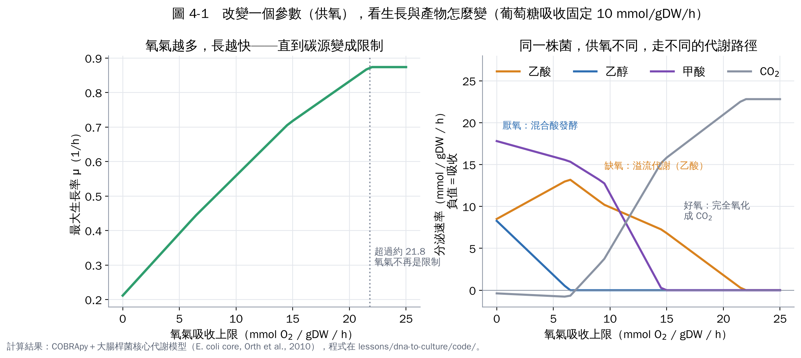
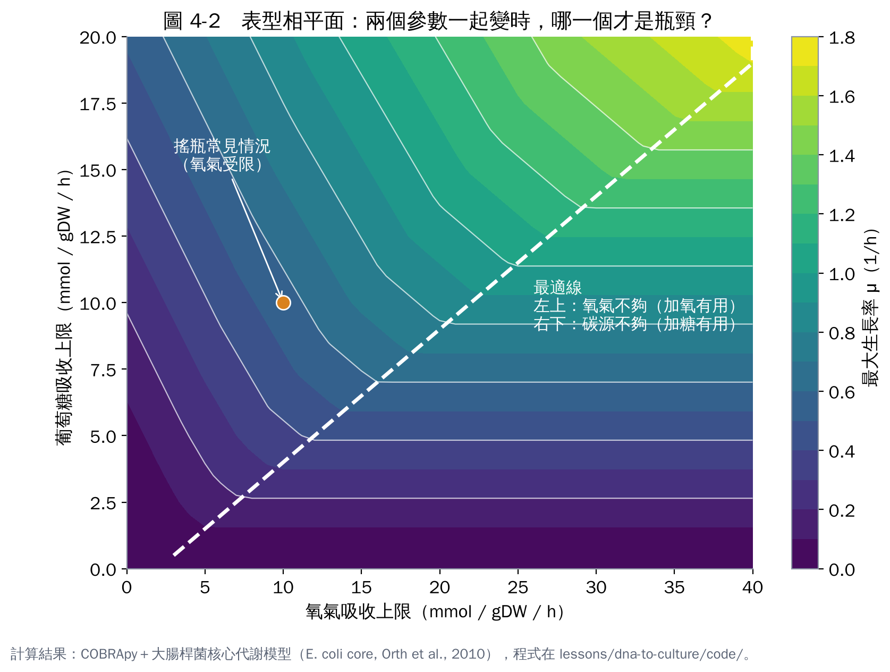
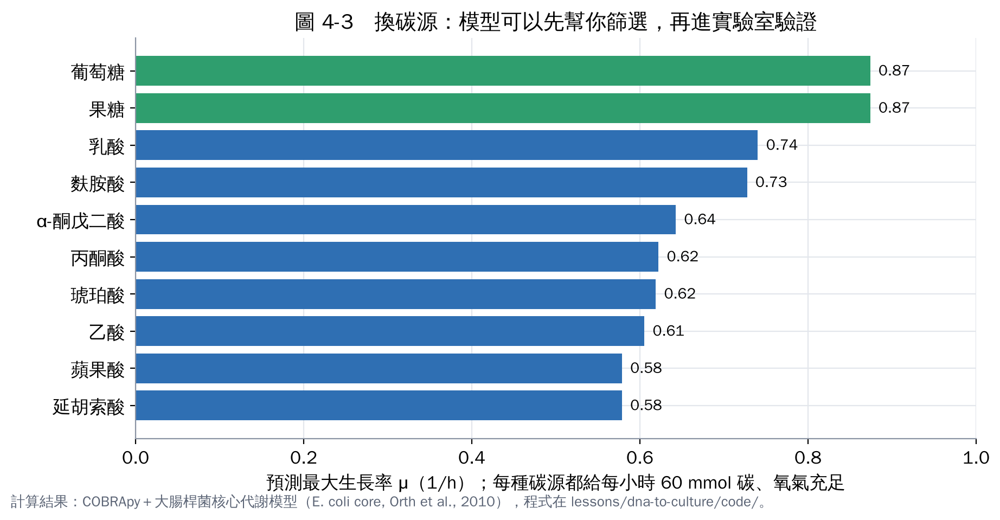
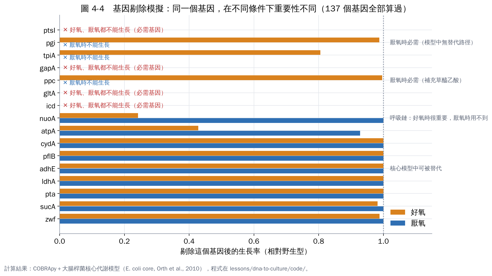
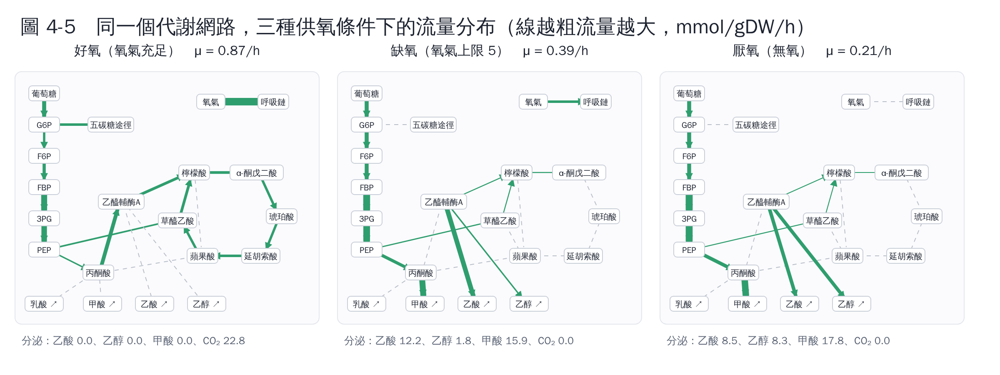

# 第 4 章　實作 1：FBA，調一個參數看代謝路徑怎麼變

這一章用 COBRApy [1] 和大腸桿菌核心代謝模型 [2]，實際算出你問的問題：「調整哪些參數會影響哪條代謝路徑、影響生長」。

- 模型規模：95 個反應、72 個代謝物、137 個基因。
- 程式：code/experiments.py 的 exp_fba()，全部結果寫在 results.json。

## 4.1 改供氧：同一株菌走三種不同的路

設定：葡萄糖吸收上限固定 10 mmol/gDW/h，把氧氣吸收上限從 0 調到 25。

| 狀態 | 氧氣上限 | 最大生長率 | 主要產物（mmol/gDW/h） |
|---|---|---|---|
| 厭氧 | 0 | 0.21 /h | 甲酸 17.8、乙酸 8.5、乙醇 8.3 |
| 缺氧 | 5 | 0.39 /h | 甲酸 15.9、乙酸 12.2、乙醇 1.8 |
| 好氧（氧充足） | ≥ 21.8 | 0.87 /h | CO₂ 22.8，不分泌有機酸 |

**怎麼解讀**：

- 氧氣讓同一份糖產生更多能量，所以生長率從 0.21 升到 0.87，提高四倍。
- 氧氣不夠時，細胞要把多出來的碳「丟掉」，丟的形式依缺氧程度改變：
  - 輕度缺氧：主要分泌乙酸（溢流代謝）；
  - 完全厭氧：乙醇與甲酸也出現。
- 超過約 21.8 之後再加氧也沒用，因為碳源變成了限制。

這和實驗觀察到的大腸桿菌行為一致。Varma 與 Palsson（1994）用類似的模型，定量預測了乙酸分泌與吸收速率 [3]。

**對培養的意義**：如果你的目標產物是發酵產物（乙醇、乳酸、琥珀酸等），供氧就是決定產物路徑的「開關」。這是第 6 章兩階段策略的基礎。

## 4.2 兩個參數一起變：誰才是瓶頸？

把葡萄糖和氧氣的上限同時掃描，畫成「表型相平面」：

- **白色虛線（最適線）**：在線上，糖和氧剛好平衡。
- **線的左上方**：氧氣不夠。加氧有用，加糖幫助很小（多的糖變成副產物）。
- **線的右下方**：碳源不夠。加糖有用，加氧沒用。

這可以用「影子價格」量化：多給 1 單位基質，生長率增加多少。

| 情境 | 多給 1 mmol 葡萄糖 | 多給 1 mmol 氧氣 | 結論 |
|---|---|---|---|
| 氧氣充足（葡萄糖 10） | +0.092 /h | 0 | 碳源是瓶頸 |
| 氧氣受限（葡萄糖 10、氧 8） | +0.032 /h | +0.032 /h | 兩者都限制；加糖的效益只剩三分之一 |
| 糖受限（葡萄糖 3） | +0.092 /h | 0 | 碳源是瓶頸 |

**這就是「哪個參數重要」的答案**：

- 重要性不是固定的，取決於你目前在相平面的哪個位置。
- 搖瓶培養通常在左上方（氧氣受限），這時多加糖不會讓菌長更快，反而產生更多乙酸。

## 4.3 換碳源：先用模型篩選

每種碳源都給每小時 60 mmol 碳（公平比較），氧氣充足：

- 葡萄糖、果糖最好（0.87 /h）。
- 乳酸、麩胺酸次之（約 0.73–0.74 /h）。
- 乙酸、琥珀酸、蘋果酸較差（0.58–0.62 /h）。

真實的菌還要考慮運輸蛋白的表現與調控，但模型能幫你快速排除不可能的選項，把實驗集中在有希望的碳源。

**換成你的菌時**：

1. 把模型的碳源預測和 Biolog 盤或簡單的生長測試比對，這是驗證模型最便宜的方法。
2. 再用模型找「便宜又長得好」的替代碳源，例如甘油、木糖或農業副產物的組成分。

## 4.4 基因剔除：哪些基因不能動？

模型可以逐一拿掉 137 個基因，看還能不能長。

- **好氧必需**：7 個基因，例如 gapA、pgk、eno（糖解）、ptsH、ptsI（葡萄糖吸收）、gltA、icd（TCA 前段）。
- **厭氧必需**：10 個，多了 tpiA、pgi、ppc。
- **條件相依**：
  - 呼吸鏈的 nuo 基因群剔除後，好氧生長只剩 24%，厭氧完全不受影響；
  - ATP 合成酶剔除後，好氧剩 43%、厭氧剩 93%。

**為什麼你需要知道這個？**

- **改良菌株**：如果要剔除某個基因來減少副產物，先確認它在你的培養條件下不是必需的。
- **理解培養條件**：同一個基因的重要性隨條件改變。這說明「基因功能」要放在培養條件下解讀，呼應第 1 章「DNA 告訴你能做什麼，培養條件決定實際做什麼」。

（核心模型只有中心代謝。在完整的基因體模型裡，許多基因有替代路徑，必需基因的清單會不同。）

## 4.5 看見代謝路徑的變化：流量圖

把每個反應的流量畫在代謝圖上，線越粗代表流量越大：

- **好氧**：完整的 TCA 循環在運轉，五碳糖途徑也有流量（提供合成用的 NADPH），氧氣大量進入呼吸鏈。
- **缺氧**：TCA 循環變細，大量碳從乙醯輔酶 A 流向乙酸，丙酮酸經 PFL 產生甲酸。
- **厭氧**：TCA 只剩下合成用的分支，乙醯輔酶 A 分流到乙酸和乙醇各一半，維持氧化還原平衡。

這種圖可以用 Escher 等工具做成互動版 [4]。第 9 章的模擬器內建了一個簡化版，拉動參數時會即時更新。

## 本章重點

- FBA 能直接回答「改這個參數，代謝路徑怎麼變」。供氧是最強的開關：好氧完全氧化、缺氧產乙酸、厭氧產乙醇與甲酸。
- 參數的重要性取決於目前的限制因子；表型相平面與影子價格可以找出瓶頸。
- 模型可以先篩選碳源與基因剔除，把實驗集中在最有希望的選項。
- 流量圖讓代謝變化「看得見」。

## 參考文獻

1. Ebrahim A, Lerman JA, Palsson BO, Hyduke DR (2013). COBRApy: COnstraints-Based Reconstruction and Analysis for Python. *BMC Systems Biology*, 7, 74. https://doi.org/10.1186/1752-0509-7-74
2. Orth JD, Fleming RMT, Palsson BØ (2010). Reconstruction and use of microbial metabolic networks: the core *Escherichia coli* metabolic model as an educational guide. *EcoSal Plus*, 4(1). https://doi.org/10.1128/ecosalplus.10.2.1
3. Varma A, Palsson BO (1994). Stoichiometric flux balance models quantitatively predict growth and metabolic by-product secretion in wild-type *Escherichia coli* W3110. *Applied and Environmental Microbiology*, 60, 3724–3731. https://doi.org/10.1128/aem.60.10.3724-3731.1994
4. King ZA, Dräger A, Ebrahim A, Sonnenschein N, Lewis NE, Palsson BO (2015). Escher: a web application for building, sharing, and embedding data-rich visualizations of biological pathways. *PLoS Computational Biology*, 11, e1004321. https://doi.org/10.1371/journal.pcbi.1004321
