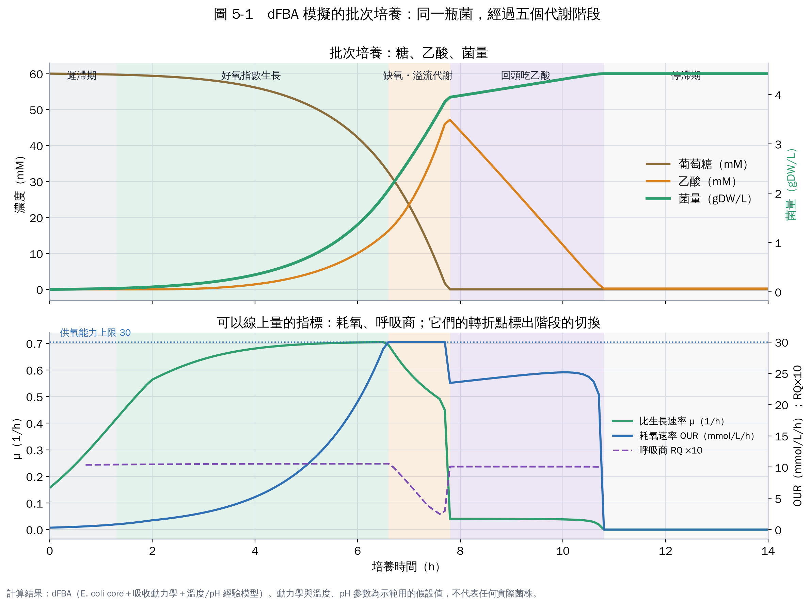
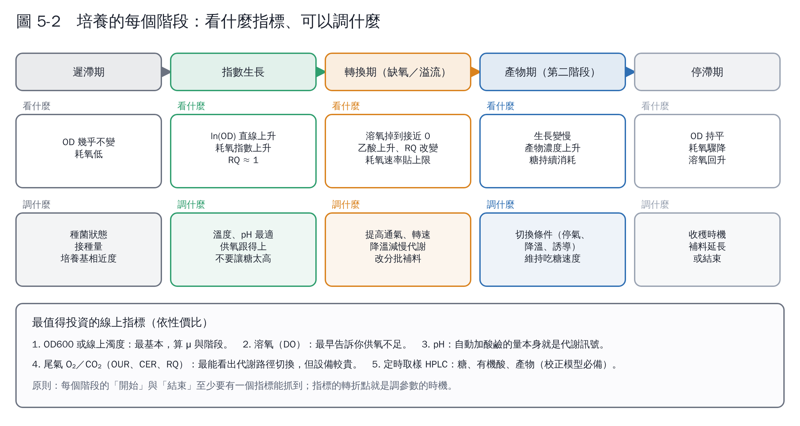
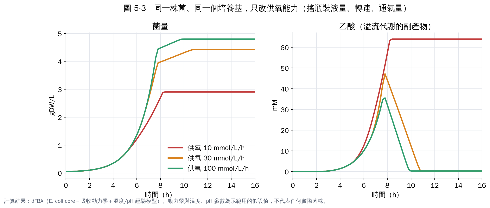
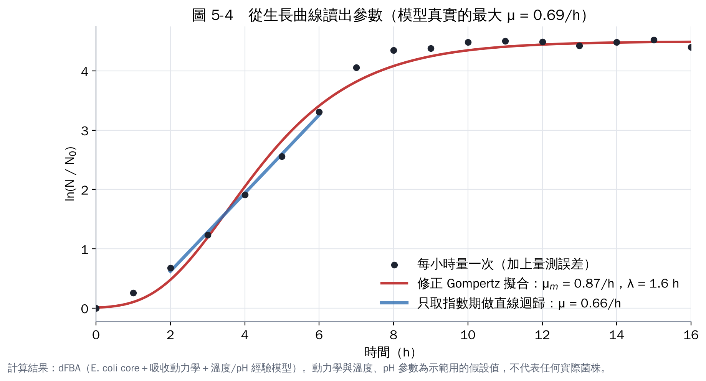

# 第 5 章　實作 2：動態培養，階段、指標與生長參數

FBA 算的是「某一瞬間」的狀態。真實的培養是動態的：糖越吃越少、菌越來越多、氧氣越來越不夠。這一章把代謝模型放進時間軸，回答你的問題：「每個階段發生什麼、要看什麼指標」。

## 5.1 動態通量平衡分析（dFBA）

做法是 Mahadevan 等人（2002）的「靜態最佳化法」[1]。把培養時間切成很多小段（本教材每段 3 分鐘），每一段做三件事：

1. **算吸收速率**：
   - 依目前培養液裡的糖濃度，用 Michaelis–Menten（Monod 型）動力學算出細胞最多能吸收多少 [2]；
   - 依供氧能力與目前菌量，算出每克菌能分到多少氧。
2. **跑 FBA**：用這些上限算出這段時間的生長率與分泌物。
3. **更新濃度**：菌量、糖、乙酸、乙醇的濃度依結果更新，進到下一段。

此外：

- 遲滯期用 Baranyi 與 Roberts（1994）的調適函數描述 [3]。
- 溫度與 pH 的效果用第 7 章的經驗模型乘上去。

**加速技巧**：每一步都解線性規劃比較慢。我事先在「糖吸收 × 氧吸收」的網格上解好，模擬時查表內插。和每步真的解線性規劃相比，菌量最大差異只有 0.0011 g/L，速度快 100 倍以上。第 9 章的模擬器能在瀏覽器即時計算，靠的就是這個技巧。

## 5.2 一批培養的五個階段

設定：

- 培養基：葡萄糖 60 mM（10.8 g/L）。
- 接種量：0.05 gDW/L。
- 供氧能力：30 mmol O₂/L/h（約等於通氣良好的搖瓶）。
- 溫度與 pH：37 °C、pH 7。

| 階段 | 時間 | 發生什麼 | 線上指標的樣子 |
|---|---|---|---|
| 遲滯期 | 0–1.3 h | 細胞適應新環境，長得慢 | 耗氧低、OD 幾乎不變 |
| 好氧指數生長 | 1.3–6.6 h | μ 約 0.69 /h，菌量指數上升；已開始分泌少量乙酸 | 耗氧指數上升；RQ 約 1.05 |
| 缺氧・溢流代謝 | 6.6–7.8 h | 菌太多、供氧到上限，多的糖變成乙酸 | 耗氧速率貼在 30 的上限；RQ 下降；乙酸快速上升 |
| 回頭吃乙酸 | 7.8–10.8 h | 糖吃完，改吃乙酸，長得很慢 | 耗氧突然下降後持平；RQ 回到約 1 |
| 停滯期 | 10.8 h 以後 | 沒有碳源，停止生長 | 耗氧驟降到 0；溶氧回升 |

（RQ＝呼吸商＝CO₂ 生成速率 ÷ O₂ 消耗速率。）

最後菌量 4.4 gDW/L，乙酸最高 47.9 mM，第 7.8 小時糖吃完。

**兩個值得注意的現象**：

1. **乙酸在供氧還沒到上限時就開始累積**：
   - 模型裡細胞呼吸鏈的能力有上限（每克菌每小時 15 mmol O₂），低於完全氧化所有糖所需的量；
   - 所以吃糖太快時，即使氧氣充足也會溢流。

   這和大腸桿菌的實際行為相符。Basan 等人（2015）認為，溢流代謝是細胞在有限的蛋白質資源下做的取捨 [4]。
2. **「回頭吃乙酸」需要氧氣**：大腸桿菌在糖用完後改用乙酸，這種「乙酸開關」有詳細的生理研究 [5]。

## 5.3 指標：每個階段看什麼、調什麼

**階段的轉折點就是調參數的時機。** 在圖 5-1 下方：

- 耗氧速率碰到上限的那一刻（6.6 h），就是「供氧開始不夠」的訊號。這時可以：
  - 提高通氣或轉速；
  - 降溫減慢代謝；
  - 改成分批補糖。
- 耗氧速率突然下降的那一刻（7.8 h），就是「糖吃完」的訊號。若目標是菌量，這是補糖的時機。

這些都是可以線上量測的訊號，不必等實驗室分析。

## 5.4 供氧能力：最常被低估的參數

同一株菌、同一個培養基，只改變供氧能力。在搖瓶上，供氧能力由裝液量、轉速、瓶型決定；在發酵槽上，由通氣量與攪拌決定。

| 供氧能力（mmol/L/h） | 最終菌量（gDW/L） | 乙酸最高（mM） | 乙酸有沒有被吃回去 |
|---|---|---|---|
| 10（裝太多液的搖瓶） | 2.9 | 64 | 沒有，一直留在培養液 |
| 30（一般搖瓶） | 4.4 | 47 | 有 |
| 100（發酵槽） | 4.8 | 36 | 有，而且較快 |

供氧不足時：

- 菌量少了三分之一；
- 留下大量乙酸，因為吃乙酸需要氧氣，而菌太多、氧太少。

**實務提醒**：搖瓶裝液量建議不超過瓶容積的 20%，並記錄轉速與瓶型。這些「看起來不重要」的條件，常常就是不同實驗結果不一致的原因 [6]。

## 5.5 從生長曲線讀出參數

模型需要的生長參數（最大比生長速率 μmax、遲滯期 λ、最大菌量 A）要從實驗量出來。

我從模擬的培養中，每小時取一個點並加上量測誤差，假裝是實驗數據，再用兩種方法分析：

| 方法 | 估計的 μmax | 和真實值 0.69 /h 比 |
|---|---|---|
| 修正 Gompertz 模型擬合（Zwietering et al., 1990）[7] | 0.87 /h | 高估 25% |
| 只取指數期（2–6 h），對 ln(OD) 做直線迴歸 | 0.66 /h | 低估 4% |

**為什麼 Gompertz 會高估？** 這批培養在糖吃完時是「突然停止」，曲線形狀和 Gompertz 假設的平滑 S 形不同。模型為了配合曲線形狀，把中段斜率拉高了。

**教訓**：

- 擬合模型之前先畫 ln(OD) 對時間的圖，看指數期是否真的是直線。
- 用模型估參數時，要確認曲線形狀符合模型的假設。
- Gompertz 估出的遲滯期（1.6 h）和真實設定（1.5 h）很接近，λ 的估計比較可靠。

**產物和生長的關係**：Luedeking 與 Piret（1959）把產物生成速率分成「跟著生長」和「跟著菌量」兩部分 [8]。量出這兩個係數，就知道產物是在生長期還是停滯期產生，這直接決定要不要分階段（第 6 章）。

## 5.6 實驗要量什麼，才能校正模型？

| 量測 | 頻率 | 用途 |
|---|---|---|
| OD600（或乾重） | 每 0.5–1 小時（指數期） | μmax、λ、最大菌量；OD 對乾重要先做檢量線 |
| 糖、有機酸、產物（HPLC） | 每 1–2 小時 | 吸收速率、產率、副產物 |
| 溶氧、pH | 線上連續 | 階段轉折、供氧是否足夠 |
| 尾氣 O₂、CO₂ | 線上連續（有設備時） | 耗氧速率、RQ |
| 培養條件 | 每批 | 溫度、轉速、裝液量、接種量與種菌狀態 |

**至少要有 3 批完整的基準培養**，才能估計批次間的變異。

## 本章重點

- dFBA 把代謝模型放進時間軸，可以預測生長曲線、副產物與階段轉換。
- 一批培養會經過遲滯、指數、缺氧溢流、轉換碳源、停滯等階段；耗氧速率、溶氧、RQ 的轉折點標出階段切換，也是調參數的時機。
- 供氧能力是最常被低估的參數：不足時菌量少三分之一、留下大量乙酸。
- 從生長曲線估參數時，要確認曲線形狀符合模型假設；只用指數期做直線迴歸通常更可靠。

## 參考文獻

1. Mahadevan R, Edwards JS, Doyle FJ (2002). Dynamic flux balance analysis of diauxic growth in *Escherichia coli*. *Biophysical Journal*, 83, 1331–1340. https://doi.org/10.1016/S0006-3495(02)73903-9
2. Monod J (1949). The growth of bacterial cultures. *Annual Review of Microbiology*, 3, 371–394. https://doi.org/10.1146/annurev.mi.03.100149.002103
3. Baranyi J, Roberts TA (1994). A dynamic approach to predicting bacterial growth in food. *International Journal of Food Microbiology*, 23, 277–294. https://doi.org/10.1016/0168-1605(94)90157-0
4. Basan M, Hui S, Okano H, et al. (2015). Overflow metabolism in *Escherichia coli* results from efficient proteome allocation. *Nature*, 528, 99–104. https://doi.org/10.1038/nature15765
5. Wolfe AJ (2005). The acetate switch. *Microbiology and Molecular Biology Reviews*, 69, 12–50. https://doi.org/10.1128/MMBR.69.1.12-50.2005
6. Garcia-Ochoa F, Gomez E (2009). Bioreactor scale-up and oxygen transfer rate in microbial processes: an overview. *Biotechnology Advances*, 27, 153–176. https://doi.org/10.1016/j.biotechadv.2008.10.006
7. Zwietering MH, Jongenburger I, Rombouts FM, van 't Riet K (1990). Modeling of the bacterial growth curve. *Applied and Environmental Microbiology*, 56, 1875–1881. https://doi.org/10.1128/aem.56.6.1875-1881.1990
8. Luedeking R, Piret EL (1959). A kinetic study of the lactic acid fermentation. Batch process at controlled pH. *Journal of Biochemical and Microbiological Technology and Engineering*, 1, 393–412. https://doi.org/10.1002/jbmte.390010406
