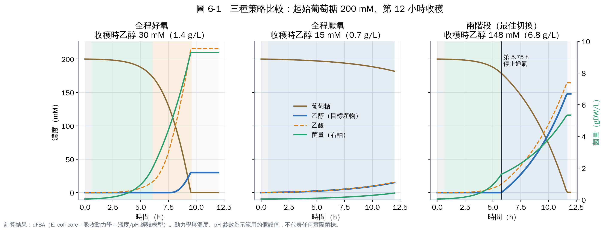
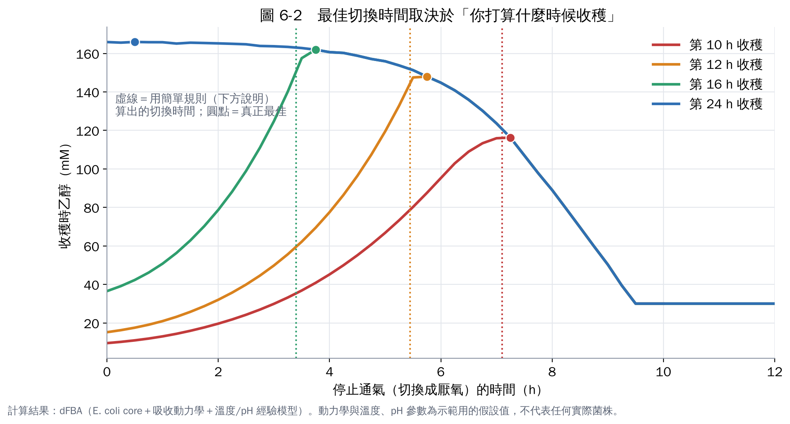
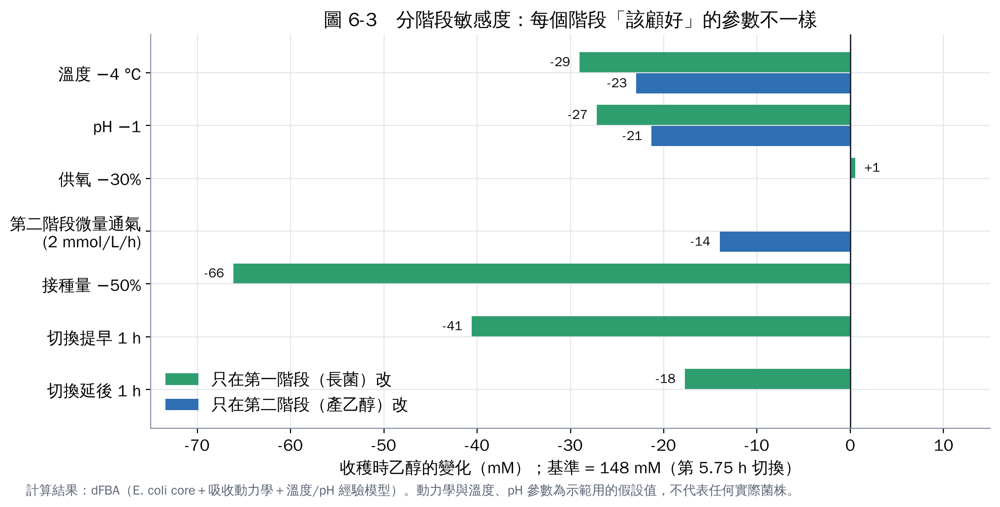
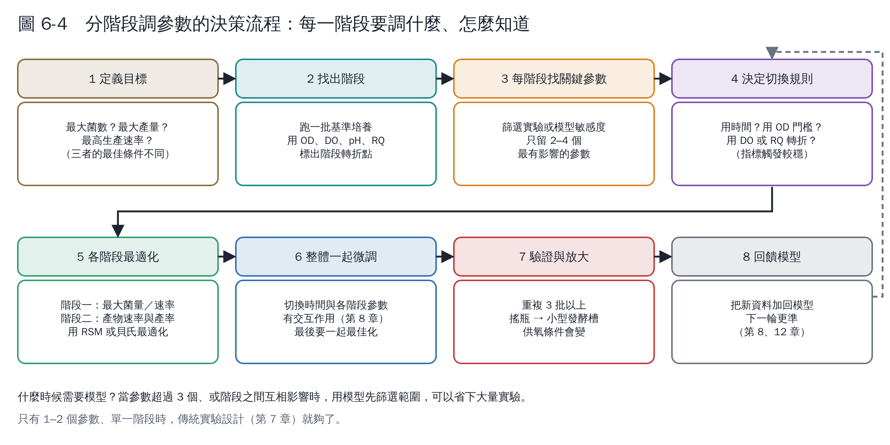

# 第 6 章　實作 3：分階段最適化，什麼時候切換、每階段調什麼

你提到「可能是分階段的參數調整，但要怎麼知道每階段要調什麼參數」。這一章用模擬實際做一次，答案比想像中具體。

## 6.1 為什麼要分階段？

長菌和產物常常是互相衝突的目標：

- **長菌**需要能量，好氧呼吸最有效率，碳大多變成菌體和 CO₂。
- **很多產物**（乙醇、乳酸、琥珀酸…）是發酵產物，要在缺氧時才大量產生，這時細胞長得很慢。

所以常見的策略是**兩階段**：先在最適合生長的條件下累積菌量，再切換到最適合生產的條件。切換的方式除了停止通氣，還可以改溫度、改 pH、加誘導劑，或用基因工程做「動態代謝控制」[1, 3]。

## 6.2 三種策略的比較

情境：

- 起始葡萄糖 200 mM（36 g/L），第 12 小時收穫，目標是乙醇。
- 第一階段：37 °C、pH 7、供氧能力 30。
- 第二階段：停止通氣。

| 策略 | 收穫時乙醇 | 收穫時菌量 | 問題 |
|---|---|---|---|
| 全程好氧 | 30 mM（1.4 g/L） | 9.3 gDW/L | 碳都變成菌體和乙酸，只有缺氧那一小段產乙醇 |
| 全程厭氧 | 15 mM（0.7 g/L） | 0.4 gDW/L | 厭氧長得太慢，12 小時只吃掉 9% 的糖 |
| **兩階段（第 5.75 h 切換）** | **148 mM（6.8 g/L）** | 5.3 gDW/L | 是單階段最好結果的 5 倍 |

**兩階段的道理**：第一階段累積足夠的「細胞工廠」；第二階段每個細胞都在產乙醇，所以 12 小時內能把糖吃完。

**副產物提醒**：這個模型的大腸桿菌在厭氧時，乙酸、乙醇、甲酸差不多各占一份，所以第二階段的乙酸比乙醇還多。真正的乙醇生產會用酵母菌或改造過的菌株，讓碳集中流向乙醇。代謝模型可以幫你找出「剔除哪些基因能讓副產物減少」（第 4 章的基因剔除就是起點）。

## 6.3 什麼時候切換最好？

把切換時間從 0 掃到收穫時間：

| 收穫時間 | 最佳切換時間 | 收穫時乙醇 |
|---|---|---|
| 第 10 h | 7.25 h | 116 mM |
| 第 12 h | 5.75 h | 148 mM |
| 第 16 h | 3.75 h | 162 mM |
| 第 24 h | 0.5 h（幾乎全程厭氧） | 166 mM |

**重要發現**：

1. **最佳切換時間不是固定值**，取決於你打算什麼時候收穫。時間越緊，越需要先長大量的菌。
2. **時間充裕時，單階段反而最好**：24 小時收穫時，幾乎全程厭氧的產量最高。原因是好氧期會把一部分糖「燒掉」變成菌體和 CO₂，降低產率（每莫耳糖產 0.83 莫耳乙醇，降到兩階段的 0.74）。
3. 這呼應了 Klamt 等人（2018）的分析：兩階段不一定勝過單階段。兩階段的好處在**生產速率**，代價是**產率**；要看你的經濟目標是哪一個 [2]。
4. **曲線是不對稱的**：切換太晚（菌太多、糖不夠產物用）比切換太早損失得更快。

## 6.4 用指標決定切換，而不是用時間

固定時間切換的問題是：每批的遲滯期、接種狀態都不同。比較穩的做法是**用量得到的指標觸發切換**。

我測試了一個簡單規則：

> 當「目前菌量在剩下的時間內，用厭氧的吃糖速度，能吃完剩下的糖」時，就切換。

| 收穫時間 | 規則算出的切換時間 | 真正最佳 |
|---|---|---|
| 第 10 h | 7.1 h | 7.25 h |
| 第 12 h | 5.45 h | 5.75 h |
| 第 16 h | 3.4 h | 3.75 h |

規則都在最佳值前 0.15–0.35 小時。它只需要知道三個數字：

- 目前菌量（OD）；
- 剩下的糖（線上或快速測定）；
- 厭氧時每克菌的吃糖速度（做一次實驗就能量）。

這就是「用指標決定分階段」的具體例子。

## 6.5 每個階段該顧哪些參數？

以第 12 小時收穫、第 5.75 小時切換為基準（乙醇 148 mM），每次只在一個階段改一個參數：

| 改變 | 只在第一階段 | 只在第二階段 | 解讀 |
|---|---|---|---|
| 接種量減半 | −66 mM | — | 第一階段最關鍵：菌量不夠，後面全部受影響 |
| 切換提早 1 h | −41 mM | — | 菌量不夠 |
| 切換延後 1 h | −18 mM | — | 糖被長菌用掉 |
| 溫度降 4 °C | −29 mM | −23 mM | 兩階段都重要 |
| pH 降 1 | −27 mM | −21 mM | 兩階段都重要 |
| 供氧能力降 30% | +0.5 mM | — | 在這個設定下第一階段供氧還夠，不是瓶頸 |
| 第二階段微量通氣 | — | −14 mM | 第二階段要嚴格厭氧，氧氣會讓碳流回呼吸與長菌 |

**怎麼用這張表**：

1. **第一階段的重點**是「準時累積到足夠的菌量」：接種量、溫度、pH、切換時機。
2. **第二階段的重點**是「維持吃糖速度、避免碳流向別處」：溫度、pH、嚴格厭氧。
3. **不重要的參數不必花力氣**：例如這個設定下的供氧能力。但如果接種量或收穫時間改變，它可能變重要（第 8 章的交互作用）。

**敏感度分析的實務做法**：

- 有模型時：像本節這樣，每個參數各試一次，就能排出優先順序。
- 沒有模型時：用 Plackett–Burman 等篩選設計（第 7 章），用十幾批實驗找出關鍵參數。

## 6.6 分階段最適化的決策流程

1. **定義目標**：菌量、濃度、速率、產率，選一個主要目標。
2. **找出階段**：跑一批基準培養，用指標標出轉折點（第 5 章）。
3. **每階段找關鍵參數**：敏感度分析或篩選實驗，只留 2–4 個。
4. **決定切換規則**：優先用指標觸發。
5. **各階段最適化**：用反應曲面法或貝氏最適化（第 7、8 章）。
6. **整體一起微調**：切換時間和各階段參數互相影響，最後要一起調。
7. **驗證與放大**：至少重複 3 批；換到發酵槽時供氧條件會改變，要重新確認。
8. **回饋模型**：把新資料加回模型，下一輪更準。

除了兩階段，常見的做法還有**分批補料**：

- 讓糖維持在低濃度，避免溢流代謝；
- 用溶氧或 pH 的變化觸發補料。

這種策略在工業發酵中很常見。

## 本章重點

- 兩階段培養（好氧長菌 → 厭氧產物）在時間有限時，產量可以是單階段的 5 倍；時間充裕時，單階段的產率反而較好。
- 最佳切換時間取決於收穫時間；用「菌量能否吃完剩下的糖」的指標規則觸發切換，結果接近最佳。
- 敏感度分析告訴你每階段該顧什麼：第一階段是接種量與切換時機，第二階段是溫度、pH 與嚴格厭氧。

## 參考文獻

1. Venayak N, Anesiadis N, Cluett WR, Mahadevan R (2015). Engineering metabolism through dynamic control. *Current Opinion in Biotechnology*, 34, 142–152. https://doi.org/10.1016/j.copbio.2014.12.022
2. Klamt S, Mahadevan R, Hädicke O (2018). When do two-stage processes outperform one-stage processes? *Biotechnology Journal*, 13, 1700539. https://doi.org/10.1002/biot.201700539
3. Burg JM, Cooper CB, Ye Z, et al. (2016). Large-scale bioprocess competitiveness: the potential of dynamic metabolic control in two-stage fermentations. *Current Opinion in Chemical Engineering*, 14, 121–136. https://doi.org/10.1016/j.coche.2016.09.008
