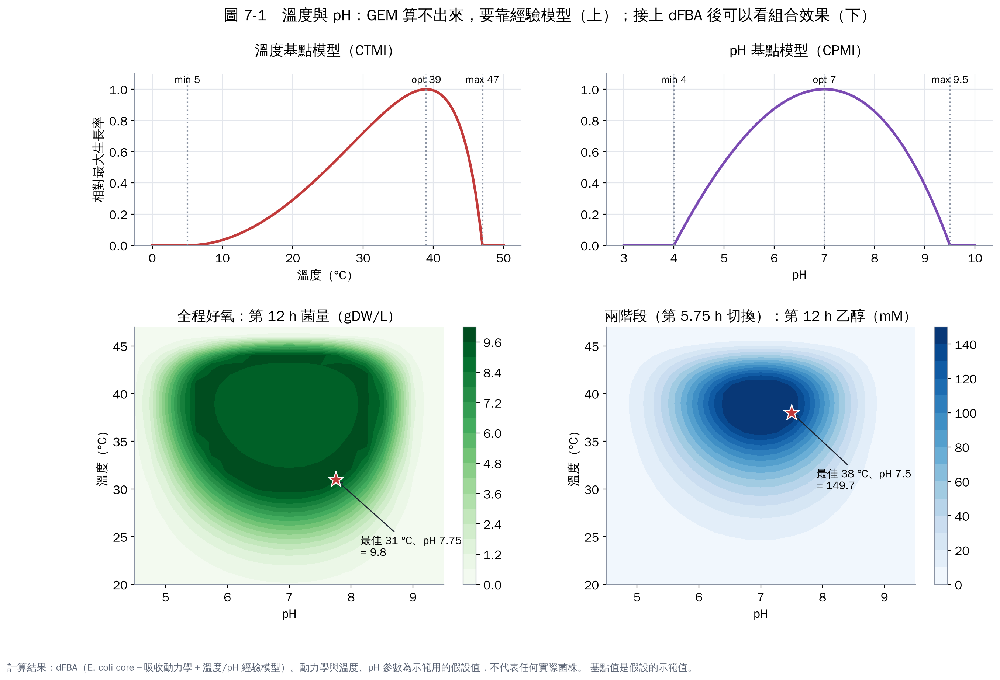
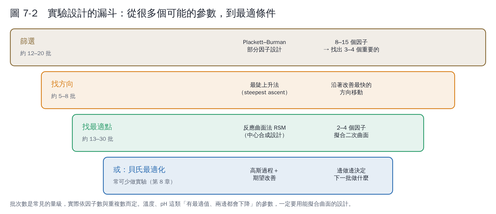

# 第 7 章　溫度、pH 與實驗設計：模型算不出來的部分

代謝模型知道「哪些反應能發生」，卻不知道溫度和 pH 會讓這些反應變快或變慢。這一章說明怎麼用經驗模型和實驗設計補上這一塊。

## 7.1 溫度與 pH 的基點模型

微生物對溫度和 pH 的反應有共通的形狀：

- 有一個最低值、一個最適值、一個最高值（三個「基點」）；
- 低於最低值或高於最高值就不長；
- 溫度曲線通常不對稱，超過最適溫度後下降得特別快。

Rosso 等人提出的基點模型只用這三個值，就能描述整條曲線：

- 溫度用 CTMI [1]；
- pH 用 CPMI [2]。

而且溫度與 pH 的效果可以相乘。這些參數都有生物意義，量起來也比較直觀。另一個常用的溫度模型是 Ratkowsky 的平方根模型 [3]。

**本教材的做法**：把基點模型算出的係數（0–1）乘在最大吸收速率上，再接進 dFBA。示範用的基點值是：

- 溫度：最低 5 °C、最適 39 °C、最高 47 °C；
- pH：最低 4.0、最適 7.0、最高 9.5。

這些值和大腸桿菌的文獻範圍相近，但是假設值。

## 7.2 組合效果：最適條件取決於目標

圖 7-1 下方是 dFBA 掃描溫度與 pH 的結果，有兩個沒那麼直覺的發現：

1. **最多菌量不在「長最快」的溫度**：
   - 全程好氧培養 12 小時，菌量最多在 31 °C、pH 7.75（9.85 gDW/L），比 37 °C 的 9.30 還多。
   - 原因是溫度低時吃糖較慢，溢流產生的乙酸較少，更多碳變成菌體；12 小時也夠把糖吃完。
   - 「長最快」和「長最多」是兩個不同的目標。
2. **改溫度，切換時間也要跟著改**：
   - 兩階段培養如果把溫度從 37 °C 降到 30 °C、但切換時間仍是 5.75 h，乙醇會從 148 mM 掉到 48 mM。
   - 原因是低溫下菌長得慢，第 5.75 小時時菌量還不夠。
   - 參數之間有交互作用，一次只調一個會被誤導（第 8 章）。

**模型沒有考慮的溫度效應**：

- 溫度升高會降低氧氣的溶解度，使供氧更困難；
- 高溫可能誘導熱休克反應；
- 某些產物在特定溫度下才會合成。

這些都要靠實驗觀察。

## 7.3 怎麼用實驗量出基點值？

1. **溫度**：
   - 在 6–8 個溫度下各做一條生長曲線（可以用多孔盤讀值儀同時做）；
   - 用第 5 章的方法算出 μmax，再用 CTMI 擬合。
   - 溫度要涵蓋到「長不起來」的兩端，最高溫附近要多取幾點。
2. **pH**：
   - 用緩衝液固定 pH（注意緩衝液本身不能被菌利用或抑制菌），步驟同上。
3. **同時改溫度和 pH**：
   - 用下面的反應曲面法設計，可以檢驗兩者是否真的能相乘；
   - Rosso 等人在大腸桿菌 O157:H7 上驗證過，相乘模型表現良好 [2]。

## 7.4 實驗設計：用最少的實驗找到最適條件

| 階段 | 方法 | 適用 | 說明 |
|---|---|---|---|
| 篩選 | Plackett–Burman 設計 [4] | 8–15 個可能的因子 | 每個因子只取高、低兩個值，用很少的實驗找出最重要的 3–4 個；不能估計交互作用 |
| 找方向 | 最陡上升法 [5] | 離最適值還很遠時 | 沿著改善最快的方向一步步移動 |
| 找最適點 | 反應曲面法（RSM），例如中心合成設計 [5] | 2–4 個因子 | 擬合二次曲面，可以估計曲率與交互作用 |
| 或：邊做邊決定 | 貝氏最適化（第 8 章） | 2–10 個因子、實驗很貴 | 每批結果出來後，決定下一批做什麼 |

**溫度、pH 這類「有最適值、兩邊都會下降」的參數，一定要用能擬合曲面的設計。** 只做高、低兩個水準，會完全錯過中間的最適值。

**常見錯誤**：

- **一次只改一個因子（OFAT）**：直覺但效率低，而且會錯過交互作用（第 8 章有實際比較）。
- **範圍設太窄**：最適值在範圍外，結果只會指向邊界。
- **沒有重複與中心點**：無法估計實驗誤差，看不出差異是真的還是誤差。
- **批次效應**：不同天的種菌狀態不同。實驗順序要隨機化，或把「批次」當成一個因子。

## 7.5 結合模型的實驗設計

有了第 3–6 章的模型之後，實驗設計可以更聰明：

1. **用模型先篩選**：
   - 代謝模型能判斷的參數（碳源、氮源、供氧、營養缺陷）先用模型排除不可能的選項；
   - 實驗只做模型算不出來的部分（溫度、pH、微量元素）。
2. **用模型決定範圍**：例如第 6 章算出的切換時間，可以把實驗範圍縮小到「最佳值 ±2 小時」。
3. **用實驗校正模型**：每一批實驗的結果都用來更新模型參數（吸收速率、基點值），模型越用越準。

## 本章重點

- 溫度與 pH 用基點模型（最低、最適、最高）描述，參數有生物意義，量起來直觀。
- 「長最快」和「長最多」的溫度可能不同；改了溫度，切換時間也要重新決定。
- 實驗設計的順序是：篩選 → 找方向 → 反應曲面法；有最適值的參數一定要用曲面設計。
- 模型先排除不可能的選項，實驗只做模型算不出來的部分。

## 參考文獻

1. Rosso L, Lobry JR, Flandrois JP (1993). An unexpected correlation between cardinal temperatures of microbial growth highlighted by a new model. *Journal of Theoretical Biology*, 162, 447–463. https://doi.org/10.1006/jtbi.1993.1099
2. Rosso L, Lobry JR, Bajard S, Flandrois JP (1995). Convenient model to describe the combined effects of temperature and pH on microbial growth. *Applied and Environmental Microbiology*, 61, 610–616. https://doi.org/10.1128/aem.61.2.610-616.1995
3. Ratkowsky DA, Olley J, McMeekin TA, Ball A (1982). Relationship between temperature and growth rate of bacterial cultures. *Journal of Bacteriology*, 149, 1–5. https://doi.org/10.1128/jb.149.1.1-5.1982
4. Plackett RL, Burman JP (1946). The design of optimum multifactorial experiments. *Biometrika*, 33, 305–325. https://doi.org/10.1093/biomet/33.4.305
5. Box GEP, Wilson KB (1951). On the experimental attainment of optimum conditions. *Journal of the Royal Statistical Society: Series B*, 13, 1–45. https://doi.org/10.1111/j.2517-6161.1951.tb00067.x
