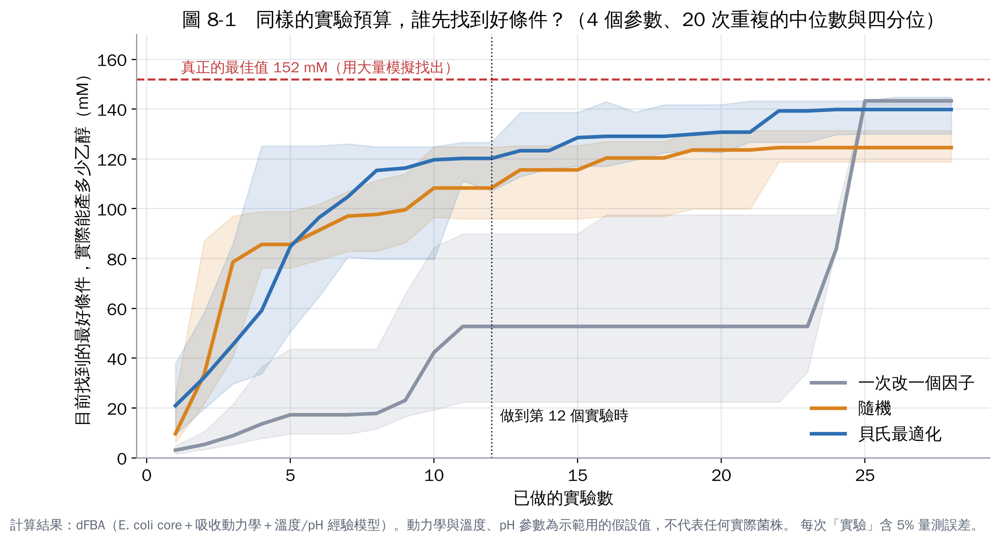
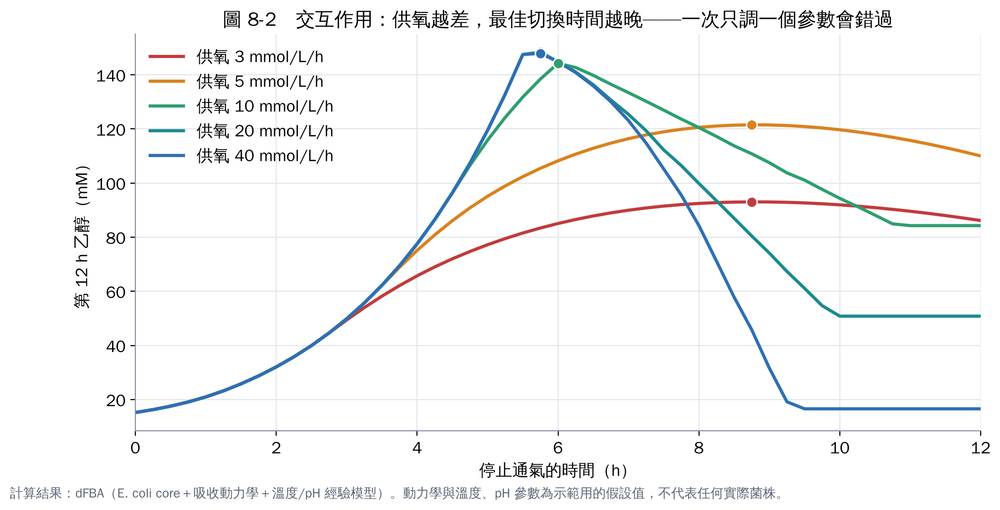
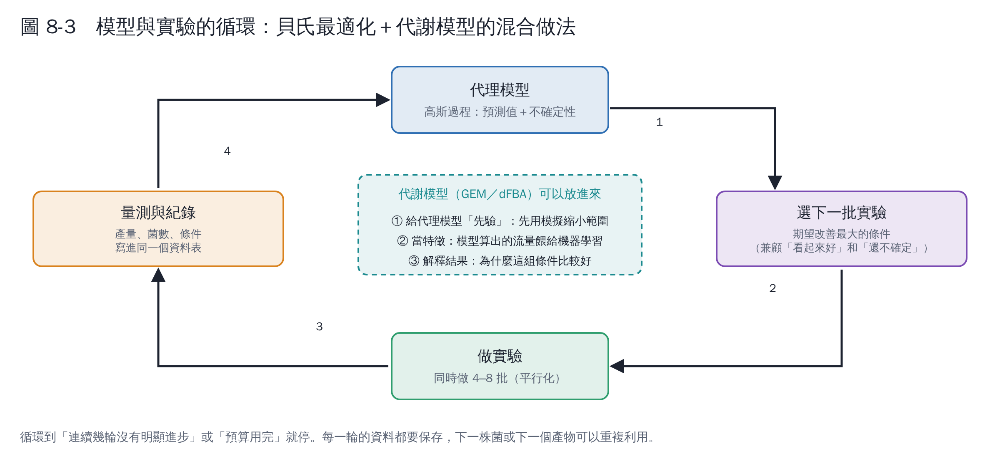

# 第 8 章　用 AI 少做實驗：貝氏最適化與主動學習

當參數有 3 個以上，而且彼此有交互作用時，靠直覺或一次改一個因子，往往要做很多實驗才找得到好條件。這一章比較三種找最適條件的方法，並說明 AI 在這裡實際能做什麼。

## 8.1 貝氏最適化是什麼？

想像你在霧中找山頂，每走一步（做一批實驗）都很貴。貝氏最適化的做法是：

1. **建一個代理模型**：通常用高斯過程，根據已做過的實驗預測「每個條件的結果大概多少」，同時給出「有多不確定」。
2. **決定下一批做什麼**：用「期望改善」等準則，同時考慮兩件事：
   - 預測結果好的地方（利用）；
   - 還很不確定的地方（探索）。
3. **做實驗、加進資料、重複**。

Shahriari 等人（2016）的綜述是入門的好讀物 [1]。這個方法在培養基與菌株設計上已有很多實例：

- **BioAutomata**：用機器人加貝氏最適化最佳化茄紅素合成路徑，評估不到 1% 的可能組合，就比隨機篩選好 77% [2]。
- **主動學習選擇性培養基**：日本團隊同時考慮「目標菌長得好」與「另一種菌長不好」[3]；同一團隊也把主動學習用在哺乳動物細胞的培養基 [4]。
- **ART 工具**：美國聯合生物能源研究所開發的推薦工具，把機器學習用在合成生物學的實驗建議 [5]。

## 8.2 實際比較：一次改一個因子、隨機、貝氏最適化

用第 6 章的 dFBA 模擬當成「實驗」，每次實驗都加上 5% 的量測誤差。條件如下：

- **要找的 4 個參數**：溫度（25–45 °C）、pH（5–9）、供氧能力（2–40）、切換時間（0–12 h）。
- **目標**：第 12 小時的乙醇濃度。
- **預算**：每種方法 28 個實驗，各重複 20 次（不同的隨機起點）。

用大量模擬找出的真正最佳值是 152 mM，條件為：39 °C、pH 7.0、供氧 18.8、第 5.3 h 切換。

| 方法 | 做到第 12 個實驗 | 做完 28 個實驗 | 20 次中最差的一次 |
|---|---|---|---|
| 一次改一個因子 | 53 mM | 143 mM（最佳值的 94%） | 97 mM |
| 隨機 | 108 mM | 125 mM（82%） | 89 mM |
| **貝氏最適化** | **120 mM** | 140 mM（92%） | **118 mM** |

（表中是 20 次重複的中位數。）

**怎麼解讀**：

1. **預算少時，貝氏最適化最好**：
   - 做到第 12 個實驗時，它已達最佳值的 79%；
   - 一次改一個因子只有 35%，因為它還在掃第二、三個參數。
2. **預算足夠時，一次改一個因子也能追上**：
   - 在這個模擬中，溫度和 pH 的效果是相乘的，交互作用不強，所以逐一掃描最後也能找到不錯的條件；
   - 但它的結果很依賴起點：運氣差時只到 97 mM。
3. **貝氏最適化最穩定**：最差的一次也有 118 mM。對實驗室來說，「不會太差」常常比「平均很好」更重要。

**這是一個誠實的比較**：貝氏最適化不是在每種情況下都大勝。參數越多、交互作用越強、每批實驗越貴時，它的優勢越明顯。

## 8.3 交互作用：一次只調一個參數會錯過什麼

| 供氧能力（mmol/L/h） | 最佳切換時間 | 第 12 h 乙醇 |
|---|---|---|
| 3 | 8.75 h | 93 mM |
| 5 | 8.75 h | 122 mM |
| 10 | 6.0 h | 144 mM |
| 20 | 5.75 h | 148 mM |
| 40 | 5.75 h | 148 mM |

供氧不足時，菌長得慢，要更晚才切換。如果你在供氧 20 的搖瓶上找到「第 5.75 小時切換」，換到裝液量較多（供氧較差）的搖瓶時直接照用，產量會掉很多。

**這就是交互作用：一個參數的最佳值，取決於另一個參數。** 一次改一個因子的方法看不到這種關係。貝氏最適化與反應曲面法會同時考慮多個參數，所以能找到。

## 8.4 模型＋機器學習：混合做法

代謝模型和機器學習各有長處，結合起來效果更好 [6]：

| 做法 | 說明 | 例子 |
|---|---|---|
| 模型當先驗 | 先用 dFBA 模擬大量條件，讓代理模型一開始就知道大概的形狀 | 減少前幾輪「盲目探索」的實驗 |
| 模型輸出當特徵 | 把模型算出的流量（例如某條路徑的流量）當成機器學習的輸入 | Zhang 等人（2020）結合機理模型與機器學習，最佳化色胺酸代謝 [7] |
| 機器學習修正模型 | 模型先算，機器學習學「模型和實驗的差距」 | 適合模型有系統性偏差時 |
| 模型解釋結果 | 機器學習找到好條件後，用代謝模型解釋為什麼 | 讓結果可以外推到新條件 |

## 8.5 自動化實驗室：把循環交給機器人

把「代理模型 → 建議實驗 → 機器人執行 → 自動量測」串起來，就是「自駕實驗室」：

- 2020 年，英國利物浦大學的移動機器人化學家在 8 天內自主完成 688 個實驗 [8]；
- 這類系統在化學與材料領域發展很快 [9]，在生物培養上也開始出現（如 BioAutomata [2]）。

**對一般實驗室的意義**：不需要機器人也能用同樣的邏輯。

- 用多孔盤或平行的小型發酵槽，一次做 4–8 個條件；
- 讓貝氏最適化建議下一批；
- 你只需要負責「做實驗和記錄」。

## 8.6 實務建議

1. **先定好目標函數**：例如「乙醇濃度」，或「乙醇濃度 − 0.1 × 乙酸濃度」。目標寫錯，最適化會很有效率地找到錯的答案。
2. **參數範圍要合理**：太窄找不到，太寬浪費實驗。用第 2 章的起始條件卡與第 3–6 章的模型決定。
3. **第一輪用空間填充設計**（例如拉丁超立方），讓代理模型先看過整個範圍。
4. **每輪做 4–8 批平行實驗**，比一次一批有效率。
5. **保留所有資料，包括失敗的實驗**：失敗的條件告訴模型「這裡不好」，同樣有價值。
6. **工具**：Python 有 scikit-optimize、BoTorch、Ax 等套件；不寫程式的話，AI 助理可以幫你寫一個「輸入結果、輸出下一批建議」的小程式。

## 本章重點

- 貝氏最適化用代理模型加上「利用與探索的平衡」，決定下一批做什麼實驗。
- 在本教材的模擬中，預算少時它明顯勝過一次改一個因子（第 12 個實驗時 120 mM 對 53 mM），而且結果最穩定；預算充足、交互作用弱時，一次改一個因子也能追上。
- 參數之間的交互作用（例如供氧與切換時間）是一次改一個因子會錯過的。
- 代謝模型可以當先驗、當特徵、當解釋工具，與機器學習互補。

## 參考文獻

1. Shahriari B, Swersky K, Wang Z, Adams RP, de Freitas N (2016). Taking the human out of the loop: a review of Bayesian optimization. *Proceedings of the IEEE*, 104, 148–175. https://doi.org/10.1109/JPROC.2015.2494218
2. HamediRad M, Chao R, Weisberg S, et al. (2019). Towards a fully automated algorithm driven platform for biosystems design. *Nature Communications*, 10, 5150. https://doi.org/10.1038/s41467-019-13189-z
3. Zhang S, Aida H, Ying BW (2023). Employing active learning in medium optimization for selective bacterial growth. *Applied Microbiology*, 3, 1355–1369. https://doi.org/10.3390/applmicrobiol3040091
4. Hashizume T, Ozawa Y, Ying BW (2023). Employing active learning in the optimization of culture medium for mammalian cells. *npj Systems Biology and Applications*, 9, 20. https://doi.org/10.1038/s41540-023-00284-7
5. Radivojević T, Costello Z, Workman K, Garcia Martin H (2020). A machine learning Automated Recommendation Tool for synthetic biology. *Nature Communications*, 11, 4879. https://doi.org/10.1038/s41467-020-18008-4
6. Zampieri G, Vijayakumar S, Yaneske E, Angione C (2019). Machine and deep learning meet genome-scale metabolic modeling. *PLoS Computational Biology*, 15, e1007084. https://doi.org/10.1371/journal.pcbi.1007084
7. Zhang J, Petersen SD, Radivojevic T, et al. (2020). Combining mechanistic and machine learning models for predictive engineering and optimization of tryptophan metabolism. *Nature Communications*, 11, 4880. https://doi.org/10.1038/s41467-020-17910-1
8. Burger B, Maffettone PM, Gusev VV, et al. (2020). A mobile robotic chemist. *Nature*, 583, 237–241. https://doi.org/10.1038/s41586-020-2442-2
9. Abolhasani M, Kumacheva E (2023). The rise of self-driving labs in chemical and materials sciences. *Nature Synthesis*, 2, 483–492. https://doi.org/10.1038/s44160-022-00231-0
