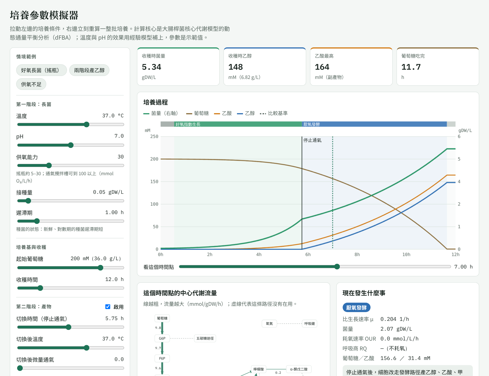
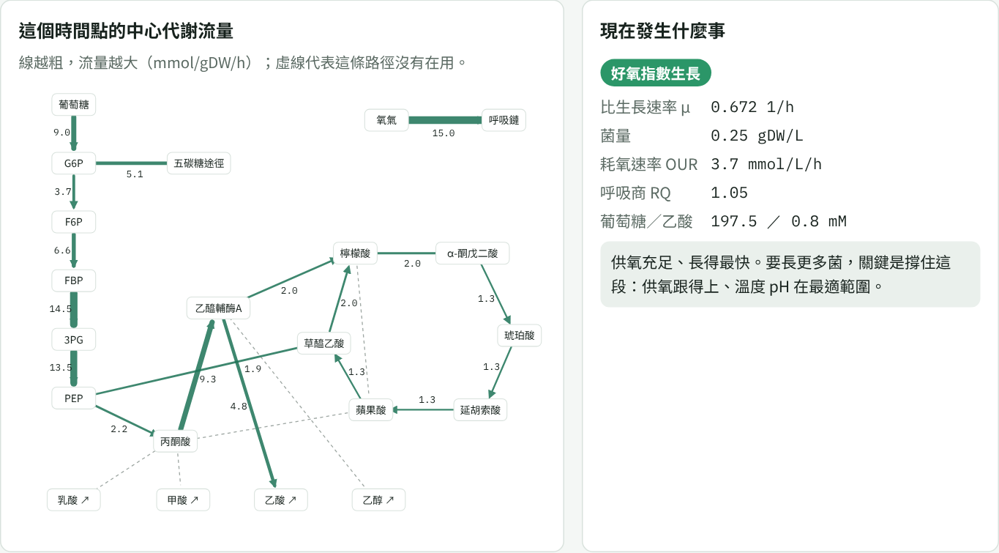
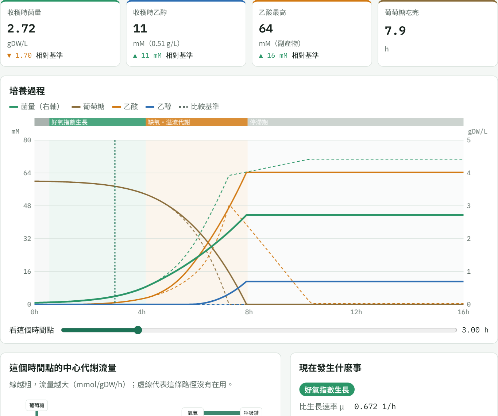
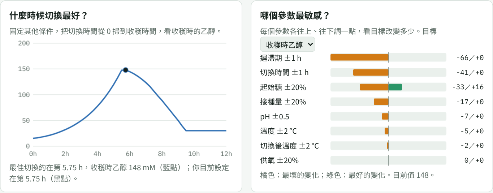

# 第 9 章　視覺化介面：拉動參數，立刻看到變化

你說你是視覺化思考的人，希望調整參數後能看到實際的變化。**這可以做到，我已經做了一個示範版。**

## 9.1 互動模擬器

**開啟方式**：

- 線上版（Claude Artifact，目前只有你的帳號能開；要分享給同事，從頁面的分享選單設定）：https://claude.ai/artifact/1RMQatnKR6smaRCX6TThNS
- 離線版：GitHub 專案中的 lessons/dna-to-culture/simulator/index.html，下載後用瀏覽器直接開啟，不需要網路，也不需要安裝。

**畫面說明**：

| 區塊 | 內容 |
|---|---|
| 左側：培養條件 | 第一階段的溫度、pH、供氧能力、接種量、遲滯期；起始葡萄糖、收穫時間；第二階段的切換時間、切換後溫度、微量通氣 |
| 上方：四個結果 | 收穫時菌量、收穫時乙醇、乙酸最高值、葡萄糖吃完的時間；設定比較基準後，會顯示增減 |
| 中間：培養過程 | 菌量、葡萄糖、乙酸、乙醇隨時間的曲線；上方色帶標出每個階段 |
| 時間滑桿 | 拖到任一時間點，下方的代謝圖與說明跟著更新 |

## 9.2 看見代謝路徑怎麼變

拖動時間滑桿時，左邊的代謝圖會即時重畫：

- **線越粗，流量越大**；虛線代表這條路徑沒有在用。
- 第 3 小時（好氧指數生長）：
  - 糖解、TCA 循環、五碳糖途徑都在運轉；
  - 氧氣大量進入呼吸鏈；
  - 已經有一部分碳流向乙酸，因為吃糖速度超過呼吸能力。
- 拖到切換之後：TCA 幾乎停止，乙醯輔酶 A 分流到乙酸與乙醇，丙酮酸經 PFL 產生甲酸。

右邊說明這個時間點的階段、比生長速率、耗氧速率、呼吸商，以及這個階段該注意什麼。

## 9.3 比較兩種條件

按「設為比較基準」把目前的結果存起來，再改參數，曲線上會出現虛線（基準）和實線（新條件）。

圖 9-3 是把供氧能力從 30 降到 8：

- 菌量少了 1.7 gDW/L；
- 乙酸最高值多了 16 mM，而且停在培養液中沒被吃回去；
- 曲線上方的色帶顯示「缺氧・溢流代謝」提早出現，接著直接進入停滯期。

## 9.4 什麼時候切換？哪個參數最敏感？

- **切換時間掃描**（左）：
  - 固定其他條件，自動試算 0 到收穫時間的每一個切換時間；
  - 藍點是最佳值，黑點是你目前的設定；
  - 改了溫度或供氧之後，最佳切換時間會跟著移動（第 8 章的交互作用）。
- **參數敏感度**（右）：
  - 每個參數各往上、往下調一點，看目標改變多少，並由大到小排序；
  - 目標可以選「收穫時乙醇」或「收穫時菌量」；
  - 橘色是最壞的變化，綠色是最好的變化。

**建議的玩法**：

1. 按「兩階段產乙醇」，把切換時間從 3 小時慢慢拉到 9 小時，看乙醇和菌量怎麼變。
2. 把收穫時間改成 16 小時，看最佳切換時間怎麼移動。
3. 把溫度降到 30 °C，看最佳切換時間變晚多少；再看敏感度排序怎麼改變。
4. 按「好氧長菌」，把目標換成「收穫時菌量」，試試降溫是否讓菌量變多（第 7 章）。

## 9.5 它是怎麼做出來的？

| 部分 | 做法 |
|---|---|
| 代謝計算 | 在電腦上用 COBRApy 對「糖吸收 × 氧吸收」與「乙酸吸收 × 氧吸收」兩張網格，各解好幾百次 pFBA，存成查表（約 300 KB） |
| 動態模擬 | 和第 5 章的 Python 程式完全相同的演算法，改寫成 JavaScript；四組測試條件下，兩者算出的菌量與乙醇完全一致 |
| 溫度、pH、遲滯期 | 第 5、7 章的經驗模型 |
| 畫圖 | 瀏覽器內建的 Canvas 與 SVG，沒有用外部函式庫 |

因為全部計算都在瀏覽器裡，拉動滑桿後會立刻重算。

## 9.6 換成你的菌，要改什麼？

1. 用你的基因體建立代謝模型（第 3 章），在 code/gem.py 改成讀你的模型。
2. 用你的實驗數據設定吸收速率、耗氧上限、溫度與 pH 基點值（第 5、7 章）。
3. 重新產生查表（python dfba.py），再執行 simulator/build.py 產生新的頁面。
4. 介面的參數、產物名稱可以依你的需求調整。

## 9.7 其他做介面的工具

| 工具 | 適合 | 說明 |
|---|---|---|
| Escher [1] | 看代謝流量 | 專門畫代謝圖的網頁工具，可直接讀 COBRApy 的結果 |
| Streamlit、Dash | 用 Python 做互動網頁 | 寫幾十行就能有滑桿和圖表；適合實驗室內部使用 |
| Jupyter＋ipywidgets | 一邊分析一邊調參數 | 適合研究階段 |
| 單一 HTML 頁面（本教材的做法） | 分享給沒有安裝任何軟體的人 | 寄一個檔案就能用 |

## 本章重點

- 互動模擬器讓你拉動溫度、pH、供氧、接種量、切換時間，立刻看到生長曲線、代謝流量、最佳切換時間與參數敏感度。
- 把代謝模型預先算成查表，就能在瀏覽器裡即時模擬。
- 換成你的菌：建模、用實驗校正參數、重新產生查表，介面可以沿用。

## 參考文獻

1. King ZA, Dräger A, Ebrahim A, Sonnenschein N, Lewis NE, Palsson BO (2015). Escher: a web application for building, sharing, and embedding data-rich visualizations of biological pathways. *PLoS Computational Biology*, 11, e1004321. https://doi.org/10.1371/journal.pcbi.1004321
