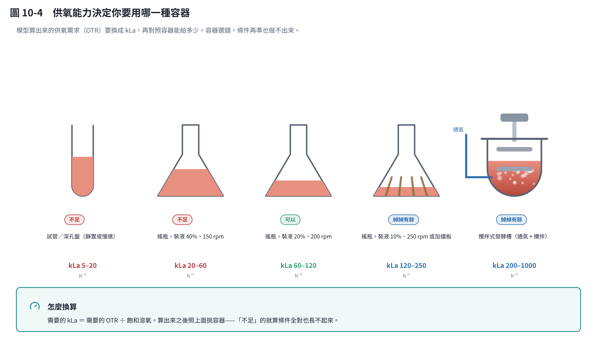
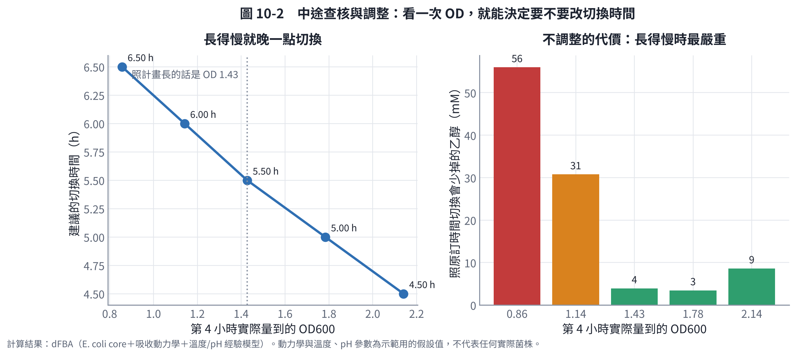
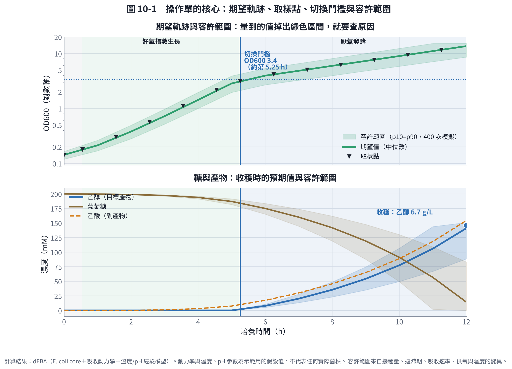
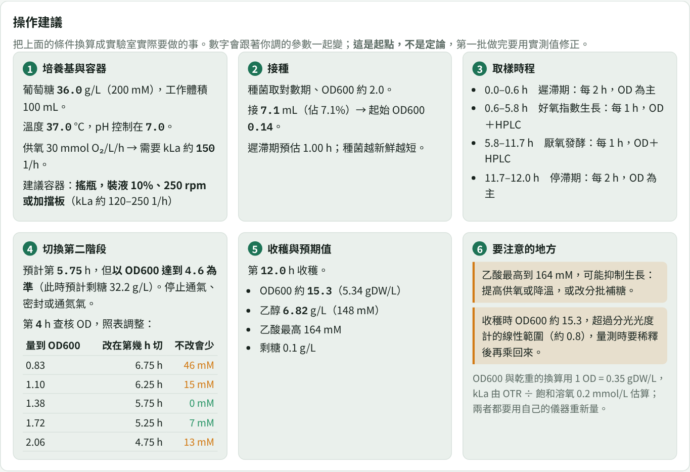

# 第 10 章　從最適條件到操作建議：模型算完之後要怎麼做

前面九章走到「找出最適條件」。但「溫度 39 °C、供氧能力 19 mmol O₂/L/h、第 5.25 小時切換」這種答案，沒辦法直接拿到實驗桌上執行：

- 供氧能力 19 是什麼意思？要用哪一種搖瓶、轉速多少？
- 要接多少種菌？
- 什麼時候取樣？
- 「第 5.25 小時切換」，但這批長得比較慢怎麼辦？
- 做出來的結果算正常還是不正常？

這一章把最適條件轉成一張**操作單**。程式在 `code/protocol.py`，第 9 章的模擬器也內建了同樣的計算（「操作建議」面板）。

## 10.1 操作單要回答的六件事

| 項目 | 模型給的 | 要換算成 |
|---|---|---|
| 培養基 | 葡萄糖 200 mM | 36.0 g/L，工作體積多少 mL |
| 供氧 | OTR 19 mmol O₂/L/h | 需要 kLa 約 95 1/h → 哪一種容器、裝液量、轉速 |
| 接種 | 起始菌量 0.05 gDW/L | 起始 OD600 0.14 → 從 OD 2.0 的種菌取 7.1 mL |
| 取樣 | 階段轉折在第 0.6、5.2 小時 | 哪幾個時間點取樣、各量什麼 |
| 切換 | 第 5.25 小時 | OD600 達到 3.4 時切換；長得慢怎麼調 |
| 判斷 | 預期乙醇 146 mM | 每個時間點的容許範圍，超出就要查原因 |

下面逐項說明怎麼算。

## 10.2 供氧能力換算成實際設備

模型講的「供氧能力」（OTR，每公升每小時能送進多少 mmol 氧氣）要換成設備語言，用的是氧氣傳送的基本式：

> OTR = kLa × (C\* − C_L)

- **kLa**（1/h）：這個容器的氧氣傳送係數，由容器、裝液量、轉速決定。
- **C\***：飽和溶氧，37 °C、1 atm 下約 0.20 mmol/L。
- **C_L**：培養液中目前的溶氧；最嚴苛的情況是接近 0。

所以 **需要的 kLa ≈ OTR ÷ 0.20**。OTR 19 → kLa 約 95 1/h。

| 容器與操作 | kLa 量級（1/h） | 對應的 OTR（mmol/L/h） |
|---|---|---|
| 試管、深孔盤（靜置或慢搖）[3] | 5–20 | 1–4 |
| 搖瓶，裝液 40%、150 rpm | 20–60 | 4–12 |
| 搖瓶，裝液 20%、200 rpm | 60–120 | 12–24 |
| 搖瓶，裝液 10%、250 rpm 或加擋板 | 120–250 | 24–50 |
| 攪拌式發酵槽（通氣＋攪拌） | 200–1000 | 40–200 |

（這些是常見的量級，會隨瓶型、搖床軌跡半徑、培養液性質而變。影響 kLa 的因素與量測方法，可參考搖瓶的系統性研究 [1] 與發酵槽放大的回顧 [2]。**你自己的設備一定要實測**，最簡單的方法是亞硫酸鈉法或動態法。）



把這張表畫成圖之後，有一件事看得比較清楚：**提高供氧最便宜的手段是「少裝液」**。同一個搖瓶，裝液從 40% 降到 10%、再加擋板，kLa 可以差一個數量級，一毛錢都不用花——代價是每瓶能做的體積變少。只有在這條路也走完了之後，才需要換設備。

所以「OTR 19」的操作建議是：**250 mL 搖瓶裝 50 mL（20%），200 rpm**。

**這一步也會告訴你「做不到」**：如果最適條件需要 kLa 500，而你只有搖床，那就不是調參數的問題，而是要換設備，或改用分批補糖降低瞬間的吃糖速度。模擬器的「要注意的地方」會直接提醒這一點。

## 10.3 接種量換算

模型用 gDW/L，實驗室用 OD600。要先做一條檢量線（不同稀釋倍率的 OD 對乾重），本教材示範值用 **1 OD600 ≈ 0.35 gDW/L**（大腸桿菌常見範圍 0.3–0.4，不同菌差很多）。

- 目標起始菌量 0.05 gDW/L → 起始 OD600 = 0.05 ÷ 0.35 ≈ **0.14**
- 種菌是對數期、OD600 2.0 → 100 mL 培養基要接 100 × 0.14 ÷ 2.0 ≈ **7.1 mL**

**種菌狀態比接種量更重要**。第 6 章的敏感度分析顯示，接種量減半會讓收穫時的乙醇少 66 mM（將近一半）；而種菌若不是對數期，遲滯期會拉長，效果等同於接種量不足。所以操作單上要寫的是「對數期、OD 約 2.0 的種菌」，不只是體積。

## 10.4 取樣時程：依階段安排，不是固定每小時

模型知道階段轉折點在哪裡，所以取樣可以**疏密有別**：

| 時段 | 階段 | 頻率 | 量什麼 |
|---|---|---|---|
| 0–0.6 h | 遲滯期 | 每 2 小時 | OD 為主 |
| 0.6–5.2 h | 好氧指數生長 | 每 1 小時 | OD ＋ HPLC（糖、有機酸） |
| 5.2–12 h | 厭氧發酵 | 每 1 小時 | OD ＋ HPLC |

原則是：**階段轉折點附近要密、穩定期可以疏**。這樣同樣的分析次數，拿到的資訊更多（第 14 章的想法 4 把這件事再往前推一步，讓模型主動指定取樣時間）。

## 10.5 切換用 OD 門檻，不要用時鐘

這是整張操作單最關鍵的一條。

**為什麼不能用時間？** 每批的種菌狀態、遲滯期都不同。如果這批慢了一小時，照第 5.25 小時切換，菌量根本還不夠。

**改成 OD 門檻**：模型算出切換當下的菌量是 1.19 gDW/L，換算成 **OD600 3.4**。操作單寫：

> 每小時量 OD，**OD600 達到 3.4 時停止通氣**（預計約在第 5.25 小時，此時剩糖約 33 g/L）。

**再加一道中途查核**：第 4 小時量一次 OD，依結果調整預計的切換時間。



| 第 4 小時量到的 OD600 | 建議改成第幾小時切換 | 照原訂時間切換會少掉 |
|---|---|---|
| 0.86（比預期慢很多） | 6.50 h | 56 mM |
| 1.14 | 6.00 h | 31 mM |
| **1.43（照計畫）** | **5.50 h** | 4 mM |
| 1.78 | 5.00 h | 3 mM |
| 2.14（比預期快） | 4.50 h | 9 mM |

**怎麼看這張表**：

- 長得慢時**一定要延後切換**，不調整會少掉三分之一以上的產物。
- 長得快時提早切換的效益比較小（少掉 9 mM），因為菌量夠了，早切晚切差別不大。
- 這張表就是「不對稱」的具體證據：**寧可晚切，不要早切**（第 6 章的切換曲線也是這個形狀）。

這張表是模型算出來的，不是經驗法則：對每一種「長得快慢」的情境，重新掃描一次最佳切換時間。換你的菌、換你的目標，重跑 `protocol.py` 就會得到你自己的對照表。

## 10.6 容許範圍：怎麼知道這批正不正常

只給「預期值」不夠用，因為實驗一定有變異。做法是把變異丟進模型，跑 400 次模擬，取第 10 到第 90 百分位當作**容許範圍**：

- 接種量 ±20%
- 遲滯期 ±0.5 小時
- 最大吸收速率 ±10%
- 供氧能力 ±20%
- 溫度 ±0.5 °C



| 時間 | OD600 容許範圍 | 乙醇容許範圍（mM） |
|---|---|---|
| 2 h | 0.28–0.50 | 0 |
| 4 h | 1.00–1.96 | 0 |
| 6 h | 2.68–5.35 | 5–11 |
| 8 h | 3.95–8.12 | 23–49 |
| 10 h | 5.84–12.36 | 50–107 |
| 12 h | 8.58–15.30 | 88–151 |

**怎麼用**：

- 量到的值在範圍內 → 照計畫走。
- 掉到範圍外 → 停下來查原因，查完再決定要不要調整（見下一節）。
- 範圍很寬（例如收穫時乙醇 88–151 mM，相差 1.7 倍）本身就是重要資訊：**它告訴你這個製程對變異很敏感**，要先把接種與供氧的重現性做好，再談最適化。

這也是判斷「模型準不準」的方法：如果連續三批都在容許範圍外同一個方向，那不是實驗做壞，而是**模型要重新校正**。

## 10.7 異常處置表

| 觀察到 | 可能原因 | 處置 |
|---|---|---|
| OD 低於容許範圍下緣 | 種菌狀態差、遲滯期過長、接種量不足、溫度偏低 | 依 10.5 的對照表延後切換；下一批改用對數期種菌、提高接種量 |
| OD 正常但乙酸比預期高 | 供氧不足，進入溢流代謝 | 提高轉速或降低裝液量；或降溫減慢吃糖速度 |
| 溶氧一直是 0、耗氧貼在上限 | 供氧已達設備極限 | 換 kLa 更高的容器；或改分批補糖 |
| 切換後產物上升很慢 | 厭氧不完全、溫度或 pH 偏離、菌量不足 | 確認密封與通氮；確認 pH 控制；回頭查 OD 是否真的到門檻 |
| 糖提早吃完 | 起始糖不足或菌量超出預期 | 提前收穫或補糖；下一批提高起始糖 |
| 收穫時糖還剩很多 | 切換太早、菌量不足、產物或乙酸抑制 | 依對照表延後切換；檢查抑制濃度 |
| 批次之間差異大 | 種菌、裝液量、轉速沒有固定 | 固定並記錄所有條件；種菌流程標準化 |

## 10.8 產生出來的操作單長什麼樣子

執行 `python protocol.py`，會印出可以直接貼在實驗桌上的操作單：

```
目標：第 12 小時收穫，乙醇約 6.7 g/L（146 mM）

【1】培養基與容器
  葡萄糖 36.0 g/L（200 mM），工作體積 100 mL
  溫度 39.0 °C，pH 控制在 7.0
  供氧需求：OTR 19 mmol O₂/L/h → 需要 kLa 約 95 1/h
    建議容器：搖瓶，裝液 20%、200 rpm（kLa 約 60–120 1/h）

【2】接種
  種菌 OD600 2.0（對數期），取 7.1 mL
  → 起始 OD600 0.14（接種比例 7.1%）

【3】取樣時程
  0.0–0.6 h　遲滯期：每 2 小時，OD
  0.6–5.2 h　好氧指數生長：每 1 小時，OD＋HPLC
  5.2–12.0 h　厭氧發酵：每 1 小時，OD＋HPLC

【4】切換（第二階段）
  預計第 5.25 小時，但以 OD600 達到 3.4 為準
  （此時預計剩糖 33.2 g/L）→ 停止通氣，密封或通氮氣
  ...
```

在第 9 章的模擬器裡，同一張操作單會跟著你拉動的參數即時更新：



## 10.9 誠實說明這張操作單的限制

**模型能算的**：體積、濃度、接種量、取樣時機、切換門檻、預期軌跡與容許範圍。這些都是從你輸入的參數推出來的算術與模擬。

**模型不能算的，要你補**：

| 項目 | 為什麼模型算不出來 |
|---|---|
| OD 與乾重的換算 | 每株菌、每台分光光度計都不同，要自己做檢量線 |
| 設備的實際 kLa | 表中是量級，實際值依瓶型與搖床而異，要實測 |
| 培養基的微量成分 | 代謝模型只處理主要碳氮源，維生素與微量元素要靠近緣菌的配方與實驗 |
| 滅菌、無菌操作、pH 控制方式 | 屬於實驗技術，不在模型範圍 |
| 抑制濃度 | 產物或副產物累積到多少會抑制，本教材的模型沒有包含，要實驗量 |
| 生物安全與廢棄物處理 | 依菌株等級與法規（第 12 章） |

**正確的用法**：把這張操作單當成**第一批的起點與對照基準**，不是標準作業程序。做完第一批，用實測值更新模型參數，操作單會越來越準。這就是第 12 章「最適化循環」的日常樣貌。

## 本章重點

- 最適條件要經過換算才能執行：供氧能力 → kLa → 容器與轉速；菌量 → OD600 → 種菌體積。
- 切換要用 **OD 門檻**觸發，不要用時鐘；再加一道中途查核，長得慢就延後切換（不調整會少掉三分之一以上的產物）。
- 取樣依階段疏密有別，轉折點附近要密。
- 用蒙地卡羅算出容許範圍，當作「這批正不正常」的判斷依據；連續三批同方向偏離，代表模型該重新校正。
- 模型算不出來的（OD 檢量線、實際 kLa、微量成分、抑制濃度、無菌操作）要由你補上。

## 參考文獻

1. Maier U, Büchs J (2001). Characterisation of the gas–liquid mass transfer in shaking bioreactors. *Biochemical Engineering Journal*, 7, 99–106. https://doi.org/10.1016/S1369-703X(00)00107-8
2. Garcia-Ochoa F, Gomez E (2009). Bioreactor scale-up and oxygen transfer rate in microbial processes: an overview. *Biotechnology Advances*, 27, 153–176. https://doi.org/10.1016/j.biotechadv.2008.10.006
3. Duetz WA (2007). Microtiter plates as mini-bioreactors: miniaturization of fermentation methods. *Trends in Microbiology*, 15, 469–475. https://doi.org/10.1016/j.tim.2007.09.004
4. Mahadevan R, Edwards JS, Doyle FJ (2002). Dynamic flux balance analysis of diauxic growth in *Escherichia coli*. *Biophysical Journal*, 83, 1331–1340. https://doi.org/10.1016/S0006-3495(02)73903-9
