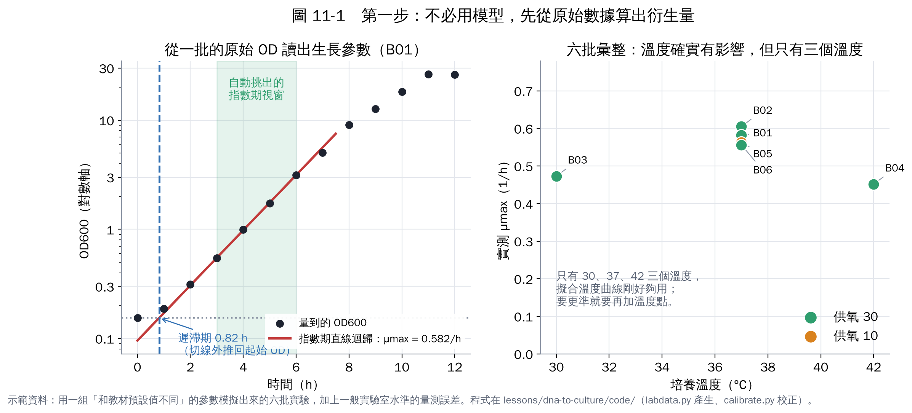
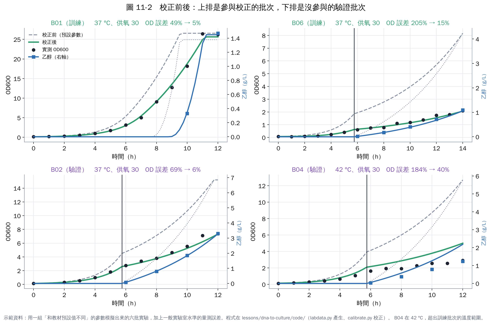
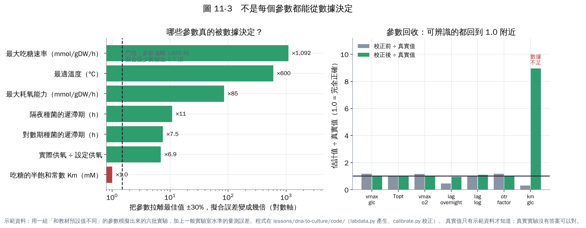

# 第 11 章　把實驗數據餵回模型：資料怎麼整理、參數怎麼校正

第 10 章產生了操作單，你照著做了實驗。接下來最關鍵的一步是：**把實測數據餵回模型，讓它下一次更準**。

這一章回答三個問題：

1. 實驗時要記什麼、怎麼記，數據才餵得回去？
2. 原始數據（OD、HPLC 數值）要怎麼變成模型需要的參數？
3. 怎麼知道校正後的模型真的變準了，而不是只是「背過答案」？

程式在 `code/calibrate.py`，示範資料在 `code/example-data/`（兩個 CSV，可以直接當範本）。

## 11.1 兩張表就夠了

不要用一張大表。**條件和量測分開記**，是整個流程能自動化的關鍵。

### 表一：`batches.csv`——每批一列

| 欄位 | 例子 | 為什麼需要 |
|---|---|---|
| `batch_id` | B01 | 唯一識別，兩張表靠它連起來 |
| `date` | 2026-11-03 | 追溯用；也能看出批次效應 |
| `strain` | WT | 換菌株時要分開 |
| `seed_state` | 對數期／隔夜培養 | **決定遲滯期**，最常被漏記 |
| `medium` | M9 | 培養基配方編號 |
| `glucose_g_L` | 36.0 | 起始糖，模型的初始條件 |
| `volume_mL` | 50 | 工作體積 |
| `vessel` | 250 mL 搖瓶 | 和轉速一起決定供氧 |
| `temperature_C` | 37.0 | 模型輸入 |
| `pH` | 7.0 | 模型輸入 |
| `rpm` | 200 | 供氧的來源 |
| `otr_setting_mmol_L_h` | 30 | 換算後的設定供氧（第 10 章） |
| `inoc_od600` | 0.14 | 起始菌量 |
| `switch_h` / `switch_action` | 5.75 ／ 停止通氣 | 分階段培養的切換紀錄 |
| `harvest_h` | 12.0 | 收穫時間 |
| `note` | 種菌為隔夜培養 | 任何異常 |

### 表二：`samples.csv`——每次取樣一列

| 欄位 | 例子 | 備註 |
|---|---|---|
| `batch_id` | B01 | 連到表一 |
| `time_h` | 4.0 | **接種後經過的小時數**，不是時鐘時間 |
| `od600` | 0.999 | 稀釋過的要先乘回來 |
| `glucose_g_L` | 36.27 | 沒測就留空，不要填 0 |
| `ethanol_g_L` | 0.0 | 真的是 0（低於偵測極限）才填 0 |
| `acetate_g_L` | 0.109 | |
| `note` | 搖床門被打開約 10 分鐘 | 事件紀錄 |

**五個最容易犯的錯**：

1. **「沒測」和「測到 0」混在一起**。沒測要留空白，測到低於偵測極限才填 0。模型校正時這兩者的處理完全不同。
2. **用時鐘時間而不是培養時數**。跨午夜就會亂掉。
3. **OD 沒把稀釋倍率乘回來**，或忘了記稀釋倍率。
4. **單位混用**：有的批用 g/L、有的用 mM；有的用 OD、有的用乾重。**整個資料夾只用一套單位**，換算寫在程式裡。
5. **條件寫在實驗記錄本、沒進表**。模型看不到的條件，就等於不存在。

## 11.2 資料品質檢查：先別急著校正

`calibrate.py` 讀進資料後會先做檢查。對示範資料，它報出四件事：

```
[注意] B02 od600：1 個時間點沒有 OD（會自動略過，但指數期缺點會影響 μmax）
[註記] B02 t=1h：未取樣
[注意] B04 glucose：第 6→8 h 糖從 32.0 升到 35.9 g/L（量測誤差或稀釋錯誤）
[註記] B04 t=6h：搖床門被打開約 10 分鐘
```

檢查的項目與理由：

| 檢查 | 在找什麼 |
|---|---|
| 必要欄位齊全 | 缺溫度或起始糖，這批就不能用於校正 |
| 缺漏值的位置 | 指數期缺點會直接影響 μmax 的估計 |
| 起始 OD 對不對得上 | 條件表寫 0.14、實測 0.3，代表接種或記錄有誤 |
| 糖是否單調下降 | 上升超過量測誤差，是 HPLC 或稀釋出問題 |
| 碳收支 | 吃掉的糖，有沒有大致對應到菌體＋產物（其餘是 CO₂）。回收率低於 35% 或高於 115% 就要查 |
| 事件註記 | 停電、搖床停止、污染——這些點可能要排除 |

**碳收支是最有用的一項**。它用的是質量守恆：葡萄糖的碳不會消失，只會變成菌體、產物或 CO₂。對不上就代表某個量測有系統性誤差。

## 11.3 第一步：不用模型，先算衍生量

拿到乾淨的數據，**先算出不需要模型就能得到的量**。這些數字本身就能回答很多問題，也是後面檢查模型的依據。



**怎麼從一批數據算出生長參數**（圖 11-1 左）：

1. 把 OD 取對數，畫對時間。
2. 自動掃過所有「連續 4 點」的視窗，找斜率最大且線性良好（R² > 0.95）的那一段，這就是**指數期**，斜率就是 μmax。
3. 把這條直線往回延伸，與起始 OD 的水平線交會的時間，就是**遲滯期**。

六批的結果：

| 批次 | 溫度 | 設定供氧 | μmax（1/h） | 遲滯期（h） | Yxs（gDW/g 糖） |
|---|---|---|---|---|---|
| B01 | 37 | 30 | 0.582 | 0.82 | 0.242 |
| B02 | 37 | 30 | 0.605 | 0.73 | 0.144 |
| B03 | 30 | 30 | 0.473 | 0.67 | 0.139 |
| B04 | 42 | 30 | 0.452 | 0.00 | 0.125 |
| B05 | 37 | 10 | 0.563 | 0.70 | 0.199 |
| B06 | 37 | 30 | 0.556 | **1.93** | 0.150 |

馬上看得出兩件事：

- **B06 的遲滯期 1.93 小時**，是其他批的兩倍多——因為它用的是隔夜種菌。這驗證了第 10 章「種菌狀態比接種量更重要」。
- **30 °C 和 42 °C 的 μmax 都比 37 °C 低**，最適溫度在中間。但只有三個溫度點，要更準就要再加溫度。

## 11.4 第二步：校正模型參數

現在把數據餵給模型。做法是**最小平方法**：調整模型參數，讓模型預測的曲線盡量貼近所有實測點。

**要校正哪些參數？** 不是全部。只挑「真的不確定、而且數據有機會決定」的：

| 參數 | 預設值 | 為什麼要校正 |
|---|---|---|
| 最大吃糖速率 | 10.0 | 每株菌都不同，最關鍵 |
| 吃糖的 Km | 0.015 | 文獻值範圍很大 |
| 最大耗氧能力 | 15.0 | 決定什麼時候開始溢流代謝 |
| 實際供氧 ÷ 設定供氧 | 1.0 | 設定值和實際一定有落差 |
| 最適溫度 | 39.0 | 第 7 章說過，基因體算不準 |
| 遲滯期（兩種種菌各一） | 1.0 | 直接從數據量得到 |

**殘差怎麼算**：用相對誤差，並依量測精度加權（OD 5%、HPLC 4%）。這樣 OD 26 的點和 OD 0.3 的點才會有相當的影響力；如果用絕對誤差，整個擬合會被大數字主導。

**最重要的規矩：留一部分批次不參與校正。**

- 訓練批次：B01、B03、B05、B06（涵蓋不同溫度、不同供氧、不同種菌狀態）
- 驗證批次：B02、B04（完全不參與校正）



結果（相對誤差 RMSE）：

| | OD600 | 葡萄糖 | 乙醇 | 乙酸 |
|---|---|---|---|---|
| 訓練批次・校正前 | 111% | 32% | 181% | 134% |
| 訓練批次・校正後 | **9%** | **3%** | **4%** | **3%** |
| 驗證批次・校正前 | 141% | 40% | 236% | 256% |
| 驗證批次・校正後 | 29% | 7% | 46% | 69% |

**怎麼解讀**：

- 校正後訓練批次誤差從 100% 以上降到 10% 以內，模型確實學到了這株菌。
- **驗證批次的誤差比訓練批次大，這是正常且誠實的**。如果兩者一樣好，反而要懷疑是不是驗證資料不小心參與了校正。

## 11.5 最重要的發現：模型只在你校正過的範圍內可信

拆開來看每一批：

| 批次 | 角色 | 條件 | OD 誤差（校正前 → 後） |
|---|---|---|---|
| B01 | 訓練 | 37 °C、供氧 30 | 49% → 5% |
| B03 | 訓練 | 30 °C、供氧 30 | 46% → 7% |
| B05 | 訓練 | 37 °C、供氧 10 | 37% → 5% |
| B06 | 訓練 | 37 °C、隔夜種菌 | 205% → 15% |
| **B02** | **驗證** | 37 °C、兩階段 | 69% → **6%** |
| **B04** | **驗證** | **42 °C**、兩階段 | 184% → **40%** |

- **B02 幾乎和訓練批次一樣準**（OD 6%、乙醇 1%）。它的溫度與供氧都在訓練批次涵蓋的範圍內，只是切換時間不同——模型對這種內插很可靠。
- **B04 明顯差**（OD 40%、乙醇 65%）。原因是訓練批次只有 30 °C 和 37 °C，**42 °C 是外推**，而且接近這株菌的生長上限，溫度曲線在那裡最陡。

這和第 5 章「樹模型不會外推」、第 8 章「參數範圍要合理」是同一件事的不同面向：

> **模型在你做過實驗的條件範圍內可信；超出範圍就是猜測。**

實務上的做法：

1. 在操作單上標示模型的有效範圍（例如「溫度 28–38 °C、供氧 8–32」）。
2. 要用到範圍外的條件時，**先做一批實驗驗證**，再把它加進訓練資料。
3. 範圍外的預測可以用來排序（哪個方向比較有希望），不要當成定量答案。

## 11.6 不是每個參數都能從數據決定

校正程式會找出一組讓誤差最小的參數，但**「找得到」不等於「可信」**。有些參數不管怎麼改，對預測幾乎沒影響——這時候擬合出來的值只是在配合雜訊。

檢查方法：把每個參數單獨拉離最佳值 ±30%，看擬合誤差變差多少。



| 參數 | 校正值 | 真實值 | 拉離 ±30% 時誤差變成 | 判定 |
|---|---|---|---|---|
| 最大吃糖速率 | 8.64 | 8.5 | ×1,092 | 可辨識 |
| 最適溫度 | 38.3 | 37.5 | ×600 | 可辨識 |
| 最大耗氧能力 | 13.01 | 13.0 | ×85 | 可辨識 |
| 隔夜種菌遲滯期 | 2.08 | 2.2 | ×11 | 可辨識 |
| 對數期種菌遲滯期 | 1.10 | 1.0 | ×7.5 | 可辨識 |
| 實際供氧倍率 | 0.84 | 0.85 | ×6.9 | 可辨識 |
| **吃糖的 Km** | **0.448** | **0.05** | **×1.0** | **數據不足** |

（真實值只有示範資料才知道，是用來評分的。真實實驗沒有答案可以對，所以才更要做這個檢查。）

**可辨識的六個參數都回到真實值附近**，誤差在 2% 以內（最適溫度差 0.8 °C）。

**Km 完全錯了**（0.448 vs 0.05，差 9 倍），而且拉離 ±30% 對擬合毫無影響。原因很直接：**批次培養中，糖的濃度幾乎全程遠高於 Km**，只有最後糖快吃完的幾分鐘才會受 Km 影響，而那時剛好沒取樣點。

**這是好消息也是壞消息**：

- 好消息：Km 不準不影響批次培養的預測，因為它在這個情境下本來就不重要。
- 壞消息：如果你之後要做**分批補料**（讓糖維持在低濃度），Km 就變成關鍵參數，而你現有的數據決定不了它。要量 Km，必須另外做恆化器實驗或低糖濃度的實驗。

**通則**：**一個參數能不能被決定，取決於你的實驗有沒有涵蓋它會發揮作用的條件。** 這也反過來告訴你下一批實驗該做什麼——想要哪個參數變準，就設計一個那個參數會主導結果的實驗。

同樣的道理，示範資料裡**最適 pH 沒有被校正**，因為六批只有一批 pH 不是 7.0，數據不足以決定它。要校正 pH，就要像溫度一樣，做幾批不同 pH 的實驗。

## 11.7 完整的回饋流程

| 步驟 | 做什麼 | 工具 |
|---|---|---|
| 1 | 依第 10 章的操作單做實驗，所有條件與量測進兩張 CSV | 試算表或實驗室資訊系統 |
| 2 | 資料品質檢查：缺漏、單調性、碳收支、事件 | `calibrate.py` 的 `check()` |
| 3 | 算衍生量：μmax、遲滯期、產率 | `derive()` |
| 4 | 選擇要校正的參數，分訓練／驗證批次 | 你決定（看 11.4 的原則） |
| 5 | 最小平方校正 | `fit()` |
| 6 | 用驗證批次評估，逐批看 | `rmse_rel()` |
| 7 | 檢查哪些參數真的被決定 | `sensitivity()` |
| 8 | 更新模型參數，重新產生操作單與模擬器 | `protocol.py`、`simulator/build.py` |
| 9 | 記下這次用了哪些批次、模型版本、有效範圍 | 版本紀錄 |

**版本紀錄要包含什麼**：

- 模型版本編號與日期；
- 用了哪些批次校正（列出 batch_id）；
- 校正後的參數值；
- 訓練與驗證誤差；
- **有效範圍**（溫度、pH、供氧、起始糖各自的上下限）；
- 已知的限制（例如「Km 未被決定，不適用於分批補料」）。

沒有這份紀錄，半年後你會不知道手上的模型是用哪些數據校正的，也不敢用它。

## 11.8 什麼時候該重新校正？

| 情況 | 要不要重新校正 |
|---|---|
| 換菌株、換菌種 | 要，而且要從第 2 章重新開始 |
| 換培養基配方 | 要 |
| 換容器或搖床（供氧改變） | 要校正供氧倍率，其他參數通常不用 |
| 累積了 5 批以上新數據 | 建議，並比較新舊版本在同一組驗證批次上的表現 |
| 連續三批實測都偏離容許範圍同一個方向 | 要（第 10 章的訊號） |
| 只是換切換時間或起始糖 | 不用，這是模型的輸入，不是參數 |

**重新校正時要用相同的驗證方式**：把新資料加進去之後，仍然要留一部分不參與校正。而且新版本要在**同一組驗證批次**上比舊版本好，才值得換掉。

## 本章重點

- 資料分兩張表：條件表（每批一列）、量測表（每次取樣一列），靠 `batch_id` 連結。「沒測」要留空白，不要填 0。
- 校正前先做品質檢查，碳收支最能抓出系統性誤差。
- 先算不需要模型的衍生量（μmax、遲滯期、產率），它們本身就有用，也是檢查模型的依據。
- 一定要留驗證批次。示範資料中，校正讓訓練誤差從 111% 降到 9%，驗證批次降到 29%。
- **模型只在校正過的條件範圍內可信**：內插的驗證批次誤差 6%，外推到 42 °C 的批次誤差 40%。
- 檢查參數可辨識性。示範資料中六個參數回到真實值附近，但 Km 完全無法從批次數據決定——因為糖濃度全程遠高於 Km。
- 想讓某個參數變準，就設計一個那個參數會主導結果的實驗。

## 參考文獻

1. Kreutz C, Timmer J (2009). Systems biology: experimental design. *FEBS Journal*, 276, 923–942. https://doi.org/10.1111/j.1742-4658.2008.06843.x
2. Raue A, Kreutz C, Maiwald T, et al. (2009). Structural and practical identifiability analysis of partially observed dynamical models by exploiting the profile likelihood. *Bioinformatics*, 25, 1923–1929. https://doi.org/10.1093/bioinformatics/btp358
3. Villaverde AF, Barreiro A, Papachristodoulou A (2016). Structural identifiability of dynamic systems biology models. *PLoS Computational Biology*, 12, e1005153. https://doi.org/10.1371/journal.pcbi.1005153
4. Zwietering MH, Jongenburger I, Rombouts FM, van 't Riet K (1990). Modeling of the bacterial growth curve. *Applied and Environmental Microbiology*, 56, 1875–1881. https://doi.org/10.1128/aem.56.6.1875-1881.1990
5. Wilkinson MD, Dumontier M, Aalbersberg IJ, et al. (2016). The FAIR Guiding Principles for scientific data management and stewardship. *Scientific Data*, 3, 160018. https://doi.org/10.1038/sdata.2016.18
6. Mahadevan R, Edwards JS, Doyle FJ (2002). Dynamic flux balance analysis of diauxic growth in *Escherichia coli*. *Biophysical Journal*, 83, 1331–1340. https://doi.org/10.1016/S0006-3495(02)73903-9
