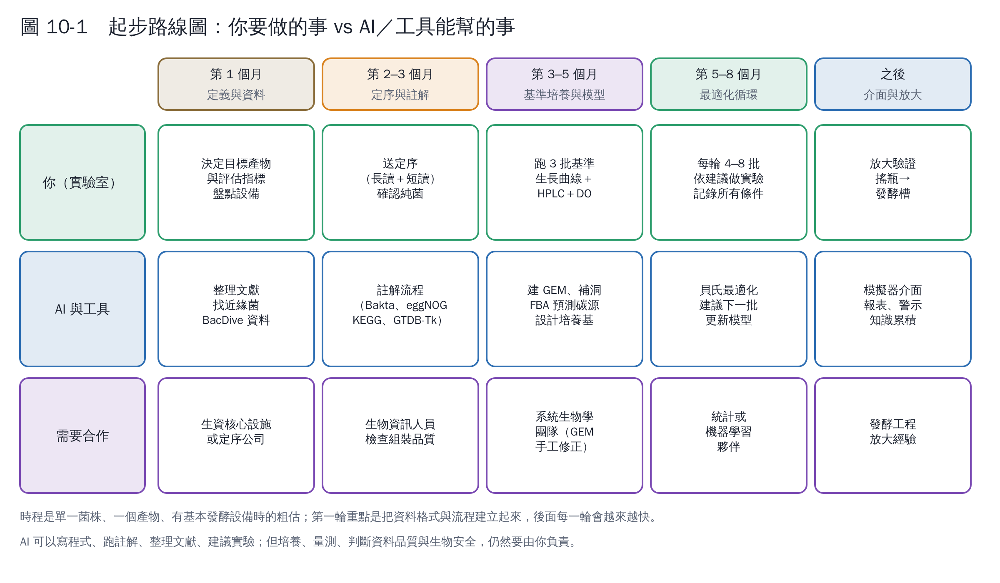

# 第 11 章　怎麼開始：步驟、分工與常見陷阱

這一章把前面的內容整理成可以照著做的步驟。

## 10.1 八個步驟

**步驟 1　定義問題（第 1 個月）**

- 寫下主要目標：菌量、產物濃度、生產速率或產率，選一個；其他當限制條件（例如乙酸不超過多少）。
- 盤點設備：
  - 搖瓶或發酵槽？
  - 能不能線上量溶氧、pH？
  - 有沒有 HPLC 或其他分析儀器？
  - 多孔盤讀值儀能不能控溫、測 OD？
- 確認菌株的生物安全等級與實驗室規定 [1, 2]。

**步驟 2　定序與註解（第 2–3 個月）**

- 確認是純菌：劃單一菌落、顯微鏡檢查、16S 定序。
- 送全基因體定序，建議長讀加短讀。
- 跑註解流程（第 2 章），整理「起始條件卡」：
  - 近緣菌株的培養條件（BacDive、MediaDive）；
  - 營養缺陷；
  - 能用的碳源。

**步驟 3　建立代謝模型（第 3 個月起）**

- 用 CarveMe 或 gapseq 產生草稿，定義你的培養基，做品質檢查（第 3 章）。
- 用模型預測：能用的碳源、需要的營養、不同供氧下的產物（第 4 章）。

**步驟 4　基準培養（第 3–5 個月）**

- 在目前慣用的條件下，完整做 3 批培養，量測：
  - OD；
  - 糖與產物；
  - 溶氧與 pH；
  - 能的話加上尾氣。
- 標出階段，算出 μmax、遲滯期、產率、吸收速率（第 5 章）。
- 用這些數據校正模型：模型的生長曲線和實驗的差距多大？

**步驟 5　找關鍵參數（第 5 個月）**

- 用模型做敏感度分析，或用 Plackett–Burman 篩選實驗，找出 2–4 個關鍵參數（第 6、7 章）。
- 量溫度與 pH 的基點值（第 7 章）。

**步驟 6　最適化循環（第 5–8 個月）**

- 每輪 4–8 批平行實驗，用貝氏最適化或反應曲面法決定條件（第 8 章）。
- 如果有分階段，先決定切換規則，再一起最適化切換時間與各階段參數（第 6 章）。

**步驟 7　驗證與放大**

- 最佳條件重複至少 3 批。
- 換到發酵槽時，重新確認和供氧有關的參數。

**步驟 8　建立介面與持續累積**

- 把校正後的模型做成模擬器（第 9 章），讓團隊成員都能試算。
- 每一批新資料都加回資料表，模型越用越準。

## 10.2 你要收集的 vs AI 能幫的

| 項目 | 你（實驗室）要做 | AI／工具能幫 |
|---|---|---|
| 菌株 | 確認純菌、保存種菌（甘油管）、記錄來源 | — |
| 定序 | 萃取高品質 DNA、送定序 | 選擇定序方式、解讀定序報告 |
| 註解 | 確認結果合理 | 寫流程腳本、執行工具、整理 KEGG 路徑、比對文獻 |
| 文獻 | 判斷哪些研究和你的菌最相關 | 搜尋、摘要、整理成表格、找近緣菌株的培養條件 |
| 代謝模型 | 提供培養基成分與實驗數據 | 產生草稿、補洞、跑 FBA、畫流量圖 |
| 實驗 | 培養、取樣、量測、**記錄所有條件** | 實驗設計、決定下一批條件 |
| 資料分析 | 判斷資料品質（異常值、汙染） | 擬合生長曲線、統計分析、畫圖 |
| 最適化 | 執行建議的實驗 | 更新代理模型、建議下一批 |
| 介面 | 決定要看哪些參數與指標 | 寫程式、做模擬器 |

**AI 的限制**：

- AI 不知道你的培養箱溫度是否準確、這批種菌是否健康、某個數據點是不是汙染造成的；
- 它的文獻摘要也可能有錯，重要的數字要回到原文確認。

**資料品質的判斷，一定要由你負責。**

## 10.3 資料表：從第一天就統一格式

所有實驗用同一個格式記錄，之後才能拿來訓練模型。建議每一批培養一列「條件」、多列「量測」：

**條件表（每批一列）**

| 欄位 | 例子 |
|---|---|
| 批次編號 | 2026-11-03-A |
| 菌株與種菌狀態 | WT，對數期種菌，OD 2.1 |
| 培養基 | M9＋葡萄糖 20 g/L（附配方編號） |
| 容器與裝液量 | 250 mL 搖瓶，50 mL |
| 溫度、轉速、初始 pH | 37 °C、200 rpm、pH 7.0 |
| 接種量 | 起始 OD 0.05 |
| 階段與切換 | 第 6 h 停止通氣 |
| 備註 | 培養箱 B，第 4 h 停電 10 分鐘 |

**量測表（每次取樣一列）**

| 批次編號 | 時間（h） | OD600 | 葡萄糖（g/L） | 產物（g/L） | 乙酸（g/L） | pH | 溶氧（%） |
|---|---|---|---|---|---|---|---|

**原則**：

- 記錄「取樣時間」，不是分析時間；
- 失敗的批次也要記；
- 單位統一；
- 原始檔案（HPLC 圖譜、讀值儀檔案）保留。

## 10.4 常見陷阱

| 陷阱 | 後果 | 預防 |
|---|---|---|
| 菌不純 | 註解混到別的菌；實驗結果無法重現 | 定序前後都確認；保存單一菌落來源的種菌 |
| 只用 16S 序列 | 無法做功能分析 | 送全基因體定序 |
| 模型培養基定義錯誤 | 模型說能長、實際不能長（或相反） | 逐一對照成分；用實驗驗證 |
| 相信自動模型的每個預測 | 補洞加入的反應可能不存在 | 標記補洞反應；關鍵結論用實驗確認 |
| 搖瓶裝液量、轉速不固定 | 供氧不同，結果無法比較 | 固定並記錄 |
| 一次只改一個因子 | 錯過交互作用、浪費實驗 | 用實驗設計或貝氏最適化 |
| 範圍設太窄 | 最適值在範圍外 | 用起始條件卡與模型決定範圍 |
| 沒有重複 | 分不清差異是真的還是誤差 | 中心點重複 3 次以上 |
| 從搖瓶直接放大 | 供氧、混合、溫度控制都不同 | 先在小型發酵槽確認 |
| 資料格式不統一 | 累積的資料無法拿來建模 | 第一天就用固定的資料表 |

## 10.5 預算與人力的粗估

- **定序**：單一細菌全基因體加基本註解，臺灣服務價格約數萬元新臺幣（第 1 章列了服務單位；實際價格以報價為準）。
- **人力**：
  - 實驗者 1 人；
  - 再加上懂一點程式或生物資訊的夥伴，或由 AI 協助寫程式；
  - 代謝模型的手工修正建議找系統生物學背景的合作者。
- **時間**：第一輪約 6–8 個月。之後換產物或換條件，因為流程與資料格式已建立，會快很多。

## 本章重點

- 八個步驟：定義問題 → 定序與註解 → 建模 → 基準培養 → 找關鍵參數 → 最適化循環 → 驗證放大 → 介面與累積。
- AI 能寫程式、跑註解、整理文獻、建議實驗；培養、量測與資料品質判斷要由你負責。
- 從第一天就用統一的資料表記錄所有條件，包括失敗的實驗。

## 參考文獻

1. World Health Organization (2020). *Laboratory biosafety manual*, 4th edition. https://www.who.int/publications/i/item/9789240011311
2. 衛生福利部疾病管制署全球資訊網，專業版「感染控制及生物安全」→「實驗室生物安全」與「感染性生物材料管理法規」（含感染性生物材料管理辦法、危險群微生物名單）。https://www.cdc.gov.tw
