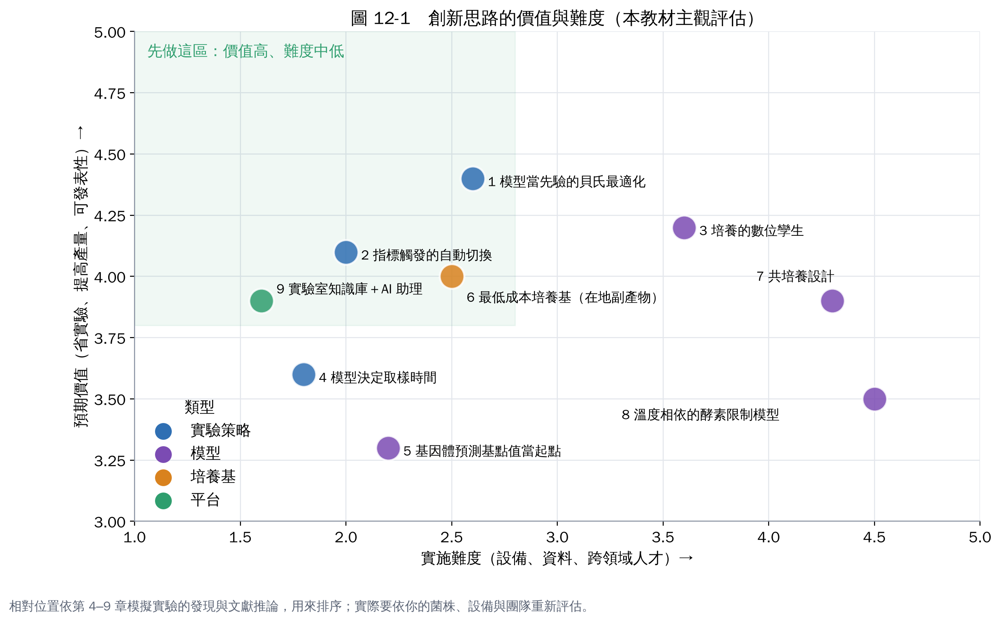

# 第 13 章　更創新的做法

> **本章全部屬於推論。** 每個想法都來自第 4–9 章模擬實驗暴露的問題，並附上方法上的文獻依據。不過，在一般實驗室的培養最適化上，這些做法目前少見，或沒有公開的完整案例。適合當研究題目、計畫亮點或產學合作的方向，執行前要先做小規模的可行性驗證。

## 1. 讓代謝模型當貝氏最適化的「先驗」

**來自哪個發現**：第 8 章的貝氏最適化，前 6 個實驗是在「完全不知道」的情況下隨機分布的，浪費了一部分預算。

**想法**：先用校正過的 dFBA 模擬幾千個條件，讓代理模型一開始就知道結果的大致形狀（例如「切換時間太晚會大幅下降」）。之後的實驗只用來修正模型和真實的差距。

**依據**：機理模型與機器學習的結合已有成功案例 [1, 2]。

**起步**：在第 9 章的模擬器上就能測試。用模擬器當「先驗」，比較有先驗和沒有先驗時，貝氏最適化達到 90% 最佳值需要幾個實驗。

## 2. 用線上指標自動觸發階段切換

**來自哪個發現**：第 6 章的簡單規則「目前菌量能否在剩下時間吃完剩下的糖」，算出的切換時間和最佳值只差 0.15–0.35 小時。

**想法**：把這條規則寫進發酵槽的控制程式，用線上 OD（濁度探頭）與線上糖濃度（或用耗氧速率推估）自動判斷切換時機。這樣不同批次的遲滯期差異就不再影響結果。

**依據**：用溶氧或 pH 變化觸發補料，是工業發酵常用的做法；兩階段的動態控制也有很多研究 [3]。

## 3. 培養的數位孿生

**來自哪個發現**：dFBA 預測和真實培養一定有差距（吸收速率、遲滯期、量測誤差）。

**想法**：讓 dFBA 和線上量測同時運作，用卡爾曼濾波持續校正模型的狀態與參數。這樣就能：

- 隨時估計看不到的量，例如此刻的糖濃度、細胞的代謝狀態；
- 提早預測這批的最終產量。

這和「沼氣 AIoT 進階」分區第 6 章的數位孿生是同一個概念，用在不同的生物程序上。

**難度**：需要線上感測器與一些控制背景，適合產學合作。

## 4. 讓模型決定什麼時候取樣

**來自哪個發現**：HPLC 分析很花時間和經費，但第 5 章顯示，階段轉折點附近的資料最有價值。

**想法**：讓模型預測「哪個時間點的取樣最能減少不確定性」，通常是轉折點附近。在那附近密集取樣，其他時間少取。同樣的分析預算，換來更好的模型。

**依據**：主動學習正是研究「該標記哪些資料」的領域 [4]。

## 5. 用基因體預測的基點值當起點

**來自哪個發現**：第 7 章的溫度與 pH 基點值要靠實驗量，但第 2 章介紹的基因體預測模型可以估計最適溫度與 pH 偏好 [5, 6]。

**想法**：把基因體預測的最適溫度與 pH 當成貝氏最適化的初始猜測與範圍，減少前幾輪的探索。累積多株菌的資料後，可以檢驗這些預測在你的菌群上有多準，甚至訓練自己的預測模型。

**風險**：預測誤差可能有好幾度，只能當起點，不能取代實驗。

## 6. 用代謝模型設計最低成本培養基（善用在地副產物）

**來自哪個發現**：第 4 章顯示，模型能預測不同碳源的生長表現。

**想法**：

1. 把臺灣常見的農業與食品副產物（例如糖蜜、米糠、豆渣、果皮）的主要成分輸入模型。
2. 用線性規劃找「達到目標生長率的最低成本組合」。
3. 再用實驗驗證。

這對要放大生產的團隊特別有價值，也有循環經濟的意義。

**依據**：代謝模型常用於培養基設計與營養需求預測 [7]。

## 7. 共培養設計

**想法**：如果單一菌株做不到，可以讓兩株菌分工，例如一株分解原料、一株產生產物。用群落代謝模型（例如 COMETS [8]）模擬兩株菌的交互作用，先在電腦上找出接種比例與培養條件。

**難度**：高。混菌的動態很複雜，模型不確定性也大，適合在單菌流程成熟之後再做。

## 8. 溫度相依的酵素限制模型

**來自哪個發現**：第 7 章的溫度效應是用經驗模型「乘上去」的，無法解釋為什麼不同溫度下產物比例會改變。

**想法**：在代謝模型中加入酵素量限制（第 3 章的 GECKO 方法 [9]），再加入每個酵素的溫度敏感度。這樣模型就能從機制上預測溫度如何改變代謝路徑。已有研究在酵母菌上用貝氏方法做到這一點 [10]。

**難度**：高，需要酵素動力學資料與系統生物學背景。

## 9. 實驗室知識庫＋AI 助理

**來自哪個發現**：第 11 章強調資料格式要統一，因為所有模型都依賴累積的資料。

**想法**：把每一批實驗的條件、量測、模型預測都存進同一個資料庫，讓 AI 助理做這些事：

- 自動畫圖、比較批次；
- 標出異常的數據點；
- 用最新資料更新貝氏最適化，產生下一批實驗建議與報告；
- 回答「上次 pH 6.5 的那批結果如何」這類問題。

**價值**：實驗室的經驗不會因為人員流動而消失；新進人員可以直接從累積的資料學習。

## 怎麼挑選

- **最容易起步**：
  - 9（知識庫）：從統一資料表開始就是第一步；
  - 2（指標觸發切換）；
  - 1（模型當先驗），可以先在模擬器上驗證；
  - 6（最低成本培養基）：只需要模型和成分資料。
- **適合產學合作**：3（數位孿生）、8（溫度相依模型）。
- **長期目標**：7（共培養）。

## 本章重點

- 九個想法都來自模擬實驗暴露的問題：前期探索浪費實驗、切換時機依賴批次、溫度效應缺乏機制、資料分散。
- 優先順序：統一資料與 AI 助理、指標觸發切換、模型當先驗的貝氏最適化、最低成本培養基。
- 全部屬於推論，要用你的菌株與實驗驗證。

## 參考文獻

1. Zhang J, Petersen SD, Radivojevic T, et al. (2020). Combining mechanistic and machine learning models for predictive engineering and optimization of tryptophan metabolism. *Nature Communications*, 11, 4880. https://doi.org/10.1038/s41467-020-17910-1
2. Zampieri G, Vijayakumar S, Yaneske E, Angione C (2019). Machine and deep learning meet genome-scale metabolic modeling. *PLoS Computational Biology*, 15, e1007084. https://doi.org/10.1371/journal.pcbi.1007084
3. Burg JM, Cooper CB, Ye Z, et al. (2016). Large-scale bioprocess competitiveness: the potential of dynamic metabolic control in two-stage fermentations. *Current Opinion in Chemical Engineering*, 14, 121–136. https://doi.org/10.1016/j.coche.2016.09.008
4. Settles B (2009). *Active learning literature survey*. Computer Sciences Technical Report 1648, University of Wisconsin–Madison. https://burrsettles.com/pub/settles.activelearning.pdf
5. Li G, Rabe KS, Nielsen J, Engqvist MKM (2019). Machine learning applied to predicting microorganism growth temperatures and enzyme catalytic optima. *ACS Synthetic Biology*, 8, 1411–1420. https://doi.org/10.1021/acssynbio.9b00099
6. Ramoneda J, Stallard-Olivera E, Hoffert M, et al. (2023). Building a genome-based understanding of bacterial pH preferences. *Science Advances*, 9, eadf8998. https://doi.org/10.1126/sciadv.adf8998
7. Gu C, Kim GB, Kim WJ, Kim HU, Lee SY (2019). Current status and applications of genome-scale metabolic models. *Genome Biology*, 20, 121. https://doi.org/10.1186/s13059-019-1730-3
8. Dukovski I, Bajić D, Chacón JM, et al. (2021). A metabolic modeling platform for the computation of microbial ecosystems in time and space (COMETS). *Nature Protocols*, 16, 5030–5082. https://doi.org/10.1038/s41596-021-00593-3
9. Sánchez BJ, Zhang C, Nilsson A, et al. (2017). Improving the phenotype predictions of a yeast genome-scale metabolic model by incorporating enzymatic constraints. *Molecular Systems Biology*, 13, 935. https://doi.org/10.15252/msb.20167411
10. Li G, Hu Y, Zrimec J, et al. (2021). Bayesian genome scale modelling identifies thermal determinants of yeast metabolism. *Nature Communications*, 12, 190. https://doi.org/10.1038/s41467-020-20338-2
