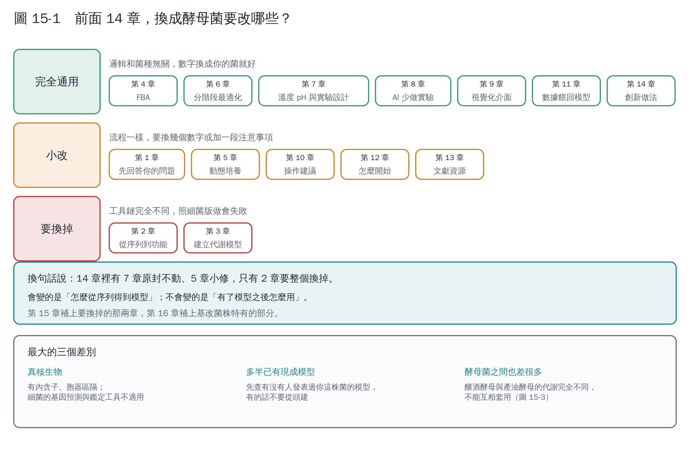
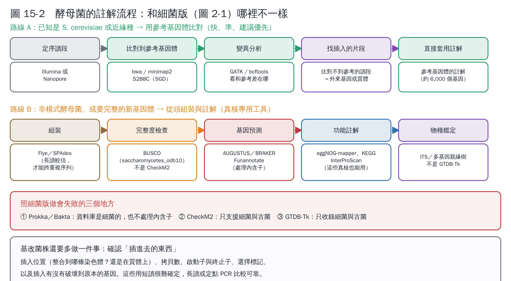
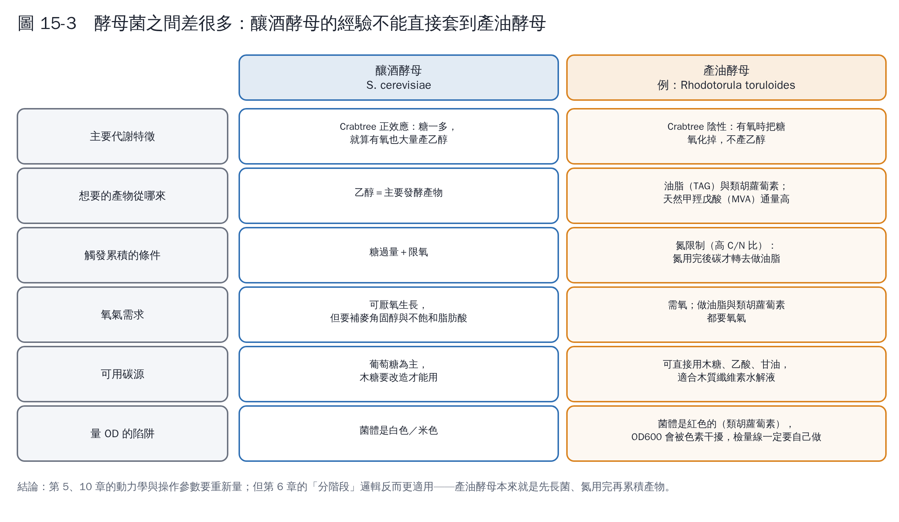

# 第 15 章　換成酵母菌：前面 14 章要改什麼

前面 14 章的例子都是細菌。如果你的菌是酵母菌，**大部分內容可以直接用，但有兩章一定要換掉**。這一章說明換什麼、怎麼換。

## 15.1 先說結論：只有 2 章要整個換

| 分類 | 章 | 為什麼 |
|---|---|---|
| **完全通用** | 4（FBA）、6（分階段）、7（溫度 pH 與實驗設計）、8（AI 少做實驗）、9（視覺化）、11（數據餵回）、14（創新） | 這些是「有了模型之後怎麼用」的邏輯，和菌種無關 |
| **小改** | 1、5（動態培養）、10（操作建議）、12（怎麼開始）、13（文獻） | 流程一樣，換幾個數字或加注意事項 |
| **要換掉** | 2（從序列到功能）、3（建立代謝模型） | 真核生物的工具鏈完全不同，照細菌版做會失敗 |

換句話說：**會變的是「怎麼從序列得到模型」，不會變的是「有了模型之後怎麼用」。**

## 15.2 第一步：確認你手上的到底是什麼

在跑任何分析之前，先把這五件事寫下來。它們決定後面每一步要用什麼工具。

| 要確認 | 為什麼重要 |
|---|---|
| ① 物種與菌株編號 | 決定有沒有現成的參考基因體與代謝模型 |
| ② 單倍體還是二倍體（倍體性） | 二倍體有兩套染色體，變異分析與基因剔除完全不同 |
| ③ 定序類型（短讀／長讀／兩者） | 短讀拼不出重複區與插入位置；長讀可以 |
| ④ 有沒有合適的參考基因體 | 有就走「比對」路線，快很多；沒有才從頭組裝 |
| ⑤ 基改的內容與方式 | 定點整合還是隨機嵌入？質體還是染色體？（第 16 章） |

**一個實際例子**：*Rhodotorula toruloides*（紅酵母，舊名 *Rhodosporidium toruloides*）。

- 常用的菌株 **IFO 8766**（同一株的其他編號：NBRC 8766、CBS 6016、DSM 4444）是 **IFO 0559（交配型 A）與 IFO 0880（交配型 a）雜交而成的二倍體接合株**，也是這個種的模式菌株 [1]。
- 這代表兩件事：
  1. **它是二倍體、而且是異型合子**。兩套染色體分別來自不同親本，差異不小。基因剔除要處理兩個等位基因；變異分析會看到大量異型合子位點，這是正常的，不是定序出錯。
  2. **兩個親本的基因體都有公開版本**。JGI 的 MycoCosm 上有 IFO 0880（Rhoto_IFO0880_4）與 IFO 0559 的基因體。把你的讀段同時比對到兩個親本，可以把兩套單倍型分開，這比只比對一個參考清楚得多。
- IFO 0880 的基因體與功能基因體研究（T-DNA 插入突變庫）已發表 [2]。那份研究還列出了約 1,337 個推定必需基因與 150 個影響油脂累積的基因——**這份清單很有用**：如果你的隨機嵌入剛好插在其中，就能解釋表現型。

## 15.3 註解流程：兩條路線

### 路線 A：有合適的參考基因體（建議優先）

適用於 *S. cerevisiae*、*R. toruloides* 這類已有公開基因體的菌。

1. 讀段品質處理（fastp）。
2. 比對到參考基因體（bwa-mem2 或 minimap2）。
3. 變異分析（GATK、bcftools）：看你的菌和參考差在哪裡。
4. **找比對不上的讀段**：這些往往就是外來基因、質體或載體序列。
5. 直接套用參考基因體的註解。

這條路線快、可靠，而且不需要從頭組裝。**對基改菌株特別重要**，因為「比對不上的讀段」就是你插進去的東西（第 16 章）。

### 路線 B：沒有合適參考，要從頭組裝

| 步驟 | 細菌版用什麼 | 酵母菌要改用 |
|---|---|---|
| 組裝 | SPAdes／Flye | 一樣，但長讀的價值更高（重複序列多） |
| 完整度檢查 | CheckM2 | **BUSCO**（真菌或酵母菌的基因集）[3] |
| 基因預測 | Prokka／Bakta | **AUGUSTUS／BRAKER／Funannotate**（要處理內含子）[4] |
| 物種鑑定 | GTDB-Tk | **ITS 或多基因親緣樹**（GTDB 只收細菌與古菌） |
| 功能註解 | eggNOG-mapper、KEGG、InterProScan | **一樣可用**（這些資料庫涵蓋真核） |

**照細菌版做會失敗的三個地方**：

1. **Prokka／Bakta**：參考資料庫是細菌的，也不處理內含子。
2. **CheckM2**：只支援細菌與古菌。
3. **GTDB-Tk**：資料庫裡沒有真菌。

## 15.4 代謝模型：先查有沒有現成的，不要從頭建

這是第 3 章變動最大的地方。第 3 章推薦的 CarveMe 與 gapseq **都是為細菌設計的**，用在酵母菌上不適合。

**正確的順序**：

| 順序 | 做法 |
|---|---|
| 1 | **查有沒有人發表過你這株菌的模型**。有的話直接用，可以省下好幾個月 |
| 2 | 沒有，但有近緣種的模型 → 用 **RAVEN** 以該模型為模板、依同源性建草稿 [5] |
| 3 | 都沒有 → 用 RAVEN 從 KEGG／MetaCyc 建草稿，再手工整理 |

**已有的酵母菌模型（部分）**：

| 菌 | 模型 | 備註 |
|---|---|---|
| *S. cerevisiae* | **Yeast8／Yeast9** 共識模型 [6] | 社群共同維護，品質最高；有酵素限制版（ecYeast8） |
| *Rhodotorula toruloides* | **rhto-GEM** [7] | 852 個基因、2,731 個反應、2,277 個代謝物；建立在 IFO 0880 的基因體上，並用 SLIMEr 處理油脂；已驗證葡萄糖、木糖、甘油上的生長 |

**對紅酵母使用者的重點**：rhto-GEM 正好建在 JGI 那份 IFO 0880 基因體上，和你手上的參考一致。程式 `code/yeast.py` 示範怎麼載入、檢查、設定培養基與剔除基因——**這支程式要在你自己的電腦上跑**，因為它需要先下載模型檔。

**二倍體要注意**：現有模型都是以單倍體為基礎。二倍體雜交株如果兩個等位基因的活性不同（例如一個親本的某個酵素失活），模型不會知道。這要靠實驗資料回來校正（第 11 章）。

## 15.5 酵母菌之間，差異可能比「細菌 vs 酵母菌」還大

這是最容易踩的坑：**把釀酒酵母的經驗套到產油酵母上**。

| | 釀酒酵母 *S. cerevisiae* | 產油酵母（例：*R. toruloides*） |
|---|---|---|
| 主要代謝特徵 | Crabtree 正效應：糖一多，就算有氧也大量產乙醇 [8] | Crabtree 陰性：有氧時把糖氧化掉，不產乙醇 |
| 天然累積什麼 | 乙醇 | 油脂（TAG）與類胡蘿蔔素；甲羥戊酸（MVA）途徑通量天生就高 |
| 觸發累積的條件 | 糖過量＋限氧 | **氮限制（高 C/N 比）**：氮用完後碳才轉去做油脂 |
| 氧氣 | 可厭氧生長，但要補麥角固醇與不飽和脂肪酸 | 需氧 |
| 碳源 | 葡萄糖為主 | 可直接用木糖、乙酸、甘油，適合木質纖維素水解液 [9] |
| 量 OD 的陷阱 | 菌體白色／米色 | **菌體是紅色的**（類胡蘿蔔素），OD600 會被色素干擾 |

**對前面幾章的具體影響**：

- **第 5 章**：動力學參數全部要重新量。產油酵母的生長慢得多，階段的劃分也不同（長菌期 → 氮耗盡 → 累積期）。
- **第 6 章（分階段）反而更適用**：產油酵母本來就是「先長菌、氮用完再累積產物」，天然就是兩階段。第 6 章的切換判準可以直接套用，只是觸發訊號從「停止通氣」換成「氮耗盡」（可用殘氮、pH 或 OD 門檻偵測）。
- **第 10 章**：`OD_TO_GDW` 常數一定要重做檢量線，紅色色素會讓 OD 讀值偏高。

## 15.6 你現在就能做的 vs 要等的

**手上有定序資料，今天就能開始**：

| 能做 | 需要什麼 |
|---|---|
| 確認菌株身分與純度 | 讀段比對到參考基因體 |
| 找出和參考的差異（SNP、缺失） | 變異分析流程 |
| 找出插入的外來序列、位置與拷貝數 | 讀段（長讀最佳，見第 16 章） |
| 功能註解、代謝路徑盤點 | eggNOG-mapper、KEGG |
| 載入現成代謝模型、跑 FBA | rhto-GEM 或 Yeast8 ＋ COBRApy |
| 用模型預測碳源、理論產率 | 同上（第 4 章的方法照用） |

**一定要等實驗的**：

| 要等 | 為什麼 |
|---|---|
| 最適溫度、pH | 基因體算不準（第 7 章） |
| 吸收速率、μmax、遲滯期 | 要從生長曲線量（第 5、11 章） |
| OD 與乾重的換算 | 紅色色素干擾，一定要自己做 |
| 產物的實際產率 | 模型只算上限（第 16 章） |
| 二倍體兩個等位基因的實際活性 | 序列看不出來 |

## 本章重點

- 14 章裡有 7 章完全通用、5 章小修，只有第 2、3 章要整個換掉。
- 先確認五件事：物種、倍體性、定序類型、有無參考基因體、基改方式。
- 酵母菌的註解優先走「比對參考基因體」路線；從頭組裝時要換成真核工具（BUSCO、AUGUSTUS／BRAKER）。
- 代謝模型**先查現成的**：*S. cerevisiae* 用 Yeast8／Yeast9，*R. toruloides* 用 rhto-GEM；沒有才用 RAVEN 以近緣模型為模板建。
- 酵母菌之間差異很大。釀酒酵母是 Crabtree 正效應、產乙醇；產油酵母是氮限制觸發油脂累積、菌體紅色。

## 參考文獻

1. Banno I (1967). Studies on the sexuality of *Rhodotorula*. *The Journal of General and Applied Microbiology*, 13, 167–196.（確立 *Rhodosporidium toruloides* 的有性世代；IFO 8766 為 IFO 0559 × IFO 0880 的接合株，菌種保存機構的目錄可查到對應編號 NBRC 8766、CBS 6016、DSM 4444）
2. Coradetti ST, Pinel D, Geiselman GM, et al. (2018). Functional genomics of lipid metabolism in the oleaginous yeast *Rhodosporidium toruloides*. *eLife*, 7, e32110. https://doi.org/10.7554/eLife.32110
3. Simão FA, Waterhouse RM, Ioannidis P, Kriventseva EV, Zdobnov EM (2015). BUSCO: assessing genome assembly and annotation completeness with single-copy orthologs. *Bioinformatics*, 31, 3210–3212. https://doi.org/10.1093/bioinformatics/btv351
4. Brůna T, Hoff KJ, Lomsadze A, Stanke M, Borodovsky M (2021). BRAKER2: automatic eukaryotic genome annotation with GeneMark-EP+ and AUGUSTUS supported by a protein database. *NAR Genomics and Bioinformatics*, 3, lqaa108. https://doi.org/10.1093/nargab/lqaa108
5. Wang H, Marcišauskas S, Sánchez BJ, et al. (2018). RAVEN 2.0: A versatile toolbox for metabolic network reconstruction and a case study on *Streptomyces coelicolor*. *PLoS Computational Biology*, 14, e1006541. https://doi.org/10.1371/journal.pcbi.1006541
6. Lu H, Li F, Sánchez BJ, et al. (2019). A consensus *S. cerevisiae* metabolic model Yeast8 and its ecosystem for comprehensively probing cellular metabolism. *Nature Communications*, 10, 3586. https://doi.org/10.1038/s41467-019-11581-3
7. Tiukova IA, Prigent S, Nielsen J, Sandgren M, Kerkhoven EJ (2019). Genome-scale model of *Rhodotorula toruloides* metabolism. *Biotechnology and Bioengineering*, 116, 3396–3408. https://doi.org/10.1002/bit.27162
8. De Deken RH (1966). The Crabtree effect: a regulatory system in yeast. *Journal of General Microbiology*, 44, 149–156. https://doi.org/10.1099/00221287-44-2-149
9. Yaegashi J, Kirby J, Ito M, et al. (2017). *Rhodosporidium toruloides*: a new platform organism for conversion of lignocellulose into terpene biofuels and bioplastics. *Biotechnology for Biofuels*, 10, 241. https://doi.org/10.1186/s13068-017-0927-5
10. Cherry JM, Hong EL, Amundsen C, et al. (2012). *Saccharomyces* Genome Database: the genomics resource of budding yeast. *Nucleic Acids Research*, 40, D700–D705. https://doi.org/10.1093/nar/gkr1029
