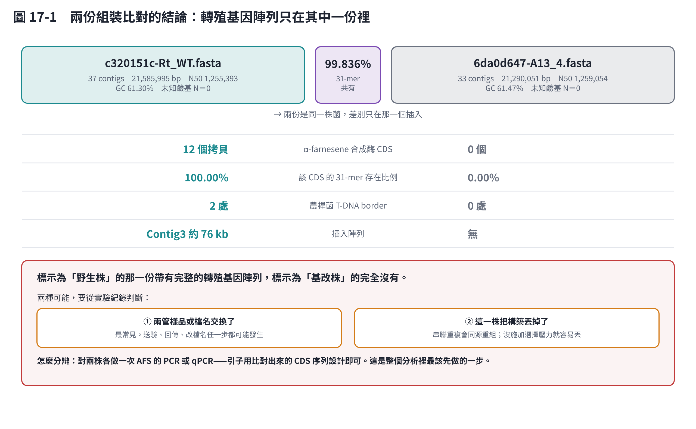
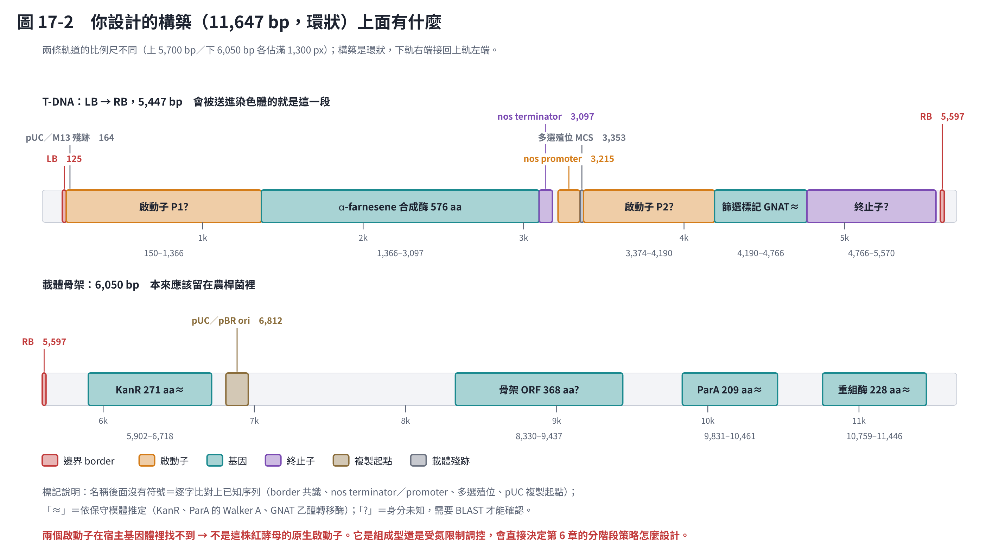
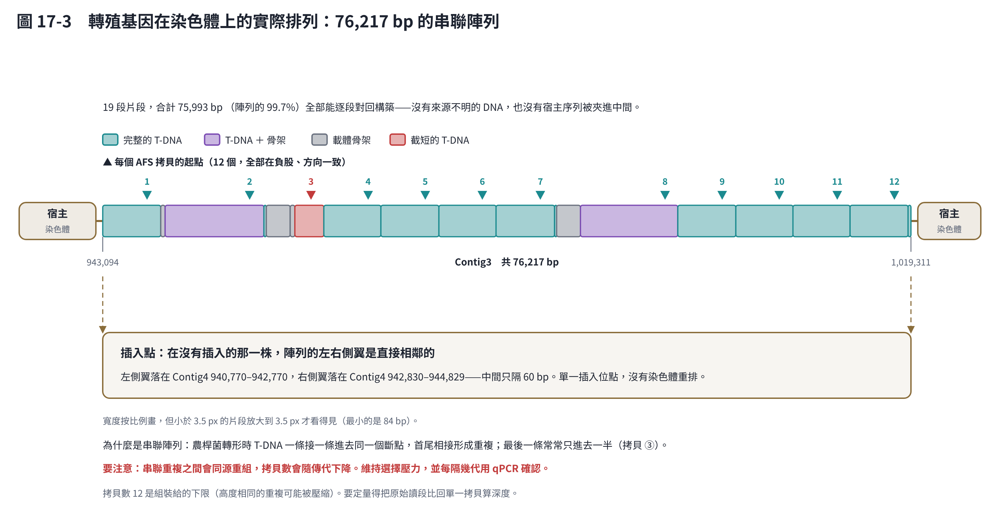
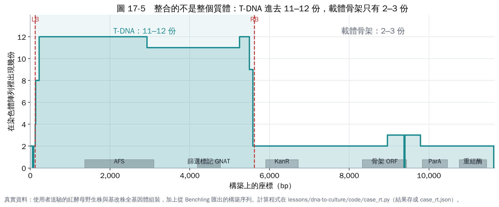
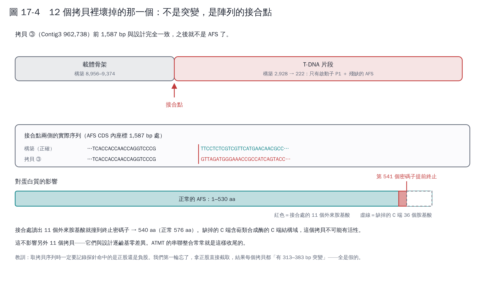
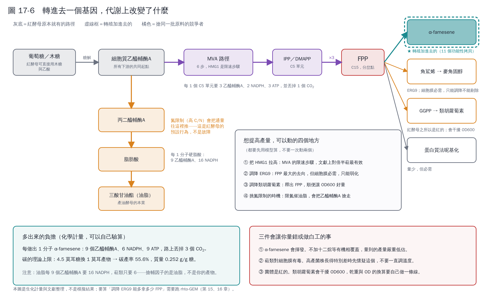
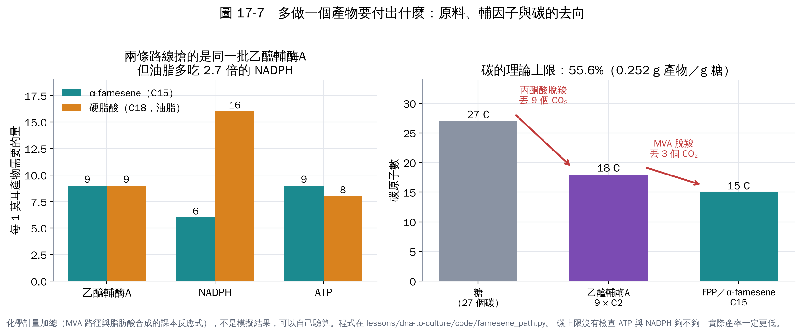

# 第 17 章　案例：把這套流程真的跑在一株基改紅酵母上

前面十六章講方法。這一章把方法用在一組**真實的、還沒發表的資料**上：一株 *Rhodotorula toruloides* 的野生株與基改株全基因體組裝，加上設計這株基改菌時用的 11,647 bp 構築序列。

目標很具體：**插進去的東西，和當初設計的一樣嗎？在哪裡？幾份？有沒有壞掉的？**

這一章值得讀的地方不只是答案，還有過程中踩到的兩個坑——它們都是會讓人得到「看起來很合理但完全錯誤」結論的那種坑。

## 17.1 手上有什麼

| 檔案 | 內容 |
|---|---|
| `Rt_WT.fasta` | 標示為野生株的組裝，37 contigs、21,585,995 bp、N50 1,255,393 bp、GC 61.30%、0 個 N |
| `A13_4.fasta` | 標示為基改株的組裝，33 contigs、21,290,051 bp、N50 1,259,054 bp、GC 61.47%、0 個 N |
| 構築序列 | 11,647 bp 環狀質體，GC 58.8%（從 Benchling 匯出） |

兩份組裝的品質都很好：N50 超過 1.2 Mb、完全沒有未知鹼基，是長讀定序的水準。GC 61.3% 與 *R. toruloides* 的文獻值一致。

**這一章所有的數字都由 `code/case_rt.py` 算出來**，結果存成 `code/case_rt.json`，圖直接讀那份 JSON。原始的三個檔案不在這個 repo 裡（是未發表資料），所以你重跑時要自己指定路徑：

```bash
python code/case_rt.py --wt WT.fasta --mut MUT.fasta --construct construct.fasta
```

## 17.2 第一個結果就不在預期內



兩份組裝有 **99.836% 的 31-mer 共有**——確實是同一株菌。但是：

- 標示為「野生株」的那一份有 **12 個** α-farnesene 合成酶拷貝、2 處農桿菌 T-DNA border、一個 76 kb 的插入陣列。
- 標示為「基改株」的那一份，上述全部是 **0**。該 CDS 的 31-mer 在裡面的存在比例是 **0.00%**——不是「少了幾個」，是完全沒有。

這種結果不要急著下結論說哪一管錯了。合理的可能有兩個：**樣品或檔名在送驗、回傳、改檔名的某一步交換了**（最常見），或是**這一株在培養過程中把構築丟掉了**（串聯重複會同源重組，沒有選擇壓力時特別容易）。

**分辨方法很便宜**：對兩株各做一次 AFS 的 PCR 或 qPCR，引子用比對出來的 CDS 序列設計。在釐清這件事之前，後面所有的分析都只能說「帶有插入的那一份」，不能說「基改株」。

> 這是第 11 章「數據要能回溯」的實例。定序結果和實驗紀錄對不起來時，**要修正的往往是標籤，不是結論**——但你得先有能力發現它們對不起來。

## 17.3 怎麼找到它的：兩個差點讓人走錯路的坑

### 坑一：用 GC 當外來 DNA 的判準，差點整個漏掉

第一輪分析用的判準是「GC 偏離基因體平均 → 可能是外來 DNA」。這個判準在很多情況下有效，但這次**完全失靈**：

| | GC |
|---|---|
| 宿主基因體平均 | 61.3% |
| 蘋果原生的 AFS 基因 | 約 42% |
| **實際插進去的 AFS CDS** | **63.3%** |

因為這個基因**做過密碼子最佳化**，GC 已經被調到和宿主一樣高。用 GC 篩，它會被歸到「和基因體相近，可能是菌株間差異」而被忽略。

真正找到它的是三個條件並用：**連續的新增區段 ＋ 完整的 ORF ＋ 保守模體**。那個 576 aa 的蛋白質同時具備：

- 長度 576 aa，與蘋果 MdAFS1 相同 [1]
- 第 33 位有 **RRx8W**（`RRSANYKPNIW`），植物萜類合成酶的標誌性模體
- 第 326 位有 **DDxxD**，萜類合成酶的鎂離子結合位，位置也吻合

反過來，那些 GC 低到 32–43%、被標成「可能是外來 DNA」的區段，轉譯出來是 `KKKKKK`、`MEWNGMEWNG`、`GGGGGG`——低複雜度重複，而且兩株都有。**全是假陽性。**

> 教訓：外來 DNA 的判準不能只看組成。密碼子最佳化會把 GC 這條線索整個抹掉，而低複雜度重複會製造大量假陽性。

### 坑二：忘了記錄探針命中的是哪一股

取出 12 個拷貝做比對時，我一開始直接用 `contig[位置:位置+1728]` 截取。但探針命中的是**負股**，所以截到的是反向互補——結果每個拷貝都「有 313–383 bp 突變」，還「在第 81 個密碼子提前終止」。

全部是假的。改成依命中方向決定要不要取反向互補之後，真實結果是：**12 個拷貝裡 11 個與設計逐鹼基零差異**。

這個坑很容易踩，因為錯誤的結果看起來非常像真的（突變數量合理、終止密碼子的位置也合理）。**自己寫比對程式時，方向一定要當成資料的一部分記下來。**

## 17.4 構築上有什麼



構築是一個標準的雙元載體：

- **T-DNA（LB 125 → RB 5,597，5,447 bp）**：兩個表現卡匣——啟動子 P1 ＋ AFS（576 aa）＋ nos terminator，以及啟動子 P2 ＋ 篩選標記（191 aa 的 GNAT 乙醯轉移酶，GC 70.8%，明顯做過真菌密碼子最佳化）。
- **骨架（5,597 → 11,647，6,050 bp）**：KanR、pUC／pBR 複製起點、ParA／RepA、絲胺酸重組酶。這些本來應該留在農桿菌裡。
- 兩個卡匣之間還留著 **nos promoter ＋ 完整的多選殖位**（SacII–BamHI–SmaI–KpnI–SacI–EcoRV–PacI–EcoRI），是 pCAMBIA 類載體沒清掉的殘跡。以後要在同一個構築再加基因，這段是現成的插入點。

**但是有一件事要特別提出來：兩個啟動子的身分不明。**

我把構築的每一段，用四種嚴格度（`asm5`、`asm20`、`sr`、`map-ont`）比對回沒有插入的那一份組裝。對照測試確認方法沒問題（宿主側翼 200/200 bp 完全對上），結果是：

**構築 11,647 bp 沒有任何一段來自這株紅酵母的基因體。**

所以 P1（1,216 bp）和 P2（840 bp）**不是這株菌的原生啟動子**，也不是 CaMV 35S、不是 nos promoter、不是 *A. nidulans* trpC（都逐條比對過）。它們可能來自另一種真菌、另一株紅酵母，或是合成啟動子。

這不是學術細節——**啟動子決定 AFS 什麼時候表現**。如果它是組成型，那麼第 6 章的氮限制階段裡 AFS 仍在表現，但乙醯輔酶 A 正被油脂合成搶走；如果它受氮或碳源調控，分階段的設計就完全不同。**所以這是做任何培養最適化之前要先查清楚的事**（把序列貼到 NCBI BLASTn，或直接問構築的來源實驗室）。

## 17.5 染色體上的實際排列



用「構築上唯一出現的 25-mer」當錨點逐鹼基追蹤，得到 19 段整合片段。為什麼不用一般的比對軟體？因為**串聯重複會讓比對器在重複單元之間跳動**，接合點的位置會變得不可信。錨點追蹤則能把每一個斷點定到單一鹼基。

結果：

- 陣列在 Contig3 的 943,094–1,019,311，共 **76,217 bp**
- 其中 **75,993 bp（99.7%）能逐段對回構築**——沒有來源不明的 DNA，也沒有宿主序列被夾進陣列中間
- **12 個 AFS 拷貝**，全部在負股、方向一致（典型的頭尾串聯）
- **單一插入位點**：在沒有插入的那一份組裝裡，陣列的左右側翼落在 Contig4 的 940,770–942,770 與 942,830–944,829，**中間只隔 60 bp**。沒有染色體重排。
- T-DNA border 附近的斷點落在構築 84–222 與 5,495–5,582，**剛好切在邊界內側幾十 bp**，正是農桿菌邊界切割的落點 [2]

這解開了一個謎：第一輪分析看到「重複單元約 5,385 bp」時，不知道那是什麼。拿到構築之後才知道——**5,385 bp 就是 T-DNA 本身**。

## 17.6 整合的不是整個質體



把每個構築座標在陣列裡出現的次數畫出來，圖形非常乾淨：

| 構築區間 | 內容 | 份數 |
|---|---|---|
| 222–2,928 | 啟動子 P1 ＋ AFS | **12** |
| 2,928–5,247 | AFS 末端、nos terminator、P2、篩選標記 | **11** |
| 5,247–5,495 | 終止子 | **12** |
| 5,582–8,956 | RB 外側、KanR、複製起點 | **2** |
| 8,956–9,785 | 骨架 ORF | **3** |
| 9,785–11,624 | ParA、重組酶 | **2** |

**T-DNA 進去 11–12 份，骨架只有 2–3 份。** 這正是 T-DNA 轉移機制應該產生的樣子：邊界之間的那一段被選擇性地送進去很多次，骨架是「順便」被帶進去的。

骨架被帶進去在農桿菌轉形很常見，但**要記在菌株紀錄裡**：這株菌的染色體上有 2–3 份細菌的 kanamycin 抗性基因與複製起點。做任何需要申報基改生物的事情時，這是要寫出來的。

## 17.7 壞掉的那一個拷貝



12 個拷貝裡有 11 個和設計**逐鹼基零差異**。第 3 個不一樣，但它不是突變：

它只含構築 222–2,928，在 AFS CDS 的第 1,587 bp（第 530 個密碼子）處**直接接到骨架序列**（構築 8,956–9,374）。前 1,586 bp 與設計完全一致，之後讀出 11 個外來胺基酸就撞到終止密碼子 → **540 aa**（正常 576 aa）。缺掉的 C 端含萜類合成酶的 C 端結構域，這個拷貝不可能有活性。

這很符合 ATMT 串聯整合的機制：T-DNA 一條接一條進入同一個斷點，**最後一條常常只進去一半，接到骨架上**。它不影響另外 11 個。

→ **功能性拷貝數：11。**

## 17.8 轉進去這個基因，代謝上改變了什麼



AFS 催化的反應只有一個：**FPP（法呢基焦磷酸）→ α-farnesene ＋ 焦磷酸**。一條反應、一個酵素。但它插進去的位置是整個萜類代謝的分岔點，所以影響比看起來大。

### 它搶的是誰的東西

FPP 原本有三個去向，現在多了第四個：

| 去向 | 做什麼 | 能不能動 |
|---|---|---|
| **ERG9 → 角鯊烯 → 麥角固醇** | 細胞膜的固醇 | **不能剔除**（必需）。只能換成弱啟動子或可調控啟動子把它調降 |
| **GGPP → 類胡蘿蔔素** | 紅酵母的紅色色素 | 可以調降。調降同時釋出 FPP，而且 OD600 會變好量 |
| **蛋白質法呢基化** | 修飾 Ras 等訊息蛋白 | 量少，但必需 |
| **α-farnesene（新增）** | 你要的產物 | — |

更上游還有一個更大的競爭者：**油脂**。脂肪酸合成搶的不是 FPP，而是再上游的**細胞質乙醯輔酶A**——也就是 MVA 路徑的原料。對產油酵母來說這條路是它的本業，而且**氮限制（高 C/N）正是把通量推往油脂的開關**。這一點很關鍵，因為第 6 章的兩階段策略常常就是用氮限制來切換階段。

### 要付多少代價：化學計量算得出來



把 MVA 路徑的六個反應式逐步加總（程式在 `code/farnesene_path.py`，數字可以自己驗算）：

- **每 1 個 C5 單元（IPP）**：3 個乙醯輔酶A、2 NADPH、3 ATP，並丟掉 1 個 CO₂。
- **每 1 分子 α-farnesene**（＝1 FPP＝3 個 C5）：**9 個乙醯輔酶A、6 NADPH、9 ATP，丟掉 3 個 CO₂**。
- **碳的理論上限**：4.5 莫耳葡萄糖換 1 莫耳產物 → 碳產率 **55.6%**，質量產率 **0.252 g/g 糖**。這個上限只算碳，沒有檢查 ATP 與 NADPH 夠不夠，所以**實際產率一定更低**。

和油脂比較很有意思：

| | 乙醯輔酶A | NADPH | ATP |
|---|---|---|---|
| α-farnesene（C15） | 9 | **6** | 9 |
| 硬脂酸（C18，油脂） | 9 | **16** | 8 |

**兩條路線搶的是同一批乙醯輔酶A，但油脂多吃 2.7 倍的 NADPH。** 所以在這株菌裡，NADPH 的主要消耗者是油脂而不是你的產物；如果要搶 NADPH，該動的是油脂那一邊。

### 可以動的四個地方

1. **把 HMG1 拉高**。HMG-CoA 還原酶是 MVA 的限速步驟，文獻上提高倍半萜產量最常用的手段之一 [3]。
2. **調降 ERG9**。FPP 最大的去向，但不能關掉——用弱啟動子或可調控啟動子。
3. **調降類胡蘿蔔素**。釋出 FPP，順便讓 OD600 變好量。
4. **挑氮限制的時機**。限氮催油脂，會把乙醯輔酶A 搶走。這一點和啟動子的身分綁在一起（見 17.4）：**如果 AFS 的啟動子是組成型，限氮階段 AFS 還在表現，但原料被油脂搶走**，那這個階段對產物就是純粹的浪費。

這四個不要一次動兩個，也不要憑感覺動——這正是第 16 章要用 rhto-GEM 算生產包絡線的理由：模型可以先告訴你「調降 ERG9 到什麼程度，產物上升而細胞還長得動」。

### 三件會讓你量錯或做白工的事

1. **α-farnesene 會揮發**。不加十二烷等有機相覆蓋收集，量到的產量嚴重低估 [3]。
2. **萜類對細胞膜有毒**。高產菌株長得特別差時先懷疑產物毒性，不要一直調溫度和 pH。有機相覆蓋同時也有解毒作用。
3. **菌體是紅的**。類胡蘿蔔素會干擾 OD600，乾重與 OD 的換算要自己做一條校正線（第 10 章的 `OD_TO_GDW` 不能照抄）。

> **這一節是生化計量與文獻整理，不是模擬結果。** 反應式與輔因子化學計量是課本等級、可以驗算的；至於「調降 ERG9 能多拿多少 FPP」「11 個拷貝夠不夠把 FPP 抽乾」這種定量問題，要跑 rhto-GEM 才能回答（第 15、16 章）。

## 17.9 這對培養條件代表什麼

這一章做的是序列分析，但每一個結果都連回前面的章節：

| 發現 | 影響到哪一章 | 要怎麼做 |
|---|---|---|
| 11 個功能性拷貝 | 第 16 章 | 拷貝數已經不是瓶頸了。文獻上同樣從 FPP 出發的 α-bisabolene 從 261 mg/L 做到 2.2 g/L，增加拷貝數是主要手段之一 [3]——這一步你已經做完。接下來要看的是 **FPP 供應**與**競爭路徑**（油脂搶乙醯輔酶 A、ERG9 與類胡蘿蔔素搶 FPP） |
| 啟動子身分不明 | 第 6、10 章 | **先查清楚再設計分階段培養。** 組成型與受調控的啟動子，第二階段要不要限氮的答案完全相反 |
| 串聯重複、12 份 | 第 10、11 章 | 串聯重複會同源重組丟失拷貝。**維持選擇壓力**（如果標記確認是 nourseothricin 抗性就要加 nourseothricin），並在條件表記下**傳代次數**，每隔幾代用 qPCR 確認拷貝數 |
| 另一份組裝完全沒有構築 | 第 11 章 | 很可能就是上一項的後果。這是「菌株會變」最直接的證據，不要假設菌株在整個實驗期間都一樣 |
| 插入點在 Contig4 約 942,800 | 第 16 章 | 要確認有沒有打斷基因，需要那個區域的註解。跑完 `genome_tools.py plan` 產生的流程之後，對照 IFO 0880 功能基因體研究列出的必需基因與影響油脂的基因清單 [4] |

## 17.10 這套分析能回答什麼、不能回答什麼

**能回答**：插入物的身分、位置、份數下限、序列正確性、有沒有骨架、接合點在哪裡、哪個拷貝壞了。

**不能回答**：

- **精確的拷貝數**。組裝會把高度相同的重複壓縮，12 是**下限**。要定量得把原始讀段比回單一拷貝算深度。
- **表現量**。多拷貝串聯很常發生基因沉默，12 份不等於 12 倍表現。要 RT-qPCR。
- **酵素活性**。要酵素活性測定或產物量測。
- **蛋白質的最終身分**。這個執行環境沒有對外網路，所有身分判定都靠模體與逐字比對已知序列。KanR、ParA、GNAT 都是**推定**，要用 BLASTp 確認。

## 17.11 把這套方法用在你自己的資料上

整套分析收在 `code/genome_tools.py`，四個步驟：

```bash
# 1. 組裝品質
python code/genome_tools.py stats WT.fasta MUT.fasta

# 2. 找出「只有其中一邊有」的序列
python code/genome_tools.py compare WT.fasta MUT.fasta --out novel.fasta

# 3. 看那些序列裡有沒有完整 ORF 與保守模體
python code/genome_tools.py orfs novel.fasta --prot candidates.faa

# 4. 有構築序列的話，直接把它對回基因體
python code/genome_tools.py construct construct.fasta MUT.fasta
```

第 4 步是這一章的主角：它會輸出每一段整合片段、每個構築座標整合了幾份、以及 border 等已知元件的位置。**有構築序列和沒有構築序列，分析的品質差很多**——沒有它只能說「有個 5,385 bp 的重複單元」，有了它才能說「那是 T-DNA，骨架進去 2–3 份，第 3 個拷貝斷在第 530 個密碼子」。

所以：**做基改之前就把構築序列存好**，這是事後解讀定序結果最重要的一份檔案。

## 本章重點

- 定序比對的第一個產出常常是「**資料和紀錄對不上**」。這不是失敗，是這個分析最有價值的時候——但前提是你要能發現它。
- **GC 不能當外來 DNA 的唯一判準**。密碼子最佳化會讓插入的基因和宿主一樣高 GC。要用「連續新增區段 ＋ 完整 ORF ＋ 保守模體」三者並用。
- 自己寫序列比對時，**股向要當成資料記下來**。忘了這件事會產生看起來很合理、實際上完全錯誤的突變清單。
- 串聯多拷貝整合用一般比對軟體會在重複單元之間跳動；**用唯一 k-mer 當錨點逐鹼基追蹤**，才能把接合點定到單一鹼基。
- T-DNA 與骨架的份數差異（11–12 份 vs 2–3 份）本身就是轉形機制的證據，也是菌株紀錄裡該寫的事。
- **轉一個基因進去，改變的不只是多一條反應**：AFS 把 FPP 從三個去向搶成四個，上游的乙醯輔酶A 還要和油脂競爭。每 1 分子產物要 9 個乙醯輔酶A、6 NADPH、9 ATP，碳的理論上限 55.6%（0.252 g/g 糖）。
- 油脂每 9 個乙醯輔酶A 要 16 NADPH，萜類只要 6——**搶輔因子的是油脂，不是你的產物**。氮限制催油脂，所以分階段策略要和啟動子的調控性質一起決定。
- 這一章能回答「在不在、在哪裡、對不對、幾份（下限）」，回答不了「表現量與活性」。後者要 RT-qPCR 與產物量測，也就是第 11 章要餵回模型的那些數據。

## 參考文獻

1. Pechous SW, Whitaker BD (2004). Cloning and functional expression of an (E,E)-α-farnesene synthase cDNA from peel tissue of apple fruit. *Planta*, 219, 84–94. https://doi.org/10.1007/s00425-003-1191-4
2. Michielse CB, Hooykaas PJJ, van den Hondel CAMJJ, Ram AFJ (2005). *Agrobacterium*-mediated transformation as a tool for functional genomics in fungi. *Current Genetics*, 48, 1–17.（農桿菌轉形在真菌的整合模式，包含串聯多拷貝與骨架共整合）
3. Kirby J, Geiselman GM, Yaegashi J, et al. (2021). Further engineering of *R. toruloides* for the production of terpenes from lignocellulosic biomass. *Biotechnology for Biofuels*, 14, 101. https://doi.org/10.1186/s13068-021-01950-w
4. Coradetti ST, Pinel D, Geiselman GM, et al. (2018). Functional genomics of lipid metabolism in the oleaginous yeast *Rhodosporidium toruloides*. *eLife*, 7, e32110. https://doi.org/10.7554/eLife.32110
5. Li H (2018). Minimap2: pairwise alignment for nucleotide sequences. *Bioinformatics*, 34, 3094–3100. https://doi.org/10.1093/bioinformatics/bty191
