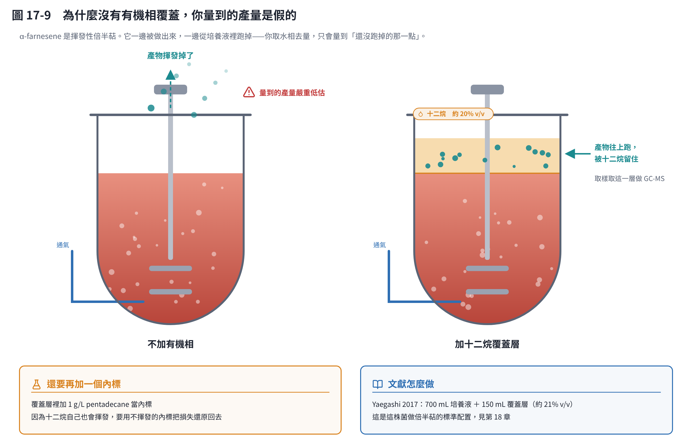
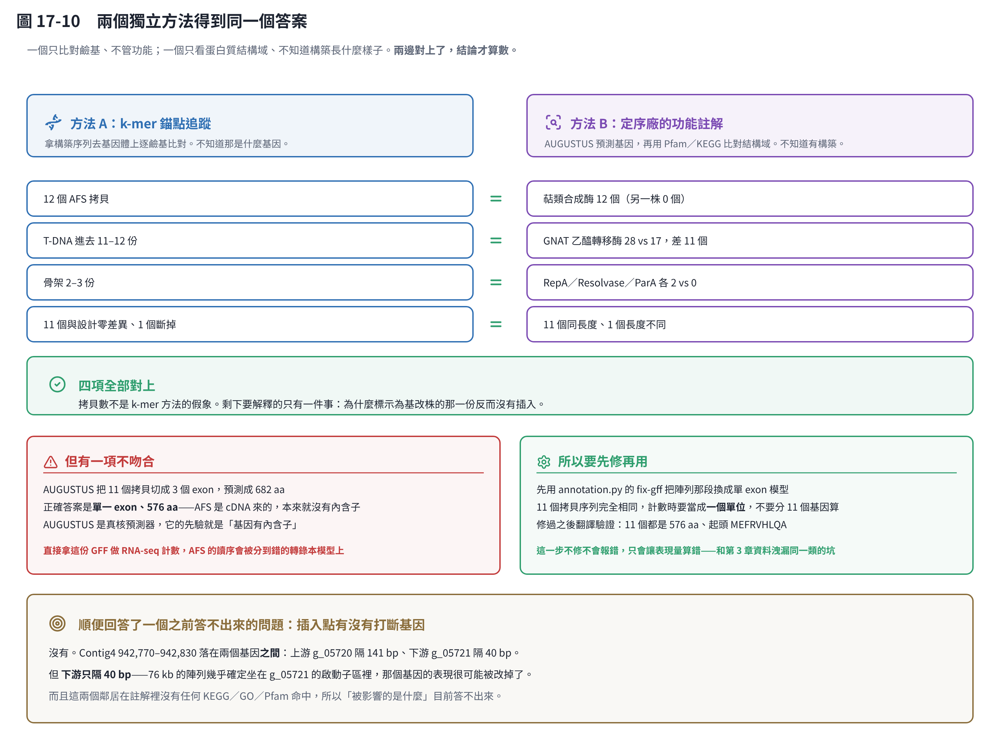
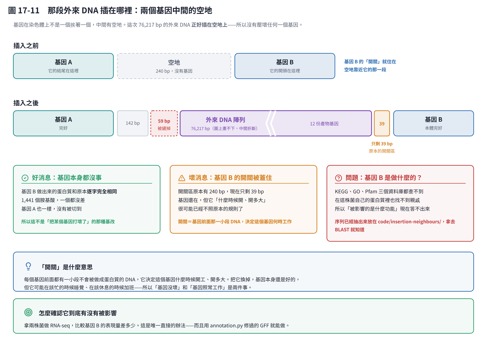
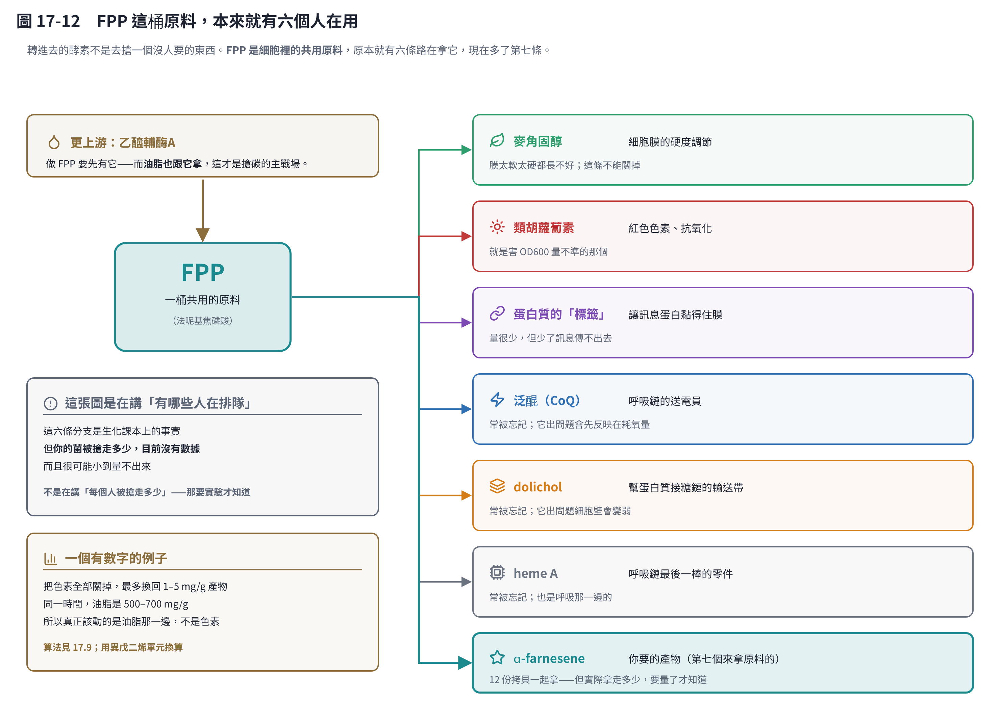

# 第 17 章　案例：把這套流程真的跑在一株基改紅酵母上

前面十六章講的是方法。這一章把方法用在**真實的、還沒發表的資料**上。

手上有三個檔案：一株紅酵母的兩份全基因體定序結果（一份標示為野生株、一份標示為基改株），加上當初設計這株基改菌時畫的那張質體圖（11,647 bp）。

要回答的問題很單純，就四個：

> **當初想放進去的那段 DNA，真的進去了嗎？進到染色體的哪裡？放了幾份？有沒有放壞的？**

這一章值得讀的不只是答案，還有過程中踩到的兩個坑——那種會讓你得到「看起來很合理、但完全錯誤」的結論的坑。

> **先講幾個會一直出現的詞**，後面就不再解釋了：
>
> - **構築（construct）**：你設計好、要送進菌裡的那一段 DNA。這裡是一個 11,647 bp 的環狀質體。
> - **拷貝（copy）**：同一段 DNA 在染色體上出現幾份。放了 12 份就是 12 個拷貝。
> - **bp**：鹼基對，DNA 的長度單位。1,000 bp 大約是一個中等大小的基因。
> - **contig**：定序之後拼出來的長片段。一個基因體會拼成好幾十個 contig。
> - **AFS**：α-farnesene 合成酶，就是這次要轉進去的那個酵素（來自蘋果）。

## 17.1 手上有什麼

| 檔案 | 內容 |
|---|---|
| `Rt_WT.fasta` | 標示為野生株的定序結果，拼成 37 段、總共 21,585,995 bp |
| `A13_4.fasta` | 標示為基改株的定序結果，拼成 33 段、總共 21,290,051 bp |
| 構築序列 | 11,647 bp 的環狀質體，從 Benchling 匯出 |

兩份定序的品質都很好。判斷依據有三個：

- **N50 超過 1.2 Mb**。N50 是「一半以上的 DNA 都在比這個長的片段裡」——1.2 Mb 代表拼得很完整，不是碎成一堆小片。
- **完全沒有 N**。N 代表「這個位置定序不出來」。一個都沒有，是長讀定序才做得到的水準。
- **GC 含量 61.3%**。GC 是 DNA 四個字母裡 G 和 C 占的比例，每個物種有自己的典型值。61.3% 和文獻上的紅酵母一致，所以菌種沒有搞錯。

**這一章所有的數字都由 `code/case_rt.py` 算出來**，結果存成 `code/case_rt.json`，圖直接讀那份 JSON。原始的三個檔案不在這個 repo 裡（是未發表資料），所以你重跑時要自己指定路徑：

```bash
python code/case_rt.py --wt WT.fasta --mut MUT.fasta --construct construct.fasta
```

## 17.2 第一個結果就不在預期內


先做最基本的檢查：這兩份定序是同一株菌嗎？

做法是把兩份 DNA 都切成 31 個字母一段的小片段，當成指紋來比對。結果 **99.836% 的片段兩邊都有**——是同一株菌沒錯。

然後看轉進去的基因。結果是這樣：

- 標示為「**野生株**」的那一份：有 **12 個** AFS 拷貝、一個 76 kb 的插入區段。
- 標示為「**基改株**」的那一份：上面這些全部是 **0**。AFS 的指紋片段在裡面的比例是 **0.00%**——不是「少了幾個」，是一個都沒有。

**兩份檔案的標籤反了。**

先不要急著下結論說哪一管錯了。合理的可能有兩個：

1. **樣品或檔名在某一步交換了**（送驗、回傳、改檔名都有可能）。這是最常見的。
2. **那一株在培養過程中真的把構築丟掉了**。後面會看到這 12 份拷貝是一個接一個排成一長串的，這種排法很容易在細胞分裂時自己掉幾份，沒有選擇壓力時特別容易。

**分辨方法很便宜**：對兩株各做一次 AFS 的 PCR，引子用比對出來的序列設計。有就是有，沒有就是沒有。

在釐清這件事之前，後面所有的分析都只能說「**帶有插入的那一份**」，不能說「基改株」。

> 這是第 11 章「數據要能回溯」的實例。定序結果和實驗紀錄對不起來時，**要修正的往往是標籤，不是結論**——但你得先有能力發現它們對不起來。

## 17.3 怎麼找到它的：兩個差點讓人走錯路的坑

### 坑一：用 GC 含量找外來 DNA，差點整個漏掉

一開始用的判準是：**外來的 DNA，GC 含量應該和宿主不一樣**。這個判準在很多情況下有效，但這次**完全失靈**：

| | GC 含量 |
|---|---|
| 宿主（紅酵母）基因體平均 | 61.3% |
| 蘋果原生的 AFS 基因 | 約 42% |
| **實際插進去的 AFS** | **63.3%** |

為什麼？因為這個基因**做過「密碼子最佳化」**——把基因的拼字改成宿主習慣的寫法，蛋白質還是同一個，但 DNA 字母換過了。改完之後 GC 就和宿主一樣高了。

用 GC 篩，它會被歸到「和基因體差不多，大概是菌株間的小差異」而被忽略。

**真正找到它的是三個條件並用**：

1. **一整段連續的新增 DNA**（不是東一點西一點）
2. **一個完整的 ORF**（從起始到終止都讀得通，可以做成蛋白質）
3. **保守的特徵字串**

第三點是關鍵。那個 576 個胺基酸的蛋白質同時具備：

- 長度 576，和蘋果的 MdAFS1 完全一樣 [1]
- 第 33 個位置有 **RRx8W**（實際序列 `RRSANYKPNIW`）——植物萜類合成酶的招牌
- 第 326 個位置有 **DDxxD**——萜類合成酶抓鎂離子用的，位置也吻合

反過來看，那些 GC 低到 32–43%、被標成「可能是外來 DNA」的片段，翻譯出來是 `KKKKKK`、`MEWNGMEWNG`、`GGGGGG` 這種同一個字母重複的東西，而且兩株都有。**全部是假陽性。**

> **教訓**：找外來 DNA 不能只看 GC 這種「組成」特徵。密碼子最佳化會把這條線索整個抹掉，而重複序列會製造一大堆假陽性。

### 坑二：忘了記錄「讀的是哪一邊」

DNA 有兩條互補的股。同一段序列，從左邊讀和從右邊讀（而且字母要換成互補的）是不一樣的——**就像同一句話倒過來念**。

取出 12 個拷貝做比對時，我一開始直接從命中的位置往右截 1,728 bp。但探針命中的是**另一股**，所以截到的是「倒過來念」的版本。結果：

- 每個拷貝都「有 313–383 bp 的突變」
- 而且都「在第 81 個密碼子提前終止」

**全部是假的。** 改成「依命中的方向決定要不要先把序列翻過來」之後，真實結果是：**12 個拷貝裡有 11 個和設計逐字零差異**。

這個坑很容易踩，因為錯誤的結果**看起來非常像真的**：突變的數量合理、終止的位置也合理。如果沒有去驗證，很可能就這樣寫進報告了。

> **教訓**：自己寫序列比對程式時，「讀的是哪一股」一定要當成資料記下來，不要靠記憶。

## 17.4 構築上有什麼


這是一個標準的農桿菌質體，分成兩半：

**上半段（T-DNA，5,447 bp）——會被送進染色體的就是這一段。**
它兩端各有一個記號（叫 LB 和 RB），農桿菌就是照著這兩個記號剪下中間那一段送進去的。裡面有兩組「開關＋基因」：

- 開關 P1 ＋ **AFS**（576 個胺基酸）＋ 終止訊號
- 開關 P2 ＋ **篩選標記**（191 個胺基酸的乙醯轉移酶；它的 GC 高達 70.8%，一看就知道也做過密碼子最佳化）

篩選標記的用途是：轉形之後把菌種在含抗生素的培養基上，只有成功拿到這段 DNA 的菌才活得下來。

**下半段（骨架，6,050 bp）——本來應該留在農桿菌裡。**
裡面是質體自己要用的東西：細菌的抗生素抗性基因、複製起點、分配蛋白。這些照理說不該跟著進去，但後面會看到它們也進去了幾份。

兩組卡匣中間還留著一段 **沒清乾淨的多選殖位**（SacII–BamHI–SmaI–KpnI–SacI–EcoRV–PacI–EcoRI）。這是上一手載體留下的，以後要在同一個構築再加一個基因，這段就是現成的插入點。

### 一件現在還不知道答案的事：兩個開關是哪裡來的

我把構築的每一段，用四種鬆緊度去比對沒有插入的那份基因體。先做對照確認方法沒問題（宿主自己的序列 200/200 bp 完全對上），然後結果是：

**構築的 11,647 bp，沒有任何一段來自這株紅酵母。**

所以 P1 和 P2 **不是這株菌自己的開關**。也不是植物常用的 35S、不是 nos、不是黴菌常用的 trpC（都逐條比對過）。可能來自另一種真菌、另一株紅酵母，或根本是人工合成的。

**這不是學術細節，它直接決定你的培養策略。** 開關分兩種：

- **一直開著的（組成型）**：那麼不管你怎麼養，AFS 都在表現。
- **會被環境調控的**：例如氮一少就關掉，或一少就打開。

這兩種情況下，第 6 章那個「先長菌、再限氮」的兩階段設計，答案完全相反。

### 要送去 BLAST 之前，先把載體殘跡切掉

我第一次切出來的「P1」有 1,216 bp。但前面 216 bp 其實不是開關，是 **pUC／M13 選殖載體的殘跡**：

```
…GGGTAACGCCAGGGTTTTCCCAGTCACGACGTTGTAAAACGACGGCCAGT  ← M13 引子結合區
GCCAAGCTT GGCGCGCC  ← HindIII、AscI 切位，真正的開關從這裡才開始
```

帶著這 216 bp 去 BLAST，命中的會是**一整頁的選殖載體**，真正的答案會被洗掉。

切乾淨之後：**P1 是 1,000 bp，P2 是 816 bp。** 要送出去查的就是這兩段。

> 這是通用的實務：**任何要送資料庫比對的片段，先確認它不含載體骨架**。NCBI 有 VecScreen 可以自動檢查。

### 連不上資料庫的時候，能從序列本身看出什麼？（答案：看不出來）

這個教材的執行環境沒有對外網路，所以我退一步，做了本機能做的事：**數開關上面有幾個關鍵的「特徵字串」**。

最關心的是 **GATA**。真菌裡有一個叫 AreA／Nit2 的蛋白質負責管「氮夠不夠」，它認的就是 GATA 這四個字母。如果一個開關受氮調控，這種位置通常會成群出現。

但光數數量沒有意義——**要和背景比**。所以程式從宿主基因體隨機抓了 2,000 段同樣長度的 DNA 當對照：

| 特徵字串 | P1 實際有幾個 | 宿主隨機片段的中位數 | 背景裡「≤ P1」的比例 |
|---|---|---|---|
| GATA | **0** | 1 | 47.6% |
| GATA 成對（50 bp 內） | **0** | 0 | 96.3% |
| TATA box | 0 | 0 | 97.7% |
| CCAAT | 0 | 0 | 51.2% |

**這個結果什麼都證明不了。** P1 一個 GATA 都沒有，但從宿主基因體隨機抓一段 1,000 bp，也有 **47.6%** 的機會一個都沒有。換句話說，「0 個」完全在正常範圍內——**既不能說它受氮調控，也不能說它不受**。

把這件事寫出來，是因為這種分析非常容易被過度解讀。特徵字串只有 4–6 個字母，隨機序列本來就會出現。**沒有和背景比，任何數量都沒有意義。**

這一節是「做了，但沒有結論」的例子。而沒有結論本身就是一個結論——不要拿它去支持任何培養策略。

### 所以還是得做這兩件事

1. **BLASTn**（用切乾淨的 1,000 bp 去查 NCBI）→ 知道這個開關是誰的、長什麼樣。
2. **不同 C/N 比下的 RT-qPCR** → 不管 BLAST 說什麼，這才是「限氮的時候 AFS 到底還有沒有在表現」的直接答案。

**第 2 件比第 1 件重要。** 文獻說某個開關是組成型，不代表在**你的**培養條件、**你的**插入位置、**12 個串聯拷貝**的情況下也是。

## 17.5 染色體上的實際排列


接下來的問題是：那 12 份拷貝在染色體上怎麼排？

這一步不能用一般的比對軟體。原因是**12 份拷貝的序列幾乎一模一樣**，比對軟體會在它們之間跳來跳去，接合點的位置就變得不可信。

改用的方法是：**找出只在構築上出現一次的 25 字母片段當錨點**，然後逐字追蹤。這樣每個斷點都能定到單一個鹼基。

結果：

- 插入區段在 Contig3 的 943,094–1,019,311，總共 **76,217 bp**
- 其中 **75,993 bp（99.7%）能逐段對回構築**——沒有來源不明的 DNA，中間也沒有夾進宿主自己的序列
- **12 個 AFS 拷貝，方向全部一致**（頭接尾、尾接頭排成一長串）
- **只有一個插入位點**。在沒有插入的那份基因體上，這段區域的左右兩側是連在一起的，中間只隔 60 bp。**沒有染色體重排。**
- 斷點的位置剛好落在 T-DNA 兩端記號的內側幾十 bp——正是農桿菌剪切的落點 [2]

這也解開了一個謎：第一輪分析看到「有個 5,385 bp 的單元一直重複」時，不知道那是什麼。拿到構築之後才知道——**5,385 bp 就是 T-DNA 本身。**

## 17.6 進去的不是整個質體


把構築上每一個位置「在染色體上出現幾次」畫出來，圖形非常乾淨：

| 構築上的區間 | 內容 | 進去幾份 |
|---|---|---|
| 222–2,928 | 開關 P1 ＋ AFS | **12** |
| 2,928–5,247 | AFS 末端、終止訊號、P2、篩選標記 | **11** |
| 5,247–5,495 | 終止訊號 | **12** |
| 5,582–8,956 | 記號外側、細菌抗性基因、複製起點 | **2** |
| 8,956–9,785 | 骨架上的一個 ORF | **3** |
| 9,785–11,624 | 分配蛋白、重組酶 | **2** |

**T-DNA 進去 11–12 份，骨架只有 2–3 份。**

這正是農桿菌的搬運機制該產生的樣子：兩個記號中間的那一段被選擇性地送進去很多次，骨架是「順便」被帶進去的。

骨架跟著進去在農桿菌轉形很常見，但**要記在菌株紀錄裡**：這株菌的染色體上現在有 2–3 份細菌的抗生素抗性基因和複製起點。做任何需要申報基改生物的事情時，這是要寫出來的。

## 17.7 壞掉的那一個拷貝


12 個拷貝裡有 11 個和設計**逐字零差異**。第 3 個不一樣，但它不是突變——**它是被截斷的**：

這個拷貝只含構築的前半段。讀到 AFS 的第 1,587 個字母（第 530 個密碼子）時，**直接接到骨架序列上**。前面 1,586 bp 和設計完全一致，之後讀出 11 個莫名其妙的胺基酸就撞到終止訊號 → **540 個胺基酸**（正常是 576 個）。

少掉的那一段是萜類合成酶的 C 端結構域，**這個拷貝不可能有活性**。

這很符合串聯整合的機制：T-DNA 一條接一條進入同一個斷點，**最後一條常常只進去一半，接到骨架上**。它不影響另外 11 個。

→ **真正能用的拷貝數：11。**

## 17.8 轉進去這個基因，代謝上改變了什麼


AFS 做的事只有一件：**把 FPP 變成 α-farnesene**。一條反應、一個酵素。

但它插進去的位置，是細胞裡一個重要的分岔路口，所以影響比看起來大。

### 它搶的是誰的東西

FPP 是一種**共用的原料**。原本就有好幾條路在拿它，現在多了一條：

| 誰在拿 | 拿去做什麼 | 能不能叫它少拿一點 |
|---|---|---|
| **ERG9** | 做麥角固醇，也就是細胞膜的硬度調節劑 | **不能關掉**（細胞必需）。只能換成弱一點的開關把它調降 |
| **GGPP** | 做類胡蘿蔔素，也就是紅酵母的紅色色素 | 可以調降。調降同時釋出 FPP，順便讓 OD600 變好量 |
| **蛋白質的標籤** | 讓訊息蛋白黏得住細胞膜 | 量少，但必需 |
| **α-farnesene（新來的）** | 你要的產物 | — |

**其實不只這三個。** 完整的名單有六個，後面三個很常被忘記——詳見 17.11 的圖 17-12。

再往上游還有一個更大的競爭者：**油脂**。

脂肪酸合成搶的不是 FPP，而是再上游的**乙醯輔酶A**——也就是做 FPP 的原料。對產油酵母來說，做油脂是它的本業。而且**氮一耗盡就會觸發油脂合成**，這一點很關鍵，因為第 6 章的兩階段策略常常就是用限氮來切換階段。

### 要付多少代價：這個算得出來


把中間六個反應式逐步加總（程式在 `code/farnesene_path.py`，數字可以自己驗算）：

- **做 1 個積木（C5 單元）**：要 3 個乙醯輔酶A、2 個 NADPH、3 個 ATP，並且丟掉 1 個 CO₂。
- **做 1 分子 α-farnesene**（＝3 個積木）：**9 個乙醯輔酶A、6 個 NADPH、9 個 ATP，丟掉 3 個 CO₂**。
- **碳最多能用到多少**：4.5 莫耳葡萄糖換 1 莫耳產物 → 碳產率 **55.6%**，也就是 **0.252 公克產物／公克糖**。

最後那個數字是**理論上限**，而且只算了碳、沒檢查 ATP 和 NADPH 夠不夠——所以**實際一定更低**。

和油脂比一下，會看到一件有意思的事：

| | 乙醯輔酶A | NADPH | ATP |
|---|---|---|---|
| α-farnesene（15 個碳） | 9 | **6** | 9 |
| 硬脂酸（18 個碳，油脂） | 9 | **16** | 8 |

**兩條路搶的是同一批乙醯輔酶A，但油脂多吃 2.7 倍的 NADPH。**

意思是：在這株菌裡，NADPH 的大戶是油脂，不是你的產物。如果你想省 NADPH，該動的是油脂那一邊。

### 可以動的四個地方

1. **把 HMG1 拉高**。這是整條路的瓶頸步驟。文獻上目前的產量紀錄，主要手段之一就是把整條路補強 [6]（第 18 章）。
2. **調降 ERG9**。FPP 最大的去向，但不能關掉——換弱一點的開關。
3. **調降類胡蘿蔔素**。釋出 FPP，順便讓 OD600 變好量。
4. **挑限氮的時機**。限氮催油脂，會把乙醯輔酶A 搶走。這一點和開關的身分綁在一起（見 17.4）：**如果 AFS 的開關是一直開著的，限氮階段它還在工作，但原料已經被油脂搶走了**——那這個階段對產物就是純粹的浪費。

**這四個不要一次動兩個，也不要憑感覺動。** 這正是第 16 章要用 rhto-GEM 算的理由：模型可以先告訴你「ERG9 調降到什麼程度，產物會上升而細胞還長得動」。

### 三件會讓你量錯或白做工的事

1. **α-farnesene 會揮發。** 不蓋一層有機相去收，量到的產量嚴重低估 [3]。
2. **萜類對細胞膜有毒。** 高產菌株長得特別差的時候先懷疑這個，不要一直調溫度和 pH。
3. **菌體是紅的。** 這件事比看起來麻煩，下面單獨說。



第一點值得單獨畫一張圖，因為它會讓整批實驗的結論失效。

情況是這樣：**產物一邊被做出來、一邊從培養液跑掉。** 你取水相去量，量到的只是「還沒跑掉的那一點」。所以兩株菌的真實產量可能差三倍，但量出來差不多——不是菌沒差別，是**量法把差別抹掉了**。

做法是在液面上鋪一層**十二烷（dodecane），大約 20% v/v**。產物往上跑進有機相被留住，取樣直接取那一層去做 GC-MS。

還要再加一樣東西：**不會揮發的內標**（例如 1 g/L 的 pentadecane）。因為十二烷自己也會揮發，少掉的體積要靠內標還原回來。文獻的標準配置見第 18 章 [3]。

### 為什麼稀釋救不了 OD600

很多人以為「稀釋 40 倍，讓讀值回到 0.1–0.5 就沒問題了」。稀釋解決的是**另外一個**問題。

這裡其實有兩個**各自獨立**的問題：

| 問題 | 原因 | 稀釋有沒有用 |
|---|---|---|
| **讀值不線性** | 菌太濃的時候，光被散射很多次，讀到的值比真實值低 | **有用。** 這正是稀釋要解決的事 |
| **OD 換算成菌量的係數不對** | 紅酵母的色素和油滴改變了每個細胞的光學性質 | **沒有用。** 稀釋把散射和吸收**同時**除以 40，比值完全沒變 |

再講細一點。OD600 量到的主要是**散射**（光被細胞擋住、彈開），不是吸收。類胡蘿蔔素的吸收峰在 450–550 nm，到 600 nm 只剩尾巴——所以色素的**直接吸收**其實貢獻不大。

真正會害你的是第二層：

- **色素和油滴改變了細胞的散射特性。** 限氮階段細胞塞滿油滴，折射率和大小都變了。**同樣 1 公克乾重的菌，OD600 讀出來就是不一樣。**
- 而且這個偏差**會隨培養階段漂移**。長菌期和產油期的換算係數不同。一條在長菌期做的校正線，用到產油期就是錯的。
- 兩株菌的色素量也可能不同，**拿 OD 直接比較兩株的菌量是不成立的**。

所以該這樣做：

1. **稀釋照做**，目的是維持線性，不是為了修正色素。
2. **自己做 OD600 ↔ 乾重的校正線**，而且**每個培養階段各做一條**（至少長菌期和產油期各一條）。第 10 章那個 `OD_TO_GDW = 0.35` 是大腸桿菌的示範值，**不能照抄**。
3. **乾重才是基準**，OD 只當線上的代理指標，每批至少取 3–4 個點用乾重錨定。
4. 想減少色素的直接吸收，可以**改量 700 nm 或 750 nm**（色素在那裡幾乎不吸收）。但這只減掉吸收那一項，**減不掉油滴造成的散射變化**——校正線還是得做。
5. 順帶一提：**OD600 和 OD750 的比值**反而可以當作色素含量的粗略指標。想追蹤類胡蘿蔔素被調降了多少時很好用。

> **這一節是生化計量與文獻整理，不是模擬結果。** 反應式和輔因子的數字是課本等級、可以自己驗算的。至於「調降 ERG9 能多拿多少 FPP」「11 個拷貝夠不夠把 FPP 抽乾」這種定量問題，要跑 rhto-GEM 才能回答（第 15、16 章）。

## 17.9 四種狀態：什麼時候產油、什麼時候產色素、什麼時候產 farnesene


上一節講的是「誰搶誰」，這一節講「**什麼時候搶**」。

這三個產物不是同時發生的，它們被**不同的訊號**觸發。只要搞清楚是哪兩個開關，就能推出四種狀態。

> **先聲明**：四個象限的邊界是**推論**，不是量出來的。下面的機制在文獻上是清楚的，但「你的菌在什麼 C/N、什麼溶氧下會跨過邊界」只有你自己的數據能回答。這一節要當成**一個可以檢驗的假說**，不是結論。

### 開關一：氮耗盡（→ 產油）

產油的觸發不是「氮很少」，而是**氮耗盡這個事件**。機制很明確，一步接一步：

> 氮耗盡 → 一個叫 AMP deaminase 的酵素被活化 → 粒線體裡的 AMP 下降 → 一個需要 AMP 的酵素（異檸檬酸脫氫酶）被卡住 → 檸檬酸累積，被送到細胞質 → 在那裡被切成乙醯輔酶A → 做成脂肪酸

這是產油酵母的**預設行為，不是故障**。

重點是：它是**事件觸發**的。你在培養液裡測到氨氮歸零的那一刻，就是開關被按下的時刻。這也是第 5、6 章說「找轉折點」要盯的那個指標。

### 開關二：逆境訊號（→ 產色素）

類胡蘿蔔素不是被氮限制直接觸發的。它是**抗氧化防禦**——靜止期、溶氧太高、光照（尤其藍光）都會誘導。

實務上它常常和油脂同時出現，但那是因為兩者都發生在培養後期，**不是同一個開關**。這點很容易搞混。

→ 一個馬上可以用的推論：**透光的搖瓶放在亮的地方，等於一直在餵競爭者。遮光是零成本的事。**

### 把兩個開關交叉，就是四種狀態

| 狀態 | 條件 | 碳流向哪裡 | 對 farnesene |
|---|---|---|---|
| **專心生長** | 氮充足、沒有逆境 | 蛋白質、核酸、膜 | ★ 競爭最小 |
| **產油** | 氮耗盡、沒有逆境 | 儲存油脂，可到乾重的 50–70% | 乙醯輔酶A 被搶 |
| **產色素** | 氮還夠、但有逆境 | FPP → 色素 | FPP 被分流 |
| **油脂 ＋ 色素** | 氮耗盡 ＋ 有逆境 | 兩條都開 | 兩邊都被搶 |

### 一個違反直覺的推論

把三條放在一起看，**farnesene 是被兩邊夾擊的那一個**：上游的乙醯輔酶A 被油脂搶，下游的 FPP 被色素分流。

而兩邊競爭都最小的狀態是「**氮充足、活躍生長、遮光、沒有逆境**」——也就是菌量還不高的時候。

**這代表經典的「先長菌、再限氮切換產物」兩階段策略，對 farnesene 很可能是錯的。** 限氮催的是油脂，不是你的產物。

文獻上在這株菌做 α-bisabolene（和 α-farnesene 一樣從 FPP 出發）實際走的路線是：**高糖饋料批次 ＋ 十二烷覆蓋層** [3, 5]。而最新把產量推到 19–20 g/L 的研究，用的手段是**從基因層次削弱油脂那條路**（相對對照提高 6–7 倍）加上補強整條上游路徑 [6]，**不是去調 C/N**。第 18 章整理了這幾篇。

**但有一件事要誠實說明**：到目前為止**沒有任何一篇論文直接掃過 C/N 對 bisabolene 產量的影響**。「限氮對 farnesene 不利」是從「限氮催油脂」加上「削弱油脂能提高 6–7 倍」**推出來的，不是量出來的**。這也是下面那份實驗設計要做 3 個 C/N 的原因。

這和第 6 章不衝突——第 6 章教的是**方法**，只是切換的目標變數要換：對 farnesene 來說，要找的切換點可能是「什麼時候開始饋料、什麼時候加有機相」，而不是「什麼時候限氮」。

**而且整段推論有一個前提：開關的身分（17.4）。** 如果 P1 剛好是受氮調控的，上面就要反過來——限氮變成必要，只是要接受油脂的競爭。

### 培養前期就看到菌變紅了，還有辦法產 farnesene 嗎

有。但它是一個**警訊**，不是判決。

**第一，色素搶走的量比想像中少。**

把類胡蘿蔔素換算成 α-farnesene 的當量——兩者都是用同一種積木堆出來的，色素是 8 個積木、α-farnesene 是 3 個（程式 `code/farnesene_path.py`）：

| 類胡蘿蔔素含量 | 全部關掉，最多多拿 |
|---|---|
| 1 mg/g 乾重 | +1.0 mg/g |
| 3 mg/g 乾重 | +3.0 mg/g |
| 5 mg/g 乾重 | +5.1 mg/g |

巧合地，**大約就是 1 比 1**。而同一時間，油脂是 **500–700 mg/g**。

所以如果你的目標產量遠高於幾 mg/g，**色素根本不是瓶頸**；要搶碳，該動的是油脂那一邊。（而且上表是**上限**——真的關掉色素，釋出的 FPP 也不會 100% 流向產物，麥角固醇那條路會先吃掉一部分。）

**第二，早紅的真正意義是「細胞已經感覺到逆境」。** 這才是要查的事：

| 可能原因 | 怎麼確認 | 怎麼處理 |
|---|---|---|
| 氮其實早就耗盡了 | 測殘餘氨氮／游離胺基氮 | 饋料補氮 |
| 光照 | 看培養箱和搖瓶擺的位置 | 遮光（鋁箔包瓶） |
| 溶氧過高 | DO 電極 | 降轉速或降通氣 |
| 產物或代謝物毒性 | 和不產物的對照株比生長 | 加十二烷覆蓋層 |
| 溫度或 pH 偏離 | 例行紀錄 | 回到設定值 |

**同一個逆境多半同時在扣你的生長和產量**，所以查原因的價值遠大於去改色素那條路。

**第三，不要只憑顏色判斷。** 紅酵母本來就是紅的，差別在「每公克乾重有多少色素」。眼睛看到的是總量，而培養前期菌量低，看起來紅＝**單位含量高**，那才是訊號。要分辨只能量：丙酮萃取，讀 450–490 nm，換算成 mg/g 乾重。

### 那加抗氧化劑可以把菌「推回」farnesene 嗎

這個想法很合理——色素是抗氧化防禦，給外源抗氧化劑應該能降低誘導。

但**當成提高產量的手段，很可能沒用**，原因就是上面那張換算表：**就算抗氧化劑完美地把色素壓到零，你最多也只拿回 1–5 mg/g。** 花成本、增加下游純化的麻煩、冒風險，換這個數字不划算。

而且有幾個實際的風險：

- **抗壞血酸在有金屬離子的時候會變成促氧化劑**（Fenton 反應），可能反而製造逆境。
- **類胡蘿蔔素是住在細胞膜裡的抗氧化劑。** 如果你用的抗氧化劑不會進到膜（抗壞血酸是水相的），等於拆了防護卻沒補上——而萜類產物的毒性正好就是作用在膜上。要補的話 α-生育酚比較合理，因為它進得了膜。
- 抗氧化劑本身可能被菌當碳源吃掉，或是干擾你的分析。

**但有一個不同的理由值得試：減輕產物毒性、讓細胞撐久一點。**

這和「把碳搶回來」是兩個完全不同的機制，而且**要用不同的指標驗證**——看的是生長速率和存活，不是顏色。

怎麼便宜地測試：抗氧化劑 2–3 個濃度 × 有沒有十二烷，量生物量、色素（A450）、farnesene（十二烷相 GC-MS）。**如果色素降了但 farnesene 沒升，這個假說就死了**，而你也同時確認了競爭不在你以為的地方——這是很值得的負面結果。

順帶一提：**十二烷覆蓋層本身就是最有效的「解毒」手段**，因為它持續把有毒又會揮發的產物移走。要先做這個，再談抗氧化劑。

### 用一次實驗把四個狀態確定下來

這正是第 7 章實驗設計該用的地方。最小的設計：**3 個 C/N（低／中／高）× 有沒有十二烷覆蓋**，每個條件做時序取樣，每個時間點同時量：

| 量什麼 | 方法 | 為什麼非量不可 |
|---|---|---|
| **殘餘氮**（NH₄⁺ 或游離胺基氮） | 試劑套組 | **最關鍵**——定出開關被按下的那一刻 |
| 殘糖 | HPLC 或試紙 | 碳還有沒有 |
| 乾重 | 離心烘乾 | 基準，不要只信 OD（見 17.8） |
| 油脂 | 乾重 − 脫脂乾重，或 Nile red | 競爭者一 |
| 類胡蘿蔔素 | 丙酮萃取，450–490 nm | 競爭者二 |
| **α-farnesene** | **十二烷相 GC-MS** | 不加有機相，這個數字是假的 |
| AFS 轉錄量 | RT-qPCR | **直接回答開關受不受氮調控** |

把這七條曲線疊在同一條時間軸上，四個狀態的邊界就自己畫出來了。而且最後那一列會順便解決 17.4 留下的問題——**不用等 BLAST 的結果**。

這組數據的格式也正好是第 11 章要的：條件一張 CSV、量測一張 CSV。

## 17.10 換一個方法再算一次：定序廠的註解怎麼說

前面每一個數字都來自同一套方法——拿構築序列當探針，在基因體上逐字比對。

**方法只有一套，有一個隱患**：如果這個方法本身有系統性的偏差，所有結果會一起錯，而且錯得很一致，看起來反而像在互相佐證。

後來拿到定序廠的功能註解包（基因位置檔、蛋白質序列、功能比對表），正好可以當獨立驗證。它的流程**完全不知道有構築這回事**：先用程式預測哪裡有基因，再拿預測出來的蛋白質去比對資料庫、看有沒有已知的結構域。

兩邊唯一的共同點，是同一份定序檔。



### 四項全部對上

| 我們算出來的 | 註解表裡數出來的 |
|---|---|
| 12 個 AFS 拷貝 | 有萜類合成酶結構域的基因 **12 個**；另一株 **0 個** |
| T-DNA 進去 11–12 份 | 乙醯轉移酶（篩選標記那一族）**28 vs 17**，差 **11 個** |
| 骨架 2–3 份 | 三個細菌專有的蛋白質家族，各 **2 vs 0** |
| 11 個拷貝零差異、1 個斷掉 | 11 個預測成同一個長度，只有 1 個不同 |

第二列要看**差值**不看絕對數，因為宿主自己本來就有 17 個乙醯轉移酶。28 − 17 = 11，正好是篩選標記的份數。

數字是 `code/annotation.py` 的 `summary` 產生的（存成 `annotation.json`），用的只有功能比對那幾欄，**完全沒有用到前面逐字比對的任何結果**。

這件事值得說清楚：**拷貝數不是我們的方法做出來的假象。** 標示為 `Rt_WT` 的那一份確實帶著 12 份 AFS，標示為 `A13_4` 的確實一份都沒有。

所以 17.2 那個「結果不在預期內」的解釋範圍縮小到兩個：**樣品或檔名交換**，或是**那一株真的把構築掉了**。

> **這是這一章最該學起來的一件事。**
> 一個方法算出來的結果，不論多漂亮，都只是「**這個方法看到的東西**」。
> 換一個假設完全不同的方法再算一次，兩邊對上了，結論才算數。
> 這和第 7 章的對照組、第 6 章「不要只信一個指標」是同一條原則。

### 但有一項不吻合，而且那一項會害你算錯

預測程式把 11 個拷貝切成 **3 段**、預測成 **682 個胺基酸**。正確答案是**一整段、576 個胺基酸**。

為什麼？因為 AFS 是從 cDNA 來的，**本來就沒有內含子**。

（內含子是真核生物基因裡「寫了但不會被用到」的片段，做成蛋白質之前會被剪掉。預測程式的預設假設就是「真核生物的基因有內含子」，所以遇到一段 1,731 bp 完全沒有內含子的外來序列，它會盡責地幫你切出兩個不存在的內含子。）

**這不是定序廠做錯了。** 它的流程不知道那是外來基因——事實上整份註解表裡，**所有 8,421 個基因的名稱欄都寫「hypothetical protein」**（意思就是「不知道是什麼」）。能用的訊號在結構域那幾欄，不在名稱欄。

後果很具體：**直接拿這份檔案去做 RNA-seq 計數，AFS 的讀序會被算到錯的模型上**，拷貝之間的訊號也會亂掉。

**而且這一步不會報錯。** 它只會讓你算出一個看起來很合理的錯誤表現量——和第 3 章「資料洩漏不會報錯，只會讓驗證分數好看得不真實」是同一類的坑。

所以 `annotation.py` 有第二個子指令：

```bash
# 把陣列那段的基因模型換成正確的單一片段模型
python code/annotation.py fix-gff --gff Rt_WT.gff --copies code/case_rt.json -o Rt_WT.fixed.gff
```

它會移除和陣列重疊的 12 個原始模型，換成 12 個正確的。修完之後把每個序列從基因體取出來翻譯驗證：**11 個都是 576 個胺基酸、開頭是 `MEFRVHLQA`**，第 12 個是已知斷掉的那個（540 個），和 17.7 完全一致。

還有一件事計數工具不會自己處理：**11 個拷貝的序列完全相同**，對比對軟體來說它們互相是「不知道該算給誰」的狀態。要設定成「**整個陣列當一個單位**」，不要當成 11 個獨立基因各自計數。

### 這份註解還能拿來做什麼

| 用途 | 能不能做 | 說明 |
|---|---|---|
| 從頭建代謝模型 | **不建議** | 有功能比對命中的只有 5,816／8,421 個基因（69%），名稱欄全是 hypothetical。從頭建會比直接用現成的 rhto-GEM 差很多（第 15 章） |
| RNA-seq 定量 | **可以，而且非做不可** | 要算每個基因的表現量，一定要有基因位置檔。**限氮階段 AFS 還在不在表現**這個卡住分階段培養的問題，就是靠這個回答 |
| 把表現量接回模型 | 可以，但要先做對照表 | rhto-GEM 用的是另一套基因編號。`annotation.py gem-map` 會產生做對照所需的指令與腳本 |
| 檢查模型適不適用這株菌 | 可以 | 同一張對照表會列出「模型裡有、你的菌株找不到」的基因——那些反應在你的菌株上不成立 |

對照表那一步要下載 rhto-GEM 和 JGI 的參考蛋白質序列。這個教材環境沒有對外網路，所以 `gem-map` 產生的是**在你自己電腦上跑**的說明與腳本，不是直接算出結果。

## 17.11 那 76 kb 插進去，對菌造成什麼影響

前面都在講「插進去的東西長什麼樣」。這一節換個方向問：**它插進去的地方，原本有什麼？被動到了嗎？**

### 先看位置：它插在兩個基因中間的空地上



基因在染色體上不是一個挨著一個排，中間有不含基因的空地。把兩株的 DNA 逐字比對之後，情況是這樣：

- 原本的空地有 **240 bp**，夾在基因 A 和基因 B 中間。
- 那 76,217 bp **正好插在這塊空地上**。
- 插進去的時候順手**鏟掉了 59 bp** 的原生序列（農桿菌插入常常這樣，稱為標靶位點缺失）。**但這 59 bp 全部在空地上，沒有碰到任何基因。**

**好消息：兩個基因本身都完好。** 基因 B 做出來的蛋白質和另一株**逐字完全相同**，1,441 個胺基酸一個都沒差。基因 A 也一樣。

**所以這不是「把某個基因打壞了」的那種基改。**

**壞消息：基因 B 的開關被蓋住了。**

每個基因前面都有一小段不會被做成蛋白質的 DNA，它決定這個基因**什麼時候開工、開多大**。基因 B 的這一段原本有 240 bp，現在只剩 **39 bp**，再往前就是外來 DNA 了。

**基因還在，但它可能不再照原本的時機工作。**「基因沒壞」和「基因照常工作」是兩件事。

**然後是最麻煩的一點：我們不知道基因 B 是做什麼的。**

| | 基因 A（上游） | 基因 B（下游，開關被蓋住的那個） |
|---|---|---|
| 蛋白質長度 | 423 個胺基酸 | **1,441 個胺基酸** |
| 三個功能資料庫的比對 | **全部沒有命中** | **全部沒有命中** |
| 在這株菌自己的蛋白質裡有沒有親戚 | — | **沒有** |

一個 1,441 個胺基酸的大蛋白質、單一拷貝、卻完全查不到功能——這通常代表兩件事之一：**它是真菌特有的蛋白質**（資料庫裡只有近緣菌的同源序列），或是**這份註解的覆蓋率不夠**（整份註解有 2,605 個基因是這種狀態）。

**所以「被影響的是什麼功能」現在答不出來。** 這不是偷懶，是資料到這裡就斷了。

兩個基因的蛋白質序列已經抽出來，放在 `code/insertion-neighbours/`。那個資料夾的 README 寫了怎麼用網頁版 BLAST 去查，大概兩分鐘就有答案。

**還有一件事要確認過**：整段插入**只有這一個位點**。逐字追蹤出來的 19 段整合片段全部落在同一個範圍內，而且下游基因之間的距離和另一株完全一樣——**沒有第二處插入，也沒有染色體重排。**

### 再看劑量：12 份拷貝本身的負擔

上面講的是「插在哪裡」，這裡講「放了幾份」。這是兩件不同的事。

1. **做蛋白質要成本。** 12 份 AFS 加 11 份篩選標記同時在表現，光是轉錄和轉譯就在和細胞自己的蛋白質搶資源。
2. **但不一定真的是 12 倍。** 多拷貝排在一起很常被細胞**關掉一部分**（基因沉默），而且兩個開關的身分還不知道。所以實際表現量可能遠低於 12 倍。**這只能量，推不出來。**
3. **一長串相同的序列不穩定。** 11 個拷貝序列完全一樣，細胞分裂時很容易自己掉幾份。**而且你手上就有證據**：另一份樣品一份都沒有。
   → 要**維持選擇壓力**（加對應的抗生素），並在紀錄裡寫下**傳代了幾次**。
4. **產物會毒細胞。** 萜類會插進細胞膜。高產菌株長得特別差時先懷疑這個。

### 最後看代謝：產物會不會被影響



17.8 的表格列了 FPP 的三個去向。**那張表簡化了，完整的名單有六個**——後面三個很常被忘記，而且它們連到的是呼吸和細胞壁：

| 誰在拿 FPP | 做出來的東西 | 對細胞的意義 |
|---|---|---|
| ERG9 | 麥角固醇 | 細胞膜的硬度調節 |
| GGPP | 類胡蘿蔔素 | 紅色色素、抗氧化（也是害 OD600 量不準的那個） |
| 法呢基轉移酶 | 蛋白質的「標籤」 | 讓訊息蛋白黏得住細胞膜 |
| **Coq1** | **泛醌（CoQ）** | **呼吸鏈的送電員**——常被忘記 |
| **順式異戊烯基轉移酶** | **dolichol** | **幫蛋白質接糖鏈的輸送帶**——常被忘記 |
| **Cox10** | **heme A** | **呼吸鏈最後一棒的零件**——常被忘記 |

再往上游，做 FPP 的原料是**乙醯輔酶A**，而那正是**油脂**的原料。

> **這張表是在講「有哪些人在排隊」，不是在講「每個人被搶走多少」。**
> 這六條分支是生化課本上的事實，但**你的菌被搶走多少，目前沒有數據**，而且很可能小到量不出來——
> 17.9 算過，把色素全部關掉最多只換回 1–5 mg/g，同一時間油脂是 500–700 mg/g。

不過有一個實用的推論：**如果菌長得莫名其妙地差，而溫度、pH、溶氧都正常**，那後面三條（呼吸和細胞壁那一邊）值得想一下。最快的檢查是量**耗氧速率**。

### 所以，該量什麼

| 想知道 | 怎麼量 | 備註 |
|---|---|---|
| **插入有沒有影響到鄰居** | RNA-seq 比較兩株的基因 B 表現量 | **最直接的實驗**，用修過的檔案就能做 |
| AFS 真的表現多少 | RT-qPCR（不同 C/N 各做一次） | 同時回答開關受不受氮調控 |
| 整體負擔多大 | 比生長速率、最終乾重（**不要用 OD**） | 和沒有插入的那株平行培養 |
| 呼吸有沒有受影響 | 耗氧速率 | 泛醌被搶的話這裡最先看得出來 |
| 固醇 | 麥角固醇含量（GC-MS 或 HPLC） | |
| 色素 | HPLC；或 OD600／OD750 比值當粗略指標 | |
| 油脂 | 總脂與脂肪酸組成 | 搶碳的主戰場 |
| 細胞壁有沒有變弱 | 對 SDS、Congo red 的敏感度 | 有異常才需要往 dolichol 想 |

還有一個設計上的提醒：**這兩株之間的差異不只有插入**。獨立的轉殖株本來就會有其他變異，何況標籤問題還沒釐清。

要把表現型歸因給插入，標準做法是**做幾個獨立的轉殖株一起比**——插入點不同、表現型一致，才能說那是基因的效果，而不是插入位置的意外。

## 17.12 這對培養條件代表什麼

這一章做的是序列分析，但每一個結果都連回前面的章節：

| 發現 | 影響到哪一章 | 要怎麼做 |
|---|---|---|
| **11 個能用的拷貝** | 第 16、18 章 | 拷貝數已經不是瓶頸了。同樣從 FPP 出發的 α-bisabolene，在這株菌的產量和拷貝數的相關性高達 R²＝0.93 [3]——**這一步你已經做完了**。接下來要看的是 **FPP 夠不夠**，以及**誰在搶**（油脂搶乙醯輔酶A，ERG9 和色素搶 FPP） |
| **開關身分不明** | 第 6、10 章 | **先查清楚再設計分階段培養。** 一直開著的開關和受調控的開關，第二階段要不要限氮的答案完全相反 |
| **12 份排成一長串** | 第 10、11 章 | 這種排法會自己掉拷貝。**維持選擇壓力**，在條件表記下**傳代次數**，每隔幾代用 qPCR 確認拷貝數 |
| **另一份完全沒有構築** | 第 11 章 | 很可能就是上一項的後果。這是「**菌株會變**」最直接的證據，不要假設菌株在整個實驗期間都一樣 |
| **插入點在兩個基因中間** | 第 16 章 | **沒有打斷基因**，但下游基因的開關只剩 39 bp（見 17.11），表現可能被改了；而那個基因沒有任何功能註解。要排除這個因素，做幾個獨立轉殖株一起比。也可以對照紅酵母功能基因體研究列出的必需基因與影響油脂的基因清單 [4] |

## 17.13 這套分析能回答什麼、不能回答什麼

**能回答的**：插進去的是什麼、在哪裡、至少幾份、序列對不對、有沒有把骨架帶進去、接合點在哪裡、哪個拷貝壞了、有沒有打斷基因。

**不能回答的**：

- **精確的拷貝數。** 定序拼接會把高度相同的重複壓縮，所以 12 是**下限**，不是確切值。要精算得把原始讀段比回去算深度。
- **表現量。** 多拷貝排在一起很常被關掉一部分，**12 份不等於 12 倍**。要 RT-qPCR。
- **酵素到底有沒有活性。** 要做酵素活性測定或直接量產物。
- **蛋白質的確切身分。** 這個執行環境沒有對外網路，所有判定都靠特徵字串和逐字比對。乙醯轉移酶、分配蛋白、重組酶這三個**家族**後來由定序廠的註解獨立確認了（見 17.10），但**確切是哪一個基因**還是要 BLASTp。細菌抗性基因仍然是推定。
- **插入點旁邊那兩個基因是做什麼的。** 三個資料庫都查不到。序列在 `code/insertion-neighbours/`，拿去 BLAST 就知道。

## 17.14 把這套方法用在你自己的資料上

整套分析收在 `code/genome_tools.py`，五個步驟：

```bash
# 1. 看兩份定序的品質
python code/genome_tools.py stats WT.fasta MUT.fasta

# 2. 找出「只有其中一邊有」的序列
python code/genome_tools.py compare WT.fasta MUT.fasta --out novel.fasta

# 3. 看那些序列裡有沒有完整的基因、有沒有特徵字串
python code/genome_tools.py orfs novel.fasta --prot candidates.faa

# 4. 有構築序列的話，直接把它對回基因體
python code/genome_tools.py construct construct.fasta MUT.fasta

# 5. 掃描開關上的特徵字串（一定要和宿主背景比）
python code/promoter_scan.py --construct construct.fasta --genome MUT.fasta
```

**第 4 步是這一章的主角。** 它會輸出每一段整合片段、每個位置進去幾份、以及記號等已知元件的位置。

**有構築序列和沒有構築序列，分析的品質差很多。** 沒有它只能說「有個 5,385 bp 的單元一直重複」；有了它才能說「那是 T-DNA，骨架進去 2–3 份，第 3 個拷貝斷在第 530 個密碼子」。

所以：**做基改之前就把構築序列存好**。這是事後解讀定序結果最重要的一份檔案。

拿到定序廠的功能註解包之後，還有四件事可以做（程式在 `code/annotation.py`）：

```bash
# 6. 統計兩株的註解，用結構域計數獨立驗證拷貝數，順便看插入點旁邊有什麼
python code/annotation.py summary --wt <WT 註解資料夾> --mut <MUT 註解資料夾> \
    --site-gff <沒有插入的那一株的資料夾> -o code/annotation.json

# 7. 把轉殖基因的模型修成正確的（RNA-seq 計數之前一定要做）
python code/annotation.py fix-gff --gff WT.gff --copies code/case_rt.json -o WT.fixed.gff

# 8. 抽出插入點旁邊兩個基因的蛋白質序列，拿去 BLAST
python code/annotation.py neighbours --dir <沒有插入的那一株的資料夾> -o code/insertion-neighbours

# 9. 產生 rhto-GEM 基因對照所需的指令與腳本（比對要在自己電腦上跑）
python code/annotation.py gem-map --faa WT.faa -o gem-map/
```

**第 6 步有一個設計上的重點：它刻意不使用第 4 步的任何結果。** 兩邊對上才有驗證的意義。

如果你照抄這套流程，**記得保持這個獨立性**——把前面的答案餵給後面的分析當提示，就等於自己證明自己。

## 本章重點

- **定序比對的第一個產出常常是「資料和紀錄對不上」。** 這不是失敗，是這個分析最有價值的時候——但前提是你要能發現它。
- **找外來 DNA 不能只看 GC 含量。** 密碼子最佳化會讓插入的基因和宿主一樣高 GC。要用「連續新增區段 ＋ 完整基因 ＋ 特徵字串」三者並用。
- **自己寫序列比對時，「讀的是哪一股」要當成資料記下來。** 忘了這件事會產生看起來很合理、實際上完全錯誤的突變清單。
- **一長串相同的重複，用一般比對軟體會在單元之間跳動。** 要用「只出現一次的片段」當錨點逐字追蹤，接合點才定得準。
- **T-DNA 進去 11–12 份、骨架只有 2–3 份**，這個差異本身就是轉形機制的證據，也是菌株紀錄裡該寫的事。
- **轉一個基因進去，改變的不只是多一條反應。** AFS 讓 FPP 多了一個去向，上游的乙醯輔酶A 還要和油脂競爭。每做 1 分子產物要 9 個乙醯輔酶A、6 個 NADPH、9 個 ATP，碳的理論上限是 55.6%（0.252 g/g 糖）。
- **油脂每 9 個乙醯輔酶A 要吃 16 個 NADPH，萜類只要 6 個。** 搶輔因子的是油脂，不是你的產物。限氮催油脂，所以分階段策略要和開關的性質一起決定。
- **送資料庫比對之前先把載體殘跡切掉。** 我第一次切出來的「開關」前面 216 bp 是選殖載體，帶著去 BLAST 只會命中一堆載體。
- **特徵字串掃描沒有和背景比就沒有意義。** P1 一個 GATA 都沒有，但宿主基因體隨機抓 1,000 bp 也有 47.6% 的機會是 0——這個分析做了，但沒有結論，而沒有結論也要照實寫。
- **稀釋救不了 OD600。** 稀釋修的是線性，不是換算係數；色素和油滴讓係數隨階段漂移，每個階段都要自己做校正線。
- **三個產物由兩個不同的開關決定**：氮耗盡催油脂，逆境和光照催色素。farnesene 被兩邊夾擊，競爭最小的反而是「氮充足、活躍生長、遮光」——所以經典的限氮兩階段策略對它可能是錯的。
- **菌變紅是警訊不是判決。** 把色素全部關掉最多只換回 1–5 mg/g（同時間油脂是 500–700 mg/g），所以該查的是「為什麼有逆境」，不是急著去改色素那條路。加抗氧化劑同理——值得試的理由是減輕產物毒性，不是搶碳。
- **一個方法算出來的結果，只是「這個方法看到的東西」。** 定序廠的功能註解用完全不同的假設重算一次，四項全部對上——拷貝數才不是我們方法做出來的假象。**換方法再算一次，是這一章最便宜也最有用的一步。**
- **自動註解在外來基因上會出錯，而且不會報錯。** 預測程式把沒有內含子的 AFS 切成 3 段、預測成 682 個胺基酸（正確是 576 個），因為它的預設假設就是「真核生物的基因有內含子」。拿這份檔案直接做 RNA-seq 計數會算出看起來合理的錯誤表現量。
- **插入點沒有打斷基因，不等於沒有影響。** 76 kb 落在兩個基因中間的空地上，但下游基因的開關只剩 39 bp。而那個鄰居查不到功能，所以「被影響的是什麼」答不出來。隨機嵌入要做幾個獨立轉殖株一起比。
- **「幾份」和「表現多少」是兩件事。** 12 份排在一起很常被關掉一部分，所以 12 份不等於 12 倍。這一章能回答「在不在、在哪裡、對不對、幾份（下限）」，回答不了「表現量與活性」——後者要 RT-qPCR 與產物量測，也就是第 11 章要餵回模型的那些數據。

## 參考文獻

1. Pechous SW, Whitaker BD (2004). Cloning and functional expression of an (E,E)-α-farnesene synthase cDNA from peel tissue of apple fruit. *Planta*, 219, 84–94. https://doi.org/10.1007/s00425-003-1191-4
2. Michielse CB, Hooykaas PJJ, van den Hondel CAMJJ, Ram AFJ (2005). *Agrobacterium*-mediated transformation as a tool for functional genomics in fungi. *Current Genetics*, 48, 1–17.（農桿菌轉形在真菌的整合模式，包含串聯多拷貝與骨架共整合）
3. Kirby J, Geiselman GM, Yaegashi J, et al. (2021). Further engineering of *R. toruloides* for the production of terpenes from lignocellulosic biomass. *Biotechnology for Biofuels*, 14, 101. https://doi.org/10.1186/s13068-021-01950-w
4. Coradetti ST, Pinel D, Geiselman GM, et al. (2018). Functional genomics of lipid metabolism in the oleaginous yeast *Rhodosporidium toruloides*. *eLife*, 7, e32110. https://doi.org/10.7554/eLife.32110
5. Yaegashi J, Kirby J, Ito M, et al. (2017). *Rhodosporidium toruloides*: a new platform organism for conversion of lignocellulose into terpene biofuels and bioplastics. *Biotechnology for Biofuels*, 10, 241. https://doi.org/10.1186/s13068-017-0927-5
6. Adamczyk et al. (2025). The oleaginous yeast *Rhodosporidium toruloides* engineered for biomass hydrolysate-derived (E)-α-bisabolene production. *Metabolic Engineering*, 90, 92–105. https://doi.org/10.1016/j.ymben.2025.02.014
7. Li H (2018). Minimap2: pairwise alignment for nucleotide sequences. *Bioinformatics*, 34, 3094–3100. https://doi.org/10.1093/bioinformatics/bty191
