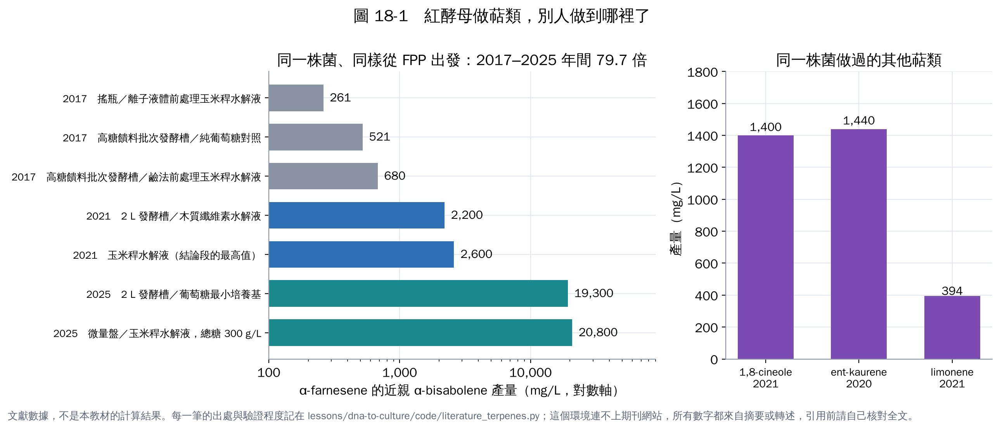
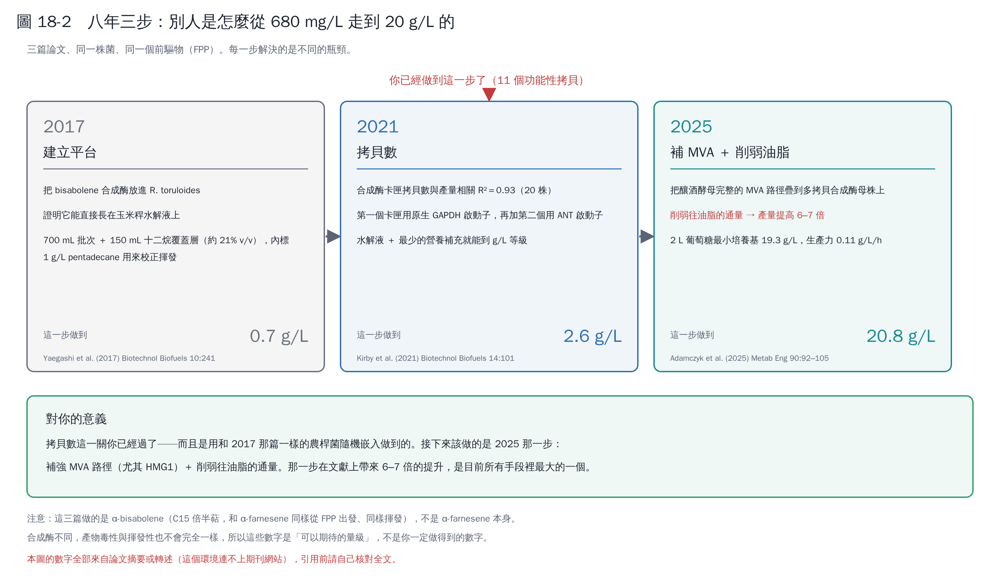

# 第 18 章　文獻精讀：紅酵母做倍半萜，別人是怎麼走到 20 g/L 的

第 17 章說「限氮催的是油脂，不是你的產物」，依據是四篇論文。這一章把那四篇攤開來讀。

值得逐篇讀的理由很單純：**它們用的是和你一樣的菌（*Rhodotorula／Rhodosporidium toruloides*）、一樣的前驅物（FPP）、一樣的隨機整合轉形方式，做的是和 α-farnesene 同為 C15 倍半萜的 α-bisabolene。** 這是你能找到最接近的先例。

## 18.1 先說這一章的限制

這一章和其他章不同——**數字不是算出來的，是從論文抄下來的**。而且這個執行環境連不上期刊網站（只有搜尋工具可用，`WebFetch` 對所有期刊網域都 DNS 失敗），所以：

> **我沒有讀過任何一篇的全文。** 所有數字來自摘要、結論，或回顧性文章的轉述。

因此每一筆數據我都在 `code/literature_terpenes.py` 裡標了 `verified` 等級：

| 等級 | 意義 |
|---|---|
| `abstract` | 摘要或結論裡明確寫出的數字 |
| `secondary` | 來自回顧文章或資料庫摘要的轉述，**連摘要都沒核對過** |

**引用到你的論文或計畫書之前，請自己開全文核對一次。** 18.9 節列了我特別不確定的幾個點。

## 18.2 產量的全景

八年之間，同一株菌、同一個前驅物，α-bisabolene 從 **261 mg/L 做到 20,800 mg/L——將近 80 倍**。

重點不是最後那個數字，而是**這 80 倍是分三步拿到的，而且每一步解決的瓶頸不同**。

## 18.3 2017：建立平台（Yaegashi et al.）[1]

### 做了什麼

把 bisabolene 合成酶放進 *R. toruloides*，證明這株菌可以直接長在**玉米稈水解液**上並產出非原生的倍半萜。同一篇也做了 amorphadiene（青蒿素前驅物）。

### 關鍵數字

| 條件 | 產量 |
|---|---|
| 搖瓶／離子液體前處理的玉米稈水解液 | **261 mg/L** |
| 高糖饋料批次發酵槽／鹼法前處理的玉米稈水解液 | **680 mg/L** |
| 同上，純葡萄糖對照 | 521 mg/L |

水解液組加的糖比對照多（73.8 vs 61.5 g/L），但乾重只稍高（27 vs 25 g/L）。

### 最該抄的一個方法細節

> 兩個發酵槽都是 **700 mL 起始批次培養液 ＋ 150 mL 十二烷覆蓋層**（約 21% v/v），覆蓋層裡加 **1 g/L pentadecane 當內標**，用來校正覆蓋層本身的揮發損失。

這一句解決了第 17 章提過的量測問題：**十二烷自己也會揮發**，所以不能只量覆蓋層裡的產物濃度，要用一個不揮發、不參與代謝的內標去還原真實量。這是最便宜就能抄走的一招。

### 對你的意義

- 這株菌**不需要先馴化**就能用水解液。你如果打算走廢資材路線，先例在這裡。
- 這篇用的是和你一樣的**農桿菌隨機嵌入**。所以你那 12 個串聯拷貝不是意外，是這個轉形方式的常態。

## 18.4 2021：拷貝數就是產量（Kirby et al.）[2]

### 這篇對你最重要

> 他們在 **20 株**轉形株裡發現，**bisabolene 產量和 P_GAPDH_-BIS 卡匣的拷貝數相關性 R² = 0.93**。

這是第 17 章那 12 個拷貝的直接參照：**在這株菌裡，合成酶的拷貝數幾乎單獨決定了產量**（至少在他們掃到的範圍內）。

### 做了什麼

- 第一個表現卡匣用**原生 GAPDH 啟動子**驅動 bisabolene 合成酶（BIS，來自 *Abies grandis*）。
- 再加上第二個卡匣，改用 **ANT（腺嘌呤核苷酸轉運蛋白）啟動子**，做出高拷貝株 GB2。
- 結果：**2 L 發酵槽、木質纖維素水解液，2.2 g/L**。論文結論段給的最高值是 **2.6 g/L bisabolene ＋ 1.4 g/L 1,8-cineole**，而且強調是「玉米稈水解液 ＋ 最少的營養補充」。

> ⚠ 2.2 與 2.6 兩個數字都出現在這篇，對應的條件我沒查清楚。要引用請看全文的 Table。

### 對你的意義

| 他們做的 | 你的狀況 |
|---|---|
| 刻意堆高合成酶拷貝數 | **你已經有 11 個功能性拷貝**（第 17 章） |
| 用兩種不同強度的啟動子分兩個卡匣 | 你只有一種啟動子，而且身分未知（17.4） |
| 水解液 ＋ 最少補充 | 你可以不必用昂貴的合成培養基 |

**換句話說，拷貝數這一關你已經過了。** 接下來該做的不是再加拷貝。

## 18.5 2025：補 MVA ＋ 削弱油脂（Adamczyk et al.）[3]

### 做了什麼

在**多拷貝合成酶母株**的基礎上，把**釀酒酵母完整的 MVA 路徑**一段一段疊上去（iterative stacking），並**削弱往油脂的通量**。

### 關鍵數字

| 條件 | 產量 |
|---|---|
| 2 L 發酵槽／葡萄糖最小培養基 | **19.3 g/L**，生產力 **0.11 g/L/h**（文獻最高） |
| 微量盤／玉米稈水解液，總糖 300 g/L | **20.8 g/L**（文獻最高） |

而最關鍵的那一句是：

> **削弱往油脂的通量，相對對照株帶來 6–7 倍的產量提升。**

### 對你的意義

這直接驗證了第 17.8 節那張代謝圖的核心論點：**油脂是主要的競爭者，不是類胡蘿蔔素。** 而且它給了量級——6–7 倍，是目前所有單一手段裡最大的一個。

這也是**你的下一步**：補強 MVA（尤其 HMG1）＋ 削弱油脂通量。

> 注意 20.8 g/L 是**微量盤**的結果，19.3 g/L 才是 2 L 發酵槽的。微量盤和發酵槽不能直接比——微量盤沒有溶氧控制、沒有 pH 控制、蒸發比例完全不同。報告裡引用時要寫清楚是哪一個。

## 18.6 三步走到哪裡，你在哪裡

| | 解決的瓶頸 | 做到 |
|---|---|---|
| 2017 | 這株菌能不能做、能不能用水解液 | 0.7 g/L |
| 2021 | 合成酶的量（拷貝數） | 2.6 g/L |
| 2025 | 前驅物供應 ＋ 競爭路徑 | 20.8 g/L |

**你在第二步的終點。** 這不是小事——那是別人花了四年、篩了 20 株才確立的一關，而你用隨機嵌入一次拿到 11 個功能性拷貝。

## 18.7 同一株菌做過的其他萜類

| 產物 | 類別 | 產量 | 年 | 出處 |
|---|---|---|---|---|
| α-bisabolene | 倍半萜 C15 | 20.8 g/L | 2025 | [3] |
| ent-kaurene | 雙萜 C20 | **1.44 g/L**（當時所有微生物宿主的最高紀錄） | 2020 | [4] |
| 1,8-cineole | 單萜 C10 | 1.4 g/L | 2021 | [2] |
| limonene | 單萜 C10 | 393.5 mg/L（另一來源寫 383.5） | 2021 | [5] |

**倍半萜（C15）的數字比單萜（C10）高一個數量級。** 這不是巧合：單萜從 GPP 出發，而酵母的 GPP 池很小（GPP 多半直接被延長成 FPP）；倍半萜從 FPP 出發，而 FPP 本來就是細胞裡的大宗中間物。

→ **你做的 α-farnesene 是倍半萜，站在比較有利的那一邊。**

### 順帶解決一半 17.4 的問題：啟動子工具箱

Nora et al. 2019 發表了當時這株菌最大的啟動子集合 [6]：**12 個單向 ＋ 8 個雙向原生啟動子**（這個種的第一組雙向啟動子），用 EGFP 與 mRuby2 雙報告基因以流式細胞儀定強度。其中**有 13 個比常用的 GAPDH 啟動子更強**。

這份清單對你有兩個用處：

1. **比對身分**：你那兩個未知啟動子如果來自紅酵母的文獻工具箱，很可能就在這篇的表裡。把序列和這篇的附件比對，比盲目 BLAST 更快。
2. **下一版構築用**：如果要重做，直接從這份清單挑，而不是沿用來路不明的啟動子。

## 18.8 可以直接抄的操作清單

從這些論文整理出來、**不需要改基因就能做**的事：

| 做什麼 | 依據 | 為什麼 |
|---|---|---|
| **十二烷覆蓋層約 20% v/v** | [1] 700 mL ＋ 150 mL | 揮發性倍半萜不覆蓋就量不到 |
| **覆蓋層裡加 1 g/L pentadecane 當內標** | [1] | 十二烷自己會揮發，要用內標還原 |
| **用水解液，營養補充給最少就好** | [2] | 這株菌天生耐水解液抑制物 |
| **產物量測取有機相做 GC-MS** | [1][2][3] | 水相的數字沒有意義 |
| **先確認拷貝數再決定要不要加拷貝** | [2] R²=0.93 | 你已經 11 個，加拷貝的邊際效益可能很低 |
| **把「削弱油脂」排在「調培養條件」前面** | [3] 6–7 倍 | 目前已知最有效的單一手段 |

需要改基因的下一步（照優先順序）：

1. **HMG1 過表現**／補整條 MVA — [3] 的主軸
2. **削弱油脂通量** — [3] 的 6–7 倍來源。注意 *R. toruloides* 的油脂相關基因清單在 Coradetti 2018 [7]（約 150 個影響油脂累積的基因）
3. **調降 ERG9** — 這三篇都沒明說有做，是第 17.8 節從代謝圖推出來的

## 18.9 這些論文沒回答，或我沒查到的

誠實清單，每一條都是你讀全文時要特別找的：

| 問題 | 狀況 |
|---|---|
| **C/N 對 bisabolene 產量的影響** | **沒有任何一篇直接掃過。** 第 17 章「限氮對 farnesene 不利」是從「限氮催油脂」＋「削弱油脂提高 6–7 倍」推出來的，**不是量出來的** |
| 2025 那篇的發酵細節（氮源、C/N、饋料策略、有沒有十二烷） | 查不到。只知道是「2 L 葡萄糖最小培養基」 |
| 2025 那篇具體削弱了哪些油脂基因 | 查不到 |
| 2021 的 2.2 vs 2.6 g/L 各對應哪個條件 | 查不到 |
| limonene 是 393.5 還是 383.5 mg/L | 兩個來源不一致 |
| Yaegashi 2017 的轉形方法細節與拷貝數 | 查不到（摘要沒寫） |

## 18.10 怎麼把全文讀完

這幾篇大多是開放取用：

| 論文 | 開放取用位置 |
|---|---|
| Yaegashi 2017 | PubMed Central：PMC5651578 |
| Kirby 2021 | PubMed Central：PMC8058980 |
| Geiselman 2020 | Microbial Cell Factories（BMC，開放取用） |
| Liu 2021 | PubMed Central：PMC8697501 |
| Nora 2019 | PubMed Central：PMC6599526 |
| Adamczyk 2025 | *Metabolic Engineering*（可能需訂閱）；OSTI 有公開版本 |

讀的時候建議帶著 18.9 那張表去找答案，找到之後回頭更新這一章——**這一章的數字是給你推翻的，不是給你背的**。

## 本章重點

- 同一株菌、同一個前驅物，α-bisabolene 八年間從 261 mg/L 到 20.8 g/L，**將近 80 倍，分三步拿到**。
- 2021 那篇證明**產量和合成酶拷貝數的相關性 R² = 0.93**——你的 11 個功能性拷貝等於把這一關做完了。
- 2025 那篇把產量推到 19–20 g/L，主要手段是**補整條 MVA ＋ 削弱往油脂的通量（6–7 倍）**。這是你的下一步，也驗證了第 17.8 節「油脂才是主要競爭者」的判斷。
- **倍半萜的數字比單萜高一個數量級**，因為 FPP 池比 GPP 池大。你做的是倍半萜，站在有利的一邊。
- 最便宜能抄走的一招：**十二烷覆蓋層 ＋ pentadecane 內標**。沒有它，你量到的產量是假的。
- **沒有任何一篇直接測過 C/N 對產量的影響。** 第 17 章那個「限氮對 farnesene 不利」仍然是推論，要你自己的實驗來確認。
- 這一章的所有數字都來自摘要或轉述，**沒有一筆核對過全文**。這是這一章最大的限制，也是為什麼每一筆都標了 `verified` 等級。

## 參考文獻

1. Yaegashi J, Kirby J, Ito M, et al. (2017). *Rhodosporidium toruloides*: a new platform organism for conversion of lignocellulose into terpene biofuels and bioplastics. *Biotechnology for Biofuels*, 10, 241. https://doi.org/10.1186/s13068-017-0927-5
2. Kirby J, Geiselman GM, Yaegashi J, et al. (2021). Further engineering of *R. toruloides* for the production of terpenes from lignocellulosic biomass. *Biotechnology for Biofuels*, 14, 101. https://doi.org/10.1186/s13068-021-01950-w
3. Adamczyk et al. (2025). The oleaginous yeast *Rhodosporidium toruloides* engineered for biomass hydrolysate-derived (E)-α-bisabolene production. *Metabolic Engineering*, 90, 92–105. https://doi.org/10.1016/j.ymben.2025.02.014
4. Geiselman GM, et al. (2020). Production of ent-kaurene from lignocellulosic hydrolysate in *Rhodosporidium toruloides*. *Microbial Cell Factories*, 19, 24. https://doi.org/10.1186/s12934-020-1293-8
5. Liu et al. (2021). Engineering *Rhodosporidium toruloides* for limonene production. *Biotechnology for Biofuels*, 14. https://doi.org/10.1186/s13068-021-02094-7
6. Nora et al. (2019). A toolset of constitutive promoters for metabolic engineering of *Rhodosporidium toruloides*. *Microbial Cell Factories*, 18, 117. https://doi.org/10.1186/s12934-019-1167-0
7. Coradetti ST, Pinel D, Geiselman GM, et al. (2018). Functional genomics of lipid metabolism in the oleaginous yeast *Rhodosporidium toruloides*. *eLife*, 7, e32110. https://doi.org/10.7554/eLife.32110
