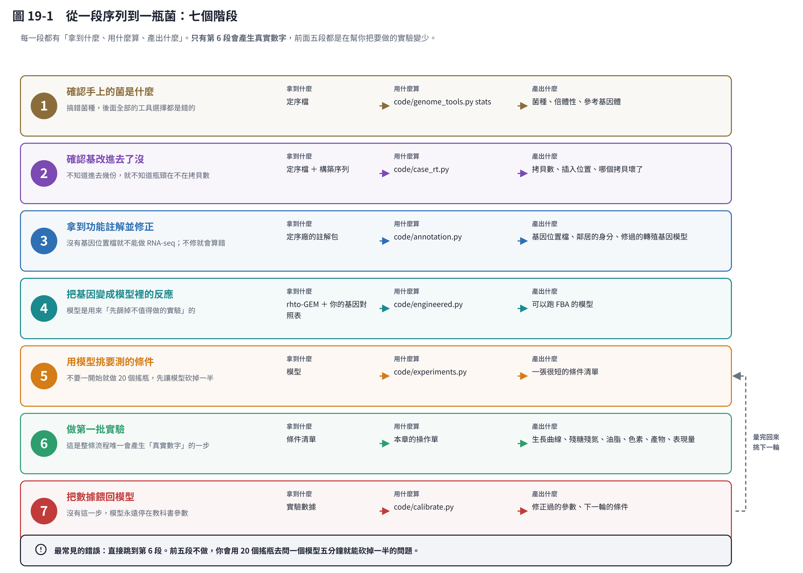
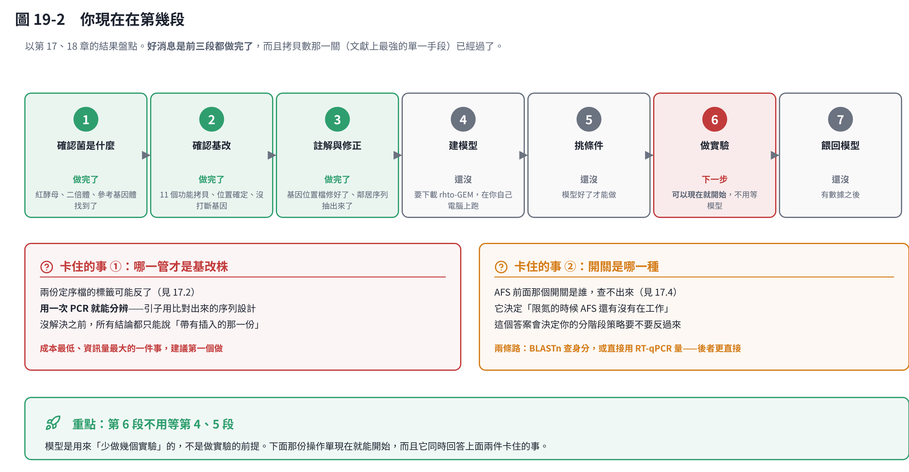
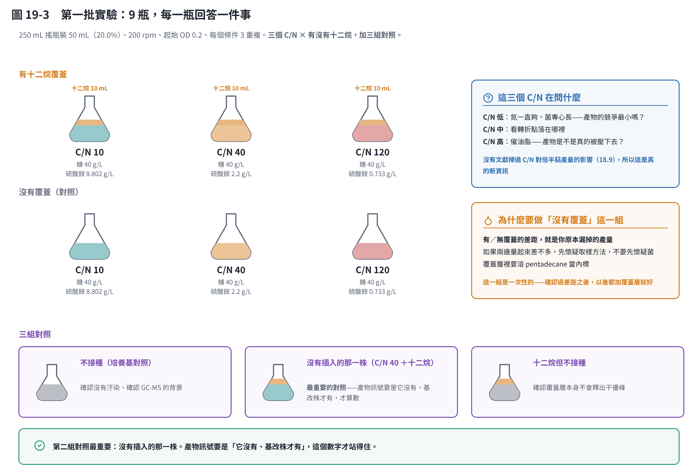
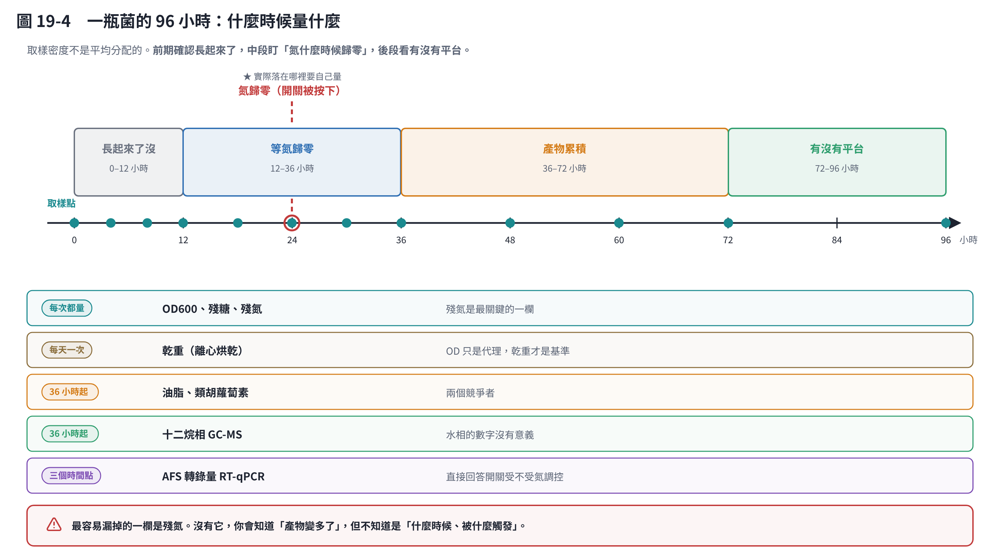
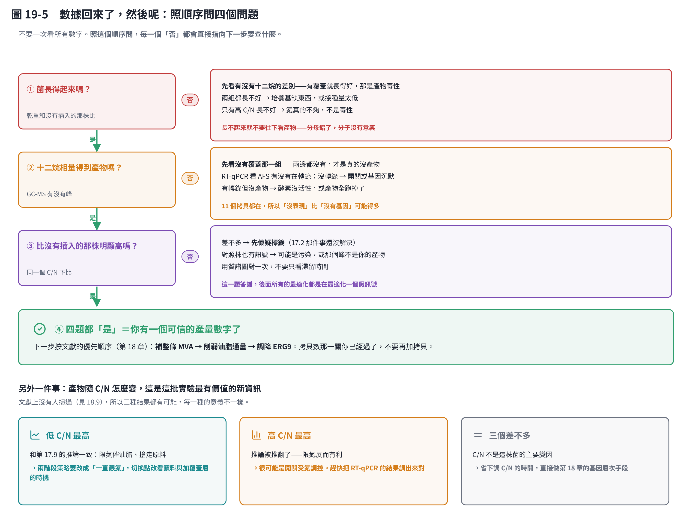

# 第 19 章　從一段序列到一瓶菌：完整的工作流程

前面十八章是一塊一塊的零件。這一章把它們串成**一條可以照著走的路**。

這一章的寫法和別章不一樣：

- 每一段都先講「**要做什麼**」，再講「**為什麼非這樣不可**」，最後附一個「**還有什麼做法、為什麼不選**」。
- 第 6 段是一份**可以直接拿進實驗室的操作單**——配多少、接多少、幾點取樣、量什麼，全部寫出來。
- 數字分三種顏色標示：**算出來的**（可以自己驗算）、**文獻來的**（有引用）、**起始猜測**（沒有這株菌的實測值，第一批實驗就是要把它量出來）。

> **這一章不是教科書流程，是給一個具體的人、一株具體的菌寫的。**
> 你的狀況不同，照抄會有問題；但「每一步在問什麼」是通用的。

## 19.1 全景：七個階段



七段，每一段都有「拿到什麼 → 用什麼算 → 產出什麼」。

有一件事值得先講清楚：**只有第 6 段會產生真實的數字。** 前面五段都不是在做研究，是在**把要做的實驗變少**。

這聽起來像在拖延，但算一下就知道划不划算：

- 你想測的變數有 C/N、溫度、pH、溶氧、碳源、接種量、有沒有覆蓋層⋯⋯隨便就七八個。
- 每個變數三個水準，全做完是 3⁷ ＝ **2,187 個搖瓶**。
- 先用模型砍掉「不管怎麼調都動不了產物」的那些，再用文獻砍掉「別人已經試過」的那些，剩下的通常是**六到九個**。

**最常見的錯誤是直接跳到第 6 段。** 前五段不做，你會用 20 個搖瓶去問一個模型五分鐘就能砍掉一半的問題。

## 19.2 你現在在第幾段



以第 17、18 章的結果盤點：**前三段都做完了。**

而且做完的那三段裡，有一段是文獻上最有價值的那一關：**拷貝數**。2021 年那篇在同一株菌做同類產物，證明產量和拷貝數的相關性高達 R² ＝ 0.93 [2]。你有 11 個功能性拷貝，**這一關已經過了，不要再加拷貝**。

還卡著兩件事：

1. **哪一管才是基改株**（見 17.2）。用一次 PCR 就能分辨。**成本最低、資訊量最大，建議第一個做。**
2. **AFS 前面那個開關是哪一種**（見 17.4）。它決定「限氮的時候 AFS 還有沒有在工作」，而那直接決定你的分階段策略要不要反過來。

**但第 6 段不用等第 4、5 段。** 模型是用來「少做幾個實驗」的，不是做實驗的前提。下面那份操作單現在就能開始，而且它**同時回答上面兩件卡住的事**。

## 19.3 第 1 段：確認手上的菌是什麼

### 做什麼

把定序檔跑一次基本統計，確認三件事：拼得完不完整、有沒有定序不出來的洞、GC 含量對不對。

```bash
python code/genome_tools.py stats WT.fasta MUT.fasta
```

### 為什麼非做不可

**搞錯菌種，後面全部的工具選擇都是錯的。**

這不是假設性的風險。紅酵母是**真核生物**，如果誤以為是細菌，你會去用 Prokka 預測基因（它假設基因沒有內含子）、用 CheckM2 算完整度（它用細菌的標記基因）、用 CarveMe 建模型（它的模板庫是細菌代謝）——每一個都會跑完、都會給你結果、**都不會報錯**，但結果全部是錯的。第 15 章整章在講這件事。

另外要確認的是**倍體性**。這株菌是二倍體，兩套染色體來自不同親本。這代表：變異分析會看到大量「兩個版本不一樣」的位點（**那是正常的，不是定序出錯**），而且基因剔除要處理兩個等位基因。

### 還有什麼做法

| 做法 | 優點 | 缺點 | 這裡為什麼不選 |
|---|---|---|---|
| 只做 ITS 或 26S 定序鑑定 | 便宜、快 | 只能定到種，看不到倍體性，也拿不到後面要用的序列 | 你已經有全基因體了，沒必要退回去 |
| 送去做 ANI 比對 | 定種很準 | 要有參考基因體，而且只回答「是不是這個種」 | 定序廠的報告已經做了，直接看就好 |
| 用 BUSCO 算完整度 | 真核專用的標準做法 | 要下載資料庫 | **值得做**，只是這個教材環境沒網路。你在自己電腦上補跑 |

## 19.4 第 2 段：確認基改進去了沒

### 做什麼

拿構築序列當探針，在基因體上逐字比對，回答四個問題：**進去了嗎、在哪裡、幾份、有沒有壞的**。

```bash
python code/case_rt.py --wt WT.fasta --mut MUT.fasta --construct construct.fasta
```

### 為什麼非做不可

**不知道進去幾份，就不知道瓶頸在不在拷貝數。**

這一段的投資報酬率極高：它是你唯一一次有機會知道「加拷貝還有沒有用」。2021 那篇的 R² ＝ 0.93 告訴你拷貝數很重要 [2]；但如果你已經有 11 份，再加第 12 份的邊際效益接近零，那筆錢應該花在別的地方。

第 17 章整章是這一段的實作，包括兩個會讓你得到「看起來很合理但完全錯誤」結論的坑。

### 還有什麼做法

| 做法 | 優點 | 缺點 | 這裡為什麼不選 |
|---|---|---|---|
| **qPCR 算拷貝數** | 便宜、快、可以定量 | 只給一個數字，不知道位置、不知道有沒有壞掉的 | **應該做，而且和定序互補**——定序給的 12 是**下限**（拼接會壓縮重複），qPCR 才給得出實際份數 |
| Southern blot | 老方法但可靠，看得到排列方式 | 慢、要放射性或地高辛標記 | 定序已經給了更細的資訊 |
| 長讀定序（Nanopore／PacBio） | 可以直接讀穿整個串聯陣列 | 貴 | **你已經做了**——N50 1.2 Mb、0 個 N 就是長讀的水準 |
| 只做 PCR 確認「有沒有」 | 最便宜 | 不給份數、不給位置 | **還是要做**——17.2 那個標籤問題就是靠它解決 |

> **這裡要特別講一下「定序的 12 是下限」。**
> 定序之後要把一段一段的讀段拼起來。遇到 12 段幾乎一模一樣的序列，拼接程式分不出哪一段是哪一份，
> 常常會把它們**壓縮成比較少的份數**。所以 12 這個數字只能說「至少 12 份」。
> 要知道確切份數，要嘛用 qPCR，要嘛把原始讀段比回單一拷貝算覆蓋深度。

## 19.5 第 3 段：拿到功能註解並修正

### 做什麼

把定序廠的註解包（基因位置檔、蛋白質序列、功能比對表）整理成能用的東西，而且**修掉它在外來基因上的錯誤**。

```bash
# 統計兩株的註解，順便用結構域計數獨立驗證拷貝數
python code/annotation.py summary --wt <WT 資料夾> --mut <MUT 資料夾> \
    --site-gff <沒有插入的那一株的資料夾> -o code/annotation.json

# 把轉殖基因的模型修成正確的（RNA-seq 之前一定要做）
python code/annotation.py fix-gff --gff WT.gff --copies code/case_rt.json -o WT.fixed.gff

# 把插入點旁邊兩個基因的蛋白質抽出來，拿去 BLAST
python code/annotation.py neighbours --dir <沒有插入的那一株的資料夾> -o code/insertion-neighbours
```

### 為什麼非做不可

兩個理由：

**一、沒有基因位置檔就不能做 RNA-seq。** 要算每個基因的表現量，得先知道每個基因在染色體的哪裡。而 RNA-seq 正是回答「限氮時 AFS 還有沒有在表現」的工具。

**二、不修就會算錯，而且不會報錯。** 基因預測程式把沒有內含子的 AFS 切成三段、預測成 682 個胺基酸（正確是 576 個），因為它的預設假設是「真核生物的基因有內含子」。直接拿這份檔案去計數，AFS 的讀序會被算到錯的模型上。

這一段還有一個附帶價值：**它可以當前一段的獨立驗證**。定序廠的流程完全不知道有構築，只是預測基因再比對結構域——它數出來的 12 個萜類合成酶，和我們逐字比對出來的 12 個拷貝對上了。**兩個假設完全不同的方法得到同一個答案，結論才算數**（見 17.10）。

### 還有什麼做法

| 做法 | 優點 | 缺點 | 這裡為什麼不選 |
|---|---|---|---|
| 自己跑 Funannotate 或 BRAKER | 參數可控，可以餵 RNA-seq 進去提高準確度 | 要裝一堆依賴、要跑好幾小時 | 定序廠已經給了一份堪用的。**等你有 RNA-seq 之後再重跑一次會明顯更準** |
| 直接用 JGI 的 `Rhoto_IFO0880_4` 註解 | 品質比定序廠這份好 | 那是**別株菌**的座標，你的插入位置不會在上面 | **兩個都要**——功能描述查 JGI，座標用自己的 |
| 不修 GFF，直接算 | 省事 | 會算出看起來合理的錯誤表現量 | 這是 17.10 整節在講的坑 |

## 19.6 第 4 段：把基因變成模型裡的反應

### 做什麼

拿現成的紅酵母代謝模型 rhto-GEM，把 AFS 那條反應加進去，就能用電腦算「理論上最多能做多少、動哪裡最有效」。

```bash
# 這一步要下載模型，在你自己的電腦上跑
python code/annotation.py gem-map --faa WT.faa -o gem-map/   # 先產生基因對照表的指令
python code/engineered.py                                     # 加反應、算生產包絡線
```

### 為什麼非做不可

**模型不是用來預測產量的，是用來「先篩掉不值得做的實驗」的。**

舉個具體的例子：你想知道「把 ERG9 調降能多拿多少產物」。這件事做實驗要改基因、建菌株、養菌、分析，三個月跑不掉。模型五分鐘就能給你一條曲線：調降到某個程度之前產物一直上升，過了某個點細胞就長不動了。**那條曲線不會告訴你確切的數字，但它會告訴你「值不值得花三個月」。**

### 還有什麼做法

| 做法 | 優點 | 缺點 | 這裡為什麼不選 |
|---|---|---|---|
| 用 CarveMe／gapseq 從基因體自動建模型 | 全自動 | **它們是細菌專用的** | 第 15 章講過，真核生物不適用 |
| 用釀酒酵母的 Yeast8 | 現成、研究得最透徹 | **不是同一種菌**：紅酵母是 Crabtree 陰性、會大量累積油脂、能直接用木糖 | 套錯模型的結論會系統性地偏 |
| 完全不用模型，直接做實驗 | 省掉學模型的時間 | 實驗數量會爆炸 | 見 19.1 那個 2,187 個搖瓶的算法 |
| **用 rhto-GEM** | 建在同一個種上、手工校正過 | 要下載、要做基因 ID 對照 | **選這個** |

> **一個誠實的提醒**：模型算出來的「理論上限」和實際產量常常差一個數量級。
> 第 17.8 算過碳的理論上限是 0.252 公克產物／公克糖；文獻實際做到的是上限的百分之幾。
> **模型拿來排序選項，不要拿來預測數字。**

## 19.7 第 5 段：用模型挑要測的條件

### 做什麼

用模型跑一輪「如果改這個會怎樣」，把要做的條件砍到最少。

```bash
python code/experiments.py     # 供氧、碳源、兩階段、溫度 pH、最適化
```

### 為什麼非做不可

因為搖瓶很貴——不是錢貴，是**時間貴**。一批 96 小時，加上分析，一個禮拜只能跑一輪。能少做三瓶，就是省下一個禮拜。

### 還有什麼做法

| 做法 | 優點 | 缺點 | 這裡為什麼不選 |
|---|---|---|---|
| 一次改一個因子 | 直覺、好解釋 | 看不到因子之間的交互作用，而且實驗數反而多 | 第 7 章有詳細比較 |
| 全因子設計 | 資訊最完整 | 實驗數爆炸 | 同上 |
| 貝氏最適化 | 用最少的實驗找到最適點 | 要先有一批數據才跑得動 | **第二輪再用**。第一輪連基準線都沒有 |
| **先用模型砍，再用簡單設計** | 實驗數少、每一瓶都在回答問題 | 依賴模型的品質 | **選這個**，而且第一輪的設計刻意保守 |

## 19.8 第 6 段：第一批實驗的完整操作單

這是整章的主菜。**所有數字由 `code/workflow.py` 算出來，存成 `workflow.json`。**

```bash
python code/workflow.py --show    # 重算並印出操作單
```

### 這批實驗要回答什麼

一次回答四件事——這就是為什麼值得先花時間設計：

1. **產物到底有沒有**，以及有多少（第一個可信的數字）
2. **C/N 對產物的影響**（文獻上沒有人掃過，見 18.9——**這是真的新資訊**）
3. **AFS 的開關受不受氮調控**（解決 17.4 卡住的事）
4. **OD600 換算乾重的校正線**（第 10、11 章之後一直要用）



### 配置

| 項目 | 數值 | 出處 |
|---|---|---|
| 搖瓶 | 250 mL | — |
| 裝液 | 50 mL（20.0%） | 算出來的 |
| 轉速 | 200 rpm | 文獻（對應 kLa 約 60–120 h⁻¹） |
| 起始 OD600 | 0.2 | **起始猜測** |
| 接種量 | 種菌 OD 5 接 2.0 mL（4.0% v/v） | 算出來的 |
| 糖 | 40 g/L 葡萄糖 | **起始猜測** |
| 時間 | 96 小時 | **起始猜測** |
| 重複 | 每個條件 3 瓶 | — |
| 總瓶數 | 9 個條件（×3 重複 ＝ 實際 27 瓶） | — |

**轉速那一欄要注意**：kLa 是量級，**你自己的搖床一定要實測**（亞硫酸鈉法或動態法）。搖床的軌跡半徑差一點，kLa 就差很多。

### 培養基（每公升）

C/N 在文獻裡有兩種寫法——**莫耳比**和**質量比**，兩者差快兩倍。看錯會整批做錯，所以這裡兩種都列：

| 條件 | 葡萄糖 | 硫酸銨 (NH₄)₂SO₄ | 莫耳 C/N | 質量 C/N |
|---|---|---|---|---|
| 低（氮充足） | 40 g | **8.802 g** | 10 | 約 8.6 |
| 中 | 40 g | **2.2 g** | 40 | 約 34.3 |
| 高（限氮） | 40 g | **0.733 g** | 120 | 約 102.8 |

換算方法很單純，可以自己驗算：葡萄糖每個分子 6 個碳、分子量 180.16；硫酸銨每個分子 2 個氮、分子量 132.14。

另外要加的（**這一欄要照你實驗室原本的配方，不要照抄**）：磷酸鹽緩衝、鎂、微量元素、維生素。紅酵母對培養基不挑，但缺了微量元素會長不好。

> **為什麼糖固定、只改氮？**
> 因為這樣才知道差異是「氮」造成的。糖和氮一起改，兩個變數糾在一起，結果沒辦法解釋。

### 十二烷覆蓋層

| 項目 | 數值 |
|---|---|
| 十二烷 | **10 mL／瓶**（20% v/v） |
| 內標 pentadecane | **10 mg**（溶在十二烷裡，1 g/L） |

依據是 2017 那篇：700 mL 培養液 ＋ 150 mL 覆蓋層，約 21% [1]。

**內標不能省。** 十二烷自己也會揮發，少掉的體積要用不揮發的內標還原回來。沒有內標，你量到的濃度會隨著培養時間越來越「高」——那是假的，是溶劑變少造成的。

### 步驟

**第 −2 天：種菌**

1. 從平板挑單一菌落，接到 5 mL 一般培養基（YPD 之類），30 °C、200 rpm 過夜。
2. 第二天轉接到 20 mL 新鮮培養基，再養到 OD600 約 5。

> **為什麼要轉接一次？** 讓菌進入穩定的對數生長期。直接從過夜培養接種，菌已經進入靜止期，會有很長的遲滯期，而且各瓶不一致。

**第 0 天：接種**

3. 配三種 C/N 的培養基，分裝每瓶 50 mL，滅菌。
4. 種菌離心、用無菌水洗一次、用培養基回溶——**這一步不要省**，不然會把種菌培養基裡的氮一起帶進去，高 C/N 那組就不是高 C/N 了。
5. 接種 2.0 mL（4.0% v/v），起始 OD600 約 0.2。
6. 「有覆蓋」那一組，**接種後立刻**鋪上 10 mL 已經溶好內標的十二烷。
7. **全部用鋁箔包起來遮光。** 光（尤其藍光）會誘導色素，等於一直在餵競爭者（見 17.9）。
8. 30 °C、200 rpm。

**第 0–4 天：取樣**



| 時段 | 間隔 | 量什麼 |
|---|---|---|
| 0–12 h | 每 4 小時 | OD600、殘糖、殘氮 |
| 12–36 h | 每 6 小時 | OD600、殘糖、**殘氮**、乾重 |
| 36–72 h | 每 12 小時 | 全部項目 ＋ 十二烷相 GC-MS |
| 72–96 h | 每 24 小時 | 全部項目 |

每次取樣的動作：

1. **先取十二烷相**（上層），取 200 µL，放 −20 °C 等著做 GC-MS。
2. 搖勻後取水相 2 mL：
   - 200 µL 稀釋後量 OD600（**稀釋到讀值 0.1–0.5**）
   - 1 mL 離心，上清量殘糖與殘氮，沉澱留著
   - 剩下的用來做乾重或色素
3. 記錄：時間、OD、稀釋倍數、瓶號、有沒有異常（顏色、味道、沉澱）。

> **為什麼殘氮是最關鍵的一欄？**
> 因為產油的開關不是「氮很少」，是**氮耗盡那個事件**（17.9）。
> 沒有量殘氮，你會知道「產物變多了」，但不知道是「什麼時候、被什麼觸發」——
> 而那正是第 5、6 章要找的轉折點。

**第 4 天：收**

9. 量最終乾重、油脂、色素。
10. 十二烷相做 GC-MS，用內標還原濃度。

### 乾重校正線（順便做掉）

這批實驗同時要產出 **OD600 ↔ 乾重**的校正線，而且**每個階段各一條**。

做法：在長菌期和產油期各挑 3–4 個時間點，同時量 OD 和乾重（取已知體積、離心、洗、60 °C 烘到恆重）。

> **為什麼每個階段都要做一條？**
> 因為限氮階段細胞塞滿油滴，折射率和大小都變了。**同樣 1 公克乾重的菌，OD600 讀出來就是不一樣**（17.8）。
> 一條在長菌期做的校正線，用到產油期就是錯的。

### 這批最多能做出多少

碳的理論上限：糖 40 g/L，**最多** 10.08 g/L（每瓶 504 mg）。

**這是上限，不是預期值。** 它只算了碳、沒檢查 ATP 和 NADPH 夠不夠，所以實際一定更低——文獻實際做到的是上限的百分之幾。

寫出來的用意是**設定 GC-MS 的期待值**：如果你預期的是毫克等級，就要先確認你的方法偵測得到那個濃度，不要等做完才發現在偵測極限以下。

### 還有什麼做法

| 做法 | 優點 | 缺點 | 這裡為什麼不選 |
|---|---|---|---|
| **直接上發酵槽** | 控溫控 pH 控溶氧、可以饋料、產量高得多 | 一次只能跑一兩個條件、建置成本高 | **第一批不適合**。你要的是「比較六個條件」，搖瓶才做得到。有了結論再放大 |
| 深孔盤（96 孔）做高通量 | 可以一次跑幾十個條件 | 供氧差（kLa 只有 5–20）、不能鋪覆蓋層、取樣困難 | **揮發性產物不能用**——沒有覆蓋層，量到的是假的 |
| 用木質纖維水解液當碳源 | 貼近實際應用，這株菌天生耐受抑制物 [2] | 成分不定，變數太多 | **第一批先用葡萄糖**，把基準線建乾淨。水解液留給第二輪 |
| 饋料批次（補糖） | 產量高得多，文獻走的就是這條 [1][3] | 要人顧、要泵 | 同上，**第二輪再做**。第一批的目的是「找開關在哪」 |
| 只做 ±十二烷，不掃 C/N | 省一半的瓶子 | 掃 C/N 才是這批最有價值的新資訊 | C/N 那三瓶不能省 |
| 不做「沒有覆蓋」那一組 | 省三瓶 | 不知道自己原本漏掉多少 | **做一次就好**，之後都加覆蓋層 |

### 這份操作單哪裡最可能錯

誠實清單——下面每一條都是「我沒有你的菌的實測值」：

| 數字 | 我給的 | 為什麼可能錯 |
|---|---|---|
| 起始 OD 0.2 | 起始猜測 | 太低遲滯期長、太高很快缺氧。0.1–0.5 都合理 |
| 糖 40 g/L | 起始猜測 | 搖瓶不補料，太高會滲透壓抑制 |
| 96 小時 | 起始猜測 | 文獻的倍半萜發酵多在 3–7 天。**第一批就是要量出你的曲線長什麼樣** |
| C/N 10／40／120 | 起始猜測 | 橫跨「氮充足」到「明顯限氮」，但轉折點落在哪裡不知道 |
| 30 °C、200 rpm | 常規值 | 你的搖床、你的菌株可能不同 |

**第一批實驗的目的，就是把這張表變成實測值。** 做完之後回來改這一節。

## 19.9 第 7 段：把數據餵回模型

### 做什麼

把量到的曲線拿去修模型的參數，讓它從「教科書參數」變成「你的菌的參數」。

```bash
python code/calibrate.py --batches batches.csv --samples samples.csv
```

### 為什麼非做不可

因為沒有這一步，模型永遠停在別人的數字上。第 11 章整章在講這件事，包括一個很重要的負面結果：**有些參數不管怎麼擬合都辨識不出來**（資料裡沒有能決定它的資訊）。知道哪些參數不可信，和知道哪些可信一樣重要。

資料格式就是第 11 章那兩張 CSV：條件一張（每批一列）、量測一張（每次取樣一列）。範本在 `code/example-data/`。

## 19.10 數據回來了，然後呢



**不要一次看所有數字。** 照這個順序問，每一個「否」都會直接指向下一步要查什麼：

1. **菌長得起來嗎？**（和沒有插入的那株比乾重）
   長不起來就不要往下看產物——分母錯了，分子沒有意義。
   先看有沒有十二烷的差別：有覆蓋就長得好 → 那是產物毒性。
2. **十二烷相量得到產物嗎？**
   先看沒有覆蓋那一組——兩邊都沒有，才是真的沒產物。
   有轉錄但沒產物 → 酵素沒活性，或產物全跑掉了。**11 個拷貝都在，所以「沒表現」比「沒有基因」可能得多。**
3. **比沒有插入的那株明顯高嗎？**
   差不多 → **先懷疑標籤**（17.2 那件事還沒解決）。
   這一題答錯，後面所有的最適化都是在最適化一個假訊號。
4. **三題都是 → 你有一個可信的產量數字了。**
   下一步按文獻的優先順序（第 18 章）：**補整條 MVA → 削弱油脂通量 → 調降 ERG9**。

而 C/N 那三個條件的結果，三種可能各有各的意義：

| 結果 | 意思 | 下一步 |
|---|---|---|
| **低 C/N 最高** | 和 17.9 的推論一致：限氮催油脂、搶走原料 | 兩階段策略改成「一直餵氮」，切換點改看饋料與加覆蓋層的時機 |
| **高 C/N 最高** | 推論被推翻了——限氮反而有利 | 很可能是開關受氮調控。把 RT-qPCR 的結果調出來對 |
| **三個差不多** | C/N 不是這株菌的主要變因 | 省下調 C/N 的時間，直接做第 18 章的基因層次手段 |

**三種結果都有價值**，包括第三種。「這個變數不重要」是一個結論，而且它會幫你省下後面好幾個月。

## 19.11 整條路上的岔路：其他做法與為什麼不選

前面每一段都附了一張「還有什麼做法」。這一節把**影響最大的五個決定**集中起來，因為它們一旦選錯，後面很難回頭。

### 決定一：模型要自己建，還是用現成的

| 選項 | 優點 | 缺點 |
|---|---|---|
| **用 rhto-GEM** ✅ | 建在同一個種上、手工校正過、有人維護 | 要下載、要做基因 ID 對照、不是你的菌株 |
| 從基因體自動建 | 完全貼合你的菌株 | 自動建模工具都是細菌用的；真核版本品質差很多 |
| 不用模型 | 省掉學習成本 | 實驗數會爆炸 |

**為什麼選現成的**：你的註解只有 69% 的基因有功能命中，名稱欄全部是「不知道是什麼」。拿這種材料從頭建，會得到一個到處是洞的模型——而那些洞你看不出來，它還是會給你答案。

### 決定二：先調培養條件，還是先改基因

| 選項 | 優點 | 缺點 |
|---|---|---|
| **先調條件** ✅（第一輪） | 便宜、快、不用做菌株 | 天花板低 |
| 先改基因 | 文獻上效果最大（削弱油脂 6–7 倍 [3]） | 慢、貴、要先知道該改哪裡 |

**為什麼第一輪選調條件**：因為你**連基準線都還沒有**。不知道現在產多少，就不知道改完有沒有變好。而且第一輪順便解決兩件卡住的事（標籤、開關），這是改基因做不到的。

**但第二輪就要換邊。** 第 18 章的三篇論文很清楚：把產量推上去的是基因層次的手段，不是培養條件。

### 決定三：搖瓶還是發酵槽

| 選項 | 優點 | 缺點 |
|---|---|---|
| **搖瓶** ✅（第一輪） | 可以同時跑很多條件、便宜 | 控制不了 pH 和溶氧、不能饋料 |
| 發酵槽 | 控制好、產量高、可以饋料 | 一次一兩個條件、建置成本高 |

**為什麼第一輪選搖瓶**：你要的是「**比較**六個條件」，不是「把一個條件做到最好」。這是兩種不同的實驗，不要混在一起。

### 決定四：量產物要不要加有機相

這個**沒有選擇**——不加就是錯的。

產物會揮發，你取水相量到的只是「還沒跑掉的那一點」。兩株菌真實產量可能差三倍，但量出來差不多。**不是菌沒差別，是量法把差別抹掉了。**

唯一要做一次的事，是**做一組「沒有覆蓋」的對照**，看看自己原本漏掉多少。確認過之後就不用再做了。

### 決定五：C/N 要不要掃

| 選項 | 優點 | 缺點 |
|---|---|---|
| **掃三個 C/N** ✅ | 文獻沒人做過，是真的新資訊 | 多做四瓶 |
| 只用文獻的條件 | 省事 | 文獻在這件事上**沒有答案**（18.9） |

**為什麼要掃**：第 17.9 那個「限氮對 farnesene 不利」是**推論，不是量出來的**。它的推論鏈是「限氮催油脂」＋「削弱油脂能提高 6–7 倍」，兩個前提都有文獻，但中間那一步沒有人直接測過。

**你的三瓶就能回答它。** 這是整批實驗裡最可能變成一篇論文的部分。

## 19.12 一頁總表

| 段 | 做什麼 | 輸入 | 產出 | 工具 | 大概要多久 |
|---|---|---|---|---|---|
| 1 | 確認菌是什麼 | 定序檔 | 菌種、倍體性、參考基因體 | `genome_tools.py stats` | 一小時 |
| 2 | 確認基改 | 定序檔 ＋ 構築 | 拷貝數、位置、哪個壞了 | `case_rt.py` | 半天 |
| 3 | 註解與修正 | 定序廠註解包 | 基因位置檔、鄰居身分 | `annotation.py` | 半天 |
| 4 | 建模型 | rhto-GEM ＋ 對照表 | 可以跑 FBA 的模型 | `engineered.py` | 一到兩天 |
| 5 | 挑條件 | 模型 | 一張很短的條件清單 | `experiments.py` | 半天 |
| 6 | **做實驗** | 條件清單 | **真實數字** | 19.8 的操作單 | **一到兩週** |
| 7 | 餵回模型 | 實驗數據 | 修正的參數、下一輪條件 | `calibrate.py` | 一天 |

「大概要多久」那一欄是**起始猜測**，而且假設你已經熟悉工具。第一次做每一段都會更久。

注意比例：**第 6 段佔掉整條流程一半以上的時間**，但它前面那五段加起來不到一週。這就是為什麼值得先做。

## 本章重點

- **七個階段裡只有第 6 段產生真實數字**，前五段是在把要做的實驗變少。七個變數各三個水準全做完是 2,187 個搖瓶；先砍過之後是六到九個。
- **你的前三段已經做完了**，而且最有價值的那一關（拷貝數，文獻 R² ＝ 0.93）已經過了。**不要再加拷貝。**
- **第 6 段不用等第 4、5 段。** 模型是用來少做幾個實驗的，不是做實驗的前提。
- **第一批實驗一次回答四件事**：產物有多少、C/N 的影響、開關受不受氮調控、OD 換算乾重的校正線。設計好的實驗就該這樣。
- **C/N 那三瓶是整批最有價值的部分**——文獻上沒有人掃過，第 17.9 那個結論到現在還只是推論。
- **殘氮是最容易漏掉、但最關鍵的一欄。** 沒有它，你會知道產物變多了，但不知道是什麼時候、被什麼觸發。
- **有機相覆蓋沒有選擇餘地。** 不加就是錯的；但要做一次「沒有覆蓋」的對照，知道自己原本漏掉多少。
- **判讀數據要照順序問**：菌長得起來嗎 → 量得到產物嗎 → 比對照株高嗎。前一題沒過就看後一題，等於在最適化一個假訊號。
- **三種 C/N 結果都有價值**，包括「三個差不多」——那代表 C/N 不是主要變因，省下你後面好幾個月。
- **這份操作單的一半數字是起始猜測**，不是實測值。第一批實驗的目的之一，就是把它們換成你自己的數字，然後回來改這一章。

## 參考文獻

1. Yaegashi J, Kirby J, Ito M, et al. (2017). *Rhodosporidium toruloides*: a new platform organism for conversion of lignocellulose into terpene biofuels and bioplastics. *Biotechnology for Biofuels*, 10, 241. https://doi.org/10.1186/s13068-017-0927-5
2. Kirby J, Geiselman GM, Yaegashi J, et al. (2021). Further engineering of *R. toruloides* for the production of terpenes from lignocellulosic biomass. *Biotechnology for Biofuels*, 14, 101. https://doi.org/10.1186/s13068-021-01950-w
3. Adamczyk et al. (2025). The oleaginous yeast *Rhodosporidium toruloides* engineered for biomass hydrolysate-derived (E)-α-bisabolene production. *Metabolic Engineering*, 90, 92–105. https://doi.org/10.1016/j.ymben.2025.02.014
4. Coradetti ST, Pinel D, Geiselman GM, et al. (2018). Functional genomics of lipid metabolism in the oleaginous yeast *Rhodosporidium toruloides*. *eLife*, 7, e32110. https://doi.org/10.7554/eLife.32110
