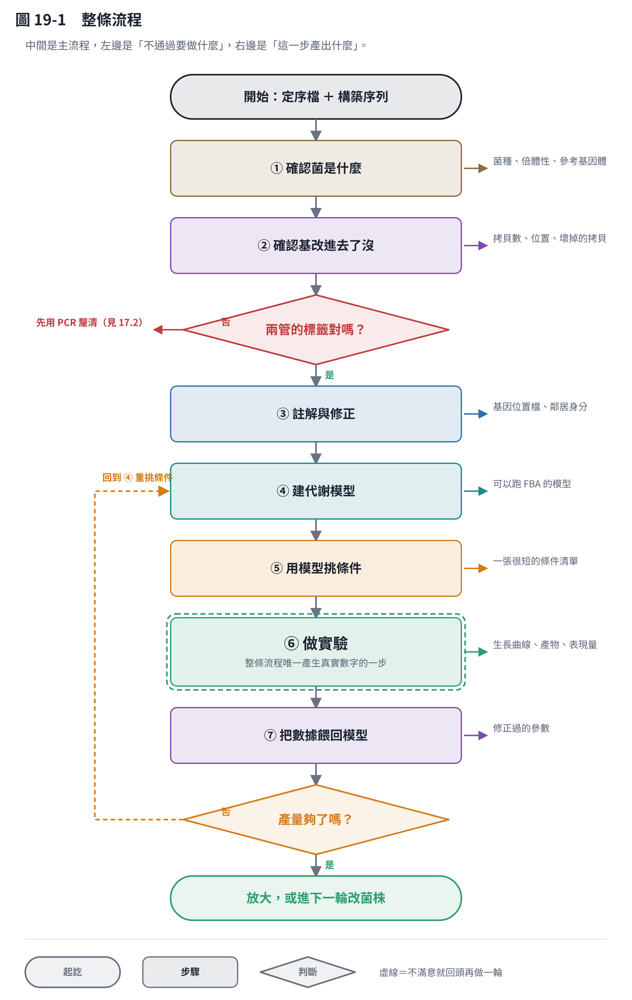
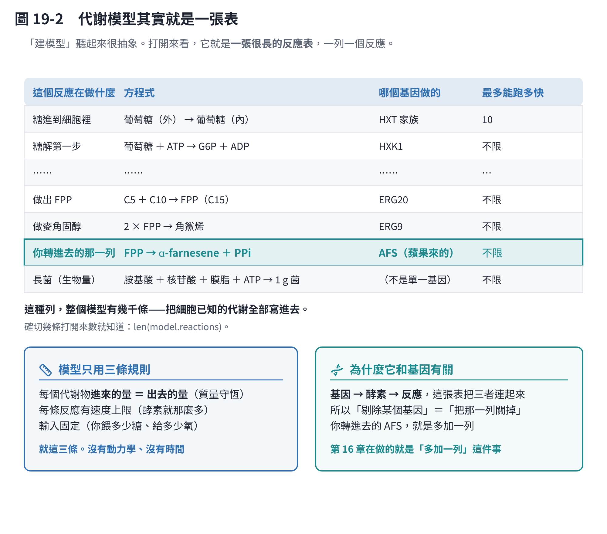
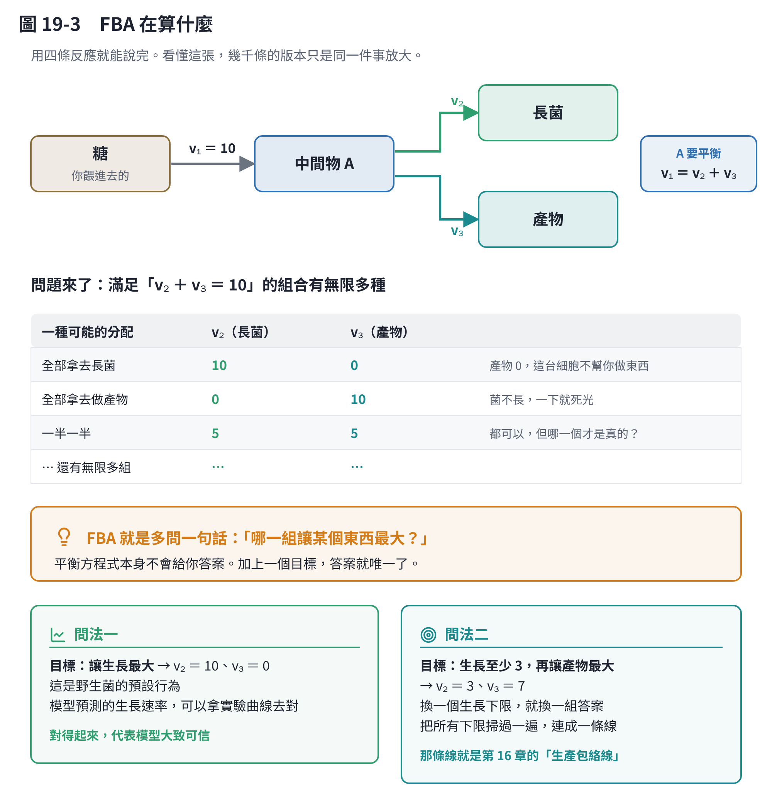
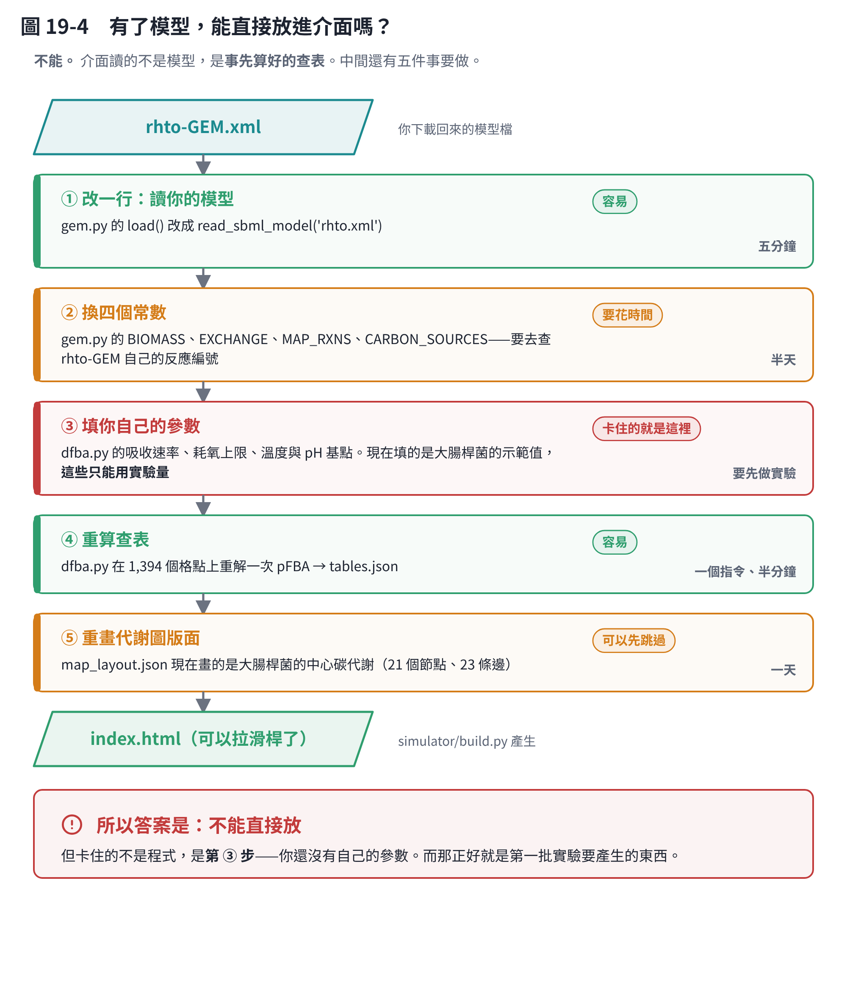
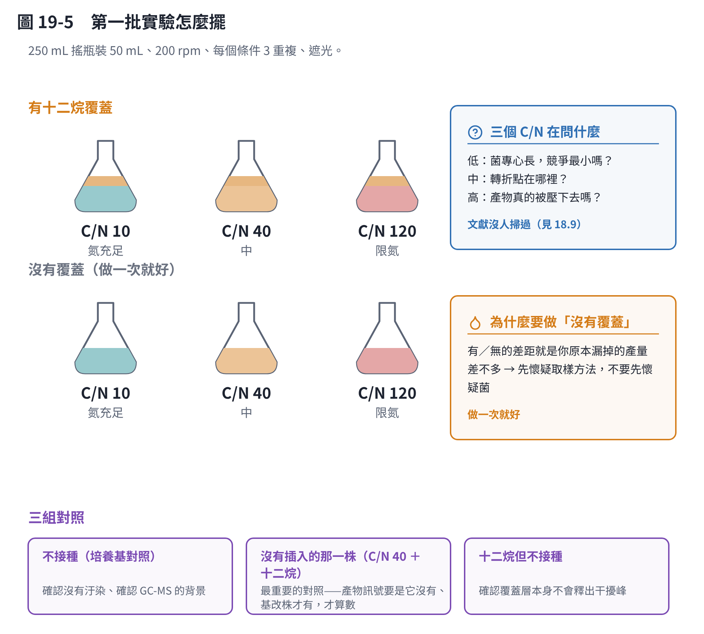
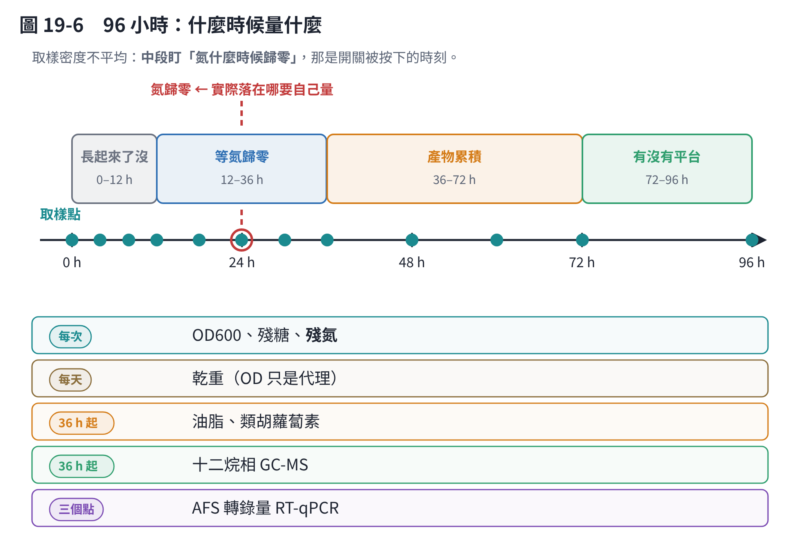
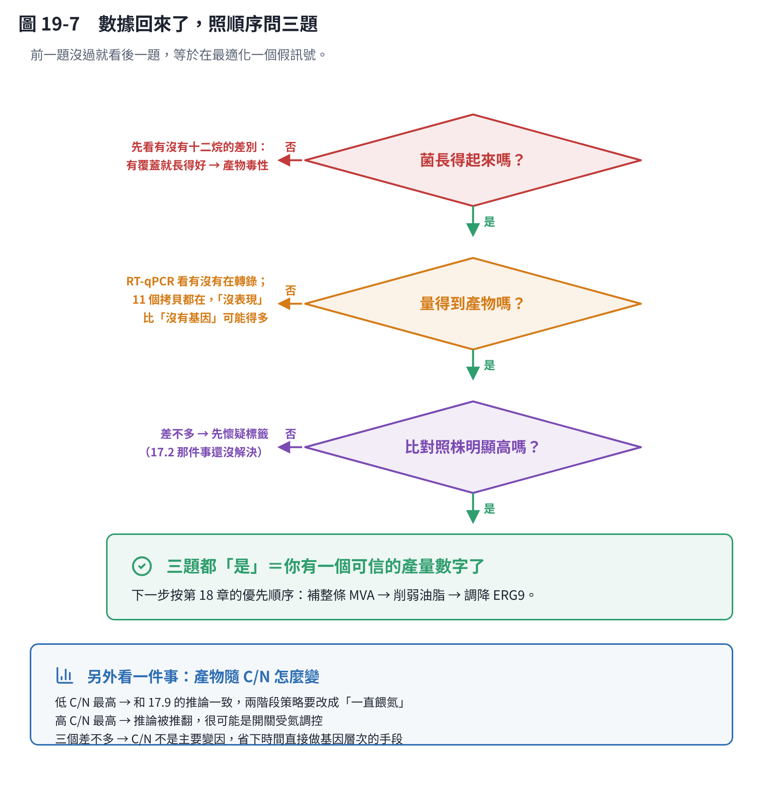

# 第 19 章　從序列到成品：完整流程

前面十八章是一塊一塊的零件。這一章把它們串成**一條可以照著走的路**，最後落在一份可以直接拿進實驗室的操作單。

這一章特別花力氣講清楚三件事，因為它們最容易卡住：

- **代謝模型到底是什麼**（19.3）——它不是黑盒子，打開來就是一張表。
- **FBA 在算什麼**（19.4）——用四條反應就能說完。
- **有了模型，能不能直接放進我做好的那個介面**（19.5）——**不能，而且卡住的地方可能和你想的不一樣。**

## 19.1 一張圖看完整條路



七個步驟。有一件事先講清楚：

> **只有第 ⑥ 步會產生真實的數字。** 前面五步都不是在做研究，是在**把要做的實驗變少**。

算一下就知道划不划算。你想測的變數隨便就七八個（C/N、溫度、pH、溶氧、碳源、接種量、有沒有覆蓋層⋯⋯），每個三個水準，全做完是 **2,187 個搖瓶**。先用文獻砍掉別人試過的，再用模型砍掉「不管怎麼調都動不了」的，剩下通常是**六到九個**。

流程圖上有兩個判斷點，都是你現在真的卡著的事：

| 判斷點 | 狀況 | 怎麼過關 |
|---|---|---|
| **兩管的標籤對嗎？** | 兩份定序檔可能反了（17.2） | 一次 PCR。**成本最低、資訊量最大，建議第一個做** |
| **產量夠了嗎？** | 還沒有任何產量數字 | 做完第一批實驗才知道 |

## 19.2 前三段：確認你手上的是什麼

這三步你**都做完了**，所以這一節很短，細節在第 17 章。

| 步驟 | 做了什麼 | 結果 |
|---|---|---|
| ① 確認菌是什麼 | 組裝統計、菌種鑑定 | 紅酵母、二倍體、參考基因體找到了 |
| ② 確認基改進去了沒 | 構築對回基因體 | **11 個功能性拷貝**、位置確定、沒有打斷基因 |
| ③ 註解與修正 | 整理定序廠的註解包 | 基因位置檔修好了、鄰居序列抽出來了 |

而且第 ② 步過的那一關，是文獻上最值錢的一關：2021 年那篇在同一株菌做同類產物，證明**產量和拷貝數的相關性 R² ＝ 0.93** [2]。

**你有 11 個功能性拷貝，所以不要再加拷貝了。** 邊際效益接近零，那筆錢該花在別的地方。

## 19.3 第 ④ 段：代謝模型到底是什麼

「建一個代謝模型」聽起來很抽象。**打開來看，它就是一張很長的表，一列一個反應。**



每一列寫四件事：

1. **這個反應在做什麼**（例：把糖運進細胞）
2. **方程式**（什麼變成什麼，比例多少）
3. **哪個基因負責**（這條把「基因」和「代謝」連起來）
4. **最多能跑多快**（上限；酵素就那麼多）

就這樣，幾千列。rhto-GEM 把這株菌已知的代謝全部寫成這種列。

### 它只用三條規則

- **每個代謝物，進來的量等於出去的量。** 這就是質量守恆——東西不會憑空出現或消失。
- **每條反應有速度上限。**
- **輸入是你定的**（你餵多少糖、給多少氧）。

**沒有動力學、沒有時間、沒有濃度。** 模型算的是「穩定下來之後，每條反應各跑多快」，不是「第幾小時長到多少」。

> 這也是它的限制：它算不出生長曲線。要算曲線得外面再包一層（第 5 章的 dFBA），那才是模擬器在做的事。

### 為什麼它和基因有關

因為第 3 欄。**基因 → 酵素 → 反應**，這張表把三者串起來。所以：

- 「剔除某個基因」＝「把那一列的上限設成 0」
- 「轉進去一個基因」＝「多加一列」

**第 16 章在做的就是「多加一列」這件事**——把 `FPP → α-farnesene ＋ PPi` 這一列加進 rhto-GEM。

## 19.4 FBA 在算什麼

這是最多人卡住的地方，但用四條反應就能說完。



假設只有四條反應：糖進來變成中間物 A，A 可以拿去長菌，也可以拿去做產物。

**你餵進去的糖固定**，所以進入 A 的速度 v₁ ＝ 10。而 A 要平衡，所以：

> v₂（長菌）＋ v₃（產物）＝ 10

問題來了：**滿足這個等式的組合有無限多種。** 10 和 0、0 和 10、5 和 5⋯⋯全都合法。

**平衡方程式本身不會給你答案。**

### FBA 就是多問一句話

> **「哪一組讓某個東西最大？」**

加上這句話，答案就唯一了：

| 你問什麼 | 答案 | 代表什麼 |
|---|---|---|
| 讓**生長**最大 | v₂ ＝ 10、v₃ ＝ 0 | 野生菌的預設行為。模型預測的生長速率可以拿實驗曲線去對 |
| 生長至少 3，再讓**產物**最大 | v₂ ＝ 3、v₃ ＝ 7 | 換一個生長下限就換一組答案 |

把第二種問法的生長下限從 0 掃到最大，每個下限都解一次，把答案連成一條線——**那條線就是第 16 章的「生產包絡線」**。它會告訴你「產物最多能拿多少，而細胞還長得動」。

### 所以模型能回答什麼、不能回答什麼

| 能 | 不能 |
|---|---|
| 理論上最多能做多少 | 實際會做多少 |
| 關掉某條路，產物會不會上升 | 上升多少 |
| 哪幾個改動值得花時間試 | 改完要多久看到效果 |
| 哪些反應在你的菌株沒有對應基因 | 基因有沒有在表現 |

**模型拿來排序選項，不要拿來預測數字。** 理論上限和實際產量常常差一個數量級——第 17.8 算過碳的理論上限是 0.252 公克產物／公克糖，文獻實際做到的是上限的百分之幾。

## 19.5 有了模型，能直接放進我做的介面嗎

**不能。** 這是你問的問題，先把答案放最前面，再講為什麼。



### 為什麼不能：介面讀的不是模型

第 13 章那個可以拉滑桿的網頁，看起來像「裡面裝著一個模型」。**它裡面沒有模型。**

它的做法是這樣的：`simulator/build.py` 在你的電腦上先把模型解一遍，把結果**存成一張查表**（`tables.json`），再把這張表連同代謝圖的版面（`map_layout.json`）一起**寫死進 HTML 檔**。你在瀏覽器上拉滑桿的時候，它只是在查表、內插，然後畫出來。

> **為什麼要這樣設計？** 因為瀏覽器跑不動線性規劃求解器。而且查表只有幾百 KB，網頁開起來是瞬間的，不用等伺服器。
> **代價就是**：換模型＝重算整張表，不是換一個檔案而已。

那張表有多大？現在是 **1,394 個格點**——葡萄糖 21 格、乙酸 13 格，各配 41 格氧氣。每個格點解一次 pFBA。

### 中間要做的五件事

| 步驟 | 要改什麼 | 難度 | 大概要多久 |
|---|---|---|---|
| ① | `gem.py` 的 `load()`，改成讀你下載的 rhto-GEM | **容易**，改一行 | 五分鐘 |
| ② | `gem.py` 的四個常數：生質反應、交換反應、要畫在圖上的反應、碳源清單 | 要花時間查 rhto-GEM 自己的反應編號 | 半天 |
| ③ | **`dfba.py` 的參數**：吸收速率、耗氧上限、溫度與 pH 基點 | **卡住的就是這裡** | 要先做實驗 |
| ④ | 重跑一次把查表算出來 | **容易**，一個指令 | 半分鐘 |
| ⑤ | `map_layout.json` 重畫代謝圖版面 | 可以先跳過（圖會不對，數字是對的） | 一天 |

①②④⑤ 都是工，不是難題。**真正卡住的是 ③。**

### 第 ③ 步卡在哪

`dfba.py` 裡面現在填的是**大腸桿菌的示範值**：吸收糖最快每小時多少、耗氧上限多少、最適溫度 39 °C⋯⋯

這些數字**沒有辦法用電腦算出來，只能從實驗曲線量**。第 11 章整章在講怎麼量：拿你的 OD 曲線、殘糖曲線去擬合，就得到你的菌的參數。

**所以順序是反過來的**：不是「先有模型再做實驗」，是

> **先做第一批實驗 → 量出參數 → 填進 `dfba.py` → 介面才有意義。**

而下一節那份操作單，產出的正好就是這些參數需要的曲線。**它們不是兩件事，是同一件事的兩端。**

> **一個中間方案**：②④ 做完就可以先用「教科書的通用參數」開起來看。
> 代謝圖和反應是你的菌的，生長曲線是假的。**拿來看結構可以，拿來預測不行**——而且要在介面上標清楚，不然三個月後你自己會忘記。

## 19.6 第 ⑤ 段：用模型挑要測的條件

### 要做什麼

用模型跑一輪「如果改這個會怎樣」，把要做的條件砍到最少。

```bash
python code/experiments.py     # 供氧、碳源、兩階段、溫度 pH、最適化
```

### 為什麼非做不可

因為搖瓶貴——不是錢貴，是**時間貴**。一批 96 小時，加上分析，一個禮拜只能跑一輪。能少做三瓶，就是省下一個禮拜。

舉個具體的例子：你想知道「把 ERG9 調降能多拿多少產物」。這件事做實驗要改基因、建菌株、養菌、分析，三個月跑不掉。模型五分鐘就給你一條曲線：調降到某個程度之前產物一直上升，過了某個點細胞就長不動了。**那條曲線不會告訴你確切的數字，但它會告訴你值不值得花那三個月。**

### 還有什麼做法

| 做法 | 優點 | 缺點 | 這裡為什麼不選 |
|---|---|---|---|
| 一次改一個因子 | 直覺、好解釋 | 看不到因子之間的交互作用，而且實驗數反而多 | 第 7 章有詳細比較 |
| 全因子設計 | 資訊最完整 | 實驗數爆炸（見 19.1 的 2,187） | 同上 |
| 貝氏最適化 | 用最少的實驗找到最適點 | 要先有一批數據才跑得動 | **第二輪再用**。第一輪連基準線都沒有 |
| **先用模型砍，再用簡單設計** | 實驗數少、每一瓶都在回答問題 | 依賴模型的品質 | **選這個**，而且第一輪刻意保守 |

> **但第 ⑥ 段不用等第 ④、⑤ 段。** 模型是用來少做幾個實驗的，不是做實驗的前提。
> 下面那份操作單現在就能開始，而且它同時回答 19.1 那兩個判斷點。

## 19.7 第 ⑥ 段：第一批實驗的操作單

整章的主菜。**所有數字由 `code/workflow.py` 算出來，存成 `workflow.json`**，可以自己驗算。

```bash
python code/workflow.py --show    # 重算並印出操作單
```

數字分三種：**算出來的**（可以驗算）、**文獻來的**（有引用）、**起始猜測**（沒有這株菌的實測值，第一批實驗就是要把它量出來）。

### 這批實驗要回答什麼

一次回答四件事——這就是為什麼值得先花時間設計：

1. **產物到底有沒有**，以及有多少（你的第一個可信數字）
2. **C/N 對產物的影響**（文獻上沒有人掃過，見 18.9——**這是真的新資訊**）
3. **AFS 的開關受不受氮調控**（解決 17.4 卡住的事）
4. **OD600 換算乾重的校正線**，以及 19.5 第 ③ 步要的那些參數



### 配置

| 項目 | 數值 | 出處 |
|---|---|---|
| 搖瓶 | 250 mL | — |
| 裝液 | 50 mL（20.0%） | 算出來的 |
| 轉速 | 200 rpm | 文獻（對應 kLa 約 60–120 h⁻¹） |
| 起始 OD600 | 0.2 | **起始猜測** |
| 接種量 | 種菌 OD 5 接 2.0 mL（4.0% v/v） | 算出來的 |
| 糖 | 40 g/L 葡萄糖 | **起始猜測** |
| 時間 | 96 小時 | **起始猜測** |
| 重複 | 每個條件 3 瓶 | — |
| 總瓶數 | 9 個條件 ×3 重複 ＝ 27 瓶 | — |

**轉速那一欄要注意**：kLa 是量級，**你自己的搖床一定要實測**（亞硫酸鈉法或動態法）。搖床的軌跡半徑差一點，kLa 就差很多。

### 培養基（每公升）

C/N 在文獻裡有兩種寫法——**莫耳比**和**質量比**，兩者差快兩倍。看錯會整批做錯，所以兩種都列：

| 條件 | 葡萄糖 | 硫酸銨 (NH₄)₂SO₄ | 莫耳 C/N | 質量 C/N |
|---|---|---|---|---|
| 低（氮充足） | 40 g | **8.802 g** | 10 | 約 8.6 |
| 中 | 40 g | **2.2 g** | 40 | 約 34.3 |
| 高（限氮） | 40 g | **0.733 g** | 120 | 約 102.8 |

換算很單純，可以自己驗算：葡萄糖每個分子 6 個碳、分子量 180.16；硫酸銨每個分子 2 個氮、分子量 132.14。

另外要加的（**照你實驗室原本的配方，不要照抄**）：磷酸鹽緩衝、鎂、微量元素、維生素。紅酵母對培養基不挑，但缺了微量元素會長不好。

> **為什麼糖固定、只改氮？** 因為這樣才知道差異是「氮」造成的。
> 糖和氮一起改，兩個變數糾在一起，結果沒辦法解釋。

### 十二烷覆蓋層

| 項目 | 數值 |
|---|---|
| 十二烷 | **10 mL／瓶**（20% v/v） |
| 內標 pentadecane | **10 mg**（溶在十二烷裡，1 g/L） |

依據是 2017 那篇：700 mL 培養液 ＋ 150 mL 覆蓋層，約 21% [1]。

**內標不能省。** 十二烷自己也會揮發，少掉的體積要用不揮發的內標還原回來。沒有內標，你量到的濃度會隨著培養時間越來越「高」——那是假的，是溶劑變少造成的。

### 步驟

**第 −2 天：種菌**

1. 從平板挑單一菌落，接到 5 mL 一般培養基（YPD 之類），30 °C、200 rpm 過夜。
2. 第二天轉接到 20 mL 新鮮培養基，再養到 OD600 約 5。

> **為什麼要轉接一次？** 讓菌進入穩定的對數生長期。
> 直接從過夜培養接種，菌已經進入靜止期，會有很長的遲滯期，而且各瓶不一致。

**第 0 天：接種**

3. 配三種 C/N 的培養基，分裝每瓶 50 mL，滅菌。
4. 種菌離心、用無菌水洗一次、用培養基回溶——**這一步不要省**，不然會把種菌培養基裡的氮一起帶進去，高 C/N 那組就不是高 C/N 了。
5. 接種 2.0 mL（4.0% v/v），起始 OD600 約 0.2。
6. 「有覆蓋」那一組，**接種後立刻**鋪上 10 mL 已經溶好內標的十二烷。
7. **全部用鋁箔包起來遮光。** 光（尤其藍光）會誘導色素，等於一直在餵競爭者（見 17.9）。
8. 30 °C、200 rpm。

**第 0–4 天：取樣**



取樣密度刻意不平均：**中段密、兩端疏**，因為中段要抓「氮什麼時候歸零」那個時刻。

| 時段 | 間隔 | 量什麼 |
|---|---|---|
| 0–12 h | 每 4 小時 | OD600、殘糖、殘氮 |
| 12–36 h | 每 6 小時 | OD600、殘糖、**殘氮**、乾重 |
| 36–72 h | 每 12 小時 | 全部項目 ＋ 十二烷相 GC-MS |
| 72–96 h | 每 24 小時 | 全部項目 |

每次取樣的動作：

1. **先取十二烷相**（上層），取 200 µL，放 −20 °C 等著做 GC-MS。
2. 搖勻後取水相 2 mL：
   - 200 µL 稀釋後量 OD600（**稀釋到讀值 0.1–0.5**）
   - 1 mL 離心，上清量殘糖與殘氮，沉澱留著
   - 剩下的用來做乾重或色素
3. 記錄：時間、OD、稀釋倍數、瓶號、有沒有異常（顏色、味道、沉澱）。

> **為什麼殘氮是最關鍵的一欄？**
> 因為產油的開關不是「氮很少」，是**氮耗盡那個事件**（17.9）。
> 沒有量殘氮，你會知道「產物變多了」，但不知道是「什麼時候、被什麼觸發」——
> 而那正是第 5、6 章要找的轉折點，也是 19.5 第 ③ 步要填的參數。

**第 4 天：收**

9. 量最終乾重、油脂、色素。
10. 十二烷相做 GC-MS，用內標還原濃度。

### 乾重校正線（順便做掉）

這批同時要產出 **OD600 ↔ 乾重**的校正線，而且**每個階段各一條**。

做法：在長菌期和產油期各挑 3–4 個時間點，同時量 OD 和乾重（取已知體積、離心、洗、60 °C 烘到恆重）。

> **為什麼每個階段都要一條？**
> 因為限氮階段細胞塞滿油滴，折射率和大小都變了。
> **同樣 1 公克乾重的菌，OD600 讀出來就是不一樣**（17.8）。
> 一條在長菌期做的校正線，用到產油期就是錯的。

### 這批最多能做出多少

碳的理論上限：糖 40 g/L，**最多** 10.08 g/L（每瓶 504 mg）。

**這是上限，不是預期值。** 它只算了碳、沒檢查 ATP 和 NADPH 夠不夠，所以實際一定更低——文獻實際做到的是上限的百分之幾。

寫出來的用意是**設定 GC-MS 的期待值**：如果你預期的是毫克等級，就要先確認你的方法偵測得到那個濃度，不要等做完才發現在偵測極限以下。

### 這份操作單哪裡最可能錯

誠實清單——下面每一條都是「我沒有你的菌的實測值」：

| 數字 | 我給的 | 為什麼可能錯 |
|---|---|---|
| 起始 OD | 0.2 | 太低遲滯期長、太高很快缺氧。0.1–0.5 都合理 |
| 糖 | 40 g/L | 搖瓶不補料，太高會滲透壓抑制 |
| 時間 | 96 小時 | 文獻的倍半萜發酵多在 3–7 天。**第一批就是要量出你的曲線長什麼樣** |
| C/N | 10／40／120 | 橫跨「氮充足」到「明顯限氮」，但轉折點落在哪裡不知道 |
| 溫度轉速 | 30 °C、200 rpm | 常規值。你的搖床、你的菌株可能不同 |

**第一批實驗的目的，就是把這張表變成實測值。** 做完之後回來改這一節。

## 19.8 第 ⑦ 段：把數據餵回模型

### 要做什麼

把量到的曲線拿去修模型的參數，讓它從「教科書參數」變成「你的菌的參數」。

```bash
python code/calibrate.py --batches batches.csv --samples samples.csv
```

資料格式就是第 11 章那兩張 CSV：條件一張（每批一列）、量測一張（每次取樣一列）。範本在 `code/example-data/`。

### 為什麼非做不可

兩個理由，一個是研究上的，一個是你剛剛問的那個：

**一、沒有這一步，模型永遠停在別人的數字上。** 第 11 章整章在講這件事，包括一個很重要的負面結果：**有些參數不管怎麼擬合都辨識不出來**（資料裡根本沒有能決定它的資訊）。知道哪些參數不可信，和知道哪些可信一樣重要。

**二、這一步的產出，正好就是 19.5 第 ③ 步要填的東西。** 擬合出來的吸收速率、耗氧上限、溫度基點，填回 `dfba.py`，重算一次查表，**那個介面才真的是「你的菌」的介面**。

> 所以整條路其實是一個圈，不是一條線：
> **模型 → 挑條件 → 做實驗 → 參數 → 更好的模型 → 更好的條件⋯⋯**
> 第一圈跑完才開始有意義。流程圖上第 ⑦ 回到第 ⑤ 的那條箭頭就是這個意思。

## 19.9 數據回來了，然後呢



**不要一次看所有數字。** 照這個順序問，每一個「否」都直接指向下一步要查什麼：

**第一題：菌長得起來嗎？**（和沒有插入的那株比乾重）

長不起來就不要往下看產物——分母錯了，分子沒有意義。先看有沒有十二烷的差別：**有覆蓋就長得好 → 那是產物毒性**，不是菌本身的問題。

**第二題：十二烷相量得到產物嗎？**

先看「沒有覆蓋」那一組——兩邊都沒有，才是真的沒產物。如果 RT-qPCR 看得到轉錄但量不到產物 → 酵素沒活性，或產物全跑掉了。**11 個拷貝都在，所以「沒表現」比「沒有基因」可能得多。**

**第三題：比沒有插入的那株明顯高嗎？**

差不多 → **先懷疑標籤**（17.2 那件事還沒解決）。這一題答錯，後面所有的最適化都是在最適化一個假訊號。

**三題都「是」＝你有一個可信的產量數字了。** 下一步按第 18 章的優先順序：**補整條 MVA → 削弱油脂通量 → 調降 ERG9**。

### C/N 那三瓶怎麼看

三種可能各有各的意義，**而且三種都有價值**：

| 結果 | 意思 | 下一步 |
|---|---|---|
| **低 C/N 最高** | 和 17.9 的推論一致：限氮催油脂、搶走原料 | 兩階段策略改成「一直餵氮」，切換點改看饋料與加覆蓋層的時機 |
| **高 C/N 最高** | 推論被推翻了——限氮反而有利 | 很可能是開關受氮調控。把 RT-qPCR 的結果調出來對 |
| **三個差不多** | C/N 不是這株菌的主要變因 | 省下調 C/N 的時間，直接做第 18 章的基因層次手段 |

第三種看起來最像「白做」，其實不是。**「這個變數不重要」是一個結論**，而且它會幫你省下後面好幾個月。

## 19.10 幾個會影響很久的決定

前面每一段都附了「還有什麼做法」。這一節把**影響最大、選錯很難回頭的六個決定**集中起來。

### 決定一：模型自己建，還是用現成的

| 選項 | 優點 | 缺點 |
|---|---|---|
| **用 rhto-GEM** ✅ | 建在同一個種上、手工校正過、有人維護 | 要下載、要做基因 ID 對照、不是你的菌株 |
| 從基因體自動建 | 完全貼合你的菌株 | 自動建模工具（CarveMe、gapseq）**都是細菌用的**；真核版本品質差很多 |
| 不用模型 | 省掉學習成本 | 實驗數會爆炸 |

**為什麼選現成的**：你的註解只有 69% 的基因有功能命中，名稱欄全部是「不知道是什麼」。拿這種材料從頭建，會得到一個到處是洞的模型——**而那些洞你看不出來，它還是會給你答案**。

### 決定二：先調培養條件，還是先改基因

| 選項 | 優點 | 缺點 |
|---|---|---|
| **先調條件** ✅（第一輪） | 便宜、快、不用做菌株 | 天花板低 |
| 先改基因 | 文獻上效果最大（削弱油脂 6–7 倍 [3]），而且哪些基因管油脂已經有系統性的功能基因體資料 [4] | 慢、貴、要先知道該改哪裡 |

**為什麼第一輪選調條件**：因為你**連基準線都還沒有**。不知道現在產多少，就不知道改完有沒有變好。而且第一輪順便解決兩件卡住的事（標籤、開關），這是改基因做不到的。

**但第二輪就要換邊。** 第 18 章的三篇論文很清楚：把產量推上去的是基因層次的手段，不是培養條件。

### 決定三：搖瓶還是發酵槽

| 選項 | 優點 | 缺點 |
|---|---|---|
| **搖瓶** ✅（第一輪） | 可以同時跑很多條件、便宜 | 控制不了 pH 和溶氧、不能饋料 |
| 發酵槽 | 控制好、產量高、可以饋料 | 一次一兩個條件、建置成本高 |

**為什麼第一輪選搖瓶**：你要的是「**比較**九個條件」，不是「把一個條件做到最好」。這是兩種不同的實驗，不要混在一起。

順帶一提，**深孔盤（96 孔）不能用**：供氧差（kLa 只有 5–20），而且鋪不了覆蓋層——揮發性產物量出來是假的。

### 決定四：量產物要不要加有機相

這個**沒有選擇**——不加就是錯的。

產物會揮發，你取水相量到的只是「還沒跑掉的那一點」。兩株菌真實產量可能差三倍，但量出來差不多。**不是菌沒差別，是量法把差別抹掉了。**

唯一要做一次的事，是**做一組「沒有覆蓋」的對照**，看看自己原本漏掉多少。確認過之後就不用再做了。

### 決定五：C/N 要不要掃

| 選項 | 優點 | 缺點 |
|---|---|---|
| **掃三個 C/N** ✅ | 文獻沒人做過，是真的新資訊 | 多做四瓶 |
| 只用文獻的條件 | 省事 | 文獻在這件事上**沒有答案**（18.9） |

**為什麼要掃**：17.9 那個「限氮對 farnesene 不利」是**推論，不是量出來的**。推論鏈是「限氮催油脂」＋「削弱油脂能提高 6–7 倍」，兩個前提都有文獻，但中間那一步沒有人直接測過。

**你的三瓶就能回答它。** 這是整批實驗裡最可能變成一篇論文的部分。

### 決定六：拷貝數要不要再用別的方法確認

定序給的 12 是**下限**，不是確切份數。拼接程式遇到 12 段幾乎一模一樣的序列，常常會把它們**壓縮成比較少的份數**。

| 做法 | 優點 | 缺點 | 建議 |
|---|---|---|---|
| **qPCR 算拷貝數** | 便宜、快、可以定量 | 只給一個數字，不知道位置和好壞 | **值得做**，和定序互補 |
| 原始讀段比回單一拷貝算覆蓋深度 | 不用再做實驗，資料已經在手上 | 要會算 | **最划算**，先做這個 |
| Southern blot | 老方法但可靠，看得到排列方式 | 慢、要標記 | 定序已經給了更細的資訊 |
| **PCR 確認哪管是哪株** | 最便宜 | 不給份數 | **一定要做，而且第一個做**（17.2） |

## 19.11 一頁總表

| 段 | 做什麼 | 輸入 | 產出 | 工具 | 大概要多久 |
|---|---|---|---|---|---|
| ① | 確認菌是什麼 | 定序檔 | 菌種、倍體性、參考基因體 | `genome_tools.py stats` | 一小時 |
| ② | 確認基改 | 定序檔 ＋ 構築 | 拷貝數、位置、哪個壞了 | `case_rt.py` | 半天 |
| ③ | 註解與修正 | 定序廠註解包 | 基因位置檔、鄰居身分 | `annotation.py` | 半天 |
| ④ | 建模型 | rhto-GEM ＋ 對照表 | 可以跑 FBA 的模型 | `engineered.py` | 一到兩天 |
| ⑤ | 挑條件 | 模型 | 一張很短的條件清單 | `experiments.py` | 半天 |
| ⑥ | **做實驗** | 條件清單 | **真實數字** ＋ 參數用的曲線 | 19.7 的操作單 | **一到兩週** |
| ⑦ | 餵回模型 | 實驗數據 | 修正的參數、下一輪條件 | `calibrate.py` | 一天 |

「大概要多久」是**起始猜測**，而且假設你已經熟悉工具。第一次做每一段都會更久。

注意比例：**第 ⑥ 段佔掉整條流程一半以上的時間**，但它前面那五段加起來不到一週。這就是為什麼值得先做。

## 本章重點

- **七段裡只有第 ⑥ 段產生真實數字**，前五段是在把要做的實驗變少。七個變數各三個水準全做完是 2,187 個搖瓶；先砍過之後是六到九個。
- **代謝模型不是黑盒子，是一張表**：一列一個反應，寫著方程式、負責的基因、速度上限。「轉進去一個基因」就是「多加一列」。
- **FBA 之所以需要一個目標，是因為平衡方程式本身有無限多組解。** 問「讓什麼最大」才會有唯一答案。所以**模型拿來排序選項，不要拿來預測數字**。
- **有了模型不能直接放進介面**：介面讀的是事先算好的查表，不是模型。中間還有五件事，而**真正卡住的是「填你自己的參數」**——那只能用實驗量。
- **順序是反過來的**：先做第一批實驗量出參數，介面才有意義。而操作單產出的曲線，正好就是參數要的那些。
- **你的前三段已經做完了**，最有價值的那一關（拷貝數，文獻 R² ＝ 0.93）也過了。**不要再加拷貝。**
- **第一批實驗一次回答四件事**：產物有多少、C/N 的影響、開關受不受氮調控、校正線與模型參數。
- **C/N 那三瓶是整批最有價值的部分**——文獻上沒有人掃過，17.9 那個結論到現在還只是推論。
- **殘氮是最容易漏掉、但最關鍵的一欄。** 沒有它，你會知道產物變多了，但不知道是什麼時候、被什麼觸發。
- **有機相覆蓋沒有選擇餘地**；但要做一次「沒有覆蓋」的對照，知道自己原本漏掉多少。
- **判讀數據要照順序問**：菌長得起來嗎 → 量得到產物嗎 → 比對照株高嗎。前一題沒過就看後一題，等於在最適化一個假訊號。
- **這份操作單的一半數字是起始猜測。** 第一批實驗的目的之一，就是把它們換成你自己的數字，然後回來改這一章。

## 參考文獻

1. Yaegashi J, Kirby J, Ito M, et al. (2017). *Rhodosporidium toruloides*: a new platform organism for conversion of lignocellulose into terpene biofuels and bioplastics. *Biotechnology for Biofuels*, 10, 241. https://doi.org/10.1186/s13068-017-0927-5
2. Kirby J, Geiselman GM, Yaegashi J, et al. (2021). Further engineering of *R. toruloides* for the production of terpenes from lignocellulosic biomass. *Biotechnology for Biofuels*, 14, 101. https://doi.org/10.1186/s13068-021-01950-w
3. Adamczyk et al. (2025). The oleaginous yeast *Rhodosporidium toruloides* engineered for biomass hydrolysate-derived (E)-α-bisabolene production. *Metabolic Engineering*, 90, 92–105. https://doi.org/10.1016/j.ymben.2025.02.014
4. Coradetti ST, Pinel D, Geiselman GM, et al. (2018). Functional genomics of lipid metabolism in the oleaginous yeast *Rhodosporidium toruloides*. *eLife*, 7, e32110. https://doi.org/10.7554/eLife.32110
