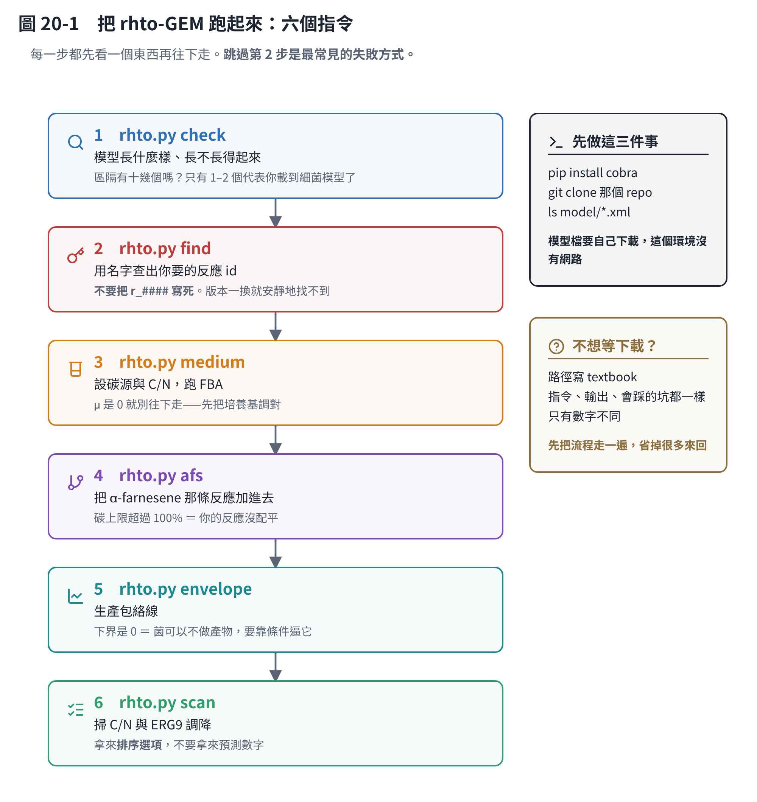
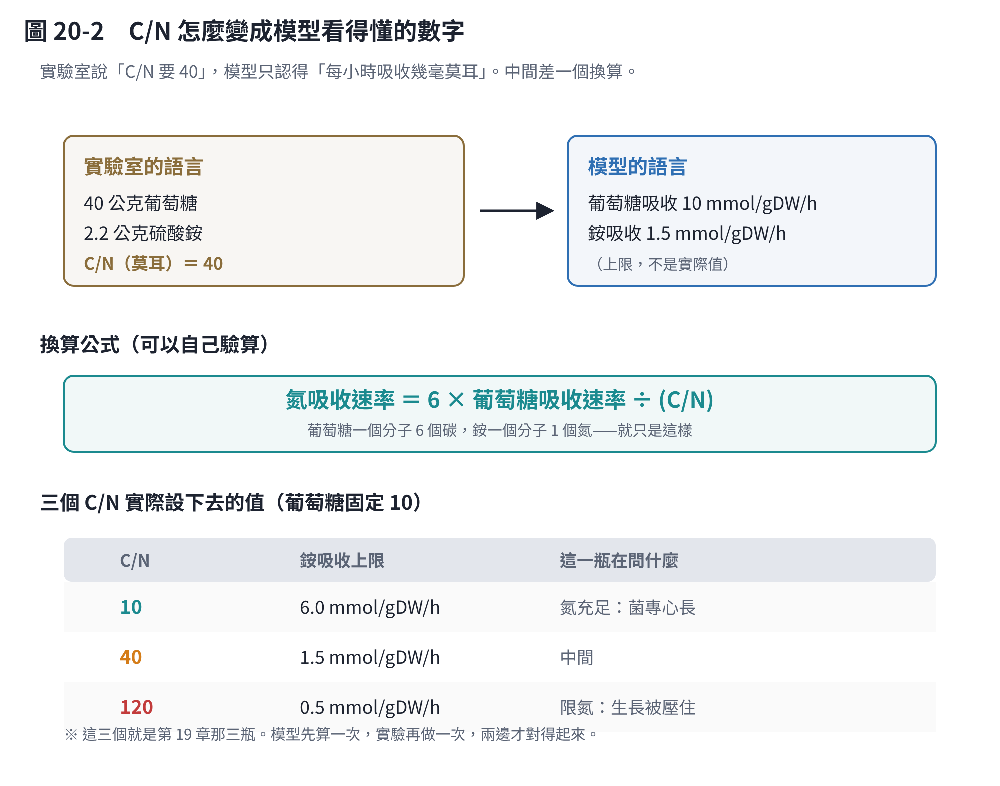
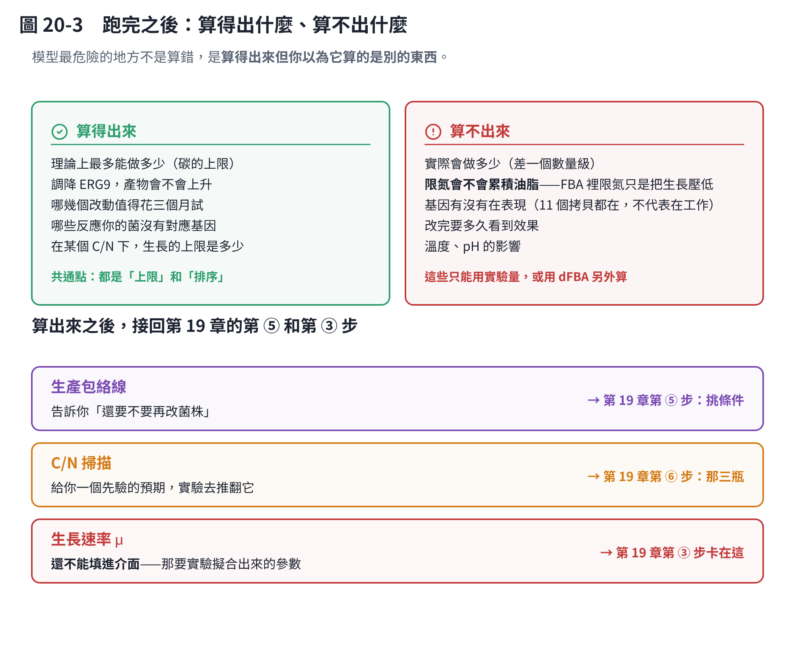

# 第 20 章　把 rhto-GEM 真的跑起來

前面十九章一直在說「用 rhto-GEM 算」。**這一章是第一次真的把它跑起來。**

為什麼值得單獨一章：第 19 章講了代謝模型是什麼（一張反應表）、FBA 在算什麼（多問一句「讓什麼最大」）。**概念懂了和跑得動是兩件事**，中間卡著一堆很瑣碎但會讓你卡半天的東西——模型檔在哪、反應叫什麼名字、C/N 怎麼翻譯成模型看得懂的數字。

這一章就是把那些東西一個一個拆掉。

> **rhto-GEM 是什麼**：*Rhodotorula toruloides* 的全基因體代謝模型 [1]，852 個基因、2,731 個反應、2,277 個代謝物，**建在 IFO 0880 上——和你的參考基因體同一株**。已經驗證過葡萄糖、木糖、甘油上的生長。
> 油脂用 SLIMEr 的寫法處理，所以它對「油脂」這件事比一般模型細。

## 20.1 六個指令



工具是 `code/rhto.py`，六個子指令照順序用。**每一步都先看一個東西，確認了再往下走。**

```bash
python code/rhto.py check    rhto.xml                  # 1 模型長什麼樣、長不長得起來
python code/rhto.py find     rhto.xml farnesyl         # 2 用名字查 id
python code/rhto.py medium   rhto.xml --glucose 10 --cn 40   # 3 設培養基、跑 FBA
python code/rhto.py afs      rhto.xml                  # 4 加 α-farnesene 反應
python code/rhto.py envelope rhto.xml                  # 5 生產包絡線
python code/rhto.py scan     rhto.xml                  # 6 掃 C/N 與 ERG9
```

每個子指令都可以加 `-o 檔名.json` 把結果存下來。

## 20.2 先裝環境（三件事）

工具用的是 COBRApy [2]——做這類模型計算的標準套件。

```bash
pip install cobra                                    # 求解器會一起裝好
git clone https://github.com/SysBioChalmers/rhto-GEM
ls rhto-GEM/model/*.xml                              # 找到那個 SBML 檔
```

**`pip install cobra` 會順便裝 GLPK 求解器**，所以不用另外處理。如果你的環境比較舊、裝不起來，用 conda：`conda install -c conda-forge cobra`。

> **為什麼這一章的程式不能在這個教材環境跑**：這個環境沒有對外網路，下載不到模型檔。
> 所以 `rhto.py` 是寫給**你自己的電腦**用的，跟 `yeast.py`、`annotation.py gem-map` 一樣。

### 不想等下載？先用內建模型把流程走一遍

把模型路徑寫成 `textbook`，程式會載入 COBRApy 內建的大腸桿菌核心模型（95 個反應，一秒載完）。

**指令一樣、輸出格式一樣、會踩的坑一樣，只有數字不同。** 強烈建議先這樣走一遍，再換成 rhto-GEM——這樣你第一次看到 rhto-GEM 的輸出時，已經知道每一欄在講什麼了。

```bash
python code/rhto.py check textbook
```

## 20.3 第 1 步：`check`——確認你載對了

這一步只回答兩件事：**載對了嗎、長得起來嗎。**

### 看「區隔」的數量

輸出的第二段是區隔（compartment）清單。**這是確認載對模型最快的訊號**：

| 看到什麼 | 代表 |
|---|---|
| 只有 2 個區隔（細胞內、細胞外） | **你載到細菌模型了**。紅酵母不是細菌（第 15 章） |
| 十幾個區隔（細胞質、粒線體、過氧化體、內質網、液泡⋯⋯） | 對了，這是真核生物的模型 |

> 為什麼真核模型要分這麼多格：萜類合成在**細胞質**、脂肪酸氧化在**過氧化體**、
> 呼吸鏈在**粒線體**。同一個代謝物在不同區隔是**不同的東西**，不能互通。
> 這也是 20.4 那個坑的來源。

### 看 μ 是不是 0

最後一行是跑一次 FBA 的生長速率。**如果是 0，不要往下做**——先看它預設的培養基缺了什麼。

用內建模型練手時會看到這樣：

```
模型：95 反應、72 代謝物、137 基因
區隔：c 52 個、e 20 個          ← 只有兩個，因為這是大腸桿菌
目標函數（生質反應）：Biomass_Ecoli_core
跑一次 FBA：生長速率 μ = 0.8739 /h（倍增時間 0.8 小時）
```

（這組數字存在 `code/rhto_demo.json`，**是大腸桿菌的，不是你的菌**。）

## 20.4 第 2 步：`find`——這一步跳過就會卡住

這是整章最重要的一節。

### 問題：rhto-GEM 的反應叫 `r_0001`、`r_0002`⋯⋯

rhto-GEM 延續 yeast-GEM 的命名，反應是 `r_####`、代謝物是 `s_####`。**流水號看不出是什麼**，而且**不同版本會變**。

所以如果你把 id 寫死在程式裡：

```python
model.reactions.get_by_id("r_2111").lower_bound = -10   # ← 不要這樣
```

版本一換，這一行會丟 `KeyError`（運氣好），或者**指到另一個反應**（運氣不好，而且你不會發現）。

### 做法：用名字找

```bash
python code/rhto.py find rhto.xml farnesyl      # 找 FPP
python code/rhto.py find rhto.xml squalene      # 找 ERG9
python code/rhto.py find rhto.xml glucose exchange
python code/rhto.py find rhto.xml ammonium
```

輸出長這樣（這是內建模型的例子）：

```
[反應] PDH         pyruvate dehydrogenase            [    0.0, 1000.0]
        coa_c + nad_c + pyr_c --> accoa_c + co2_c + nadh_c
        基因：b0114, b0115, b0116
[代謝物] pyr_c     Pyruvate      C3H3O3　區隔 c
```

**四欄都要看**：id、名字、反應式、**區隔**。

### 最容易錯的地方：區隔

找 FPP 的時候，rhto-GEM 很可能同時有**細胞質**和**粒線體**版本。**萜類合成在細胞質**，所以要拿細胞質那個。拿錯的話，模型會跑得完，但你加的反應接在一條根本不通的路上，產物上限會是 0——而你會以為是菌的問題。

`rhto.py` 的 `afs` 子指令會把它選到的 FPP 和區隔印出來，**請每次都看一眼**。不對就用 `--fpp-id` 指定。

## 20.5 第 3 步：`medium`——把 C/N 翻譯成模型的語言



實驗室說「C/N 要 40」，模型只認得「每小時每公克菌最多吸收幾毫莫耳」。中間差一個換算：

> **氮吸收速率 ＝ 6 × 葡萄糖吸收速率 ÷ (C/N)**

因為葡萄糖一個分子 6 個碳、銨一個分子 1 個氮。就這樣而已。

葡萄糖吸收固定在 10 mmol/gDW/h 的話：

| C/N | 銨吸收上限 | 這一瓶在問什麼 |
|---|---|---|
| 10 | 6.0 mmol/gDW/h | 氮充足：菌專心長 |
| 40 | 1.5 mmol/gDW/h | 中間 |
| 120 | 0.5 mmol/gDW/h | 限氮：生長被壓住 |

**這三個就是第 19 章那三瓶。** 模型先算一次、實驗再做一次，兩邊才對得起來。

```bash
python code/rhto.py medium rhto.xml --glucose 10 --cn 40
```

輸出會先把**它實際設到哪幾個反應**印出來——**請核對**，然後才是 FBA 結果和分泌出來的東西。

> **葡萄糖 10 是哪裡來的？** 那是這類模型的慣用值，大概對應「不缺糖」。
> 它**不是你的菌的實測值**——那要第 19 章第一批實驗擬合出來（第 11 章的做法）。
> 在那之前，**用模型比較不同條件可以，拿它的絕對數字當預測不行。**

## 20.6 第 4 步：`afs`——把你轉進去的基因變成一列

第 16 章講過原理：轉一個基因進去，在模型裡就是**多加一列反應**。這裡是實際操作。

要加的是蘋果的 α-farnesene 合成酶：

> **FPP → α-farnesene ＋ 焦磷酸**

```bash
python code/rhto.py afs rhto.xml --cn 40
```

程式會做三件事：建一個新代謝物（α-farnesene，C15H24）、建那條反應、再建一條把它排出細胞的交換反應。

> **為什麼要排出去那條**：產物會揮發，實驗上要用十二烷覆蓋層收集（第 19 章）。
> 模型裡如果沒有出口，產物會在細胞裡「堆到無限大」，質量守恆就解不出來，產量永遠是 0。

### 三個數字，以及為什麼第一個是 0

| 問法 | 會得到 | 意思 |
|---|---|---|
| ① 讓生長最大 | **產物 ＝ 0** | **這是對的，不是壞掉。** 讓生長最大的解不會浪費碳去做產物 |
| ② 不管菌長不長，讓產物最大 | 碳的理論上限 | 上限，不是預期值。它沒檢查 ATP 和 NADPH 夠不夠 |
| ③ 生長保留一半，再讓產物最大 | **有意義的那個數字** | 細胞要活著，才做得出東西 |

**第 ① 個是 0 會嚇到很多人**，以為模型壞了或反應加錯了。沒有——那正是第 19.4 講的：平衡方程式有無限多組解，你問「讓生長最大」，它就給你一組完全不做產物的解。

### 一個自動的檢查

如果 ② 算出來的**碳上限超過 100%**，程式會跳警告。那在物理上不可能，代表**你的反應沒有配平**——最常見的原因就是 20.4 那個：FPP 或焦磷酸指到了錯的代謝物。回去用 `find` 查清楚。

## 20.7 第 5 步：`envelope`——判斷「還要不要再改菌株」

```bash
python code/rhto.py envelope rhto.xml --points 11
```

它把生長速率從 0 掃到最大，每一格問兩次：**產物最多能多少、最少能多少**。

輸出的**下界那一欄**是重點：

| 下界 | 意思 | 你要做的事 |
|---|---|---|
| 全部是 **0** | 細胞**可以**「只長菌、不做產物」 | 產量要靠**控制培養條件**去逼它。而且菌株不穩定時會往這邊跑 |
| **> 0** | 細胞**不做產物就長不動**（成長耦合） | 最穩的狀態。不用一直盯著 |

**絕大多數「加一條路出去」的菌株，下界都會是 0**——包括你這一株。這不是壞消息，但它解釋了一件事：**為什麼產量會因為培養條件而差很多**。因為模型允許的範圍很寬，實際落在哪裡是條件決定的。

要把下界推到 0 以上，要做的是**把競爭的路關掉**（第 18 章那三篇做的事），不是調培養基。

## 20.8 第 6 步：`scan`——模型拿來排序，不是預測

```bash
python code/rhto.py scan rhto.xml --cn-list 10 40 120
```

兩件事：掃 C/N、掃 ERG9 調降。每一格都用「生長保留一半，再讓產物最大」。

你會看到的形狀大概是：**C/N 越高 → μ 越低、產物上限越高**。因為氮少了，碳沒有被拿去長菌，剩下的碳理論上可以拿去做產物。

> **但這裡要非常小心。** 這個形狀**不代表「限氮對 farnesene 有利」**。
> 它只代表「限氮的時候，碳的去處變少了，所以上限變高」。
> 實際會不會做出來，取決於酵素有沒有在表現、開關受不受氮調控——**模型完全不知道這些**。
> 17.9 那個「限氮對 farnesene 不利」的推論，和這裡的形狀**不衝突**，因為兩者講的是不同的東西。

ERG9 那一段同理：曲線會告訴你「調降到什麼程度之前產物一直上升，過了某個點細胞就長不動」。**那條曲線不會告訴你確切數字，但它會告訴你值不值得花三個月去做那個菌株。**

## 20.9 FBA 做不到的三件事



**模型最危險的地方不是算錯，是算得出來、但你以為它算的是別的東西。** 三個最容易誤會的：

### 一、限氮不會自己產生「油脂累積」

這是最重要的一條。你可能預期：把 C/N 調高，模型就會像真的菌那樣開始囤油脂。**不會。**

FBA 算的是**穩態** [3]：每個代謝物進來的量等於出去的量，沒有時間、沒有累積。在 FBA 裡，限氮只是「氮的吸收上限變小」，結果就是**生長速率變低**，如此而已。

真實的油脂累積是**動態 ＋ 調控**的結果：氮耗盡那個事件觸發一連串訊號，細胞才開始把碳導向油脂。要看到這個，要用 **dFBA**（第 5 章）或**分階段模擬**（第 6 章），而且要有實驗擬合出來的參數。

### 二、基因在不在 ≠ 基因在工作

模型看的是「有沒有這個反應」。**你的 11 個拷貝都在，但它們有沒有在轉錄、酵素有沒有活性，模型完全不知道。** 這要 RT-qPCR 和產物量測（第 19 章那批實驗）。

### 三、溫度和 pH 完全不在模型裡

rhto-GEM 沒有溫度，也沒有 pH。這兩個要另外用經驗模型處理（第 7 章）。

## 20.10 基因 ID 對照：你的註解和 rhto-GEM 對不起來

還有一件事會卡住，而且沒有捷徑。

rhto-GEM 的基因用的是 **IFO 0880 的 JGI 編號**；你的定序廠註解用的是 **`g_#####`**。要把「我這個基因對應到模型裡哪一個」，得做一次**雙向最佳命中**（reciprocal best hit）比對。

`annotation.py gem-map` 會幫你產生所需的指令與腳本：

```bash
python code/annotation.py gem-map --faa Rt_WT.faa -o gem-map/
```

**這一步要下載 rhto-GEM 和 JGI 的參考蛋白質序列，所以在你自己的電腦上跑。**

> **什麼時候才真的需要它**：只有在你要「把表現量接回模型」或「模擬剔除某個特定基因」時才需要。
> 如果你現在只是要算理論上限、生產包絡線、C/N 的影響——**用反應名字就夠了，不用做對照表。**
> 這件事可以先放著。

## 20.11 算完之後接回哪裡

| 你算出來的 | 接到第 19 章的 |
|---|---|
| 生產包絡線 | 第 ⑤ 步：挑條件。它告訴你「還要不要再改菌株」 |
| C/N 掃描 | 第 ⑥ 步：那三瓶。模型給先驗的預期，實驗去推翻它 |
| 生長速率 μ | **還不能填進介面。** 第 19 章第 ③ 步卡的就是這個——介面要的是實驗擬合出來的動力學參數，不是 FBA 的穩態解 |

最後那一列要特別講清楚，因為最容易誤會：

**rhto-GEM 跑得動 ≠ 第 9 章那個介面可以用了。** 介面讀的是 `dfba.py` 的參數（吸收速率、耗氧上限、溫度基點），那些**只能從實驗曲線量**（第 11 章）。rhto-GEM 給的是「代謝網路本身」，不是「你的菌長多快」。

**兩件事都要，而且順序是：先跑模型挑條件 → 做實驗 → 擬合參數 → 介面才有意義。**

## 20.12 卡住時照這個順序查

| 症狀 | 先查什麼 |
|---|---|
| `check` 說區隔只有 2 個 | 載錯檔了。確認你拿的是 rhto-GEM 不是別的模型 |
| `check` 的 μ ＝ 0 | 看它印出來的培養基清單，通常是碳源沒開或缺某個必需成分 |
| `medium` 設完 μ 還是 0 | 碳源 id 指錯了。用 `find` 重查，用 `--glucose-id` 明確指定 |
| `afs` 說找不到 FPP | 用 `find rhto.xml farnesyl` 查，注意**區隔要是細胞質** |
| 碳上限 > 100% | 反應沒配平，FPP 或焦磷酸指錯 |
| 產物上限是 0 | 八成是區隔錯了——FPP 拿到粒線體那個 |
| `scan` 找不到 ERG9 | 用 `find rhto.xml squalene` 查，用 `--erg9-id` 指定 |

## 本章重點

- **rhto-GEM 建在 IFO 0880 上**，和你的參考基因體同一株——這是它比 Yeast8 值得用的主要理由 [1]。
- **先用內建的大腸桿菌模型把六個指令走一遍。** 指令、輸出、會踩的坑都一樣，只有數字不同，而且不用等下載。
- **不要把反應 id 寫死。** rhto-GEM 用 `r_####` 流水號，版本一換就會安靜地指到別的地方。一律用名字找，而且**把找到的 id 印出來核對**。
- **區隔是最容易錯的一件事。** 萜類合成在細胞質；FPP 拿到粒線體那個，模型會跑得完但產物上限是 0。
- **C/N 的換算只有一行**：氮吸收 ＝ 6 × 葡萄糖吸收 ÷ (C/N)。模型裡的三個 C/N 就是第 19 章的三瓶。
- **「讓生長最大」會得到產物 ＝ 0，這是對的不是壞掉。** 有意義的問法是「生長保留一半，再讓產物最大」。
- **碳上限超過 100% ＝ 你的反應沒配平**，不是發現了新物理。
- **生產包絡線的下界是 0，代表菌可以不做產物**——產量要靠控制條件去逼它。要把下界推上去，要關掉競爭的路，不是調培養基。
- **FBA 不會自己產生「限氮 → 累積油脂」。** 限氮在 FBA 裡只是把生長壓低。油脂累積是動態與調控的結果，要 dFBA 或分階段模擬。
- **模型跑得動不等於介面可以用了。** 介面要的是實驗擬合出來的動力學參數，rhto-GEM 給的是代謝網路本身。
- **基因 ID 對照表可以先不做。** 只有要把表現量接回模型、或模擬剔除特定基因時才需要。

## 參考文獻

1. Tiukova IA, Prigent S, Nielsen J, Sandgren M, Kerkhoven EJ (2019). Genome-scale model of *Rhodotorula toruloides* metabolism. *Biotechnology and Bioengineering*, 116, 3396–3408. https://doi.org/10.1002/bit.27162
2. Ebrahim A, Lerman JA, Palsson BO, Hyduke DR (2013). COBRApy: COnstraints-Based Reconstruction and Analysis for Python. *BMC Systems Biology*, 7, 74. https://doi.org/10.1186/1752-0509-7-74
3. Orth JD, Thiele I, Palsson BØ (2010). What is flux balance analysis? *Nature Biotechnology*, 28, 245–248. https://doi.org/10.1038/nbt.1614
