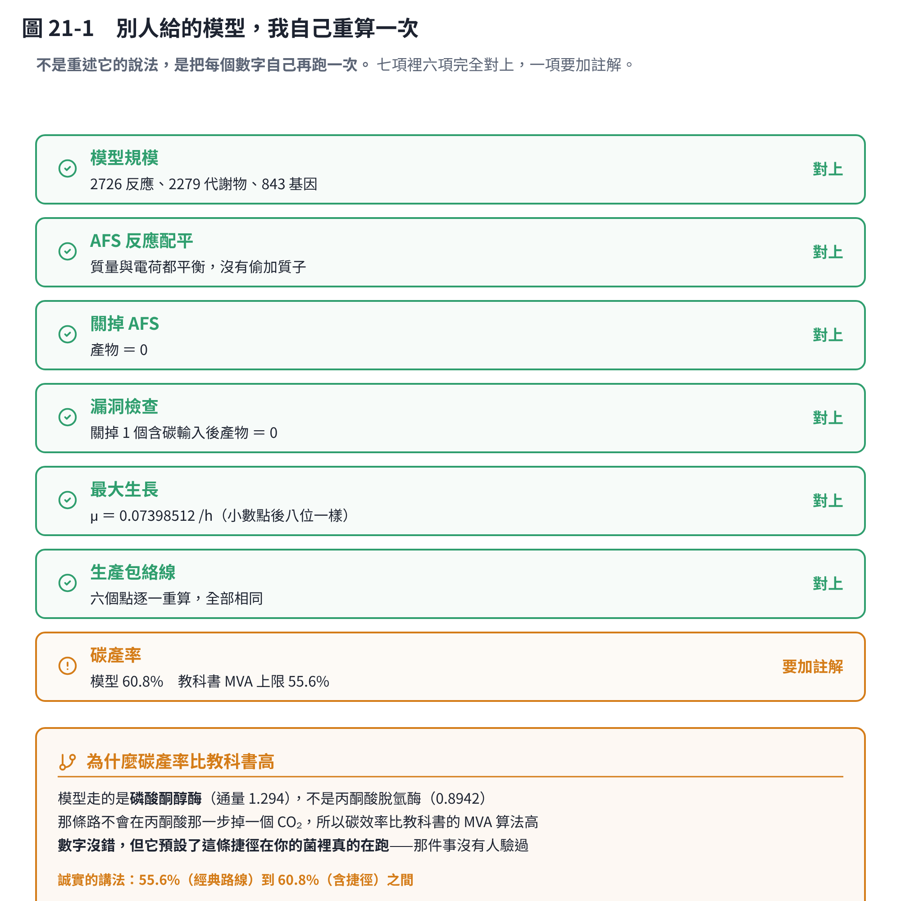
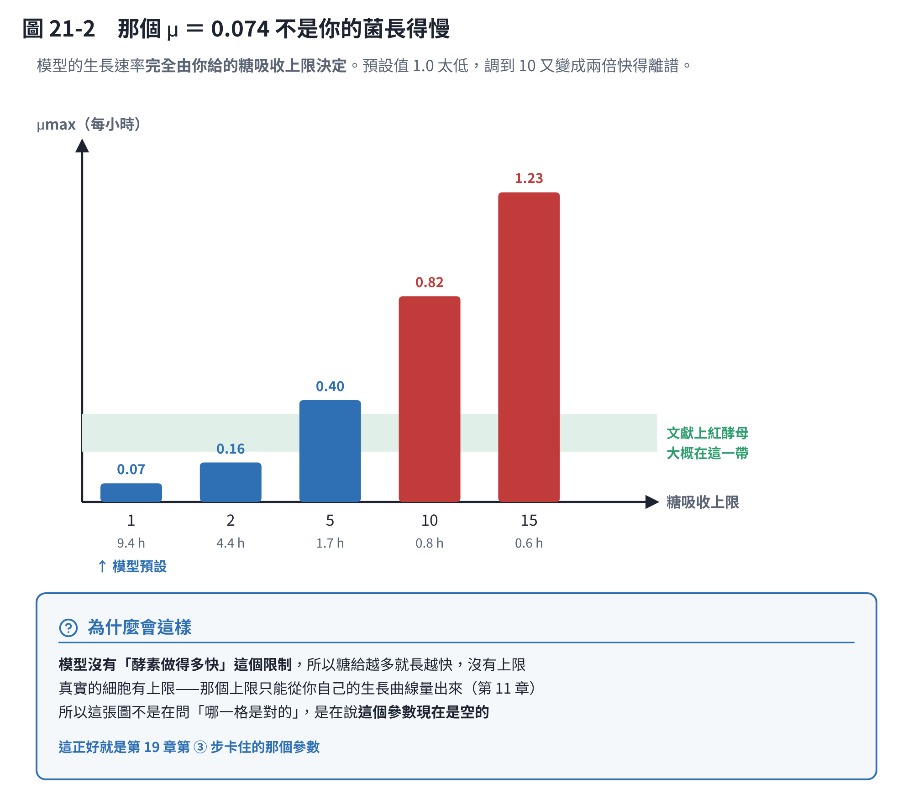
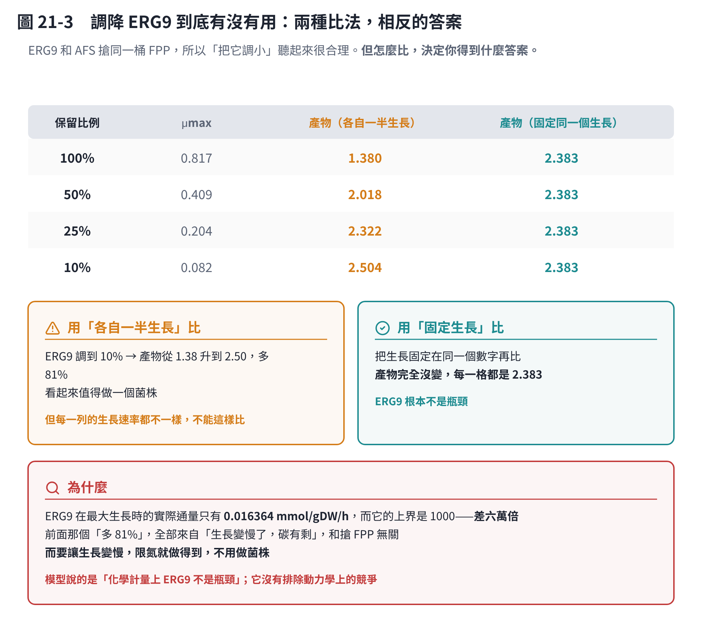
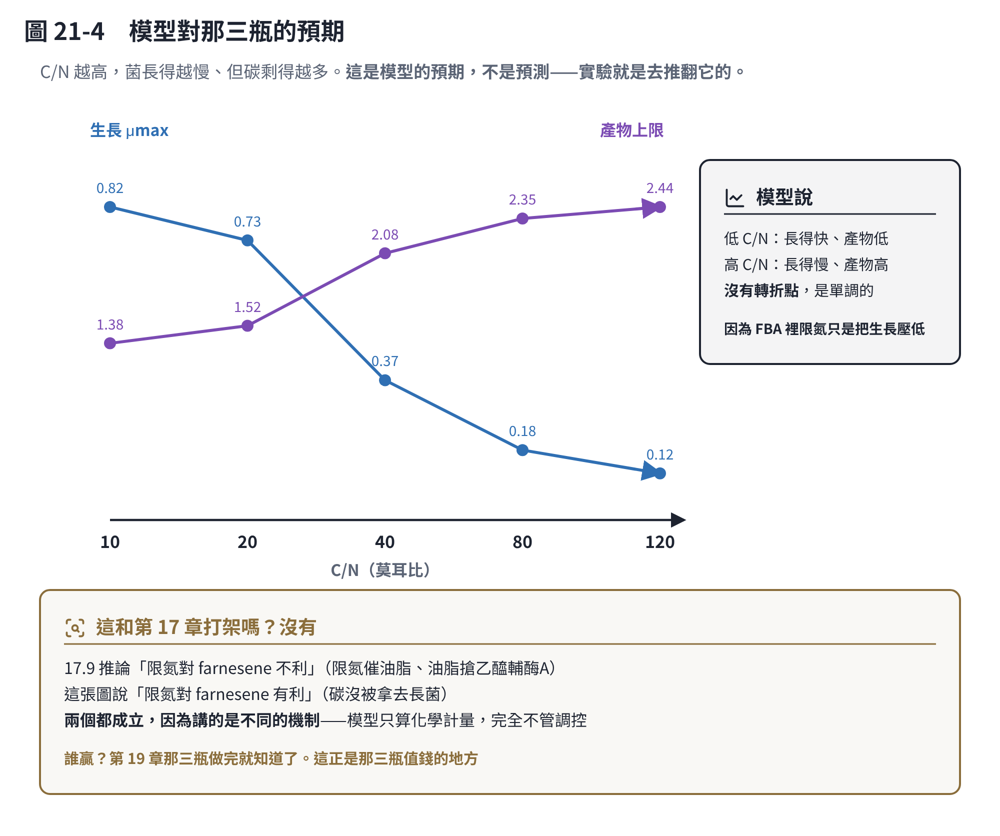

# 第 21 章　核對一個別人做好的模型

第 20 章教怎麼跑 rhto-GEM。這一章是**別人已經跑完了，而且做出一個加了 AFS 的模型**——那該怎麼驗收？

這件事會越來越常見：請同事、請外包、請另一個 AI 幫你做一段分析，拿回來一包檔案。**你不可能每次都從頭重做，但你也不能照單全收。** 這一章就是一次完整的驗收示範。

> **這一章的材料是真的。** 使用者請另一個 AI 助理做了「基因對照 ＋ 加 AFS ＋ 生產包絡線」，
> 交回一個 2,726 個反應的模型。下面每個數字都是我自己用 `code/rhto_afs.py` 重算的，
> 存在 `code/rhto_afs.json`（用 COBRApy [3]）。
>
> **結論先講：那份工作做得好。** 七項核對裡六項完全對上，一項要加註解。
> 但我多算了三件它沒算的，其中一件直接改變了「下一步要不要做某個菌株」。

## 21.1 驗收的原則：不要讀它的說法，要自己再算一次

拿到一包結果，最省力的做法是讀它的 README，看起來合理就收下。**那不是驗收，那是閱讀。**

驗收是：**挑幾個它宣稱的數字，自己再跑一次，看對不對得上。**

這裡挑了七項。選的標準是「如果這一項錯了，後面全部白做」：

| 核對項 | 它說的 | 我算的 | |
|---|---|---|---|
| 模型規模 | 2,726 反應、2,279 代謝物、843 基因 | 完全一樣 | ✅ |
| AFS 反應配平 | 質量與電荷都平衡 | 平衡 | ✅ |
| 關掉 AFS | 產物 ＝ 0 | 0 | ✅ |
| 無碳源的漏洞 | 產物 ＝ 0 | 0 | ✅ |
| 最大生長 | μ ＝ 0.07398512 /h | **小數點後八位一樣** | ✅ |
| 生產包絡線六個點 | 0.2431、0.1858、0.1257⋯ | 逐點相同 | ✅ |
| 碳產率 | （它沒算） | 60.8% | ⚠️ 要加註解 |

**「小數點後八位一樣」這件事值得講一下。** 線性規劃的解不是唯一的，但目標函數值是唯一的；八位相同代表我載到的是同一個模型、設的是同一組條件。**這比對五個描述性的句子有用得多。**

### 它做對的幾件事

這份工作有幾個做法值得學起來：

- **原始檔案沒有被改動。** 菌株名稱交換只改檔名與封面，FASTA／GFF 的內容逐位元組保留，而且留著原始 ZIP。這正是第 11 章「記錄修正，不要竄改原始資料」。
- **每個數字都標了「這是假設還是證據」。** 例如「細胞質定位是假設」「上界 1000 是寬鬆數值界，不是測得的酵素能力」「11 份拷貝沒有被當成 11 倍產量」。
- **做了漏洞檢查。** 關掉碳源、放開維持能量，確認產物是 0。**沒做這一步的模型不能信**——代謝模型很容易出現「憑空生出碳」的循環。
- **記了來源的 commit 與 SHA256。** 半年後要重現，這兩個東西比任何說明都有用。

### 唯一要加註解的那一項：碳產率 60.8%

模型算出來，**在不管菌長不長的極端下，每 100 個糖的碳最多有 60.8 個變成產物**。

但第 17.8 節自己算過經典的 MVA 路線：4.5 個葡萄糖做 1 個 farnesene，**碳上限是 55.6%**。

**模型比教科書高，這不合理——除非模型走了另一條路。**

查下去就找到了：模型把大部分碳送進**磷酸酮醇酶**（phosphoketolase，通量 1.294），而不是丙酮酸脫氫酶（0.894）。差別在於：

| 路線 | 做什麼 | 碳 |
|---|---|---|
| 丙酮酸脫氫酶（教科書那條） | 丙酮酸 → 乙醯輔酶A | **每次掉一個 CO₂** |
| 磷酸酮醇酶 | 木酮糖-5-磷酸 → 乙醯磷酸 ＋ 三碳糖 | **不掉 CO₂** |

所以模型的 60.8% 沒有算錯，**但它預設了這條捷徑在你的菌裡真的在跑**。那件事**沒有人驗過**——這個酵素在基因體裡有註解，不代表它在細胞裡有通量。

> **誠實的講法**：理論上限落在 **55.6%（只走經典路線）到 60.8%（捷徑全開）之間**。
> 寫論文時要兩個都寫，而且說明差別從哪裡來。

## 21.2 我多算的第一件：那個 μ ＝ 0.074 不是你的菌長得慢

模型跑出來最大生長速率 **0.074 /h**，換算倍增時間 **9.4 小時**。

紅酵母沒有這麼慢。但這不是模型錯了——**是它用了 rhto-GEM 的預設培養條件，葡萄糖吸收上限只有 1.0 mmol/gDW/h**。

| 糖吸收上限 | μmax | 倍增時間 | 產物上限 |
|---:|---:|---:|---:|
| **1.0（模型預設）** | 0.074 | 9.4 h | 0.243 |
| 2 | 0.157 | 4.4 h | 0.508 |
| 5 | 0.404 | 1.7 h | 1.302 |
| 10 | 0.817 | **0.85 h** | 2.626 |
| 15 | 1.230 | 0.56 h | 3.950 |

**兩端都不對。** 預設值太低（9.4 小時倍增，太慢），調到 10 又變成 51 分鐘倍增——**那比大腸桿菌還快，酵母菌做不到**。文獻上紅酵母大概在 0.2–0.35 /h。

原因很簡單：**FBA 沒有「酵素做得多快」這個限制**。糖給越多就長越快，而且是線性的，沒有天花板。

> **所以這張圖不是在問「哪一格是對的」，是在說：這個參數現在是空的。**
> 它只能從你自己的生長曲線量出來（第 11 章），而那正是第 19 章第 ③ 步卡住的東西。
> **交回來的模型沒有這個數字，不是它偷懶，是這件事只能靠實驗。**

## 21.3 我多算的第二件：調降 ERG9 到底有沒有用

這一件最重要，因為它直接影響「要不要花三個月做一個菌株」。

ERG9（鯊烯合成酶）和 AFS 搶同一桶 FPP，所以「把 ERG9 調小，產物就會變多」聽起來天經地義。第 17、18 章也把它列在建議清單上。

**模型怎麼說？取決於你怎麼比。**

| ERG9 保留 | μmax | 產物（各自一半生長） | 產物（固定同一個生長） |
|---:|---:|---:|---:|
| 100% | 0.817 | 1.380 | **2.383** |
| 50% | 0.409 | 2.018 | **2.383** |
| 25% | 0.204 | 2.322 | **2.383** |
| 10% | 0.082 | 2.504 | **2.383** |
| 0% | 0 | 長不起來 | 長不起來 |

**第三欄說「調到 10% 可以多 81%」。第四欄說「完全沒變」。**

差別在於**生長速率有沒有被控制住**。第三欄每一列的生長速率都不一樣（因為調降 ERG9 會讓菌長得慢），所以第三欄其實是在比「長得慢的菌 vs 長得快的菌」，不是在比「有沒有搶到 FPP」。

**把生長固定在同一個數字，產物一格都沒動。**

### 為什麼是這樣

查一下 ERG9 在最大生長時實際跑多快：**0.016364 mmol/gDW/h**。而它的上界設在 **1000**。

**差六萬倍。** 也就是說，ERG9 根本沒有在「大量」消耗 FPP——它只拿走維持細胞膜所需的那一點點。**把一個本來就很小的數字再調小，當然什麼都不會變。**

那第三欄的 81% 是哪來的？**全部來自「生長變慢了，碳有剩」。** 而要讓生長變慢，**限氮就做得到，不用做菌株。**

> **這就是模型最值錢的時候：它在你花三個月之前，告訴你這條路不值得走。**
>
> 但要講清楚範圍：模型說的是「**化學計量上** ERG9 不是瓶頸」。
> 它沒有排除動力學上的競爭——如果 ERG9 的酵素很快、FPP 的池子很小，
> 細胞裡的瞬時競爭還是可能存在。**要排除那個，要量 FPP 的池子，不是跑模型。**
>
> 另外，第 18 章文獻上那個 6–7 倍是**削弱油脂通量**換來的，搶的是**乙醯輔酶A**，
> 不是 FPP。那一條和這裡的結論不衝突，而且它仍然是最值得做的那一個。

## 21.4 我多算的第三件：C/N 和拷貝數

### C/N：模型對那三瓶的預期

| C/N | 氮吸收 | μmax | 產物（一半生長） |
|---:|---:|---:|---:|
| 10 | 6.00 | 0.817 | 1.380 |
| 20 | 3.00 | 0.730 | 1.517 |
| 40 | 1.50 | 0.365 | 2.083 |
| 80 | 0.75 | 0.183 | 2.355 |
| 120 | 0.50 | 0.122 | 2.445 |

**單調的：C/N 越高，長得越慢、產物上限越高。沒有轉折點。**

這和第 17.9 的推論**看起來相反**（那邊說限氮對 farnesene 不利）。兩個都成立，因為講的是不同的機制：

- **模型講的是化學計量**：氮少 → 碳沒被拿去長菌 → 剩下的碳理論上可以做產物。
- **17.9 講的是調控**：氮耗盡會**觸發油脂累積**，油脂把乙醯輔酶A 搶走。

**FBA 完全看不到第二件事**（第 20.9 節）。所以這張圖是「如果沒有調控，會長這樣」的基準線，**不是預測**。

> **第 19 章那三瓶就是用來分勝負的。** 現在兩邊都有明確的預期，實驗做完一定會推翻其中一個——
> **那正是一個實驗最值錢的時候。**

### 拷貝數：在 FBA 裡完全沒有用

模型把 11 個拷貝寫成 `AFS_copy_01 or AFS_copy_02 or …`，用 OR 連起來。

| 情況 | 產物上限 |
|---|---:|
| 11 個全在 | 2.626 |
| **只剩 1 個** | **2.626** |
| 11 個全部剔除 | 0 |

**OR 規則只管「有沒有」，不管「幾份」。** 交回來的文件自己也寫清楚了這件事（「沒有將 11 拷貝換成 11 倍產量」），這是對的——**在 FBA 裡本來就做不到**。

要讓拷貝數進到模型，得加「酵素量」這一層（酵素限制模型，如 GECKO），而那需要蛋白質體或酵素動力學資料。**現在沒有，所以先不做。**

## 21.5 一個事實更正：rhto-GEM 不是建在 IFO 0880 上

核對的過程中發現**我自己在第 15、20 章寫錯了一件事**。

我寫過「rhto-GEM 建在 IFO 0880 上——和你的參考基因體同一株」，並把這當成選它的主要理由。**這是錯的。**

| 模型 | 建在哪一株 | 基因編號長什麼樣 |
|---|---|---|
| **rhto-GEM** [1] | **NP11** | `RHTO_#####` |
| **iRhto1108** [2] | **IFO 0880** | （IFO 0880 的編號） |
| 你的定序廠註解 | 你的菌 | `g_#####` |

交回來的那份文件從頭到尾寫的是 NP11，而且用的就是 `RHTO_#####` 這套編號。**它是對的，我是錯的。**

**這件事的實際影響**：基因 ID 對照**不是可有可無的加分題**。第 20.10 我寫「可以先放著」，前半段的理由是錯的（我以為是同一株），但**結論仍然成立**——如果你只是要算理論上限、包絡線、C/N，用反應名字就夠了。**但只要你要講「某個基因」，就一定要先對照。**

而對照這件事，那份工作已經做完了：

| 狀態 | Rt_WT | A13_4 |
|---|---:|---:|
| 強候選（雙向最佳命中） | 804 | 808 |
| 要人看的（並列或覆蓋不足） | 17 | 15 |
| 完全沒命中 | 4 | 2 |
| 參考序列本身缺漏 | 7 | 7 |
| 合計 | 832 | 832 |

**832 個裡對上 804–808 個，這是一份可以用的對照表。** 剩下的 7 個參考缺漏是 COX1/2/3 等粒線體基因——那是參考蛋白質檔案本身沒有，不是你的菌缺基因。

> **更正已經寫回第 15、20 章與 `CLAUDE.md`。**
> 順帶補上 iRhto1108 的建議用法：**以 rhto-GEM 為主、iRhto1108 當交叉核對**。
> 兩個模型對同一個問題給出不同答案時，那個答案就不能信。

## 21.6 那四條用 FPP 的路，現在有你的菌的基因編號了

對照表最直接的好處：第 17.8 那張「誰在搶 FPP」的表，現在每一列都有一個**可以拿去做實驗的基因編號**。

| 反應 | 做什麼 | 你的菌的基因 |
|---|---|---|
| `AFS_alpha_farnesene` | **你轉進去的那一條** | `AFS_copy_01…11` |
| `r_1012` 鯊烯合成酶 | 往麥角固醇（細胞膜） | **`g_00498`** |
| `r_0373` 法呢基轉移酶 | 往 GGPP、類胡蘿蔔素 | **`g_00412`** |
| `r_1766` FPP 運輸 | 送到其他區隔 | （無 GPR） |

**這就是為什麼要做對照表。** 沒有它，你只能說「ERG9」；有了它，你可以直接設計 `g_00498` 的 RT-qPCR 引子或剔除構築。

（不過根據 21.3，`g_00498` 現在**不建議動**。先把它記下來，等有 FPP 池子的量測資料再回來。）

## 21.7 如果是我，我會怎麼做

被問到「你會不會也這樣做」，誠實的回答是：**大方向一樣，三個地方會不同。**

| | 那份工作 | 我會改的 |
|---|---|---|
| **做出來的東西** | 一包檔案 ＋ 一份交接文件 | 一樣。但**把產生數字的程式一起交**，不只交結果——沒有程式就不能重算，不能重算就只能相信 |
| **介面** | Streamlit（要裝 Python、開終端機） | **做成一個網頁連結**，手機也打得開。見 21.8 |
| **分析深度** | 停在生產包絡線 | 多做 21.2–21.4 那三件。**包絡線只告訴你「上限」，不告訴你「下一步該做什麼」** |
| **比較的嚴謹度** | — | **任何「改 A 之後 B 變多」的比較，都要先把生長速率固定住**。21.3 那個 81% 就是沒固定造成的 |

但要講清楚：**上面四點裡，只有第四點是「錯」，其他三點是「選擇不同」。** 而第四點我自己第一版也寫錯了（我原本用上界的比例去掃，結果上界根本沒綁住，掃出來一片平坦），是發現平坦得太可疑才回頭查的。

> **這件事本身就是教學點**：模型給你一個「很乾淨」的結果時——全部一樣、完美線性、剛好整數——
> **先懷疑是你的設定沒有生效**，再考慮它是真的。

## 21.8 介面：我的版本

那份工作做了一個 Streamlit 介面：載入 SBML／JSON、搜尋反應、改吸收上限、跑 FBA 與 FVA、匯出 CSV。**功能是對的**，而且在 Mac 上跑得起來。

我做的版本差別在**打開它的成本**：

| | Streamlit 版 | 我的版本 |
|---|---|---|
| 要裝什麼 | Python、conda、cobra、streamlit | **不用裝** |
| 怎麼開 | 開終端機、`streamlit run`、等它起來 | **點連結** |
| 手機 | 不行 | 可以 |
| 換模型 | 上傳檔案就好 | **不行**——數字是事先算好的 |
| 算新的東西 | 可以 | 不行 |

**兩個不是取代關係。** Streamlit 那個是**工作台**：要試新條件、要查某個反應、要換模型，用它。我這個是**看板**：已經算完的結果，隨時隨地打開給自己或給別人看。

> 這也是第 19.5 講過的那件事：**我的版本讀的是事先算好的查表，不是模型。**
> 它快、不用裝、手機能開，代價就是**只能看算好的東西**。

## 本章重點

- **驗收不是閱讀。** 挑幾個它宣稱的數字自己重算一次——目標函數值對到小數點後八位，比讀五段說明有用得多。
- **這份工作做得好**：七項核對六項完全對上，原始檔案沒被改動，假設和證據分開標示，做了漏洞檢查，記了 commit 與 SHA256。
- **碳產率 60.8% 比教科書的 55.6% 高，不是算錯**，是模型走了磷酸酮醇酶那條不掉 CO₂ 的捷徑。**數字對，但預設了那條路在你的菌裡真的在跑。** 誠實的講法是「55.6% 到 60.8% 之間」。
- **μ ＝ 0.074 不是你的菌長得慢**，是糖吸收上限用了模型預設的 1.0。FBA 沒有「酵素做得多快」這個限制，所以糖給越多就長越快，沒有天花板。**這個參數只能從實驗曲線量。**
- **調降 ERG9 在這個模型裡沒有用。** ERG9 的實際通量只有 0.016，上界卻是 1000——差六萬倍，它本來就不是瓶頸。看起來有用的那個「多 81%」，全部來自生長變慢，而限氮就能讓生長變慢。
- **任何「改 A 之後 B 變多」的比較，都要先把生長速率固定住。** 沒固定就不是在比你以為在比的東西。
- **模型對 C/N 的預期和第 17.9 的推論相反，但兩個都成立**——一個算化學計量，一個講調控，FBA 看不到調控。第 19 章那三瓶就是用來分勝負的。
- **拷貝數在 FBA 裡完全沒有用。** OR 規則只管有沒有，不管幾份。要讓拷貝數進模型得用酵素限制模型，而那需要蛋白質體資料。
- **rhto-GEM 建在 NP11 上，不是 IFO 0880**——我先前寫錯了，更正已寫回第 15、20 章。所以基因 ID 對照是談基因層次問題的前提。
- **有了對照表，第 17.8 那張「誰在搶 FPP」的表就有了你的菌的基因編號**：鯊烯合成酶是 `g_00498`、法呢基轉移酶是 `g_00412`。
- **模型給你一個「很乾淨」的結果時，先懷疑是設定沒生效。** 全部一樣、完美線性、剛好整數，通常是 bug 不是發現。

## 參考文獻

1. Tiukova IA, Prigent S, Nielsen J, Sandgren M, Kerkhoven EJ (2019). Genome-scale model of *Rhodotorula toruloides* metabolism. *Biotechnology and Bioengineering*, 116, 3396–3408. https://doi.org/10.1002/bit.27162
2. Dinh HV, Suthers PF, Chan SHJ, et al. (2019). A comprehensive genome-scale model for *Rhodosporidium toruloides* IFO0880 accounting for functional genomics and phenotypic data. *Metabolic Engineering Communications*, 9, e00101. https://doi.org/10.1016/j.mec.2019.e00101
3. Ebrahim A, Lerman JA, Palsson BO, Hyduke DR (2013). COBRApy: COnstraints-Based Reconstruction and Analysis for Python. *BMC Systems Biology*, 7, 74. https://doi.org/10.1186/1752-0509-7-74
