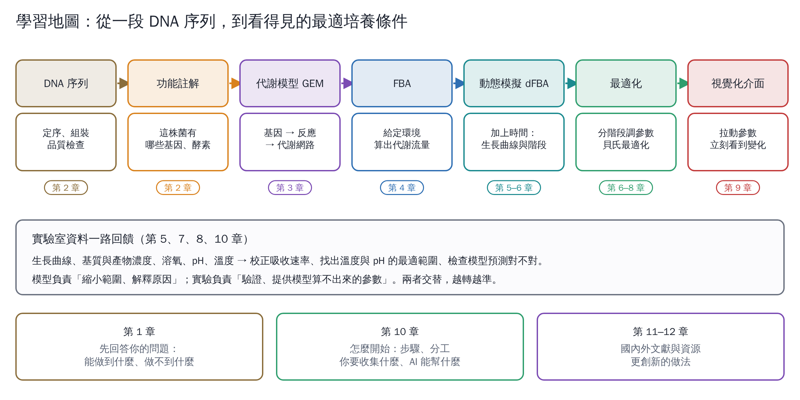

# 從 DNA 到最適培養：建模與視覺化

你想要一個系統：丟進微生物的 DNA 序列，它先查資料庫告訴你這株菌的基因能做什麼，再建議實驗室的培養參數，告訴你哪些參數重要、調哪個參數會影響哪條代謝路徑、怎麼分階段調整才能得到最多菌數或最高產量，最後在介面上拉動參數就能看到變化。

**這可以做到，而且國外已經有成熟的工具和研究**。不過有一部分只看 DNA 算不出來，一定要靠實驗補上。這個分區把整條路走一遍：

- 第 4–8 章的圖和數字，都是我用開源工具實際算出來的。
- 第 9 章有一個做好的互動模擬器，可以直接拉參數看變化。

| 章 | 主題 | 你會學到 |
|---|---|---|
| [1](01-your-questions.md) | 先回答你的問題 | 能做到什麼、做不到什麼；需不需要模型；國內外誰做過；你沒想到的問題 |
| [2](02-sequence-to-function.md) | 從序列到功能 | 定序、組裝、物種鑑定、功能註解；從基因體找培養條件的線索 |
| [3](03-metabolic-model.md) | 建立代謝模型 | 基因體尺度代謝模型（GEM）是什麼、怎麼自動建、怎麼檢查 |
| [4](04-lab-fba.md) | 實作 1：FBA | 改供氧、換碳源、剔除基因，看代謝路徑怎麼改變 |
| [5](05-lab-dynamic.md) | 實作 2：動態培養 | 生長曲線的五個階段、每階段看什麼指標、生長參數怎麼量 |
| [6](06-lab-two-stage.md) | 實作 3：分階段最適化 | 兩階段培養、什麼時候切換、每階段該顧哪些參數 |
| [7](07-environment-and-doe.md) | 溫度、pH 與實驗設計 | 模型算不出來的參數怎麼補；篩選、反應曲面法 |
| [8](08-ai-optimization.md) | 用 AI 少做實驗 | 貝氏最適化、主動學習、模型＋機器學習的混合做法 |
| [9](09-visual-interface.md) | 視覺化介面 | 互動模擬器的使用與做法；自己做介面的工具 |
| [10](10-getting-started.md) | 怎麼開始 | 步驟與時程；你要收集什麼、AI 能幫什麼；常見陷阱 |
| [11](11-literature-and-resources.md) | 國內外文獻與資源 | 分類閱讀清單、資料庫、臺灣的資源與研究現況 |
| [12](12-innovation.md) | 更創新的做法 | 9 個少有人做、但按道理可行的方向 |

## 先講結論：七個回答

1. **丟 DNA 就能定義基因功能嗎？** 可以，這部分最成熟。註解工具加上 KEGG 等資料庫，就能列出這株菌有哪些酵素和代謝路徑（第 2 章）。
2. **能直接得到最適培養參數嗎？** 只能得到一部分。
   - 代謝模型可以預測碳源、氮源、供氧、產物路徑（第 3、4 章）。
   - 最適溫度、pH、鹽度與遲滯期，基因體算不準，要靠實驗或經驗模型（第 7 章）。
3. **需要建立模型嗎？** 參數超過 3 個，或有分階段培養時，建議要。模型負責縮小範圍、解釋原因；實驗負責驗證與校正（第 6、8 章）。
4. **分階段要調什麼、看什麼指標？** 先跑一批基準培養，用 OD、溶氧、pH、尾氣找出階段的轉折點，再看每階段各自的關鍵參數。
   - 在本教材的模擬中，長菌階段最敏感的是接種量與切換時間。
   - 產物階段最敏感的是溫度、pH 與通氣（第 5、6 章）。
5. **國內外有人這樣做嗎？** 國外很多，從 2010 年前後的代謝模型，到 2019 年後的機器人加 AI 自動實驗都有。臺灣我只找到零星研究，沒有找到公開的完整平台；這是機會（第 11 章）。
6. **我需要自己收集什麼？** 需要：純菌的定序資料、幾批完整的生長曲線（含糖、產物、溶氧、pH），以及每一次實驗的條件紀錄。AI 能幫你跑註解、建模、整理文獻、建議下一批實驗（第 10 章）。
7. **能看到調參數後的變化嗎？** 可以。第 9 章的模擬器就是示範：拉動溫度、供氧或切換時間，會立刻看到：
   - 生長曲線；
   - 代謝流量圖；
   - 最佳切換時間；
   - 參數敏感度。

## 關於計算結果

- 第 4–9 章用的是**大腸桿菌核心代謝模型**（*E. coli* core，95 個反應、137 個基因；Orth et al., 2010）。它是公開的教學模型，換成你的菌，步驟完全相同（第 3 章）。
- 動力學、溫度與 pH 的參數是**示範值**，數字只用來比較不同做法的相對好壞，不代表任何實際菌株。
- 程式放在 [`code/`](code/)，照著 [`code/README.md`](code/README.md) 就能重跑。互動模擬器在 [`simulator/`](simulator/)。
- 有 DOI 的文獻都由 GitHub Actions 自動到 Crossref 核對。第 12 章全部屬於推論。
