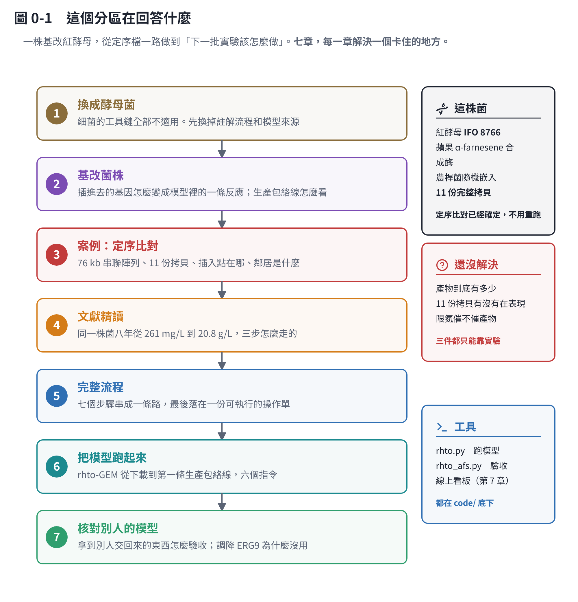

# 紅酵母 α-farnesene：定序、模型與實驗

一株基改紅酵母，從定序檔一路做到「下一批實驗該怎麼做」。

隔壁分區「從 DNA 到最適培養」教的是**方法**，例子是細菌。**這個分區是同一套方法用在一株真的菌上**——而且大部分篇幅在講「哪裡會出錯、哪些結論不能下」。

## 這株菌是什麼

| | |
|---|---|
| 菌株 | *Rhodotorula toruloides*（紅酵母）**IFO 8766**。二倍體接合株，IFO 0559 × IFO 0880 |
| 基改 | 蘋果的 **α-farnesene 合成酶（AFS）**，農桿菌隨機嵌入（ATMT） |
| 參考基因體 | JGI MycoCosm 的 `Rhoto_IFO0880_4` |
| 產物 | α-farnesene，倍半萜（C15），從 FPP 做出來 |

## 定序比對已經確定的事

這幾件**不用再查、不用再跑**，第 3 章有完整的推導過程：

| 問題 | 答案 |
|---|---|
| 兩份定序檔是同一株菌嗎 | 是。31-mer 共有 99.836% |
| 基改進去了沒 | 進去了。染色體上一段 **76,217 bp 的串聯陣列** |
| 幾份 | **11 份完整拷貝**，和設計逐鹼基零差異；第 12 份斷在陣列接合點 |
| 插在哪 | Contig3 943,094–1,019,311，**單一位點、沒有重排** |
| 有沒有打斷基因 | 沒有。落在兩個基因中間的空地，鏟掉 59 bp 但全在空地上 |
| 兩個檔名 | **送定序時標反了**。檔名 `Rt_WT` 其實是基改株 |

**兩件還沒解決**：

- **AFS 前面那兩個啟動子是什麼**——不在宿主基因體裡，也不是 35S／nos／trpC。這件事卡住「限氮的時候 AFS 還有沒有在工作」，進而卡住分階段培養要怎麼設計（3.4）。
- **插入點旁邊那個基因是做什麼的**——BLAST 查過了，37 筆命中 35 筆是 hypothetical。它是譜系特有的基因，**沒有任何模式生物有它可以借名字**（3.11）。

## 模型算完之後的結論

第 5、6 章把 rhto-GEM 加上 AFS 跑完了。**最有用的結論都是負面的**：

- **不要再加拷貝。** 文獻上產量和拷貝數的相關性 R² ＝ 0.93，但你已經有 11 份，邊際效益接近零。
- **不要調降 ERG9。** 把生長速率固定住之後，產物一點都沒多——它的實際通量只有 0.016，本身就不是瓶頸（6.3）。
- **843 個基因全部剔除一次，沒有一個能讓產物變多。** 產物上限是被「碳總量」和「要長多少菌」決定的，不是被某條支線搶走的。
- **模型跑得動不等於可以預測產量。** 它算的是上限，而上限和實際常常差一個數量級。

## 下一步只有一件事

**做實驗。** 第 4 章第 ⑥ 步那份操作單一次回答四件事：

1. 產物到底有多少（第一個可信的數字）
2. C/N 對產物的影響（**文獻上沒有人掃過**）
3. AFS 的開關受不受氮調控
4. OD600 換算乾重的校正線，以及模型還缺的那些參數

## 七章

| 章 | 主題 | 你會學到 |
|---|---|---|
| [1](r01-yeast.md) | 換成酵母菌 | 細菌的工具鏈哪裡不適用；真核註解流程；現成的酵母菌模型怎麼選 |
| [2](r02-engineered.md) | 基改菌株 | 插進去的基因怎麼變成模型裡的一條反應；生產包絡線與成長耦合 |
| [3](r03-case-study.md) | 案例：定序比對 | 把構築對回基因體：拷貝數、串聯陣列、壞掉的拷貝、插入點旁邊是什麼；兩個會得到錯誤結論的坑 |
| [4](r04-workflow.md) | 完整流程 | 七個步驟串成一條路；代謝模型與 FBA 從頭講一次；第 ⑥ 步是一份可以直接拿進實驗室的操作單 |
| [5](r05-run-rhto-gem.md) | 把模型跑起來 | 六個指令從裝環境到第一條生產包絡線；反應 id 為什麼不能寫死、「上下限」是什麼意思 |
| [6](r06-audit-afs-model.md) | 核對別人的模型 | 拿到別人交回來的模型要怎麼驗收；調降 ERG9 為什麼沒用；一個我自己寫錯的事實更正 |
| [7](r07-literature-rt-terpenes.md) | 文獻精讀 | 同一株菌八年從 261 mg/L 到 20.8 g/L 的三步；可以直接抄的操作與沒人回答的問題。**當參考資料用，不必照順序讀** |

## 工具

程式都在 `code/`，和隔壁分區共用（數字和圖是同一套程式產生的）：

| 檔案 | 做什麼 |
|---|---|
| `genome_tools.py`、`case_rt.py` | 定序比對：組裝統計、找插入點、把構築對回基因體 |
| `annotation.py` | 讀定序廠的註解包；修轉殖基因的基因模型；抽插入點旁邊的鄰居 |
| `blast_neighbours.py` | 解讀 blastp 的 XML：命中分佈、保守核心在哪、低複雜度誤標 |
| `rhto.py` | 把 rhto-GEM 跑起來：六個子指令 |
| `rhto_afs.py`、`rhto_afs_grid.py`、`rhto_afs_export.py` | 核對加了 AFS 的模型、算查表、匯出給介面 |
| `workflow.py` | 把「C/N 要 40」換算成「秤幾公克」 |

**線上看板**（不用裝任何東西，手機也能開）：<https://claude.ai/artifact/BiBQ9HUf4CAPWp1j1GXuoZ>

## 這個分區的立場

**負面結果照實寫。** 模型失準、參數辨識不出來、推論和模型對不起來——這些都留著，因為那通常才是最值得看的部分。

**假設和證據分開標。** 「序列完整」不等於「基因有表現」；「模型算得出來」不等於「菌真的做得到」。每一處都會講清楚現在站在哪一邊。
