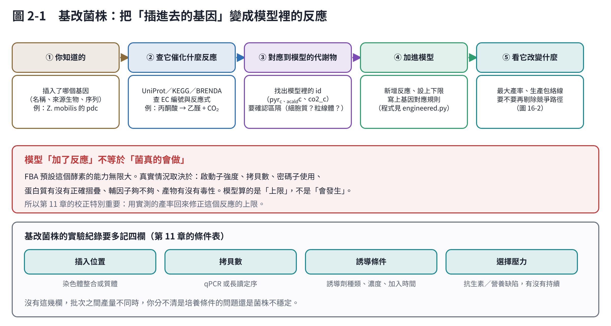
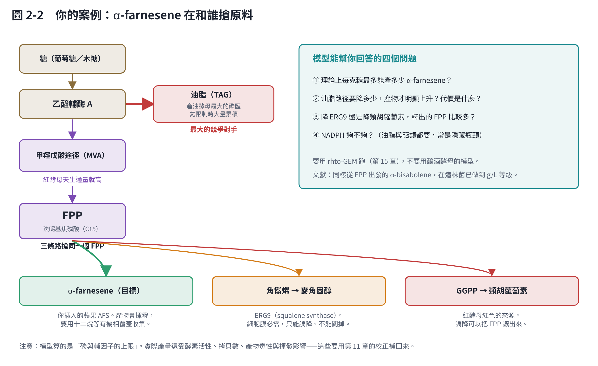
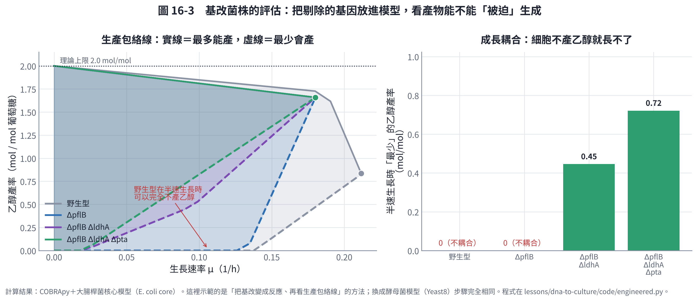

# 第 2 章　基改菌株：把插入的基因變成模型裡的反應

基改菌株多了一個問題：**模型裡沒有你插進去的那條路徑**。這一章說明怎麼補上，以及怎麼用模型判斷「還要再改什麼」。

全章以一個實際案例貫穿：**把蘋果的 α-farnesene 合成酶（AFS）以隨機嵌入放進紅酵母 *Rhodotorula toruloides***。

## 2.1 基改菌株的序列能回答什麼

| 問題 | 序列能回答嗎 | 怎麼做 |
|---|---|---|
| 插入的基因在不在？序列對不對？ | **可以** | 把讀段比對到你的載體／片段序列 |
| 插在哪裡（染色體位置）？ | **可以**（長讀最可靠） | 找「一半對參考、一半對插入片段」的讀段 |
| 插了幾個拷貝？ | **可以**（半定量） | 比較插入片段與單拷貝基因的讀段深度 |
| 有沒有破壞到原本的基因？ | **可以** | 看插入點落在哪個基因內或其啟動子 |
| 這個酵素在細胞裡活性多高？ | **不行** | 要酵素活性測定或產物量測 |
| 表現量多少？ | **不行** | 要 RT-qPCR 或轉錄體 |

**隨機嵌入（random integration）特別需要做這件事。** 定點整合你知道插在哪裡；隨機嵌入不知道，而插入位置會直接影響表現量（染色質環境）與菌株穩定性，也可能剛好破壞一個重要基因。

**找插入位置的三個方法**：

| 方法 | 成本 | 可靠度 |
|---|---|---|
| 長讀定序（Nanopore／PacBio）＋比對 | 中 | 最高，一次解決位置與拷貝數 |
| 短讀 WGS ＋ split-read 分析 | 低（若已有資料） | 可行，但重複區容易失敗 |
| 反向 PCR／TAIL-PCR | 低 | 針對單一插入點有效，多拷貝時麻煩 |

**對紅酵母的額外提示**：第 1 章提到的 IFO 0880 功能基因體研究列出了約 1,337 個推定必需基因與 150 個影響油脂累積的基因 [1]。**找到插入位置後，第一件事就是去對這份清單**——如果插在影響油脂的基因裡，那你的菌表現異常可能和 AFS 無關，而是插入位置造成的。

## 2.2 把插入的基因變成反應

五個步驟：

1. **你知道的**：插入了哪個基因（名稱、來源生物、序列）。這裡是蘋果（*Malus domestica*）的 α-farnesene 合成酶 [2]。
2. **查它催化什麼反應**：到 UniProt、KEGG 或 BRENDA 查 EC 編號與反應式。AFS 的反應是：
   > FPP（法呢基焦磷酸）→ (E,E)-α-farnesene ＋ 焦磷酸
3. **對應到模型裡的代謝物 id**：在 rhto-GEM 裡找出 FPP 的 id，並確認**區隔**（細胞質還是粒線體？萜類合成通常在細胞質）。這一步最容易出錯。
4. **加進模型**：新增反應、設上下限、寫上基因對應規則。程式見 `code/engineered.py` 的 `add_heterologous()`，三行就能加一個反應。
5. **看它改變什麼**：理論最大產率、生產包絡線、要不要再剔除競爭路徑。

**最重要的警告**：

> **模型「加了反應」不等於菌「真的會做」。**
> FBA 預設這個酵素的能力無限大。真實情況取決於啟動子強度、拷貝數、密碼子使用、蛋白質摺疊、輔因子供應、產物毒性。**模型算的是上限，不是會發生的事。**

所以基礎課第 11 章的校正特別重要：用實測的產率回來修正這個反應的上限。

## 2.3 你的案例：α-farnesene 在和誰搶原料

α-farnesene 是**倍半萜（C15）**，由 FPP 做成。要提高產量，就要讓更多碳流到 FPP、再讓更多 FPP 流向 AFS。競爭者有三個：

| 競爭者 | 搶什麼 | 能不能動 |
|---|---|---|
| **油脂（TAG）** | 乙醯輔酶 A（更上游） | 產油酵母最大的碳匯。調降有幫助，但會影響生長 |
| **角鯊烯 → 麥角固醇**（ERG9） | FPP | 細胞膜必需，**只能調降、不能關掉**（常用弱啟動子或可調控啟動子） |
| **GGPP → 類胡蘿蔔素** | FPP | 紅酵母紅色的來源，調降可以把 FPP 讓出來 |

**好消息**：紅酵母天生的 MVA 途徑通量就很高（它本來就要做大量類胡蘿蔔素），這正是它適合做萜類的原因。同樣從 FPP 出發的 **α-bisabolene**，在這株菌已經從 261 mg/L [3] 做到 2.2 g/L [4]——而 Kirby 等人提高產量的主要手段之一，就是**增加合成酶的拷貝數**。對隨機嵌入的菌株來說，這直接說明了為什麼**先確定拷貝數**很重要。

**模型能幫你回答的四個問題**：

1. 理論上每克糖最多能產多少 α-farnesene？
2. 油脂路徑要降多少，產物才會明顯上升？代價是什麼？
3. 降 ERG9 還是降類胡蘿蔔素，釋出的 FPP 比較多？
4. NADPH 夠不夠？（油脂與萜類都要大量 NADPH，常是隱藏瓶頸）

這些都用 rhto-GEM 跑，不要用釀酒酵母的模型。

## 2.4 生產包絡線：判斷「還要不要再改」的工具

光知道「理論最大產率」不夠用，因為那通常發生在細胞完全不生長的時候。真正有用的是**生產包絡線**：在每一個生長速率下，產物最多與最少能有多少。

下面用大腸桿菌核心模型示範這個方法（這裡用的是乙醇，因為它在核心模型裡；換成你的菌與產物，步驟完全相同）：

| 菌株 | 最大生長率 | 最大生長時的乙醇產率 | 半速生長時「最少」產率 | 成長耦合？ |
|---|---|---|---|---|
| 野生型 | 0.212 /h | 0.83 mol/mol | **0** | 否 |
| ΔpflB | 0.180 /h | 1.65 mol/mol | **0** | 否 |
| ΔpflB ΔldhA | 0.180 /h | 1.66 mol/mol | 0.45 mol/mol | **是** |
| ΔpflB ΔldhA Δpta | 0.180 /h | 1.66 mol/mol | **0.72 mol/mol** | **是** |

**怎麼讀這張圖**：

- **實線（上限）＝ 最多能產多少**。剔除 pflB 後，最大生長時的產率從 0.83 翻倍到 1.65，代價是最大生長率降低 15%。
- **虛線（下限）才是關鍵**。野生型的下限是 0：代表**細胞可以一邊長得很好、一邊完全不產乙醇**。你只能靠控制培養條件去「拜託」它產物。
- 再剔除 ldhA 與 pta 之後，下限被推到 0.45、0.72：**細胞不產乙醇就長不了**。這叫**成長耦合（growth coupling）**，是代謝工程最想要的狀態——因為此時「長得快的細胞」就是「產得多的細胞」，連續培養或長時間發酵也不會被不產物的突變株佔據。

這正是當年把大腸桿菌改造成產乙醇菌株的邏輯 [5]。找出該剔除哪些基因有系統性的演算法，例如 OptKnock [6]；也有研究指出，對主要的生產宿主而言，大部分代謝物其實都能找到成長耦合的設計 [7]。

**對你的案例**：α-farnesene 不是生長必需的副產物，所以**天然不會成長耦合**。可行的方向是：

- 把 ERG9 換成可調控啟動子，讓「生長期開、生產期關」（接回基礎課第 6 章的兩階段）；
- 或接受不耦合，改用基礎課第 6、10 章的方式——用培養條件分階段控制。

模型可以先幫你比較這兩條路的理論上限，再決定要不要投入做基因工程。

## 2.5 基改株的實驗與紀錄：多記四欄

基礎課第 11 章的條件表，對基改菌株要再加四個欄位。沒有它們，批次之間產量不同時，你分不清是培養條件的問題還是菌株的問題。

| 欄位 | 怎麼得到 |
|---|---|
| `insertion_site` | 插入位置（第 2.1 節） |
| `copy_number` | qPCR 或讀段深度 |
| `induction` | 誘導劑種類、濃度、加入時間（若用誘導型啟動子） |
| `selection` | 選擇壓力（抗生素或營養缺陷）有沒有持續施加 |

**另外三件實務上一定會遇到的事**：

1. **菌株穩定性**：隨機嵌入若在重複序列附近，傳代可能丟失。建議每隔幾代確認一次拷貝數與產量，並在條件表記下傳代次數。
2. **產物揮發與收集**：α-farnesene 是揮發性倍半萜，**不加有機相覆蓋會從培養液跑掉**，你量到的產量會嚴重低估。文獻上常用十二烷（dodecane）覆蓋層收集 [3, 4]。這件事要寫進基礎課第 10 章的操作單。
3. **產物毒性**：萜類對細胞膜有毒性。如果高產菌株長得特別差，先懷疑這個，不要一直調培養條件。有機相覆蓋同時也有解毒的作用。

## 本章重點

- 基改菌株的序列可以回答「插在哪、幾個拷貝、有沒有破壞基因」，但回答不了「表現量與活性」。隨機嵌入一定要先確定插入位置與拷貝數。
- 把插入的基因變成模型反應只有五步，但要特別注意代謝物的區隔；加了反應不等於菌真的會做，模型算的是上限。
- 以 α-farnesene 為例，競爭者是油脂（搶乙醯輔酶 A）、麥角固醇與類胡蘿蔔素（搶 FPP）。紅酵母天生 MVA 通量高，是它適合做萜類的原因。
- 生產包絡線的**下限**才是重點：下限 > 0 代表成長耦合，細胞不產物就長不了，這是最穩定的設計。
- 基改株的條件表要多記插入位置、拷貝數、誘導條件與選擇壓力；揮發性產物要用有機相覆蓋收集。

## 參考文獻

1. Coradetti ST, Pinel D, Geiselman GM, et al. (2018). Functional genomics of lipid metabolism in the oleaginous yeast *Rhodosporidium toruloides*. *eLife*, 7, e32110. https://doi.org/10.7554/eLife.32110
2. Pechous SW, Whitaker BD (2004). Cloning and functional expression of an (E,E)-α-farnesene synthase cDNA from peel tissue of apple fruit. *Planta*, 219, 84–94. https://doi.org/10.1007/s00425-003-1191-4
3. Yaegashi J, Kirby J, Ito M, et al. (2017). *Rhodosporidium toruloides*: a new platform organism for conversion of lignocellulose into terpene biofuels and bioplastics. *Biotechnology for Biofuels*, 10, 241. https://doi.org/10.1186/s13068-017-0927-5
4. Kirby J, Geiselman GM, Yaegashi J, et al. (2021). Further engineering of *R. toruloides* for the production of terpenes from lignocellulosic biomass. *Biotechnology for Biofuels*, 14, 101. https://doi.org/10.1186/s13068-021-01950-w
5. Ingram LO, Conway T, Clark DP, Sewell GW, Preston JF (1987). Genetic engineering of ethanol production in *Escherichia coli*. *Applied and Environmental Microbiology*, 53, 2420–2425. https://doi.org/10.1128/aem.53.10.2420-2425.1987
6. Burgard AP, Pharkya P, Maranas CD (2003). OptKnock: a bilevel programming framework for identifying gene knockout strategies for microbial strain optimization. *Biotechnology and Bioengineering*, 84, 647–657. https://doi.org/10.1002/bit.10803
7. von Kamp A, Klamt S (2017). Growth-coupled overproduction is feasible for almost all metabolites in five major production organisms. *Nature Communications*, 8, 15956. https://doi.org/10.1038/ncomms15956
8. Tiukova IA, Prigent S, Nielsen J, Sandgren M, Kerkhoven EJ (2019). Genome-scale model of *Rhodotorula toruloides* metabolism. *Biotechnology and Bioengineering*, 116, 3396–3408. https://doi.org/10.1002/bit.27162
