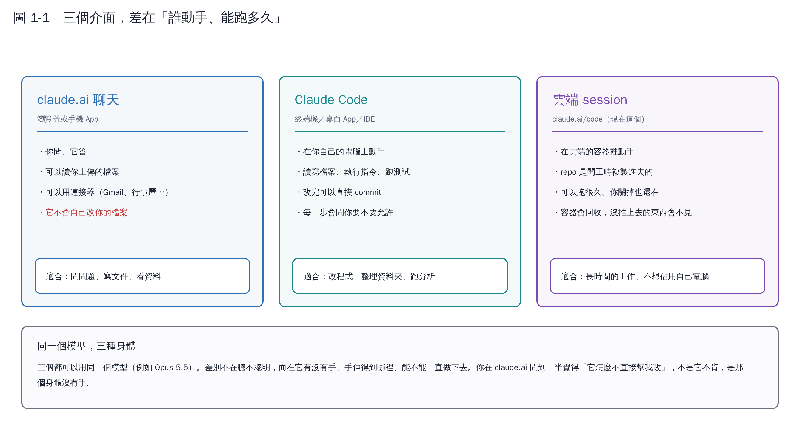

# 第 1 章　三個介面：差在「誰動手、能跑多久」

## 1.1 先分清楚三層

很多人把「Claude 很厲害」和「Claude 幫我改了檔案」混成一件事。其實是三層不同的東西：

| 層 | 是什麼 | 決定什麼 |
|---|---|---|
| **模型** | Haiku／Sonnet／Opus／Fable | 它有多聰明 |
| **介面** | 聊天視窗、Claude Code、雲端 session、API | 它能不能自己動手、能跑多久 |
| **工具** | 讀寫檔案、GitHub、Gmail、搜尋⋯ | 它伸得到哪裡 |

**卡住的時候先問：這是哪一層的問題？**

- 「它算錯了」→ 模型層（換更強的模型，或把問題拆小）
- 「它不會自己改檔案」→ 介面層（換到 Claude Code）
- 「它說連不到那個網站」→ 工具層（網路政策、連接器）

## 1.2 三個介面

### claude.ai 聊天視窗

最常見的那個。你問、它答，可以上傳檔案、用連接器。**但它不會自己去改你電腦上的東西。**

適合：問問題、寫文件、看資料、整理想法。

### Claude Code

裝在**你自己的電腦**上（終端機、桌面 App 或 IDE 外掛）。它能讀寫檔案、執行指令、跑測試、commit。每一個會動到東西的動作，預設都會先問你。

適合：改程式、整理資料夾、跑分析、任何「要動到檔案」的事。

### 雲端 session

就是你現在這個。程式跑在**雲端的容器**裡，不佔你電腦的資源，你關掉瀏覽器它也繼續做。

適合：長時間的工作。

**但有三個限制一定要知道**：

1. **容器會被回收。** 沒有 commit 並 push 的檔案會消失。
2. **它只看得到被加進來的 repo。** 其他的要先授權。
3. **對外連線有白名單。** 不是所有網站都連得到。

> 這份教材就是在雲端 session 裡做的。第 18 章那四篇論文我查不到全文，原因就是第 3 點——這不是藉口，是實際的限制，知道它才能繞過它（例如改用搜尋工具，或請你把 PDF 上傳給我）。

## 1.3 還有一個：API

如果你要**寫程式**呼叫 Claude（例如做一個會自動分類實驗紀錄的小工具），那是第四種用法。第 9 章會談到。

## 本章重點

- 模型、介面、工具是三層不同的東西，卡住時先判斷是哪一層。
- 同一個模型在三個介面裡一樣聰明，差別在**有沒有手**。
- 雲端 session 最強但有三個限制：容器會回收、只看得到授權的 repo、對外連線有白名單。
