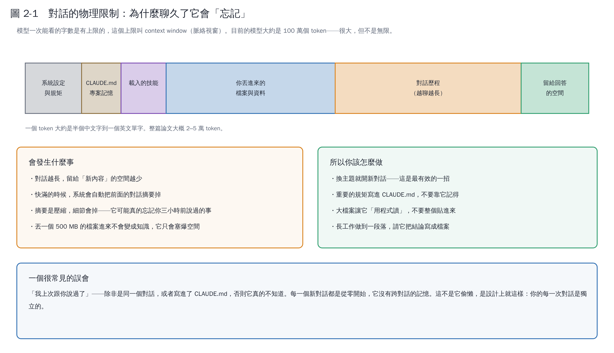

# 第 2 章　對話的物理限制：為什麼聊久了它會「忘記」

## 2.1 context window 是什麼

模型一次能「看到」的文字量有上限，這個上限叫 **context window（脈絡視窗）**。目前的模型大約是 **100 萬個 token**。

一個 token 大約是半個中文字到一個英文單字。所以：

| 東西 | 大約幾個 token |
|---|---|
| 一頁 A4 的中文 | 1,000–1,500 |
| 一篇期刊論文 | 20,000–50,000 |
| 一本書 | 300,000+ |

100 萬 token 很大，但**不是無限**，而且它要裝的不只是你的問題。

## 2.2 這個空間被誰佔走

從上面那張圖可以看到，空間被這些東西分掉：

- 系統設定與規矩
- `CLAUDE.md` 專案記憶
- 載入的技能
- 你丟進來的檔案與資料
- **對話歷程（越聊越長）**
- 留給回答的空間

前面幾項大致固定，**真正會膨脹的是對話歷程**。

## 2.3 快滿的時候會發生什麼

系統會自動把前面的對話**摘要**掉，騰出空間。摘要是壓縮，壓縮就會掉細節——所以它可能真的忘記你三小時前講過的某個條件。

這不是它偷懶，是物理限制。

## 2.4 四個實用對策

### ① 換主題就開新對話

**這是最有效的一招。** 做完一件事、要換下一件時，開新對話。新對話乾淨、便宜、不會被舊東西干擾。

### ② 重要的規矩寫進 CLAUDE.md

寫進去的東西每次都會重新讀，不會被摘要掉。詳見第 3 章。

### ③ 大檔案讓它「用程式讀」

不要把 50 MB 的 CSV 貼進對話。給它檔案路徑，叫它寫程式去讀、去算，只把結果拿回來。這份教材的基因體分析就是這樣做的——兩個 21 MB 的序列檔從來沒有進過對話，進去的只有統計結果。

### ④ 做到一段落就請它寫成檔案

「把剛才的結論整理成 `分析報告.md`」。檔案不會忘記，對話會。

## 2.5 一個很常見的誤會

> 「我上次跟你說過了。」

除非是**同一個對話**，或者寫進了 `CLAUDE.md`，否則它真的不知道。每一個新對話都是從零開始，**它沒有跨對話的記憶**。

這也是為什麼第 3 章那麼重要。

## 本章重點

- context window 是物理限制，不是態度問題。
- 真正會膨脹的是對話歷程；換主題就開新對話。
- 大資料用程式讀，不要貼進對話。
- 要它「記得」的事，寫進 CLAUDE.md 或寫成檔案。
