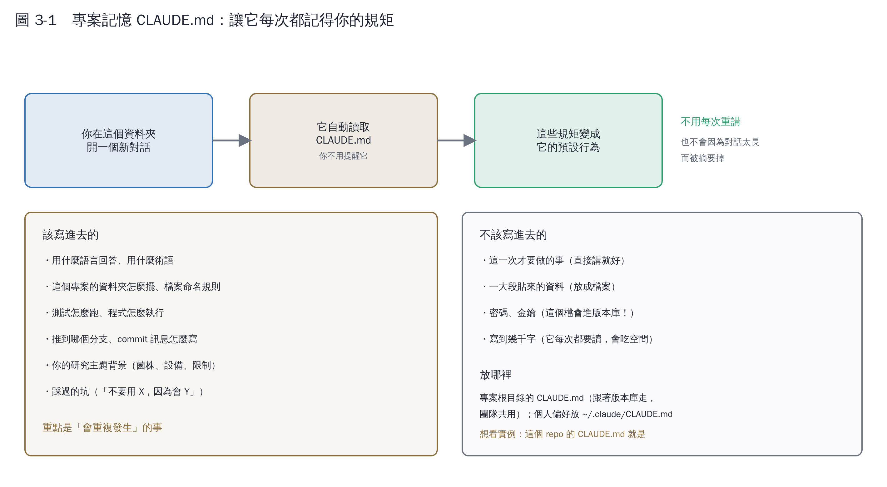

# 第 3 章　專案記憶 CLAUDE.md：十分鐘，效果最大的一件事

## 3.1 它解決什麼問題

第 2 章說過：每個新對話都是從零開始。所以你會一直重複這些話——

> 「請用繁體中文」
> 「圖裡的數字要用程式算，不要憑印象寫」
> 「推到 `claude/xxx` 這個分支，不要開 PR」
> 「我的菌是紅酵母，不要套釀酒酵母的經驗」

**`CLAUDE.md` 就是把這些話寫成一個檔案，放在專案資料夾裡。** 之後在這個資料夾開任何對話，它會**自動讀**，你不用提醒。

## 3.2 怎麼做

在專案根目錄建一個 `CLAUDE.md`，用一般的 Markdown 寫。沒有規定格式，寫得讓人看得懂就好——因為它讀的方式和人一樣。

最快的做法：**直接叫它幫你寫。**

> 「幫我看一下這個專案，然後寫一個 CLAUDE.md，把我們這幾次對話裡我一直重複交代的事都寫進去。」

然後你自己讀一遍、改掉不對的地方。

## 3.3 該寫什麼

| 類別 | 例子 |
|---|---|
| **語言與風格** | 用繁體中文（臺灣用語）；commit 訊息也是 |
| **專案結構** | 哪個資料夾放什麼、檔案怎麼命名 |
| **怎麼跑** | 測試指令、產生圖的指令、預覽的指令 |
| **Git 規矩** | 推哪個分支、要不要開 PR、commit 訊息格式 |
| **品質標準** | 「數字要是算出來的」「推論要標示為推論」 |
| **你的研究背景** | 菌株、設備、已知限制 |
| **踩過的坑** | 「不要用 X，因為會 Y」 |

判準很簡單：**會重複發生的事**。

## 3.4 不該寫什麼

| 不要寫 | 為什麼 |
|---|---|
| 這一次才要做的事 | 直接講就好，寫進去反而變成每次都要讀的雜訊 |
| 一大段貼來的資料 | 放成檔案，需要時叫它讀 |
| **密碼、API 金鑰** | **這個檔案會進版本庫！** 金鑰要放環境變數 |
| 寫到幾千字 | 它每次都要讀，會吃掉 context 空間 |

## 3.5 放在哪裡

| 位置 | 適用範圍 |
|---|---|
| 專案根目錄 `CLAUDE.md` | 跟著版本庫走，**團隊共用** |
| 個人目錄 `~/.claude/CLAUDE.md` | 只有你自己，跨所有專案 |

## 3.6 看一個真的

這個 repo 的 `CLAUDE.md` 就是實例。它大概這樣分段：

1. 專案在做什麼（兩條主線）
2. 使用者是中文使用者，所有輸出用繁體中文
3. 教材的目錄結構與做法
4. **寫教材的規矩**（數字要算出來、誠實標示推論、文獻 DOI 會被 CI 核對）
5. 常用指令
6. 環境限制（沒有對外網路、字型設定）
7. **使用者的實際研究題目**（菌株、基改方式、該用哪個模型）
8. Git 規矩

第 7 點特別值得說：把你的研究背景寫進去之後，它就不會再建議你用釀酒酵母的模型、不會忘記產物會揮發要加覆蓋層。**這一段省下的來回解釋，比其他所有段落加起來都多。**

## 3.7 維護它

`CLAUDE.md` 不是寫完就放著。每次你發現自己又在重複講同一件事，就是該補一條的時候。

一個好習慣：**當它做錯了而你糾正它之後**，問自己「這個糾正下次還會發生嗎？」會的話就加進去。

## 本章重點

- `CLAUDE.md` 是放在專案資料夾的規矩清單，開對話時自動載入。
- 判準是「會重複發生的事」；一次性的事直接講。
- 絕對不要寫密碼或金鑰——這個檔案會進版本庫。
- 糾正它之後想一下：這個糾正會不會再發生？會的話就寫進去。
