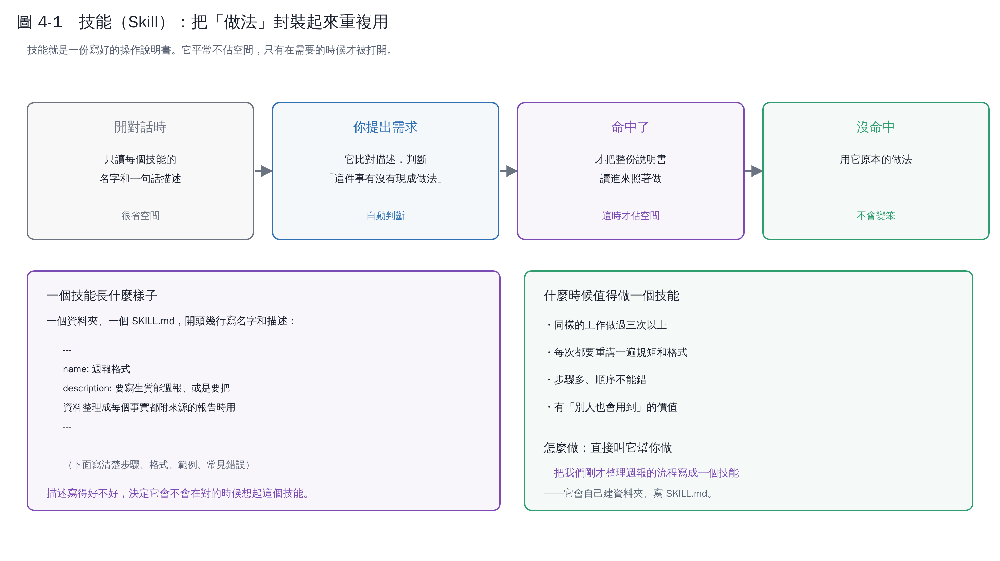

# 第 4 章　技能（Skill）：把「做法」封裝起來重複用



## 4.1 技能和 CLAUDE.md 差在哪

| | CLAUDE.md | 技能 |
|---|---|---|
| 什麼時候讀 | **每次**開對話都讀 | 只有**用得到的時候**才讀 |
| 放什麼 | 整個專案的規矩 | 某一種工作的完整做法 |
| 長度 | 要短（每次都佔空間） | 可以長（不佔空間，需要時才載入） |

一句話：**CLAUDE.md 是「我們家的規矩」，技能是「某件事的 SOP」。**

## 4.2 它怎麼運作（這個設計很聰明）

1. **開對話時**，它只讀每個技能的**名字**和**一句話描述**——很省空間。
2. **你提出需求**，它比對這些描述，判斷「這件事有沒有現成做法」。
3. **命中了**，才把整份說明書讀進來照著做。
4. **沒命中**，用它原本的做法，不會因此變笨。

所以你可以裝很多技能而不會拖慢它。

## 4.3 一個技能長什麼樣子

一個資料夾、一個 `SKILL.md`。開頭幾行是名字和描述，下面是正文：

```markdown
---
name: 週報格式
description: 要寫生質能週報、或是要把資料整理成
  每個事實都附來源的報告時用
---

## 步驟
1. ...
2. ...

## 格式
...

## 常見錯誤
...
```

**描述（description）寫得好不好，決定它會不會在對的時候想起這個技能。** 描述要寫「什麼時候該用我」，不要只寫「我是什麼」。

> 壞描述：`report writer`
> 好描述：`要寫每週的資料收集報告、或任何需要每個事實都附上來源連結的分析文件時使用`

## 4.4 什麼時候值得做一個技能

- 同樣的工作**做過三次以上**
- 每次都要重講一遍規矩和格式
- 步驟多、順序不能錯
- 有「別人也會用到」的價值

做不做的判準不是「複雜不複雜」，是「**會不會再做一次**」。

## 4.5 怎麼做一個

最簡單的方式：**做完一次之後，叫它幫你包起來。**

> 「我們剛才整理週報的流程，幫我寫成一個技能，放在 `.claude/skills/` 下面。」

它會自己建資料夾、寫 `SKILL.md`。你再讀一遍，把描述改得更準確。

## 4.6 技能也可以是別人寫的

Anthropic 和社群都有現成的技能（處理 PDF、Excel、簡報、研究⋯）。有些工具介面會直接列出可用的技能讓你挑。

**但別人的技能不等於適合你。** 用之前讀一下它的 `SKILL.md`——這是純文字，看得懂。

## 4.7 和「斜線指令」的關係

很多介面可以用 `/名字` 直接叫出一個技能。你也可以在對話裡用自然語言觸發，兩種都行。

> 具體的檔案位置、frontmatter 欄位、指令寫法各版本會調整，以官方文件為準：[code.claude.com/docs/en/skills](https://code.claude.com/docs/en/skills)。
> 這一章講的是**什麼時候該做技能、描述怎麼寫**——這兩件事不會因為改版而變。

## 本章重點

- 技能是「某件事的 SOP」，平常不佔空間，用得到才載入。
- 判準是「會不會再做一次」，不是「複不複雜」。
- **描述比內容更重要**——描述寫不好，它永遠不會想起這個技能。
- 最省事的做法：做完一次，叫它幫你包成技能。
