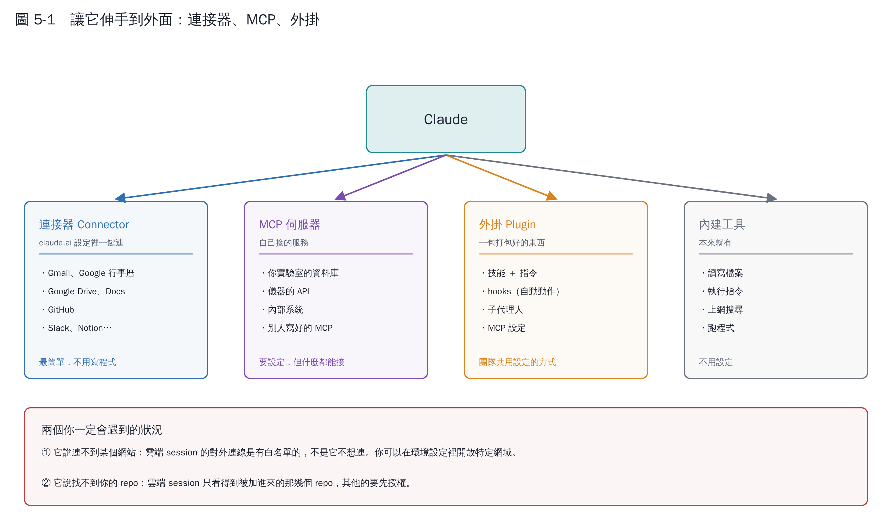

# 第 5 章　連接器、MCP、外掛：讓它伸手到外面

## 5.1 四種「伸手」的方式

| 方式 | 是什麼 | 難度 |
|---|---|---|
| **內建工具** | 讀寫檔案、執行指令、上網搜尋 | 不用設定 |
| **連接器 Connector** | claude.ai 設定裡一鍵連的服務 | 最簡單 |
| **MCP 伺服器** | 自己接的服務 | 要設定，但什麼都能接 |
| **外掛 Plugin** | 一包打包好的技能＋設定 | 團隊共用用的 |

## 5.2 連接器：先從這個開始

在 claude.ai 的設定裡可以一鍵連接 Gmail、Google 行事曆、Google Drive、GitHub、Slack 等常見服務。授權完就能用，不用寫任何程式。

對研究者最有用的三個：

- **GitHub**：讀寫程式、看 CI、開 issue
- **Google Drive／Docs**：讀你的實驗紀錄、寫報告
- **行事曆**：排實驗、提醒取樣時間

## 5.3 MCP：接你自己的東西

**MCP（Model Context Protocol）** 是一套「讓 Claude 跟外部服務說話」的通用規格。就像 USB——只要照規格做，什麼都能接上。

你可能會用到的情境：

- 實驗室的資料庫
- 儀器的 API（發酵槽的即時數據）
- 內部系統（排程、庫存）

**這需要一點技術工作**，但不需要你自己寫——把需求講清楚，讓 Claude 幫你寫那個 MCP 伺服器，是很合理的用法。

## 5.4 外掛：團隊共用設定

外掛就是把技能、指令、hooks（自動動作）、子代理人、MCP 設定**打包成一包**，別人可以一次裝好。

適合的情境：你的實驗室有一套大家都該遵守的流程，不想每個人自己設定一次。

> 外掛的目錄結構與安裝指令各版本會調整，以官方文件為準：[code.claude.com/docs/en/plugins-reference](https://code.claude.com/docs/en/plugins-reference)。

## 5.5 兩個你一定會遇到的狀況

### ①「它說連不到某個網站」

雲端 session 的對外連線有白名單。這不是它不想連，是環境設定擋住了。

**怎麼辦**：在環境設定裡開放特定網域。如果只是要查資料，也可以改用搜尋工具。

> 這份教材第 18 章就撞到這個：我連不上期刊網站，所以四篇論文只能靠搜尋工具，沒辦法讀全文。我把這件事寫進那一章了——**限制要寫出來，不要假裝沒有**。

### ②「它說找不到你的 repo」

雲端 session 只看得到被加進來的 repo。其他的要先授權。

## 5.6 一個原則：需要時再加

每多接一個東西，就多一個出錯的地方、多一份權限風險。

**不要「先全部接起來以備不時之需」。** 等到某件事真的卡住了，再去接那一個。

## 本章重點

- 四種伸手方式：內建工具（免設定）、連接器（一鍵）、MCP（自己接）、外掛（打包共用）。
- 先用連接器；連接器沒有的才考慮 MCP。
- 雲端 session 的兩個常見卡點：對外連線白名單、repo 授權。
- 需要時再加，不要先全部接起來。
