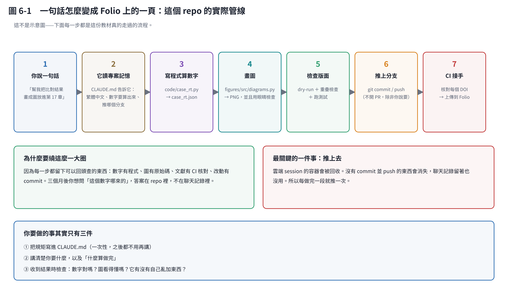
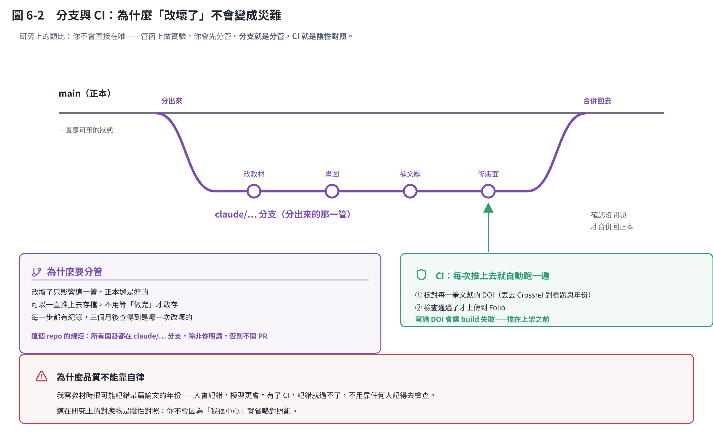

# 第 6 章　讓它寫程式並且真的跑起來

## 6.1 這一章用真的例子

上面那張圖不是示意圖，是**這份教材自己走過的流程**。你現在讀的這一頁，就是這樣產生的。

## 6.2 為什麼要用版本庫（repo）

很多人會說：「我又不是工程師，為什麼要搞 git？」

因為版本庫解決的不是寫程式的問題，是**回溯**的問題：

| 問題 | 沒有版本庫 | 有版本庫 |
|---|---|---|
| 「這個數字哪來的？」 | 翻聊天記錄 | 看 `code/` 裡的程式 |
| 「這張圖怎麼畫的？」 | 翻聊天記錄 | 看 `figures/src/` |
| 「上週的版本是什麼？」 | 沒了 | `git log` |
| 「是誰改的、為什麼改？」 | 不知道 | commit 訊息 |

三個月後你要寫論文、要回答審稿人「這個數字怎麼來的」，答案在 repo 裡，不在聊天記錄裡。

## 6.3 分支：在旁邊做，不要動到正本

**分支（branch）** 就是「從現在這份複製一份出來改」。改壞了不影響正本，改好了再合併回去。

研究上的類比：你不會直接在唯一一管菌上做實驗，你會先分管。分支就是分管。

這個 repo 的規矩寫在 `CLAUDE.md` 裡：所有開發都在 `claude/...` 分支上，**除非你明講，否則不開 PR**。這樣我可以一直推，你想看的時候才看。

## 6.4 CI：自動的守門員

**CI（持續整合）** 就是「每次推上去，自動跑一遍檢查」。

這個 repo 的 CI 做兩件事：

1. **核對每一個 DOI**：把教材裡每一筆參考文獻的 DOI 丟去 Crossref，確認標題和年份對得上。**寫錯會讓 build 失敗。**
2. **上傳到 Folio**：檢查過了才上架。

為什麼這很重要？因為**品質不能靠自律**。我寫教材時很可能記錯某篇論文的年份——人會記錯，模型更會。有了 CI，記錯就過不了，不用靠任何人記得去檢查。

> 這在研究上的對應物是「陰性對照」。你不會因為「我很小心」就省略對照組。

## 6.5 這份教材的七步管線

| 步驟 | 做什麼 | 留下什麼 |
|---|---|---|
| 1 | 你說一句話 | — |
| 2 | 它讀 `CLAUDE.md` | 規矩自動生效 |
| 3 | 寫程式算數字 | `code/*.py` → `*.json` |
| 4 | 畫圖 | `figures/src/*.py` → PNG |
| 5 | 檢查版面 | dry-run、重疊檢查、跑測試 |
| 6 | 推上分支 | commit 訊息 |
| 7 | CI 接手 | DOI 核對 → 上傳 Folio |

**第 3 步是關鍵**：數字不是我寫出來的，是程式算出來的，結果存成 JSON，圖和文章都引用那份 JSON。這樣「這個數字哪來的」永遠有答案。

## 6.6 最關鍵的一件事：推上去

雲端 session 的容器會被回收。**沒有 commit 並 push 的東西會消失**，聊天記錄留著也沒用。

所以：**每做完一段就推一次。** 不要等到最後。

## 6.7 你要做的其實只有三件事

1. **把規矩寫進 `CLAUDE.md`**（一次性，之後都不用再講）
2. **講清楚你要什麼，以及「什麼算做完」**
3. **收到結果時檢查**：數字對嗎？圖看得懂嗎？它有沒有自己亂加東西？

第 3 點不能省。它很快，但**它不負責**——負責的是你。

## 本章重點

- 版本庫解決的是回溯問題，不是寫程式的問題。
- 分支＝分管：在旁邊做，不要動到正本。
- CI 是自動守門員，**品質不能靠自律**。
- 雲端 session 沒推上去的東西會不見，每做完一段就推。
- 數字要由程式產生並存檔，這樣永遠答得出「哪來的」。
