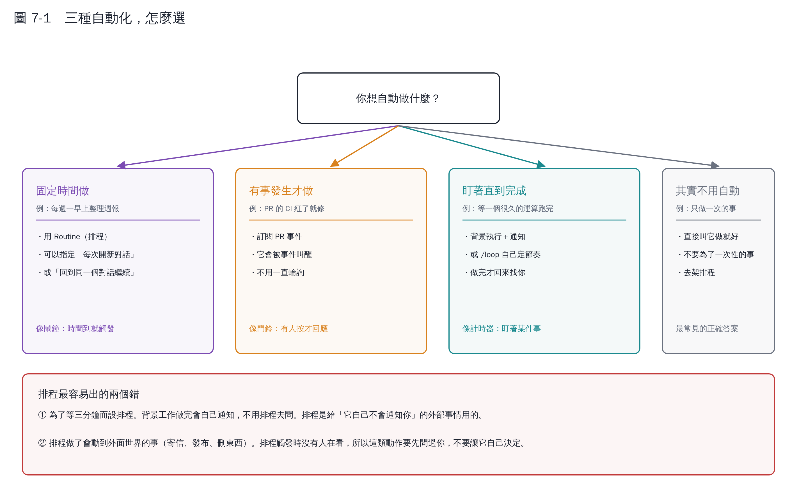

# 第 7 章　排程與自動化：什麼該自動，什麼不該

## 7.1 先問：真的需要自動嗎

最常見的正確答案是**不用自動**。只做一次的事，直接叫它做就好。為了一次性的事去架排程，花的時間比省下的多。

真正值得自動的只有兩種：**會週期性重複的**，和**會在你沒看的時候發生的**。

## 7.2 三種自動化

### ① 固定時間做（排程 / Routine）

像鬧鐘：時間到就觸發。

適合：每週一早上整理上週的資料、每月產一次報表。

設定時要決定一件事：**每次開新對話，還是回到同一個對話繼續？**

- **開新對話**：每次從乾淨狀態開始，適合「產週報」這種獨立的工作。
- **回到同一個對話**：適合「繼續盯著某件事」。

### ② 有事發生才做（事件觸發）

像門鈴：有人按才回應。

適合：PR 的 CI 紅了就去修、有人留了 review 就去回。

**這比排程好**，因為它不用一直問「有沒有事」，有事才會被叫醒。

### ③ 盯著直到完成（背景執行）

像計時器：盯著某件事，做完才回來找你。

適合：等一個要跑半小時的運算、等 CI 跑完。

這份教材每次推上去之後等 CI 的那段，就是這樣做的——不是每 20 秒去問一次，是掛一個「等到有結果為止」的背景工作，它自己會回來通知。

## 7.3 兩個最常見的錯

### ① 為了等三分鐘而設排程

背景工作做完會自己通知你，**不需要排程去問**。排程是給「它自己不會通知你」的外部事情用的（例如一個跑在別的系統上的 CI、一個每天更新的資料來源）。

### ② 讓排程去做會動到外面世界的事

寄信、發布、刪東西、改別人的資料——這些動作在排程觸發時**沒有人在看**。

所以原則是：**排程可以去查、去算、去整理、去提醒你；要真的動手改外面的東西，先問過你。**

這不是技術限制，是責任歸屬問題。半夜三點自動寄出的信，出問題時是你要負責。

## 7.4 一個實用的組合

研究上最常見、而且真的有用的組合是這樣：

| 時機 | 做什麼 |
|---|---|
| 每週一早上（排程） | 收集上週的資料，整理成草稿，**存成檔案** |
| 你上班後 | 讀草稿、改、決定要不要發出去 |

**自動的部分負責收集與整理，判斷與發布留給你。** 這個分工幾乎永遠是對的。

## 本章重點

- 最常見的正確答案是「不用自動」。
- 三種自動化：固定時間（鬧鐘）、事件觸發（門鈴）、盯著完成（計時器）。
- 不要為了等幾分鐘而設排程——背景工作會自己通知。
- 排程可以查、算、整理、提醒；**會動到外面世界的動作要先問過你**。
