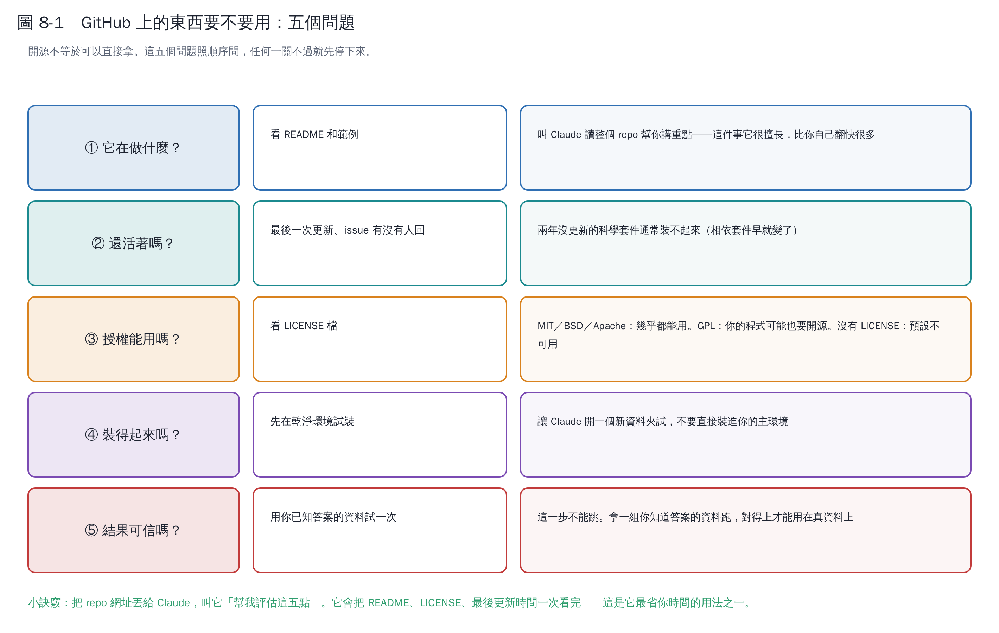

# 第 8 章　GitHub 上的開源東西，怎麼拿來用

## 8.1 開源不等於可以直接拿

GitHub 上有大量現成的科學工具——基因體分析、代謝模型、影像處理、統計套件。這是研究者最被低估的資源。

但「公開」不等於「能用」。下面五個問題照順序問，**任何一關不過就先停下來**。

## 8.2 ① 它在做什麼？

看 README 和範例。

**最省時間的做法：把 repo 網址丟給 Claude，叫它「幫我讀完這個 repo，用白話告訴我它在做什麼、輸入是什麼、輸出是什麼」。** 這件事它非常擅長，比你自己翻快很多。

## 8.3 ② 還活著嗎？

看最後一次更新、issue 有沒有人回。

**兩年沒更新的科學套件通常裝不起來**——不是程式壞了，是它依賴的其他套件早就改版了。這在 Python 生態裡特別嚴重。

判斷標準不是「有多少星星」，是「最近有沒有人在維護」。

## 8.4 ③ 授權能用嗎？

看 repo 裡的 `LICENSE` 檔。

| 授權 | 白話 |
|---|---|
| **MIT／BSD／Apache 2.0** | 幾乎都能用，包括商業用途。標註出處即可 |
| **GPL／AGPL** | 可以用，但如果你把它寫進你要發布的程式裡，**你的程式可能也必須開源** |
| **CC BY-NC** | 不能商業使用 |
| **沒有 LICENSE 檔** | **預設是「保留所有權利」，也就是不可用** |

學術研究大多沒問題，但如果你的成果要技轉或商業化，第 2、4 項要特別注意。**不確定就問你們單位的智財窗口**，不要問 AI（包括我）——這是法律問題。

## 8.5 ④ 裝得起來嗎？

**先在乾淨的環境試裝，不要直接裝進你的主環境。**

叫 Claude 開一個新資料夾、建一個獨立的 Python 環境（venv 或 conda）試。裝壞了刪掉就好，不會污染你正在用的東西。

## 8.6 ⑤ 結果可信嗎？

**這一步不能跳。**

拿一組**你已經知道答案的資料**跑一次，看對不對得上。

- 做序列比對的工具 → 拿一段你知道來源的序列試
- 做代謝模型的工具 → 拿文獻上有發表過結果的菌株試
- 做影像分析的工具 → 拿你人工數過的照片試

對得上才能用在真資料上。**裝得起來不等於算得對。**

## 8.7 安全：三件不要做的事

1. **不要把你的金鑰、密碼貼進任何來路不明的程式或設定檔。**
2. **不要直接執行沒看過的安裝腳本。** `curl ... | bash` 這種寫法等於讓對方在你電腦上執行任意程式。
3. **下載的資料夾裡不要直接跑直譯器。** Python 會從目前目錄載入同名模組——有人放一個 `json.py` 在裡面，你 `import json` 就中招了。

> 這三點 Claude 自己也被要求遵守：下載的檔案要放在獨立資料夾、腳本放在別的地方、用 `-I` 執行。這不是誇張，是實際的攻擊手法。

## 8.8 怎麼讓 Claude 幫你做這件事

一句話就夠：

> 「這個 repo：<網址>。幫我評估五件事：它在做什麼、還有沒有在維護、授權能不能用、裝起來要什麼、以及我可以拿什麼已知答案的資料驗證它。」

它會把 README、LICENSE、最後更新時間一次看完。**這是它最省你時間的用法之一。**

## 本章重點

- 五個問題照順序問：做什麼、活著嗎、授權、裝得起來嗎、結果可信嗎。
- 兩年沒更新的科學套件通常裝不起來。
- 沒有 LICENSE 檔＝預設不可用；要商業化就問智財窗口，不要問 AI。
- **拿已知答案的資料驗證**，這一步不能跳。
- 不要貼金鑰、不要盲跑安裝腳本、不要在下載的資料夾裡跑直譯器。
