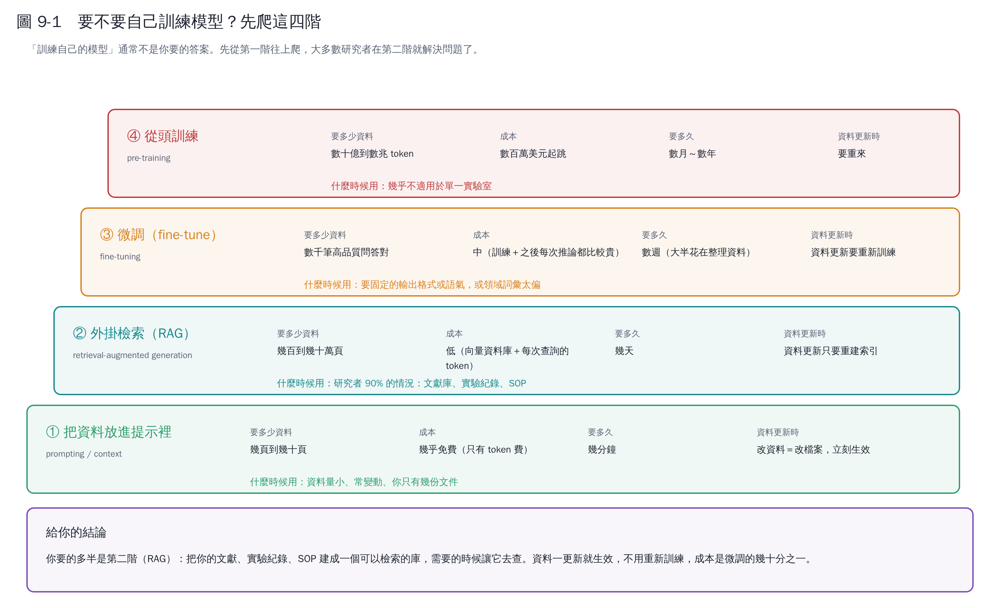
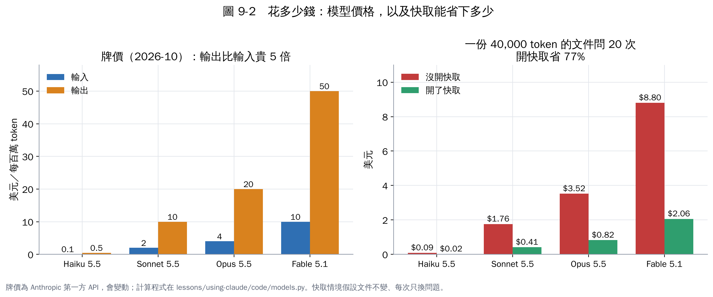

# 第 9 章　要不要自己訓練模型？

## 9.1 先說結論

**「訓練自己的模型」通常不是你要的答案。**

這句話不是在潑冷水。而是「讓模型懂你的領域」有四種做法，成本差了好幾個數量級，而大多數研究者在**第二階**就解決問題了。

從第一階往上爬，不要從第四階往下想。

## 9.2 四階梯

### ① 把資料放進提示裡

最直接：把你的文件貼進去，或上傳檔案，然後問。

- **資料量**：幾頁到幾十頁
- **成本**：幾乎免費（只有 token 費）
- **時間**：幾分鐘
- **資料更新**：改檔案，立刻生效
- **什麼時候用**：資料量小、常變動、你只有幾份文件

### ② 外掛檢索（RAG）

RAG 是 **Retrieval-Augmented Generation**，白話是：**先查資料，再回答**。

你把文獻、實驗紀錄、SOP 建成一個可以搜尋的庫。每次提問時，系統先從庫裡找出最相關的幾段，連同問題一起送給模型。

- **資料量**：幾百到幾十萬頁
- **成本**：低
- **時間**：幾天
- **資料更新**：重建索引就好
- **什麼時候用**：**研究者 90% 的情況**

**為什麼 RAG 對研究者特別合適**：

1. 你的文獻一直在增加——RAG 加一篇進去就好，微調要重新訓練。
2. 你需要**知道答案來自哪一篇**——RAG 天生就能給出處，微調不行。
3. 你的資料量通常是「幾百篇論文」等級，這正好是 RAG 的甜蜜點。

### ③ 微調（fine-tuning）

拿一個現成的模型，用你的資料再訓練一輪，調整它的權重。

- **資料量**：數千筆**高品質**問答對
- **成本**：中（訓練費 ＋ 之後每次推論都比較貴）
- **時間**：數週（**大半花在整理資料**，不是訓練）
- **資料更新**：要重新訓練
- **什麼時候用**：要固定的輸出格式或語氣，或領域詞彙太偏

**微調不會讓模型「學到新知識」**，這是最常見的誤解。它比較像是在調整「說話的方式」。要讓它知道新事實，RAG 才是對的工具。

### ④ 從頭訓練

- **資料量**：數十億到數兆 token
- **成本**：數百萬美元起跳
- **時間**：數月到數年
- **什麼時候用**：幾乎不適用於單一實驗室

## 9.3 花多少錢：實算

左邊是牌價（2026-10，美元／每百萬 token）。兩個要注意的地方：

1. **輸出比輸入貴 5 倍。** 所以「叫它寫很長的東西」比「給它看很長的東西」貴得多。
2. **模型之間差 100 倍。** Haiku 和 Fable 差兩個數量級。

右邊是一個實際情境：**一份 4 萬 token 的文件（約一篇長論文），問 20 個問題**。

| 模型 | 沒開快取 | 開了快取 |
|---|---|---|
| Haiku 5.5 | $0.09 | $0.02 |
| Sonnet 5.5 | $1.76 | $0.41 |
| Opus 5.5 | $3.52 | $0.82 |
| Fable 5.1 | $8.80 | $2.06 |

**開快取省了 77%。**

### 什麼是快取

如果你每次都送同一份文件、只換問題，系統可以把「文件那部分」暫存起來，第二次之後就不用重算。快取讀取大約是正常輸入價的十分之一。

這對研究場景特別有用，因為你常常就是「同一篇論文問很多問題」。

**重點是順序**：不變的東西（文件、規矩）放前面，會變的東西（問題）放後面。前面只要動一個字，後面全部的快取都失效。

## 9.4 所以你該怎麼做

1. **先試第一階。** 把文件丟進去問，很多問題當場就解決了。
2. **文件多到放不下，就做第二階（RAG）。** 這是研究者的標準答案。
3. **只有在「輸出格式怎麼講都講不對」時，才考慮第三階。**
4. **第四階當作不存在。**

## 9.5 如果真的要做 RAG

大致的步驟（可以請 Claude 幫你做）：

1. 把你的 PDF／筆記轉成純文字
2. 切成段落（通常幾百到一千字一段）
3. 用 embedding 模型把每段轉成向量，存進向量資料庫
4. 查詢時：問題也轉成向量 → 找最相近的幾段 → 連同問題送給模型
5. **要求它回答時標出來自哪一段**

第 5 點不要省。沒有出處的 RAG 回答，和它自己掰的沒兩樣——你無從分辨。

## 本章重點

- 四階梯：提示 → RAG → 微調 → 從頭訓練。從第一階往上爬。
- **研究者 90% 的答案是 RAG**：資料更新即時生效、而且給得出出處。
- **微調不會讓模型學到新知識**，它調的是說話方式。
- 輸出比輸入貴 5 倍；模型之間差 100 倍；開快取省 77%。
- RAG 一定要能標出處，不然你無從分辨它有沒有掰。
