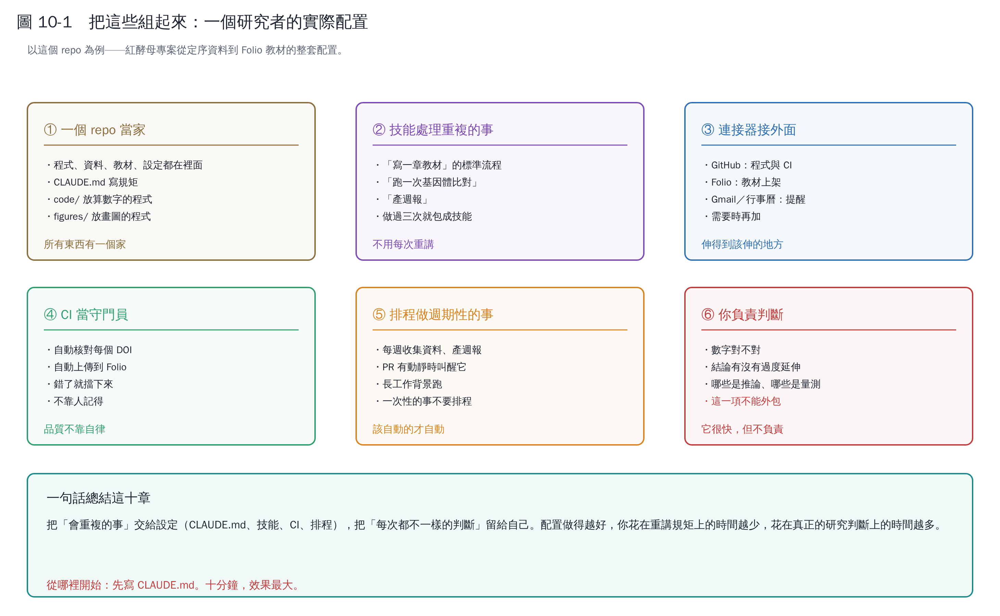

# 第 10 章　把這些組起來：你的工作流

## 10.1 以這個 repo 為例

上面那張圖是真的——紅酵母專案從定序資料到 Folio 教材，整套就是這樣配置的。

| | 怎麼配 | 解決什麼 |
|---|---|---|
| ① **一個 repo 當家** | 程式、資料、教材、設定都在裡面 | 所有東西有一個家 |
| ② **技能處理重複的事** | 做過三次就包成技能 | 不用每次重講 |
| ③ **連接器接外面** | GitHub、Folio；需要時再加 | 伸得到該伸的地方 |
| ④ **CI 當守門員** | 自動核對 DOI、自動上傳 | 品質不靠自律 |
| ⑤ **排程做週期性的事** | 每週收集資料；一次性的事不排程 | 該自動的才自動 |
| ⑥ **你負責判斷** | 數字對不對、結論有沒有過度延伸 | **這一項不能外包** |

## 10.2 從哪裡開始

**先寫 `CLAUDE.md`。十分鐘，效果最大。**

其他的等遇到問題再加：

| 什麼時候加 | 加什麼 |
|---|---|
| 發現自己第三次重講同一個流程 | 做一個技能 |
| 發現自己手動檢查同一件事 | 加一個 CI 檢查 |
| 發現每週一都在做同一件事 | 設一個排程 |
| 發現某個服務一直要手動複製貼上 | 接一個連接器 |

**不要一開始就全部建好。** 沒有被問題逼出來的設定，通常是錯的設定。

## 10.3 七個常見地雷

### ① 把它當搜尋引擎

它不是查資料用的，是**處理你已經有的東西**用的。要查最新文獻，用搜尋工具或資料庫；要讀懂、比對、整理那些文獻，才是它的強項。

### ② 相信它給的數字

**它會算錯，也會記錯。** 所以這個 repo 的規矩是「數字必須由程式產生」——不是不信任它，是建立一個「算錯會被發現」的機制。

你自己的研究也該用同一個標準：**凡是會寫進論文的數字，都要有可以重跑的來源。**

### ③ 一個對話做所有事

換主題就開新對話。混在一起只會讓它越來越容易搞混（第 2 章）。

### ④ 不給驗收標準

> ❌「幫我分析這批數據」
> ✅「幫我分析這批數據，我要知道三件事：A、B、C。每個數字都要說明怎麼算的。如果資料不足以回答某一項，直接說不知道。」

**「如果不確定就說不知道」這句話要明講。** 不講的話，它傾向給你一個看起來完整的答案。

### ⑤ 不讀它的輸出就用

它寫得很快、很有條理、看起來很可信——這正是危險的地方。**可信的外表和正確不是同一件事。**

特別要檢查：它有沒有把「推論」寫成「事實」？這份教材第 17、18 章刻意把每一個推論都標出來，原因就在這裡。

### ⑥ 讓它做會動到外面世界的事而沒有確認

寄信、發布、刪檔案、改資料庫——這些要先問過你。排程觸發時特別危險，因為沒有人在看（第 7 章）。

### ⑦ 不更新 CLAUDE.md

每次糾正它之後問一句：「這個糾正下次還會發生嗎？」會的話就寫進去。不寫，你就會一直糾正同一件事。

## 10.4 一個健康的分工

| 它負責 | 你負責 |
|---|---|
| 讀完 50 篇論文找出相關段落 | 判斷哪些結論可信 |
| 寫程式、跑分析、畫圖 | 決定要分析什麼、圖要說什麼 |
| 記得所有格式規矩 | 決定規矩是什麼 |
| 把流程重複一百次 | 決定流程對不對 |
| 指出「這裡資料不足」 | 決定要不要補實驗 |

左邊是**速度與記性**，右邊是**判斷與責任**。左邊可以外包，右邊不行。

## 10.5 一句話總結這十章

> **把「會重複的事」交給設定，把「每次都不一樣的判斷」留給自己。**

配置做得越好，你花在重講規矩上的時間越少，花在真正的研究判斷上的時間越多。

而判斷永遠是你的工作——它很快，但它不負責。

## 本章重點

- 六個元件：repo、技能、連接器、CI、排程、你的判斷。
- **先寫 CLAUDE.md**，其他等問題逼出來再加。
- 七個地雷裡最致命的兩個：相信它給的數字、不讀輸出就用。
- 「如果不確定就說不知道」這句話要明講。
- 速度與記性可以外包，判斷與責任不行。
