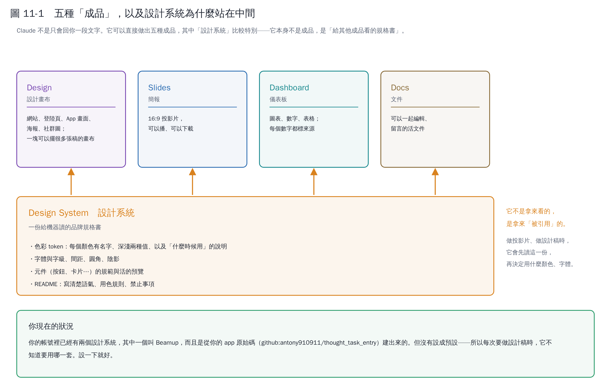
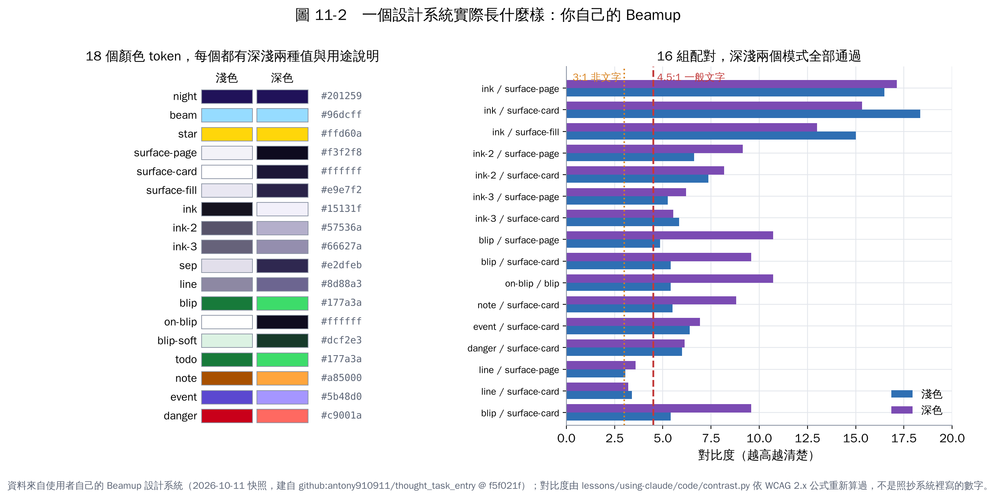
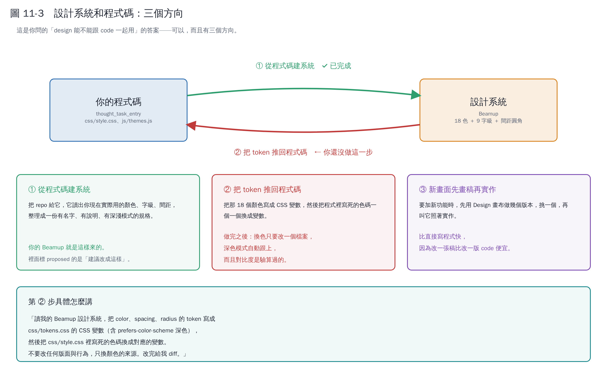

# 第 11 章　Claude Design：配色、模板，和怎麼跟程式一起用

## 11.1 先說一件事：你已經有一個了

你問「好像可以用模板？我不知道怎麼設定」——其實你的帳號裡**已經有兩個設計系統**，其中一個叫 **Beamup**，而且它是**從你 app 的原始碼建出來的**（`github:antony910911/thought_task_entry`，2026-10-10 同步）。

所以這一章不是教你從零開始，是教你**怎麼用好已經有的那一個**。

## 11.2 Claude 能做出哪五種成品

| 類型 | 做什麼 |
|---|---|
| **Design** | 設計畫布：網站、登陸頁、App 畫面、海報、社群圖。一塊可以擺很多張稿的畫布 |
| **Slides** | 16:9 投影片，可以播、可以下載 |
| **Dashboard** | 儀表板：圖表、數字、表格，每個數字都標來源 |
| **Docs** | 可以一起編輯、留言的活文件 |
| **Design System** | **設計系統**——比較特別，見下一節 |

前四個是「成品」，第五個不是。**設計系統是一份給機器讀的規格書**：做投影片、做設計稿時，它會先讀這一份，再決定用什麼顏色、字體、間距。

這就是你說的「模板」——但它比模板更有用，因為模板是固定版面，設計系統是**規則**，規則可以套在任何版面上。

## 11.3 token 是什麼（白話）

設計系統的核心是 **token**。一個 token 就是「**一個有名字的設計決定**」。

不要說「#177a3a」，要說「`blip`」。這有三個好處：

1. **它有名字**，所以大家（包括 Claude）知道什麼時候該用它。
2. **它有兩個值**：淺色模式一個、深色模式一個。你用名字，深色模式自動跟上。
3. **它有說明**：「主要按鈕、連結、焦點、選取態」——所以不會被亂用。

你的 Beamup 裡，`blip` 這個 token 長這樣：

| | 值 | 說明 |
|---|---|---|
| 淺色 | `#177a3a` | 品牌主色 = Blip 綠。主要按鈕、連結、焦點、選取態 |
| 深色 | `#3ddc6a` | 同上 |

## 11.4 你的 Beamup 實際長什麼樣

**18 個顏色、9 種文字樣式、6 個間距、4 個圓角、2 種陰影**，外加一份寫得很細的 README。

我把它的 16 組「文字／底色」配對**重新算了一次對比度**（WCAG 公式，程式在 `code/contrast.py`，不是照抄系統裡寫的數字）：

> **深淺兩個模式，16 組全部通過。**

最接近邊緣的是框線 `line`（淺色 3.05:1，門檻 3.0:1）——通過，但沒有餘裕，以後改色要重算。

它的 README 裡還記了一條很值得學的教訓：

> `ink-3`（placeholder）**proposed：取代現在 30% 透明的 `--label-3`（只有約 2:1，看不清楚）**

**半透明灰當次要文字，是最常見的無障礙錯誤。** 你的設計系統已經抓到並修掉了。

## 11.5 怎麼「設定」

你的兩個設計系統**都沒有設成預設**。所以每次要做設計稿時，它不知道該用哪一套。

兩個解法：

### A. 設一個預設（一勞永逸）

在設計系統的列表裡把 Beamup 設為預設。設定之後，你每次說「做一張設計稿」，它會自動用 Beamup，不用你再講。

### B. 每次指定（確定有效）

直接在對話裡講：

> 「用我的 Beamup 設計系統（<貼上連結>）做⋯⋯」

B 比較囉嗦但保證有效。**如果 A 的 UI 位置你一時找不到，就先用 B。**

## 11.6 怎麼下 prompt

這是你問的重點。先看對照：

> ❌「做一個好看的待辦清單頁面，用綠色系」

> ✅「用 Beamup 設計系統做待辦清單頁，要三個版本：**空狀態**、**有 5 筆**、**有 20 筆含逾期**。主要按鈕用 `blip`／`on-blip`，逾期用 `danger` 並加圖示。**深淺兩個模式都要。** 不要用彩色模糊光暈。」

差別在六個地方：

### ① 指定設計系統

不指定它就自己發明配色，每次都不一樣。

### ② 用 token 名稱，不要用顏色名稱

說「`blip`」而不是「綠色」。說「綠色」它會挑一個綠，可能和你 app 裡的綠差一點點——**那一點點就是「看起來不像同一個 App」的原因**。

### ③ 一次要多個版本

Design 是**畫布**，可以並排擺很多張稿。一次要三個版本，比做一個再改三次快。

### ④ 說清楚「狀態」

空的、少量、大量、載入中、錯誤——**這是設計稿最常漏掉的東西**。只做「資料剛剛好」的版本，實作時就會卡在空狀態沒設計。

### ⑤ 深淺兩個模式都要

不然你只會拿到淺色，深色是後來硬湊的。

### ⑥ 說「不要做什麼」

你的 Beamup README 已經寫了一串禁止事項（不要彩色模糊光暈、不要 iOS 設定頁那種每列一個彩色方塊、停用狀態不要把主色調淡）。**指定設計系統就等於把這些規則一起帶上**——這是設計系統最被低估的價值。

## 11.7 和程式一起用：三個方向

這是你問的「design 能不能跟 code 一起用」。可以，而且有三個方向。

### ① 從程式碼建系統　✓ 你已經做了

把 repo 給它，它讀出你現在實際用的顏色、字級、間距，整理成有名字、有說明、有深淺模式的規格。

Beamup 就是這樣來的。裡面標 `proposed` 的，意思是「**建議改成這樣，但還沒改進程式**」——例如把 iOS 藍 `#007AFF` 換成 Blip 綠當主色、把大標從 34px 降到 30px（中文 34px 粗體太壓迫）。

### ② 把 token 推回程式碼　← **你還沒做這一步**

這是三個方向裡**對你的 app 幫助最大的一個**。

現在你的顏色寫死在 `css/style.css` 裡。推回去之後：

- 換色只要改一個檔案
- 深色模式自動跟上
- 而且對比度是驗算過的

具體怎麼講：

> 「讀我的 Beamup 設計系統，把 `color`、`spacing`、`radius` 的 token 寫成 `css/tokens.css` 的 CSS 變數（含 `prefers-color-scheme` 深色），然後把 `css/style.css` 裡寫死的色碼換成對應的變數。**不要改任何版面與行為，只換顏色的來源。改完給我 diff。**」

最後那句很重要：**一次只做一件事**。顏色和版面一起改，出問題時你分不出是哪個造成的。

### ③ 新畫面先畫稿再實作

要加新功能時，先用 Design 畫布做幾個版本，挑一個，再叫它照著實作。

**改一張稿比改一版 code 便宜。**

## 11.8 配色的硬規則

這幾條不是品味問題，是會不會有人看不清楚的問題。

| 規則 | 數字 |
|---|---|
| 一般文字對比度 | **≥ 4.5:1** |
| 大字（24px 以上，或 18.66px 粗體） | ≥ 3:1 |
| 框線、焦點環、圖示等非文字 | ≥ 3:1 |

另外三條：

### 不要只靠顏色區分

約 8% 的男性有紅綠色覺辨識困難。要分辨的兩個東西，**要差在明度，不只是色相**；藍／橘比紅／綠安全。而且顏色一定要**搭配文字或圖示**——你的 Beamup README 就寫了：「`danger` 一律搭配文字或圖示，不單靠顏色」。

### 深色模式不是把顏色反轉

- Beamup 的深色底是 `#0e0b1f`，**帶靛藍的夜色，不是純黑**——純黑配白字對比太強，久看刺眼。
- `on-blip`（主要按鈕上的字）在淺色時是白字，**深色時是深字** `#0e0b1f`。因為深色模式的 `blip` 是亮綠色，白字在上面看不清楚。

**每個 token 都要各自決定兩個值，不是算出來的。**

### 代表色只用小面積

待辦綠、筆記琥珀、行程靛紫——這些只出現在入口圖塊和小標記，**不要整片鋪滿**。鋪滿之後整個畫面都是色塊，反而看不出重點。

## 11.9 常見錯誤

| 錯誤 | 後果 |
|---|---|
| 說「用藍色」而不是 token 名稱 | 每次的藍都差一點點，看起來不像同一個 App |
| 沒有設計系統，每次重新發明配色 | 五個畫面五種風格 |
| 設計稿只做「資料剛剛好」的版本 | 實作時卡在空狀態、爆量狀態 |
| 只做淺色模式 | 深色是後來硬湊的，對比度常常不過 |
| 把設計系統當成「給人看的」 | 它是**給機器讀的**——你不引用它，它就沒作用 |
| 顏色寫死在程式裡 | 改一個主色要翻遍所有檔案 |
| 半透明灰當次要文字 | 對比度可能只有 2:1，看不清楚 |

## 本章重點

- **你已經有一個設計系統（Beamup），而且是從你 app 的原始碼建出來的**——但沒設成預設，所以要嘛設一下，要嘛每次指定。
- **token 是「一個有名字的設計決定」**：有名字、有深淺兩個值、有用途說明。下 prompt 時**說 token 名稱，不要說顏色**。
- 下 prompt 的六個要素：指定系統、用 token 名、要多個版本、說清楚狀態、深淺都要、說不要做什麼。
- 和程式一起用有三個方向，**對你幫助最大的是第 ②（把 token 推回程式碼）**——那是你還沒做的一步。
- 配色的硬規則：文字 4.5:1、非文字 3:1、不要只靠顏色、**深色模式不是反轉**。
- 我驗算過你的 Beamup：**16 組配對在深淺兩個模式全部通過**。
