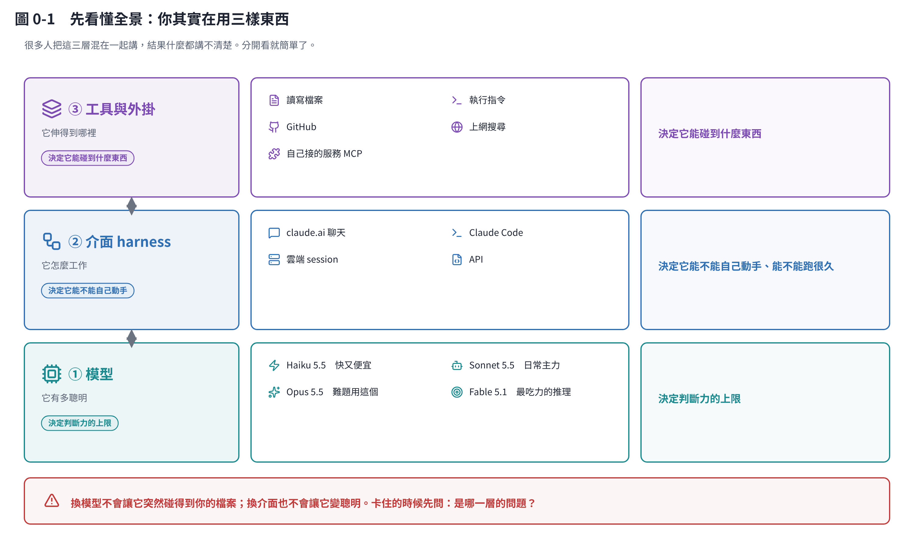

# 把 Claude 用好：給研究者的實戰手冊

這個分區回答一個問題：**同樣是用 Claude，為什麼有人只是拿它當聊天機器人，有人卻能讓它跑完整條研究流程？**

差別不在「會不會下指令」，而在**有沒有把會重複的事變成設定**。這十一章就是在講那些設定：專案記憶、技能、外掛、排程、版本庫、CI、設計系統，以及什麼時候該停手自己判斷。

## 這十一章在講什麼

| 章 | 主題 | 你會學到 |
|---|---|---|
| [1](01-three-surfaces.md) | 三個介面 | claude.ai、Claude Code、雲端 session 差在哪；什麼時候用哪個 |
| [2](02-context.md) | 對話的物理限制 | 為什麼聊久了它會忘記；什麼時候該開新對話 |
| [3](03-claude-md.md) | 專案記憶 CLAUDE.md | 十分鐘、效果最大的一件事 |
| [4](04-skills.md) | 技能 Skill | 把做法封裝起來重複用；怎麼自己做一個 |
| [5](05-connect.md) | 連接器、MCP、外掛 | 讓它伸手到 GitHub、Gmail、你的資料庫 |
| [6](06-code-and-ci.md) | 讓它寫程式並真的跑起來 | repo、分支、CI；以這份教材的管線為例 |
| [7](07-automation.md) | 排程與自動化 | 三種自動化怎麼選；兩個最常見的錯 |
| [8](08-open-source.md) | GitHub 開源怎麼用 | 五個問題的評估流程；授權與安全 |
| [9](09-train-your-own.md) | 要不要自己訓練模型 | 四階梯；成本實算；為什麼你多半只需要第二階 |
| [10](10-your-workflow.md) | 組成你的工作流 | 實際配置、常見地雷、從哪裡開始 |
| [11](11-design.md) | Claude Design 與設計系統 | token 是什麼、prompt 怎麼下、配色硬規則、怎麼和程式一起用 |

## 寫給誰

寫給**會用電腦、但不是軟體工程師**的研究者。所有名詞第一次出現都會用白話解釋，程式碼只在真的需要時出現，而且都附說明。

## 這個分區的特別之處

**例子全部是真的。** 第 6 章的管線、第 10 章的配置，就是你正在讀的這份教材自己走過的流程——同一個 repo、同一套設定、同一個 CI。你可以直接打開來看。

## 關於數字

- 第 9 章的模型價格與成本試算由 [`code/models.py`](code/models.py) 產生，牌價是 2026-10 的 Anthropic 第一方 API 價格，**會變動**。
- 功能與指令會改版。這份教材講的是**概念與判斷**（這些變得慢），具體指令以官方文件為準：[code.claude.com/docs](https://code.claude.com/docs)。
