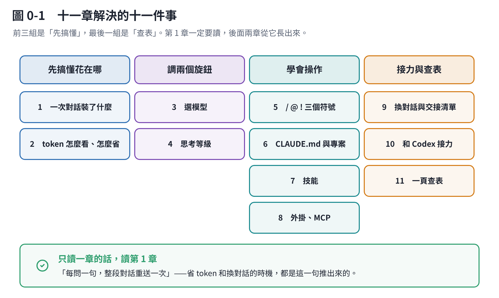

# Claude Code 操作手冊：從不會用到很順手

隔壁那個分區（「把 Claude 用好」）講的是**觀念**：有哪幾個介面、什麼是 context、要不要自己訓練模型。

這個分區講的是**手**：你坐在 Claude Code 前面，螢幕上那一行要打什麼。

## 這十一章在回答什麼

| 章 | 你的問題 | 一句話答案 |
|---|---|---|
| [1](c01-what-is-in-a-turn.md) | 它到底在讀什麼？ | 每問一句，整段對話都重送一次。這是後面所有問題的根 |
| [2](c02-tokens.md) | token 用量怎麼看？ | `/context` 看空間、`/usage` 看額度。最大的浪費是「忘了開新對話」 |
| [3](c03-models.md) | 哪種任務用哪個模型？ | 預設 Opus 就好。只有兩種情況要換 |
| [4](c04-effort.md) | 思考高低是什麼？ | 五個等級，調的是「想多久」。大部分時候不用動 |
| [5](c05-symbols.md) | `@` 和 `/` 是什麼？ | 三個符號：`/` 下指令、`@` 指檔案、`!` 跑終端機 |
| [6](c06-project.md) | 要不要開專案？ | Claude Code 沒有「專案」這個東西。資料夾＋`CLAUDE.md` 就是你的專案 |
| [7](c07-skills.md) | 技能什麼時候用？ | 同一套做法做第三次的時候 |
| [8](c08-plugins.md) | 外掛跟技能差在哪？ | 技能是一份說明書，外掛是一個包裹。包裹裡面常常裝著技能 |
| [9](c09-handoff.md) | 什麼時候換新對話？ | 換題目就換。交接清單有範本 |
| [10](c10-codex.md) | 怎麼跟 Codex 接力？ | 用 `AGENTS.md`，兩邊都讀得到 |
| [11](c11-cheatsheet.md) | 遇到狀況要做什麼？ | 一頁查表 |

## 讀法建議

**第 1 章一定要讀。** 它只有一個觀念，但第 2、9 兩章是從它長出來的——不懂這個，省 token 和換對話的時機都會做錯。

第 3、4 章讀完知道「不用動」就夠了。第 5 章是最快見效的，看完馬上會用。第 6–8 章是你想讓 Claude 更懂你的專案時才需要。

## 關於這份手冊的正確性

Claude Code 更新很快，**指令和功能三個月前的寫法現在可能就不對了**。這十一章的內容是 2026-10 從官方文件（`code.claude.com/docs`）逐項查過的，不是憑印象寫的。

但也因為這樣：

> **如果哪個指令按下去跟這裡寫的不一樣，以 `/help` 和官方文件為準。**
> 你的版本可以用 `claude --version` 看。

有兩件事我標示得特別清楚：

- **Codex 那一章**（第 10 章）：Claude Code 這一側我查了官方文件，**Codex 那一側只查到第三方整理**，沒有核對過 OpenAI 官方文件。要用之前請自己確認一次。
- **價格與額度**：各家方案的數字變動頻繁，這裡只講「怎麼查自己的」，不抄數字。
