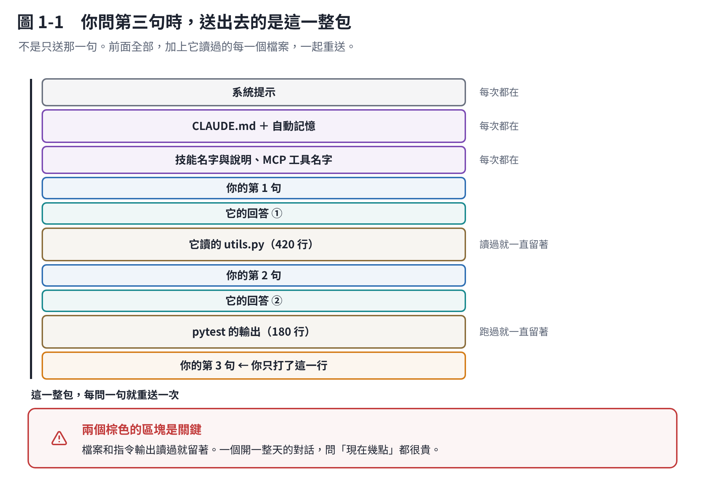

# 第 1 章　一次對話裡到底裝了什麼

這一章只有一個觀念。但你會一直用到它。

## 1.1 它沒有記憶，只是每次都重讀一遍

直覺上，你會以為 Claude「記得」你們剛才講過什麼。

**它不記得。** 真正發生的事是：

> 你每送出一句話，**整段對話從頭到尾重新送一次**給模型。

你的第 1 句、它的第 1 個回答、你的第 2 句⋯⋯一路到你剛打的這句，全部打包，一起送。模型讀完這一整包，然後回一句。

下一次你再打一句，這整包**再送一次**，只是尾巴多了兩段。

## 1.2 這一包有多大，是有上限的

這個上限叫 **context window**（上下文視窗）。現在主流的模型是 **100 萬個 token**。

token 大概是什麼單位？一個英文單字約 1 個多，一個中文字約 1 個。100 萬 token 大約是一本厚厚的書。

聽起來很多，但它裝的不只是你們的對話：

| 進到這一包裡的東西 | 什麼時候進來 |
|---|---|
| 系統提示 | 每次都在。Claude Code 自己的操作說明 |
| `CLAUDE.md` | 每次都在。你寫給它的專案規矩（第 6 章） |
| 自動記憶 | 每次都在。它自己記下來的筆記（第 6 章） |
| 技能的**名字與說明** | 每次都在。每個技能一兩行（第 7 章） |
| MCP 工具的名字 | 每次都在（第 8 章） |
| **它讀過的每一個檔案** | 讀過就留著 |
| **每一個指令的輸出** | 跑過就留著 |
| 你們來回的每一句話 | 全部 |

**注意那兩個粗體的。** 它讀一個 2,000 行的檔案，那 2,000 行就一直待在這包裡面，之後每一次對話都跟著重送。它跑一次測試，測試輸出的幾百行也是。

這就是為什麼**一個開了一整天的對話，你問一句「現在幾點」都很貴**——那一句話後面拖著一整天的東西。

## 1.3 滿了會怎樣

不會當掉。Claude Code 會自己**壓縮**（compact）：把前面的對話換成一段摘要，騰出空間繼續。

但壓縮有代價：

- **細節會掉。** 摘要就是摘要，不可能把三小時的對話完整保留。
- **壓縮本身很貴。** 它要先把那一整包讀完才能寫摘要，所以壓縮那一次是個大請求。
- **檔案要重讀。** 壓縮後它只會自動重讀最近改過的五個檔案，其他的要重新找。

所以**壓縮不是免費的**。能不壓縮最好。

> 壓縮之後哪些東西會自己回來、哪些不會，列在第 9 章。

## 1.4 這個觀念推出三件事

這一章其實已經回答了後面三章的核心：

**① 省 token 的第一招不是講話簡短，是「換對話」。**
你打字多打一百個字，影響微乎其微。但一個累積了五十個檔案的對話，每問一句都重送那五十個檔案。
→ 第 2 章

**② 換題目就該開新的。**
舊題目留下的東西不會幫到新題目，只會佔位子、花錢，還可能讓它搞混。
→ 第 9 章

**③ 「把東西寫進 CLAUDE.md」是有成本的。**
因為那份檔案**每一次**都在包裡。寫得越長，每一句話都貴一點。所以 CLAUDE.md 要短，長的東西放技能裡（用到才載入）。
→ 第 6、7 章

## 本章重點

- Claude 沒有記憶。每問一句，**整段對話重送一次**。
- 這一包有上限（現在是 100 萬 token），裝的不只對話，還有它讀過的所有檔案和指令輸出。
- 滿了會自動壓縮，不會壞掉，但**會掉細節、會花一筆、檔案要重讀**。
- **最有效的省錢方式是換對話，不是少打字。**
