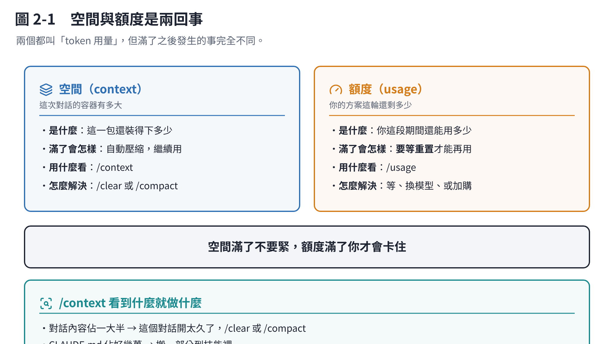

# 第 2 章　token 用量：怎麼看、什麼在吃、怎麼省

## 2.1 先分清楚兩件常被混在一起的事

| | **空間**（context） | **額度**（usage） |
|---|---|---|
| 是什麼 | 這一包還裝得下多少 | 你這段期間還能用多少 |
| 滿了會怎樣 | 自動壓縮，繼續用 | **要等到重置**才能再用 |
| 用什麼看 | `/context` | `/usage` |
| 怎麼解決 | `/clear` 或 `/compact` | 等重置、換模型、或加購 |

兩個都叫「token 用量」，但是不同的東西。**空間滿了不要緊，額度滿了你才會卡住。**



## 2.2 `/context`：看這一包裝了什麼

打 `/context`，它會畫一個彩色方格圖，把這一包切成幾類，告訴你各佔多少。

你會看到類似這些分類：系統提示、`CLAUDE.md`、自動記憶、技能說明、MCP 工具、對話內容、可用空間。

**要看的是哪一塊特別大。** 常見的三種情況：

| 看到什麼 | 代表 | 怎麼辦 |
|---|---|---|
| 對話內容佔一大半 | 這個對話開太久了 | `/clear`（換題目）或 `/compact`（同一題繼續） |
| `CLAUDE.md` 佔好幾萬 | 專案規矩寫太長 | 搬一部分到技能裡（第 6、7 章） |
| MCP 工具名字佔很多 | 連了用不到的伺服器 | `/mcp` 關掉沒在用的（第 8 章） |

## 2.3 `/usage`：看你的額度

打 `/usage`（`/cost`、`/stats` 是同一個指令的別名）。

訂閱制（Pro／Max／Team／Enterprise）看的是**用量條**。額度有兩個窗口同時在跑：**五小時**一輪和**每週**一輪。訊息會告訴你什麼時候重置。

> `/usage` 上面那個 `$` 金額是給 API 計費用戶看的。**訂閱制的人不用管那個數字**，你的額度不是用錢算的。

訂閱制還會多出兩段很有用的東西：

**① 用量歸屬。** 最近的用量有多少是技能、子代理、外掛、各個 MCP 伺服器吃掉的，各佔幾 %。這是找出「哪個東西在偷吃」最快的方法。

**② 建議。** 每一條建議前面有它能省下的比例（至少 10%），例如：

```text
40%  Switch from max to high effort · /effort high
25%  Trim ~/code/api/CLAUDE.md · 49k tokens per request
30%  Compact before you step away · run /compact
```

看到頁尾出現 `f to fix` 就按 `f`，它會把能自動處理的處理掉。（需要較新版本；沒出現就照建議自己做。）

按 `d` / `w` 可以切換看「最近 24 小時」或「最近 7 天」。

> **這個數字只算這台電腦。** 你在手機或網頁用掉的不會算進來。

## 2.4 為什麼一個開很久的對話特別貴

官方文件直接列了原因，最主要的是第一條：

- **對話長。** 每一次請求都帶著完整歷史。就算只問一句話，也要重讀一整天的東西。
- **快取失效。** 重複的部分有快取（便宜很多），但**離開太久快取會過期**，回來的第一句就要重新算全部。所以「開著不管、隔幾小時回來問一句」是最貴的用法之一。
- **壓縮本身是大請求。** `/compact` 要讀完才能寫摘要。
- **子代理、排程、背景工作**各自也在送自己的請求。

## 2.5 省法，按有效程度排

### 最有效：換對話

```text
/clear          # 換題目：清空，從頭開始
/compact 專心保留 OO 的部分   # 同一題繼續：壓縮，但告訴它要留什麼
```

兩者差在**要不要延續**。換題目用 `/clear`，繼續同一題但太長了用 `/compact`。

想之後找得回來，先 `/rename 取個名字` 再 `/clear`，之後用 `/resume` 回去。

### 很有效：CLAUDE.md 寫短一點

它**每一次**都在包裡。官方建議**控制在 200 行以內**，只放必要的。

長的、只有特定工作才用得到的東西（例如「發 PR 的流程」「資料庫遷移怎麼做」），搬進**技能**——技能平常只有名字和說明在包裡，用到才整份載入。

### 很有效：把大量閱讀丟給子代理

要它去讀十個檔案找一件事，那十個檔案會留在你的包裡。改成請它**用子代理去查**，檔案留在子代理自己的包裡，回來的只有結論。

（子代理自己的請求還是算你的額度，但你的主對話乾淨很多。）

### 有效：把話講具體

「改善一下這個專案」→ 它會到處翻。
「在 `auth.py` 的 `login` 函式加上輸入檢查」→ 它直接開那個檔案。

### 有效：複雜的事先用計畫模式

按 `Shift+Tab` 切到 **plan 模式**。它會先探索、提出做法給你確認，再動手。**方向錯了的重做成本，遠高於先規劃的成本。**

### 有效：發現走偏就馬上按 Esc

不要等它做完。按 `Esc` 停下來，講清楚，再繼續。

### 有效：能用命令列工具就不要掛 MCP

`gh`、`aws`、`gcloud` 這類指令，Claude 可以直接跑，**不佔任何常駐空間**。MCP 伺服器則會把工具名單放進每一包。

### 次要：降低思考等級

簡單的事不需要想很久。`/effort medium` 或 `low`（第 4 章）。

## 2.6 不用管的事

- **背景開銷**：整理對話摘要、`/usage` 查詢這類，官方說通常**一個 session 不到 0.04 美元**。
- **打字長短**：你多寫兩句話的影響，和一個檔案比起來可以忽略。**想清楚再問，比省字重要得多。**

## 本章重點

- **空間**（`/context`）和**額度**（`/usage`）是兩回事。空間滿了自動壓縮，額度滿了才會卡住。
- `/usage` 會直接告訴你誰在吃額度、該改什麼，有 `f` 就按。
- **省 token 最有效的一招是 `/clear`**，不是少打字。
- `CLAUDE.md` 每次都在包裡，**控制在 200 行以內**，長的搬進技能。
- 大量閱讀丟給子代理；能用命令列就不要掛 MCP。
