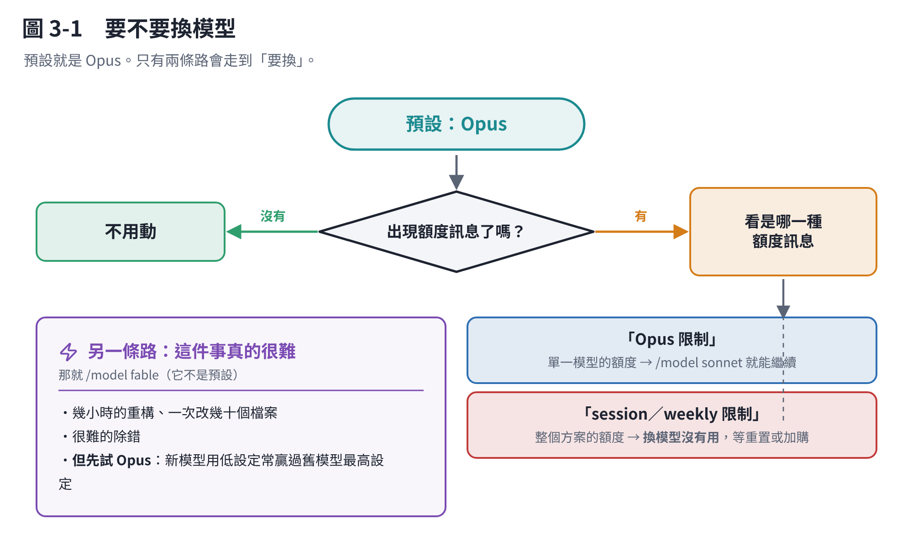

# 第 3 章　選模型：哪種任務用哪一個

## 3.1 先講結論：大部分時候不用選

**Pro、Max、Team、Enterprise 方案的預設就是 Opus**，而 Opus 是通用能力最強的那一檔。你什麼都不做，用到的就是它。

**只有兩種情況需要動它。** 看完這一章如果你的結論是「那我不用改」，那就是對的。



## 3.2 四個名字，分三檔

在 Claude Code 裡你用**代號**選，不是用完整的模型編號：

| 代號 | 指到哪一個 | 它的定位 |
|---|---|---|
| `opus` | 最新的 Opus（Anthropic API 上是 Opus 5.5） | **通用最強**，各方案的預設 |
| `sonnet` | 最新的 Sonnet（Sonnet 5.5） | 速度與能力的平衡，日常寫程式夠用 |
| `haiku` | Haiku 5.5 | 最快最便宜，適合簡單、量大的事 |
| `fable` | Fable 5.1 | 最難、最長的任務。**不是任何方案的預設，要自己選** |

另外三個組合代號：

- `opusplan`：**計畫用 Opus、執行用 Sonnet**。規劃最需要判斷力，執行比較機械——這個組合很實用。
- `best`：有 Fable 就用 Fable，沒有就用 Opus。
- `default`：清掉你設的，回到帳號預設。

> **在 Bedrock、Google Cloud、Microsoft Foundry 上，這些代號指到的是比較舊的版本。** 例如 Bedrock 的 `sonnet` 是 Sonnet 4.5。要指定版本就打完整名稱，例如 `claude-opus-5-5`。

## 3.3 怎麼換

```text
/model              # 開選單，上下選
/model sonnet       # 直接換
/model default      # 回到預設
```

在選單裡按 **Enter** 是「存成以後的預設」，按 **s** 是「只有這個對話」。這個差別很重要——**按錯了你會以為自己只改了一次，結果每個新對話都變了**。

## 3.4 什麼時候該換

### 情況一：額度快用完，但工作還沒做完

額度訊息分兩種：

- **「你達到 session／weekly 限制」**：這是整個方案的額度，**換模型沒有用**，所有模型共用同一份。
- **「你達到 Opus 限制」**：這是**單一模型**的額度。這時候 `/model sonnet` 就能繼續做事。

所以看到額度訊息，**先看它是哪一種**。

### 情況二：這件事真的很難、很長

幾個小時的重構、一次要改幾十個檔案、很難的除錯——這是 `fable` 的場合。它不是預設，要自己選。

**但先試 Opus。** 新一代模型用低一點的設定，常常就贏過舊模型用最高設定。多數時候你不需要爬到最上面那一階。

## 3.5 什麼時候不該換

**不要為了省而降級。** 比較「每做完一件事花多少」，不是「每一次請求花多少」。

一個比較弱的模型可能要來回五次才做對，而強的模型一次就好——算下來**反而更貴**，而且你多花了四次的時間。

**例外：子代理。** 子代理常常只是「去讀一堆東西、回報重點」，判斷力需求低、閱讀量大。這種讓它跑 `haiku` 或 `sonnet` 很划算，而且可以單獨指定（在子代理設定裡寫 `model: haiku`）。

> **注意：主對話換成 Opus，繼承設定的子代理也會跟著變 Opus。** 如果你同時開了好幾個子代理，這會放大很多。

## 3.6 1M 上下文、快速模式

**1M 上下文**：Fable 5.1/5、Sonnet 5 以後、Haiku 5.5、Opus 4.7 以後**本來就是 100 萬**，不用做任何事。只有 Opus 4.6 和 Sonnet 4.6 要特地寫成 `sonnet[1m]` 這種形式。

**快速模式**（`/fast`）：同一個模型跑得更快，但**價格是兩倍**。趕時間、而且你確定那件事值這個價的時候才用。

## 本章重點

- **預設就是 Opus，不用動。**
- 兩種情況才換：**Opus 專屬額度滿了**（換 `sonnet` 繼續），或**任務真的很難**（換 `fable`）。
- 「session／weekly 限制」換模型沒用，「Opus 限制」才有用。
- **不要為了省而降級**——算每件事的總成本，不是每次請求的成本。子代理是例外。
- 選單裡 **Enter ＝ 存成預設，s ＝ 只有這次**。
