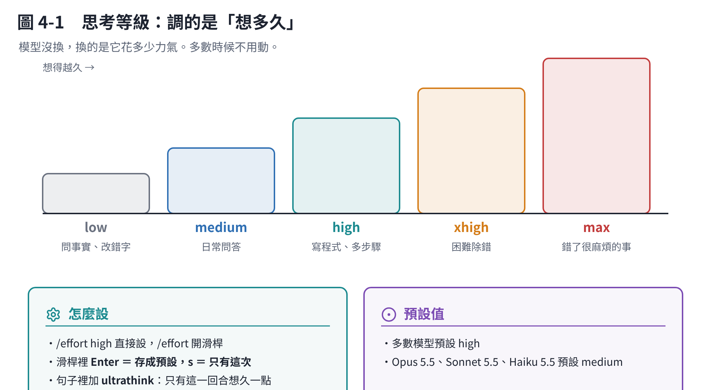

# 第 4 章　思考高低：effort 是什麼

## 4.1 它調的是「想多久」，不是「聰不聰明」

模型在回答之前會先「想」一段——推理、試幾個方向、自己檢查。這段思考**也是 token**，而且算在輸出那一邊。

**effort（思考等級）決定它願意想多久。** 模型沒有換，換的是它花多少力氣。



## 4.2 五個等級

| 等級 | 大概是什麼感覺 | 適合 |
|---|---|---|
| `low` | 幾乎不想，直接答 | 問一個事實、改一個錯字、子代理去讀東西 |
| `medium` | 想一下 | 日常問答、一般的小修改 |
| `high` | 認真想 | 寫程式、多步驟的工作 |
| `xhigh` | 想很久 | 困難的除錯、牽涉很多檔案的改動 |
| `max` | 想到不能再想 | **正確性比花費重要**的時候 |

**預設值**：多數模型是 `high`；**Opus 5.5、Sonnet 5.5、Haiku 5.5 是 `medium`**。

> 選一個這個模型沒有的等級，它會自動降到它支援的最高階。例如在 Opus 4.6 上設 `xhigh`，實際跑的是 `high`。

## 4.3 怎麼設

```text
/effort          # 開滑桿
/effort high     # 直接設
/effort auto     # 清掉你設的，回到預設
/effort status   # 看現在是多少
```

和 `/model` 一樣：滑桿裡按 **Enter 是存成預設**，按 **s 是只有這個對話**。

**只想要這一次想久一點**，不改設定：在你的句子裡加上 `ultrathink` 這個字。

```text
這個 bug 我找三天了，ultrathink 一下到底哪裡錯
```

只對那一回合有效，不動你的設定。

## 4.4 什麼時候真的要調

**往上調（`xhigh`／`max`）：**

- 卡很久的 bug
- 牽涉很多檔案、動一個地方會影響別處的改動
- 「錯了很麻煩」的事——例如會改到資料、會推上去給別人看的東西

**往下調（`low`／`medium`）：**

- 只是問一個事實
- 改一個字、換一個變數名
- 子代理去讀一堆東西

**但先看 `/usage` 再決定。** 如果它的建議列表裡出現 `Switch from max to high effort`，代表思考確實是你的大頭，那就調。如果沒出現，effort 不是你的問題，調了省不了多少。

## 4.5 兩個會搞混的東西

### effort ≠ 能不能看到它在想什麼

- **effort** 是它想多久。
- **extended thinking** 是「你看不看得到那段思考」，按 `Option+T`（macOS）或 `Alt+T` 切換，按 `Ctrl+O` 看內容。

**在 Opus 5.5、Sonnet 5.5、Haiku 5.5 和 Fable 上，思考關不掉**——那幾個模型一定會想，你只能用 effort 調深淺。

### effort ≠ 計畫模式

- **effort** 調的是每一步想多久。
- **計畫模式**（`Shift+Tab` 切過去）是流程：**先給你看做法，你同意了才動手**。

複雜的事兩個搭配最好用：計畫模式確保方向對，effort 確保每一步做得細。

## 本章重點

- effort 調的是**想多久**，不是換模型。
- 五級：`low` `medium` `high` `xhigh` `max`。預設多數是 `high`，Opus 5.5／Sonnet 5.5／Haiku 5.5 是 `medium`。
- `/effort` 設定；**句子裡加 `ultrathink` 只影響這一次**。
- 大部分時候不用動。**看 `/usage` 的建議再決定**。
- 新的模型關不掉思考，只能調深淺。
