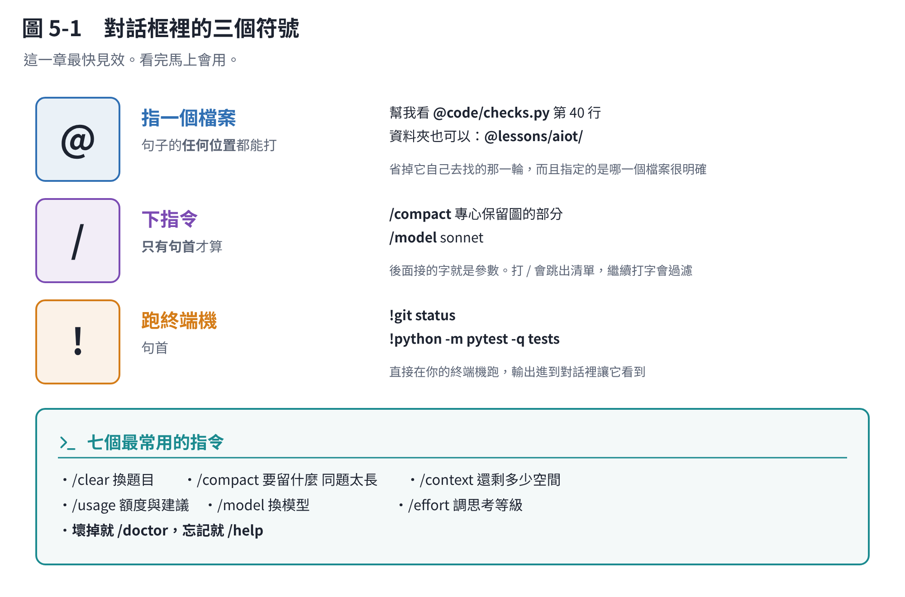

# 第 5 章　對話框裡的 /、@、!

這一章最快見效。看完馬上會用。



## 5.1 `@`：指一個檔案

在句子的**任何位置**打 `@`，會跳出檔案路徑的自動完成。選一個，那個路徑就插進你的句子。

```text
幫我看 @lessons/bmb171-phb/code/checks.py 為什麼第 40 行會錯
```

**為什麼要用它，而不是直接打檔名？**

- **你指定的是哪一個。** 專案裡有三個 `utils.py` 的時候，打 `utils.py` 它要猜；`@` 選的是確定的那一個。
- **不用它自己去找。** 省掉一輪搜尋。
- **資料夾也可以。** `@lessons/bmb171-phb/` 指整個資料夾。

> 打 `@` 之後再打至少一個字母，清單裡除了檔案，還會出現**你這台機器上其他還開著的 Claude Code 對話**——選了就可以叫它去跟那個對話講話。（需要較新版本。）

## 5.2 `/`：下指令

**只有在句子最前面**打 `/` 才算指令。中間打就只是一個斜線。

打 `/` 會跳出清單，繼續打字會過濾。指令後面接的字就是它的參數：

```text
/compact 專心保留圖的部分
/model sonnet
/effort high
```

內建指令有一百多個。你平常只會用到十幾個：

### 你一定會用的

| 指令 | 做什麼 |
|---|---|
| `/clear` | **換題目了**，清空重來 |
| `/compact [指示]` | 同一題但太長了，壓縮成摘要。後面可以講要留什麼 |
| `/context` | 這一包裝了什麼（第 2 章） |
| `/usage` | 額度還剩多少、誰在吃（第 2 章） |
| `/model` | 換模型（第 3 章） |
| `/effort` | 調思考等級（第 4 章） |
| `/help` | **忘記任何東西就打這個** |

### 很常用

| 指令 | 做什麼 |
|---|---|
| `/init` | 幫這個專案產一份 `CLAUDE.md`（第 6 章） |
| `/memory` | 開啟編輯 `CLAUDE.md` 與自動記憶 |
| `/rewind` | **倒帶**：把對話和程式碼退回先前某一點 |
| `/diff` | 看目前改了哪些東西 |
| `/resume` | 回到之前的對話 |
| `/rename` | 幫這個對話取名字（`/clear` 前先做） |
| `/skills` | 看有哪些技能可用（第 7 章） |
| `/plugin` | 管理外掛（第 8 章） |
| `/mcp` | 管理 MCP 連線（第 8 章） |
| `/doctor` | **哪裡怪怪的就跑這個**，它會自己檢查設定 |

### 偶爾很救命

| 指令 | 做什麼 |
|---|---|
| `/plan` | 直接進計畫模式 |
| `/review` | 審查目前的改動 |
| `/btw [問題]` | 問一個**不會進到對話裡**的旁支問題 |
| `/export` | 把對話存成純文字 |
| `/insights` | 分析你最近怎麼用、哪裡卡住，產一份報告 |
| `/skill-doctor` | 哪些技能在佔空間卻沒人用 |

> **不確定有沒有某個指令，打 `/` 然後打幾個字去找。** 比用猜的快。

## 5.3 `!`：直接跑終端機指令

句首打 `!`，後面的東西**直接在你的終端機跑**，輸出會進到對話裡，Claude 會看到。

```text
!git status
!python -m pytest -q tests
```

**什麼時候用？** 當你想讓它看某個指令的結果，但不想花一輪讓它自己去跑。

## 5.4 其他兩個符號

- `:` ：emoji。打 `:name:` 插入，或打兩個字以上看建議。
- `?` ：**在空白的輸入框**按 `?` 開快捷鍵說明。輸入框有字的時候就只是個問號。

## 5.5 順便記這幾個鍵

| 鍵 | 做什麼 |
|---|---|
| `Shift+Tab` | **切換權限模式**：手動 → 自動接受修改 → 計畫模式 → ⋯⋯ |
| `Esc` | **打斷它。** 走偏了馬上按，不要等它做完 |
| `Esc` `Esc` | 輸入框空的時候連按兩下＝**倒帶選單**；有字的時候＝清掉草稿 |
| `Ctrl+O` | 看詳細記錄（它用了哪些工具、想了什麼） |
| `Option+T` / `Alt+T` | 顯示／隱藏思考過程 |
| `Ctrl+R` | 往回搜尋你打過的東西 |
| `Ctrl+C` | 中斷；沒東西在跑的話按兩下離開 |

**最值得養成的習慣是 `Esc`。** 看到它開始往錯的方向走，立刻按。讓它做完再講，那一整段白做的工作全部留在你的 context 裡（第 1 章），又貴又礙事。

## 本章重點

- `@` 指檔案（任何位置）、`/` 下指令（**只有句首**）、`!` 跑終端機（句首）。
- 最常用的七個：`/clear` `/compact` `/context` `/usage` `/model` `/effort` `/help`。
- 壞掉就 `/doctor`，忘記就 `/help`。
- **`Esc` 是最該養成的習慣**：走偏馬上停。
