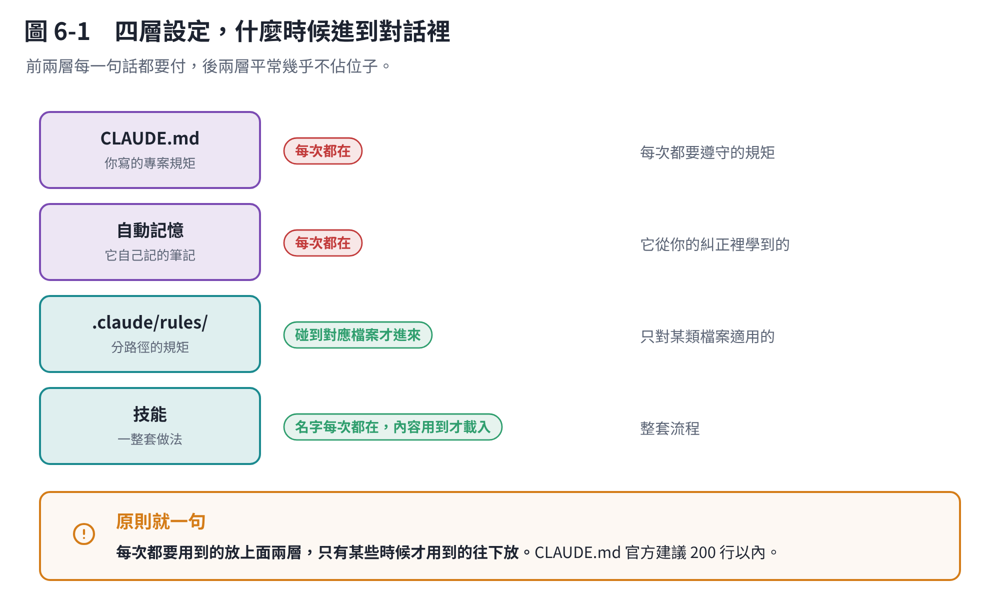

# 第 6 章　要不要「開專案」

## 6.1 先澄清：Claude Code 裡沒有「專案」這個按鈕

你可能在網頁版 claude.ai 看過「專案（Projects）」——那是網頁版的功能，可以把一組檔案和指示放在一起。

**Claude Code 沒有那個東西。** 在 Claude Code 裡：

> **你的「專案」就是一個資料夾，加上資料夾裡的 `CLAUDE.md`。**

你 `cd` 進去、開 Claude Code，它就在這個專案裡了。沒有要建立、沒有要設定。

要讓它更懂你的專案，就是往資料夾裡放檔案。放哪些檔案，就是這一章。

## 6.2 四層，由淺到深



| 層 | 誰寫 | 什麼時候進到對話裡 | 放什麼 |
|---|---|---|---|
| **`CLAUDE.md`** | 你 | **每次都在** | 這個專案的規矩 |
| **自動記憶** | Claude 自己 | **每次都在** | 它從你的糾正裡學到的 |
| **`.claude/rules/`** | 你 | **碰到對應的檔案才進來** | 只對某類檔案適用的規矩 |
| **技能** | 你 | **名字和說明每次都在，內容用到才載入** | 整套做法（第 7 章） |

這個順序就是**成本順序**：前兩層每一句話都要付，後兩層平常幾乎不佔位子。

**所以原則很簡單：**

> **每次都要用到的 → `CLAUDE.md`。只有某些時候才用到的 → 往下放。**

## 6.3 `CLAUDE.md`：怎麼開始

最快的方法：在專案資料夾裡打

```text
/init
```

它會看過你的專案，產一份 `CLAUDE.md` 草稿。而且它會順便讀別的工具的設定檔（Cursor 的 `.cursor/rules/`、Copilot 的 `.github/copilot-instructions.md`），把能用的併進來。

產出來之後**你一定要自己改**。它猜的東西不一定對，而你知道的規矩它不知道。

### 該寫什麼

- 跑測試的指令是什麼
- 這個專案的慣例（命名、語言、格式）
- **踩過的坑**——「這個地方不要用 X，會壞掉」
- 檔案放哪裡、推到哪個分支

### 不該寫什麼

- **密碼、金鑰。** 這個檔案會進版本庫。
- 它自己看程式碼就知道的事（架構、檔案路徑）。
- 長篇的工作流程——那個放技能。

### 長度

**官方建議 200 行以內。** 理由就是第 1 章：它每一次都在包裡，寫多長，每一句話就貴多少。

想知道自己的多大？打 `/context` 看 `CLAUDE.md` 那一塊。

### 放哪裡

| 位置 | 範圍 |
|---|---|
| 專案根目錄的 `CLAUDE.md` | 這個專案，**會進版本庫，團隊共用** |
| `~/.claude/CLAUDE.md` | 你這台電腦上的所有專案 |
| `CLAUDE.local.md` | 只有你、只有這個專案（不進版本庫） |

### 一個重要的事實

> **`CLAUDE.md` 不是強制設定，是「它會讀到的一段話」。**

官方文件寫得很明白：這份內容是當成一則訊息送進去的，Claude 會讀、會盡量照做，但**沒有保證一定遵守**，尤其是寫得模糊或自相矛盾的時候。

所以：**寫具體、寫簡短、不要自相矛盾。** 真的要「絕對不准做某件事」，那要用 hook（它在工具層攔截），不是寫在 `CLAUDE.md` 裡拜託它。

## 6.4 自動記憶：它自己記的筆記

預設是**開著**的。你糾正它、告訴它你的偏好，它會自己存下來，下次新對話還記得。

它會記四類：你的角色與習慣、你給的糾正、專案的進度與決定、外部資源在哪。它**不會**記程式碼裡看得到的東西，也不會記 `CLAUDE.md` 已經寫過的。

```text
/memory       # 看、編輯，也可以在這裡關掉
```

你直接說「記住這件事」，它就會存進自動記憶。想存進 `CLAUDE.md` 要明講：**「把這個加到 CLAUDE.md」**。

> **以前有教學說按 `#` 可以加記憶。** 現在官方的快捷符號只有 `/`、`!`、`@`、`:`、`?` 這五個。要加記憶就直接講，或用 `/memory`。

## 6.5 `.claude/rules/`：只對某類檔案的規矩

有些規矩只有碰到特定檔案才有意義。例如「畫圖的程式一律用 tokens.py 裡的顏色」——只有在改畫圖程式的時候才要管。

這種就放 `.claude/rules/` 底下，在檔案開頭用 `paths:` 指定它對哪些路徑生效。**Claude 讀寫到那些檔案的時候才會載入**，平常不佔位子。

> **有個小陷阱**：這類規則是「碰到才載入」，所以**壓縮之後會跟著對話一起被摘要掉**。如果某條規矩非得一直在，就把它搬回 `CLAUDE.md`。

## 6.6 怎麼確認它真的讀到了

```text
/context
```

看 **Memory files** 那一區。該載入的 `CLAUDE.md` 在不在裡面？**不在就代表它根本沒看到**，別再猜為什麼它不聽話。

它不照做的話，依序檢查：

1. `/context` 確認檔案有載入
2. 那條規矩寫得夠具體嗎？（「寫好一點」不是規矩，「commit 訊息用繁體中文」才是）
3. 有沒有跟別條矛盾？
4. 如果是壓縮之後才不聽——那條規矩是不是放在 `.claude/rules/` 裡被摘要掉了？

## 本章重點

- **Claude Code 沒有「開專案」這個動作**，資料夾＋`CLAUDE.md` 就是專案。
- `/init` 產初稿，然後自己改。
- **四層：`CLAUDE.md` / 自動記憶（每次都在）→ rules / 技能（用到才載入）。**
- `CLAUDE.md` 控制在 **200 行以內**，密碼絕對不要寫進去。
- 它是**一段會被讀到的話，不是強制規則**。要強制請用 hook。
- 不聽話先跑 `/context` 確認它到底有沒有讀到。
