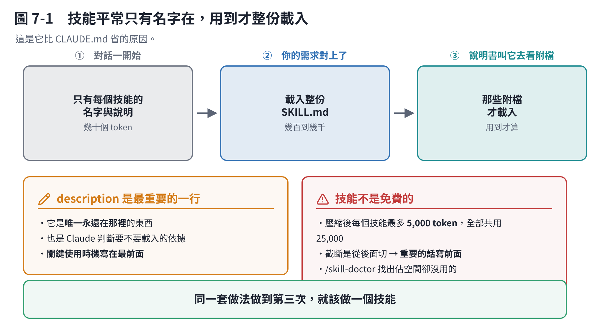

# 第 7 章　技能：什麼時候做、怎麼做

## 7.1 一句話：技能是一份「做這件事的說明書」

一個技能就是**一個資料夾，裡面有一個 `SKILL.md`**。

```text
.claude/skills/push-lesson/SKILL.md
```

裡面寫「要做這件事的時候，照以下步驟」。

**它比 `CLAUDE.md` 好在哪？** 第 6 章講過的那個：

> `CLAUDE.md` 每一次都在包裡。技能**平常只有名字和一行說明在包裡，真的要用才整份載入**。

所以長的、只有特定工作才用的東西，放技能。



## 7.2 它怎麼決定要不要載入

分三階段，官方叫「漸進揭露」：

1. **對話一開始**：它只看到每個技能的**名字和說明**（`description`，連同 `when_to_use`，最多 1,536 字元）。
2. **你的需求和哪個說明對得上**：載入那份 `SKILL.md` 的全文。
3. **說明書裡叫它去看別的檔案**：那些附檔才會載入。

**這個設計決定了一件事：`description` 是整個技能最重要的一行。**

它是唯一永遠在那裡的東西，也是匹配的依據。寫不好，技能就永遠不會被叫到。

```yaml
# 不好：看不出什麼時候該用
description: 教材相關的工具

# 好：講清楚「做什麼」和「什麼時候」
description: 要在 lessons/ 下新增或修改一章教材、加一張圖時使用。涵蓋算數字、畫圖、檢查版面到推上去確認 CI 的完整流程。
```

**把最關鍵的使用時機寫在最前面**，因為匹配靠的就是這段文字。

## 7.3 什麼時候值得做一個

> **同一套做法做到第三次的時候。**

第一次是摸索，第二次可能是巧合，第三次就是流程了。

具體一點，這三個訊號出現就該做：

- 你發現自己**又在貼同一段說明**給它
- 有一個**順序不能錯**的流程（先算數字 → 再畫圖 → 再檢查 → 再推）
- 有一組**每次都要做的檢查**（推之前要跑哪三個檢查器）

**什麼時候不值得：** 只會做一次的事；一句話就講得完的事（那寫進 `CLAUDE.md` 就好）。

## 7.4 最小的一個長什麼樣

```markdown
---
name: push-lesson
description: 教材改完要推上去時使用。跑完三個檢查再 commit 和 push。
---

推送前依序做：

1. `python lessons/_tools/check_geometry.py` —— 圖裡面的幾何
2. `python lessons/_tools/check_layout.py` —— Folio 頁面上會不會疊
3. `python -m pytest -q tests`

三個都過才 commit。commit 訊息用繁體中文。
推到 `claude/ammonia-nitrogen-degradation-a0nidi`，不要開 PR。

推完去確認 Actions 的兩個 job 都綠。
```

就這樣。上面兩條橫線中間是設定，下面是給它看的說明。

**只有 `description` 是真的建議要寫的**，`name` 不寫就用資料夾名字。

## 7.5 放哪裡

| 位置 | 範圍 |
|---|---|
| `~/.claude/skills/<名字>/SKILL.md` | 你這台電腦上的所有專案 |
| `.claude/skills/<名字>/SKILL.md` | 這個專案。**進版本庫就是團隊共用** |

## 7.6 幾個好用的設定

寫在上面那兩條橫線中間：

| 欄位 | 做什麼 |
|---|---|
| `when_to_use` | 補充什麼時候該用，會接在 `description` 後面 |
| `disable-model-invocation: true` | **只有你能叫它**，Claude 不會自己用。有副作用的流程（部署、推送）建議加 |
| `user-invocable: false` | 反過來：藏起來，只有 Claude 會用，當成背景知識 |
| `allowed-tools` | 這次執行可以不用問就用的工具 |
| `model` / `effort` | 這個技能跑的時候用哪個模型、什麼思考等級 |
| `context: fork` | **丟到子代理去跑**，大量閱讀不佔你的主對話 |
| `paths` | 碰到哪些路徑的檔案才啟用 |

### 兩個很實用的寫法

**跑指令把結果塞進來**：用 `` !`指令` ``，Claude 看到技能內容之前就會先跑，輸出直接插進去。

```markdown
## 目前的改動
!`git diff HEAD`

依據上面的改動寫一則繁體中文的 commit 訊息。
```

**接收參數**：`$ARGUMENTS` 是你打的全部，`$0`、`$1` 是第幾個。

```markdown
把 $0 這一章的圖全部重畫一次。
```

→ 你打 `/redraw c03`，`$0` 就是 `c03`。

## 7.7 技能就是斜線指令

**同一件事。** 做了一個叫 `push-lesson` 的技能，你就可以打 `/push-lesson`。

兩種叫法：

- **你自己叫**：打 `/技能名字`，後面可以接參數
- **它自己判斷**：你描述的事情和 `description` 對得上，它就會載入

> 以前的寫法 `.claude/commands/<名字>.md` 還能用，但新的東西建議用技能。

**可以一次疊好幾個**：`/skill-a /skill-b 幫我做 XYZ` 會同時載入兩個技能，後面的文字當參數傳給兩個。最多六個。

## 7.8 技能的成本

技能不是免費的，要知道它在哪裡花錢：

- **一直都在**：每個技能的名字和說明在每一回合都佔位子。**技能多了會累積。**
- **用了之後**：載入的全文會留在對話裡，之後每一輪都跟著重送。所以 `SKILL.md` **不要寫太長**（官方建議 500 行以內），長的參考資料放附檔，叫它需要的時候再看。
- **壓縮之後**：最近用過的技能會被重新接回來，但**每個技能上限 5,000 token，全部共用 25,000 token**，超過就從最舊的開始丟。截斷是從後面切，**所以最重要的話寫在 `SKILL.md` 前面**。

```text
/skill-doctor
```

這個指令會告訴你**哪些技能在佔空間卻幾乎沒用過**。定期跑一下，砍掉沒用的。

## 本章重點

- 技能＝一個資料夾＋一份 `SKILL.md`。
- **平常只有名字和說明在包裡，用到才整份載入**——這是它比 `CLAUDE.md` 省的原因。
- **`description` 是最重要的一行**，寫清楚「做什麼、什麼時候用」，關鍵詞放前面。
- **同一套做法做第三次就該做一個。**
- 技能就是斜線指令，`/技能名字` 直接叫。
- 有副作用的流程加 `disable-model-invocation: true`。
- `SKILL.md` 重要的話寫前面（壓縮會從後面截）。定期跑 `/skill-doctor`。
