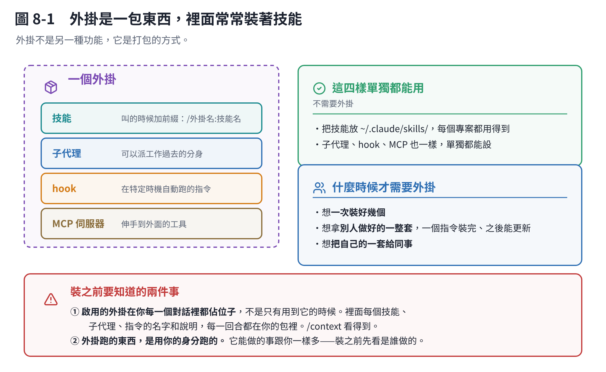

# 第 8 章　外掛、MCP、連接器：差在哪

## 8.1 一句話分清楚

> **技能是一份說明書。外掛是一個包裹——裡面常常裝著好幾份說明書。**

就這樣。外掛不是另一種功能，它是**打包的方式**。



## 8.2 一個外掛裡面裝什麼

一個外掛是一個資料夾，裡面有一份清單檔（`.claude-plugin/plugin.json`），和以下任意幾種東西：

| 裝的東西 | 是什麼 |
|---|---|
| **技能** | 第 7 章那個。裝在外掛裡的技能，叫的時候要加前綴：`/外掛名:技能名` |
| **子代理** | 可以派工作過去的分身 |
| **hook** | 在特定時機自動跑的指令（例如「每次改完檔案就跑格式化」） |
| **mod** | 用 JavaScript 寫的 hook，還能畫面板、加指令 |
| **MCP 伺服器** | 讓 Claude 伸手到外面的工具（下一節） |

**所以：技能、子代理、hook、MCP 自己單獨都能用，不需要外掛。**

把一個技能存在 `~/.claude/skills/` 底下，你每個專案都用得到——這就夠了。

**什麼時候才需要外掛？**

- 你想**一次裝好幾個東西**（一包裡有三個技能、兩個 hook、一個 MCP）
- 你想**拿別人做好的一整套**，一個指令裝完，而且之後能更新
- 你想**把自己的一套給同事**，或在很多專案裡重複裝

## 8.3 怎麼裝

```text
/plugin
```

開啟來有幾個分頁。**Discover** 是目錄，列出你加過的市集裡有哪些外掛。

> **市集（marketplace）是一份目錄，不是商店。** 它只是一個清單檔，說「有哪些外掛、各自去哪裡拿」。Anthropic 的官方市集在你第一次開 Claude Code 的時候就自動加好了。

裝的時候要選**範圍**：

| 範圍 | 意思 |
|---|---|
| User | 你這台電腦的**所有專案** |
| Project | **這個版本庫的所有人**（寫進 `.claude/settings.json`，會進版本庫） |
| Local | 只有你、只有這個版本庫 |

## 8.4 裝外掛是有代價的，裝之前要知道

這一節很重要，因為它是新手最容易踩的坑。

> **外掛一旦啟用，它就在你的每一個對話裡，不是只有你用到它的時候。**

具體來說：

- **佔空間**：它帶來的每個技能、子代理、指令，**名字和說明在每一回合都在你的包裡**，就算你今天完全沒用到它。這些 token 算你的額度，也擠掉你的 context。
- **跑東西**：它定義的 MCP 伺服器會跟著每個 session 一起跑；它的 hook 會在對應的時機觸發。
- **權限**：**外掛跑的東西是用你的身分跑的。** 它能做的事跟你一樣多。

怎麼看一個外掛的footprint：

- **裝之前**：在 `/plugin` 的市集分頁打開它。官方市集的外掛會顯示 **Context cost** 估計。
- **裝之後**：`/context` 看它佔多少。`/plugin` 的 **Installed** 分頁有一組 **Not used recently**，列出你可以關掉的。
- **不想移除但想停用**：在 `/plugin` 裡停用就好。

> **原則：需要的時候再裝，定期清掉沒在用的。** 這和技能是同一個道理。

## 8.5 MCP 是什麼

**MCP 是讓 Claude 伸手去碰外面東西的方式。** 連資料庫、連你公司的系統、連某個 API。

```text
/mcp          # 看有哪些、連線狀態、關掉沒在用的
```

**但在你裝 MCP 之前，先問一句：這件事有沒有命令列工具？**

官方文件直接建議：**`gh`、`aws`、`gcloud`、`sentry-cli` 這類命令列工具，比 MCP 伺服器省 context**，因為 Claude 可以直接跑它們，不需要把工具清單放進每一包。

MCP 的工具定義現在預設是**延後載入**的（只有名字和伺服器說明會進來，真的要用某個工具才載入它的細節），所以沒有以前那麼貴了。但「完全不佔」還是贏「佔一點」。

## 8.6 連接器又是什麼

**連接器是網頁版和桌面版 claude.ai 上的東西**——點一下就連上 Google Drive、Gmail 這類服務。

**在 Claude Code 裡，對應的機制是 MCP。** 有些服務兩邊都有，名字不一樣而已。

## 8.7 一張表

| | 技能 | 外掛 | MCP | 連接器 |
|---|---|---|---|---|
| 是什麼 | 一份說明書 | 一個包裹 | 伸手到外面的管道 | 網頁版的一鍵連接 |
| 誰做的 | 通常是你 | 通常是別人 | 別人或你 | 服務商 |
| 給它什麼 | **做法** | 一整套東西 | **工具** | **工具** |
| 怎麼管 | 檔案 / `/skills` | `/plugin` | `/mcp` | 網頁設定 |
| 平常佔多少 | 名字＋一行說明 | 裡面每樣東西的名字＋說明 | 工具名字＋伺服器說明 | （不在 Claude Code 裡） |

**最常見的誤會：以為要先裝外掛才能用技能。** 不用。技能自己就能用，而且那是比較常見的做法。

## 本章重點

- **技能＝一份說明書，外掛＝一個包裹**（裡面常裝著技能）。
- 技能、子代理、hook、MCP **單獨都能用，不需要外掛**。要打包給別人、或一次裝一整套，才需要外掛。
- **啟用的外掛在你每一個對話裡都佔位子**，不是只有用到的時候。裝之前看 Context cost，裝之後定期清。
- **外掛用你的身分跑東西**，裝之前先看它是誰做的。
- MCP 是伸手到外面；**能用命令列工具（`gh`、`aws`）就不要掛 MCP**。
- 連接器是網頁版的說法，Claude Code 這邊對應的是 MCP。
