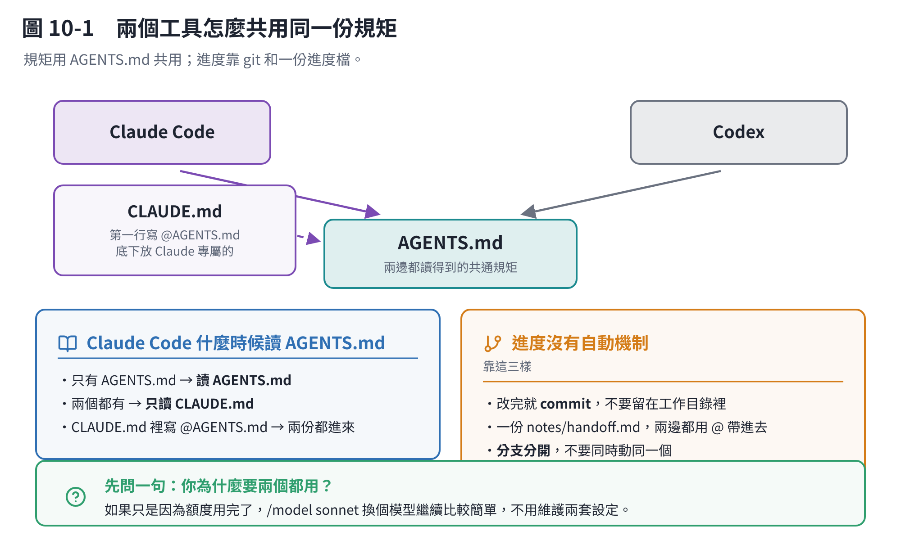

# 第 10 章　和 Codex 接力

> **這一章的查證程度和別章不一樣，先說清楚。**
> Claude Code 這一側（`AGENTS.md` 怎麼讀、`/import` 做什麼、`/init` 會看哪些檔案）我逐項查過官方文件。
> **Codex 那一側我只查到第三方整理，沒有核對過 OpenAI 官方文件。** 用之前請自己確認一次。

## 10.1 問題在哪

兩個工具接力做同一個專案，會遇到兩件事：

1. **規矩要講兩次。** 你跟 Claude Code 講的專案規矩，Codex 不知道。
2. **進度接不上。** 一邊做到一半，另一邊不知道發生過什麼。

兩件事分開解決。



## 10.2 規矩：用 `AGENTS.md`

`AGENTS.md` 是一個**跨工具的共通檔案**。多個 AI 編碼工具都讀它，Claude Code 也讀。

### Claude Code 什麼時候會讀它

這是官方文件的規則：

| 你的專案裡有 | Claude 讀哪一份 |
|---|---|
| 只有 `AGENTS.md`（工作目錄與上層都沒有 `CLAUDE.md`） | **讀 `AGENTS.md`** |
| 兩個都有 | **只讀 `CLAUDE.md`** |
| `CLAUDE.md` 裡用 `@AGENTS.md` 引入 | 讀 `CLAUDE.md`，`AGENTS.md` 透過引入一起進來 |

> 直接讀 `AGENTS.md` 需要 Claude Code v2.1.277 以後。舊版就用下面的引入寫法。

讀到的時候，對話裡會出現一行類似
`no CLAUDE.md found; AGENTS.md loaded: /home/you/repo/AGENTS.md`。

### 三種做法，選一種

**做法 A：只用 `AGENTS.md`（最乾淨）**

專案裡不要有 `CLAUDE.md`，規矩全部寫在 `AGENTS.md`。兩邊都讀得到，改一次就好。

適合新專案、或你的規矩本來就沒什麼 Claude 專屬的。

**做法 B：`CLAUDE.md` 引入 `AGENTS.md`（最實用）**

```markdown
@AGENTS.md

## Claude Code 專屬

改 `src/billing/` 底下的東西先用計畫模式。
```

共通的規矩寫在 `AGENTS.md`，Claude 專屬的寫在引入後面。**兩邊都讀得到共通的，Claude 多讀一段自己的。**

這個 repo 現在是純 `CLAUDE.md`。要改成這種做法，就是把共通的部分搬到 `AGENTS.md`，然後在 `CLAUDE.md` 最上面加一行 `@AGENTS.md`。

**做法 C：符號連結**

```bash
ln -s AGENTS.md CLAUDE.md
```

只有在完全不需要 Claude 專屬內容的時候才用。**兩個限制**：

- Claude 的編輯工具**不會透過符號連結寫入**，它會叫你改 `AGENTS.md` 本體
- **Windows 會壞掉**：建符號連結需要管理員權限，而且 git 把它 checkout 成一行純文字檔。團隊裡有人用 Windows 就不要用這招，改用做法 B

### 做完要確認

```text
/context
```

看 **Memory files** 那一區，確認該載入的在裡面。**沒在裡面就是沒讀到**，不要猜。

## 10.3 設定：`/import codex`

```text
/import codex
```

它會把 Codex 在你這台機器上的設定帶進 Claude Code：

- 把 `AGENTS.md` 這類指示檔**附加一份複本**到對應的 `CLAUDE.md`
- 把 **MCP 伺服器、指令、子代理、技能**也帶過來

> **這是一次性的複製，不是持續同步。** Codex 那邊之後改了，Claude Code 這邊不會跟著變。

`/import` 也支援 `gemini` 和 `cursor`。加 `--dry-run` 可以先看它打算做什麼。

另外，`/init` 產 `CLAUDE.md` 的時候，本來就會去讀別的工具的規則檔（Cursor 的 `.cursor/rules/`、Copilot 的 `.github/copilot-instructions.md`），把能用的併進來。

## 10.4 進度：兩邊都看得到的東西

規矩共用了，但**「做到哪裡」是另一回事**。這個沒有自動的機制，只能靠兩個都看得到的媒介。

**最可靠的順序是這樣：**

### ① git 是主要的交接媒介

**改完就 commit。** 不要讓一邊做一半的東西留在工作目錄裡，另一邊根本不知道。

commit 訊息寫清楚**做了什麼、為什麼**。這是兩個工具都讀得到的歷史。

### ② 一份進度檔

和第 9 章的交接清單同一招，只是這次是給另一個工具看的：

```text
notes/handoff.md
```

裡面寫：在做什麼、做到哪裡、**試過但失敗的**、下一步、還沒決定的事。

**兩邊都用 `@notes/handoff.md` 帶進去。**

### ③ 分支分開

兩邊同時動同一個分支，一定會打架。一邊一個分支，做完再合。

### 交接的順序

```text
A 邊做完 → commit + push
         → 更新 notes/handoff.md
         → 也 commit

B 邊開始 → git pull
         → 讀 notes/handoff.md
         → 繼續做
```

## 10.5 老實說：值不值得

**先問一句：你為什麼要兩個都用？**

常見的合理理由只有一個：**某一邊的額度用完了，但工作不能停。**

如果是這個理由，那**第 3 章的做法通常更簡單**——`/model sonnet` 換個模型繼續，不用維護兩套設定、兩份檔案、兩個工具的習慣。

真的要兩邊接力（例如公司規定、或你同時有兩邊的訂閱），那就照上面做：**`AGENTS.md` 共用規矩，git ＋ 一份進度檔共用進度。**

## 本章重點

- **規矩用 `AGENTS.md` 共用。** Claude Code 在沒有 `CLAUDE.md` 的時候會直接讀它；兩個都有的話只讀 `CLAUDE.md`。
- **最實用的是做法 B**：`CLAUDE.md` 第一行寫 `@AGENTS.md`，底下放 Claude 專屬的。
- 符號連結那招**在 Windows 上會壞**，團隊有 Windows 就不要用。
- `/import codex` 把 Codex 的設定複製過來，**一次性，不是同步**。
- **進度沒有自動機制**：靠 git commit ＋ 一份 `notes/handoff.md` ＋ 分支分開。
- 做完用 `/context` 確認檔案真的載入了。
- **先想清楚為什麼要兩個都用**——如果只是額度問題，換模型比較簡單。
