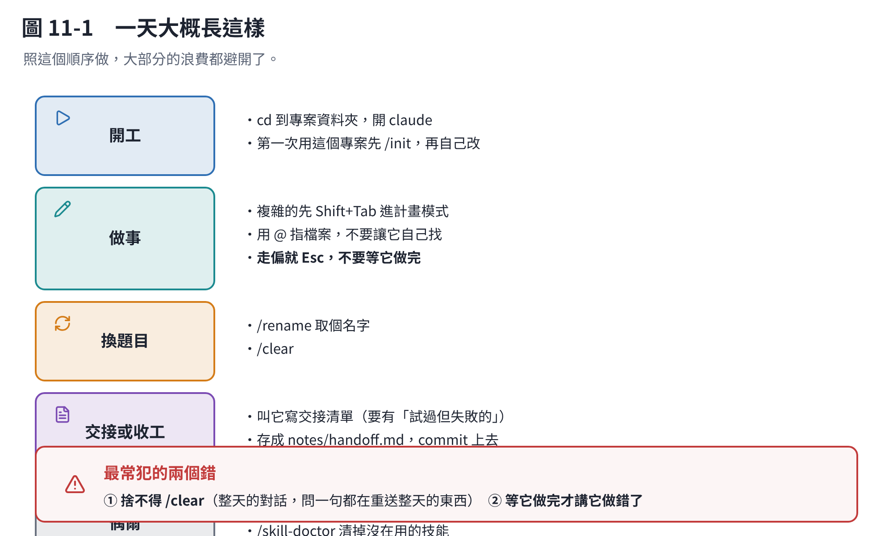

# 第 11 章　一頁查表

這一章不用讀，用查的。



## 11.1 遇到狀況怎麼辦

| 狀況 | 做什麼 | 章 |
|---|---|---|
| 要開始做**別的事** | `/clear` | 9 |
| 同一件事但對話太長 | `/compact 專心保留 OO` | 9 |
| **它走偏了** | 馬上按 `Esc` | 5 |
| 它已經把檔案改壞了 | `/rewind` | 9 |
| 想知道還剩多少空間 | `/context` | 2 |
| 想知道額度剩多少、誰在吃 | `/usage`，有 `f` 就按 | 2 |
| **「你達到 Opus 限制」** | `/model sonnet` 繼續 | 3 |
| 「你達到 session／weekly 限制」 | 換模型沒用，等重置或加購 | 3 |
| 這件事很難 | `/model fable`，或句子裡加 `ultrathink` | 3、4 |
| 這件事很簡單 | `/effort medium` 或 `low` | 4 |
| 複雜的改動，怕方向錯 | `Shift+Tab` 切計畫模式 | 2 |
| 要它看某個檔案 | `@路徑` | 5 |
| 要它看某個指令的輸出 | `!指令` | 5 |
| 它老是不照專案規矩 | `/context` 確認 `CLAUDE.md` 有載入 | 6 |
| 同一套做法做第三次了 | 做一個技能 | 7 |
| `CLAUDE.md` 太長 | 搬一部分進技能 | 6、7 |
| 技能太多佔空間 | `/skill-doctor` | 7 |
| MCP 吃太多 | `/mcp` 關掉沒在用的 | 8 |
| **哪裡怪怪的** | `/doctor` | 5 |
| **忘記怎麼用** | `/help` | 5 |

## 11.2 七個最常用的指令

```text
/clear          換題目
/compact 要留什麼   同題太長
/context        還剩多少空間
/usage          額度剩多少、誰在吃
/model          換模型
/effort         調思考等級
/help           忘記就打這個
```

## 11.3 三個符號、六個鍵

| | 做什麼 |
|---|---|
| `@路徑` | 指一個檔案（句子任何位置） |
| `/指令` | 下指令（**只有句首**） |
| `!指令` | 跑終端機（句首） |
| `Esc` | **打斷它** |
| `Esc` `Esc` | 空輸入框時＝倒帶選單 |
| `Shift+Tab` | 切權限模式（含計畫模式） |
| `Ctrl+O` | 看它用了哪些工具 |
| `Option+T`／`Alt+T` | 顯示／隱藏思考 |
| `Ctrl+R` | 搜尋打過的東西 |

## 11.4 四層設定，怎麼選

| 這件事 | 放哪裡 |
|---|---|
| **每次都要遵守**的規矩 | `CLAUDE.md`（200 行以內） |
| 只有碰到**某類檔案**才要管 | `.claude/rules/`，用 `paths:` 指定 |
| 一整套**做法、流程** | 技能 |
| 想**一次裝好幾樣**，或分給別人 | 外掛 |
| 要**伸手到外面**的系統 | MCP（先問有沒有命令列工具） |

## 11.5 一天大概長這樣

**開工**

```text
cd 到專案資料夾
claude
```

第一次用這個專案的話先 `/init`，然後把產出來的 `CLAUDE.md` 自己改一遍。

**做事**

- 複雜的事先 `Shift+Tab` 進計畫模式，看過方向再動手
- 用 `@` 指檔案，不要讓它自己找
- 走偏就 `Esc`，不要等它做完

**換題目**

```text
/rename 剛才那件事叫什麼
/clear
```

**要交接或收工**

叫它寫一份交接清單（第 9 章的範本），存成 `notes/handoff.md`，commit 上去。

**偶爾**

```text
/usage          看誰在吃額度，有建議就照做
/skill-doctor   清掉沒在用的技能
/context        看 CLAUDE.md 是不是變太長了
```

## 11.6 五個最容易犯的錯

1. **捨不得 `/clear`。** 一個開一整天的對話，問一句話都在重送一整天的東西。
2. **等它做完才講它做錯了。** 按 `Esc`。那一整段白做的工作會一直留在 context 裡。
3. **`CLAUDE.md` 越寫越長。** 它每一次都在包裡。200 行是上限，長的搬技能。
4. **以為 `CLAUDE.md` 是強制的。** 它是一段會被讀到的話，不是設定。真的要擋，用 hook。
5. **交接清單漏掉「試過但失敗的」。** 新對話會把你試過的錯誤方法再試一次。

## 11.7 回去看哪一章

| 想搞懂 | 章 |
|---|---|
| 為什麼開久的對話會貴 | [1](c01-what-is-in-a-turn.md) |
| token 用量怎麼看 | [2](c02-tokens.md) |
| 要不要換模型 | [3](c03-models.md) |
| 思考等級要不要調 | [4](c04-effort.md) |
| `@`、`/`、`!` 怎麼用 | [5](c05-symbols.md) |
| `CLAUDE.md` 怎麼寫 | [6](c06-project.md) |
| 技能怎麼做 | [7](c07-skills.md) |
| 外掛跟技能差在哪 | [8](c08-plugins.md) |
| 什麼時候換對話、交接怎麼寫 | [9](c09-handoff.md) |
| 跟 Codex 接力 | [10](c10-codex.md) |
